:::panel rounded="true" style="border-width: 3px;border-color: black;"

1975년 켄 톰슨은 모교인 버클리 대학에서 방문 교수로 안식년을 보내면서 최신 기기인 PDP-11/70에 유닉스 버전6를 포팅하고 있었다.[&lbrack;2&rbrack;][2]

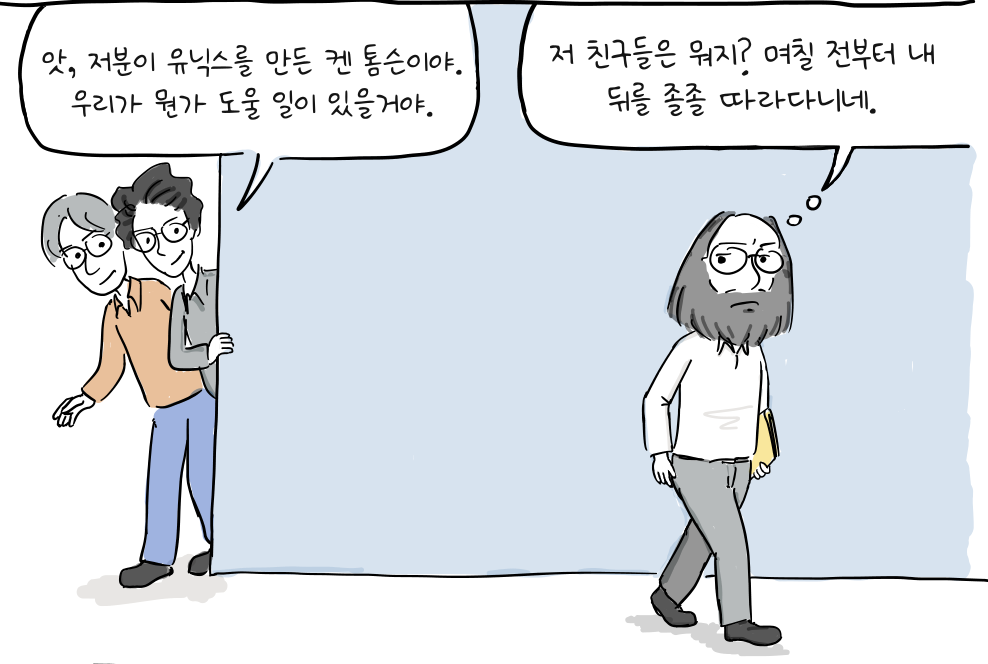

<!-- dialogue: bill-spot-ken -->
> 앗, 저분이 유닉스를 만든 켄 톰슨이야. 우리가 뭔가 도울 일이 있을 거야.
<!-- /dialogue -->

<!-- dialogue: ken-followers -->
> 저 친구들은 뭐지? 며칠 전부터 내 뒤를 졸졸 따라다니네.
<!-- /dialogue -->

:::

:::panel rounded="true" style="border-width: 3px;border-color: black;"

PDP-11/70 기계실

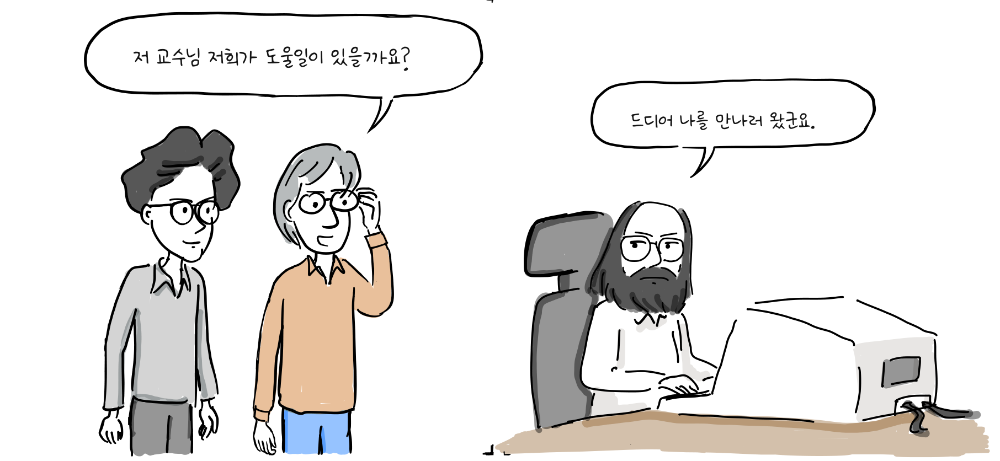

<!-- dialogue: bill-offer-help -->
> 저 교수님 저희가 도울 일이 있을까요?
<!-- /dialogue -->

<!-- dialogue: ken-welcome -->
> 드디어 나를 만나러 왔군요.
<!-- /dialogue -->

:::

::::panels columns="2" label=""

:::panel rounded="true" style="border-width: 3px;border-color: black;padding: 0;"

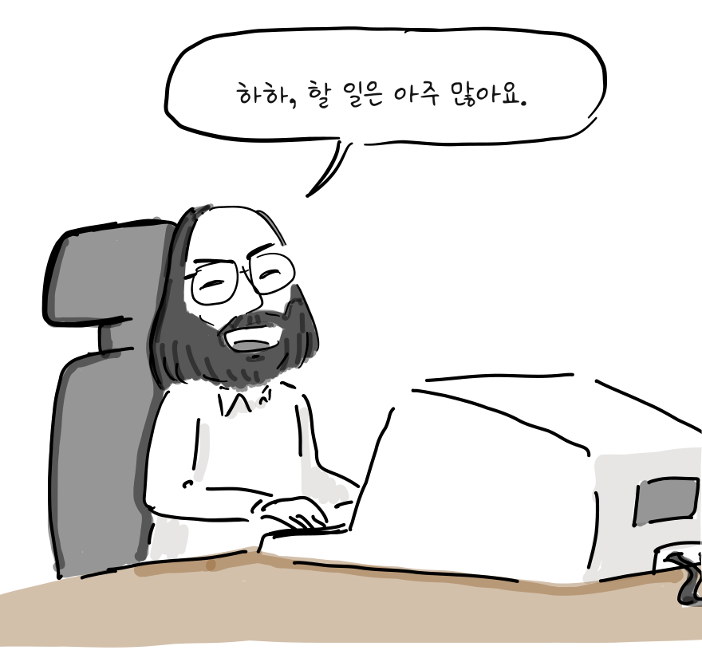

<!-- dialogue: ken-plenty-of-work -->
> 하하, 할 일은 아주 많아요.
<!-- /dialogue -->

:::

:::panel rounded="true" style="border-width: 3px;border-color: black;padding: 0;"

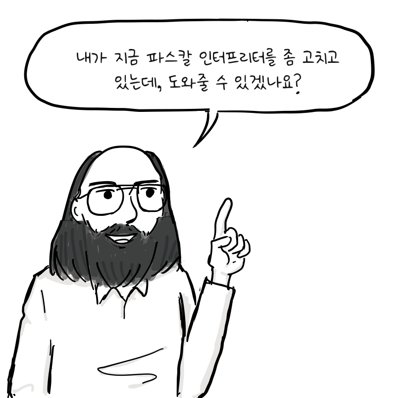

<!-- dialogue: ken-pascal-help -->
> 내가 지금 파스칼 인터프리터를 좀 고치고 있는데, 도와줄 수 있겠나요?
<!-- /dialogue -->

:::

::::

:::panel rounded="true" style="border-width: 3px;border-color: black;"

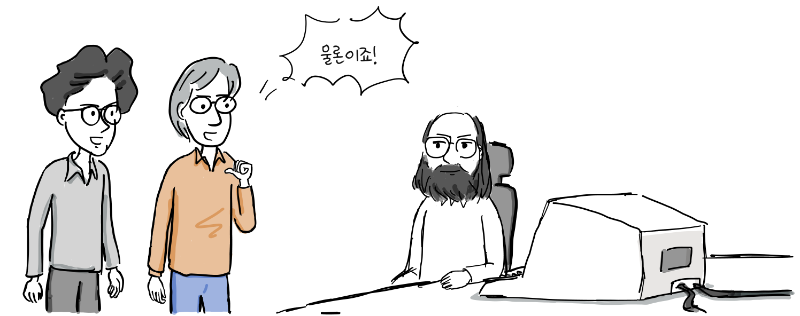

<!-- dialogue: bill-chuck-accept -->
> 물론이죠!
<!-- /dialogue -->

이후, 빌 조이와 척 핼리가 확장하고 개선한 파스칼 컴파일러는 성능이 향상되었는데, 우선 컴파일 시간을 단축했고, 프로그램 실행 속도를 높여서 학생들에게 인기가 많았다.[&lbrack;2&rbrack;][2]

:::

**vi 에디터의 탄생**

:::panel rounded="true" style="border-width: 3px;border-color: black;"

당시 유닉스는 [ed라는 에디터](https://ko.wikipedia.org/wiki/Ed_\(%EB%AC%B8%EC%84%9C_%ED%8E%B8%EC%A7%91%EA%B8%B0\))를 제공하고 있었다. 이는 1969년, 켄 톰슨이 유닉스를 개발할 때 추가한 최초의 에디터였다.[&lbrack;4&rbrack;][4]

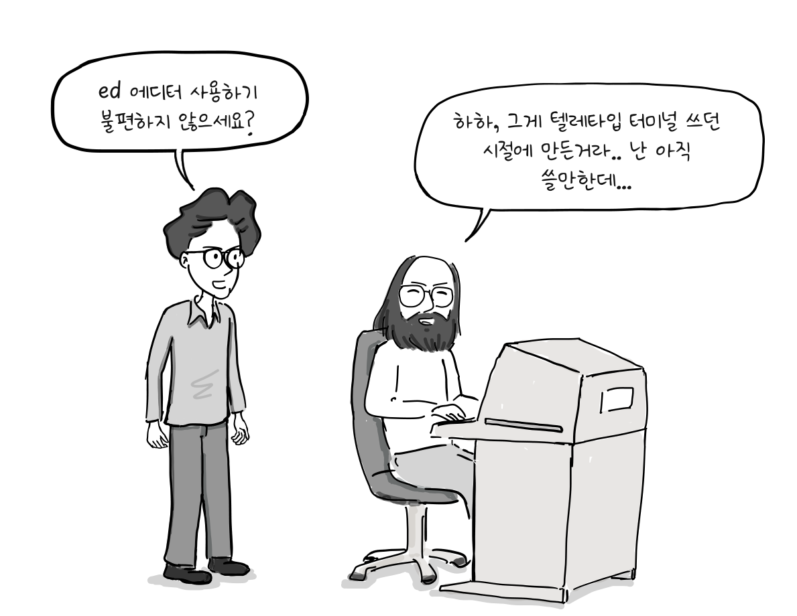

<!-- dialogue: bill-ed-question -->
> ed 에디터 사용하기 불편하지 않으세요?
<!-- /dialogue -->

<!-- dialogue: ken-ed-answer -->
> 하하, 그게 텔레타입 터미널 쓰던 시절에 만든거라.. 난 아직 쓸만한데...
<!-- /dialogue -->

:::

:::panel 

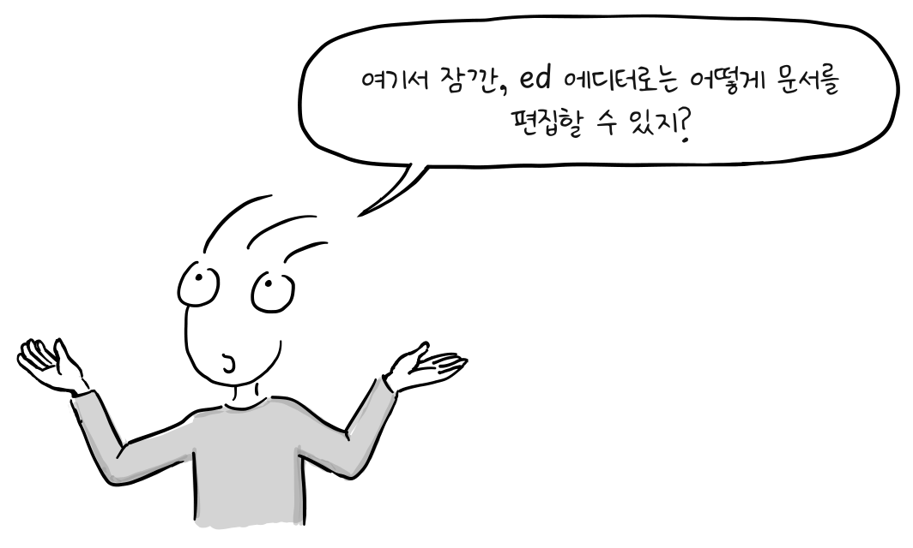

<!-- dialogue: guide-ed-question -->
> 여기서 잠깐, ed 에디터로는 어떻게 문서를 편집할 수 있지?
<!-- /dialogue -->

:::

다음은 짧은 ed 세션의 예제이다. 명령어와 입력한 텍스트, 출력이 함께 표시되어 있다. `$`는 셸의 프롬프트이며, ed 자체는 보통 프롬프트를 표시하지 않는다.[&lbrack;6&rbrack;][6]

```text
$ ed
a
ed is the standard Unix text editor.
This is line number one.
.
,p
ed is the standard Unix text editor.
This is line number one.
2s/one/two/
,p
ed is the standard Unix text editor.
This is line number two.
w text
62
q
$ cat text
ed is the standard Unix text editor.
This is line number two.
```

`a` 명령은 텍스트 입력을 시작한다. 두 줄을 입력한 뒤, 마침표만 있는 줄을 입력하면 입력 상태가 종료된다. `,p`는 버퍼의 모든 줄을 출력한다. 쉼표는 전체 줄의 주소 범위를 나타내고, `p`는 그 범위를 출력하는 명령이다.

두 번째 줄의 `one`을 `two`로 바꾸려면 `2s/one/two/`를 입력한다. 커서를 옮기는 대신 줄 번호와 치환 명령 `s`로 수정할 위치와 내용을 지정한다. `w text`는 버퍼를 `text`라는 파일로 저장하고, 저장한 바이트 수를 출력한다. 마지막으로 `q`를 입력하면 ed가 종료된다.

최종 결과는 다음의 문자를 포함하는 텍스트 파일이다:

```text
ed is the standard Unix text editor.
This is line number two.
```

:::panel rounded="true" style="border-width: 3px;border-color: black;"

ed에디터가 이렇게 만들어진 것은 1960년대 컴퓨터 메모리가 귀했고, 당시에는 지금과 같은 모니터가 아니라 종이에 출력을 프린트하는 텔레 프린터를 사용했기 때문이다. 모뎀 속도 역시 느렸다.


대표적인 텔레 프린터인 텔레타입 모델 33

:::

:::panel rounded="true" style="border-width: 3px;border-color: black;"

하지만, 1970년대 CRT 모니터가 달린 터미널이 보급된 이후에도 유닉스에서는 ed에디터가 계속 사용되고 있었다.

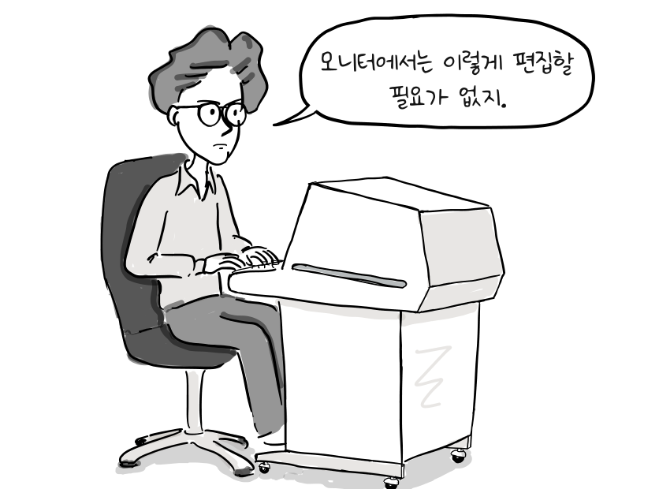

<!-- dialogue: bill-monitor -->
> 모니터에서는 이렇게 편집할 필요가 없지.
<!-- /dialogue -->

:::

:::panel rounded="true" style="border-width: 3px;border-color: black;"

1976년 여름, 퀸 매리 대학의 [조지 쿨루리스](https://www.coulouris.net/)가 버클리를 방문했다.[&lbrack;5&rbrack;][5]

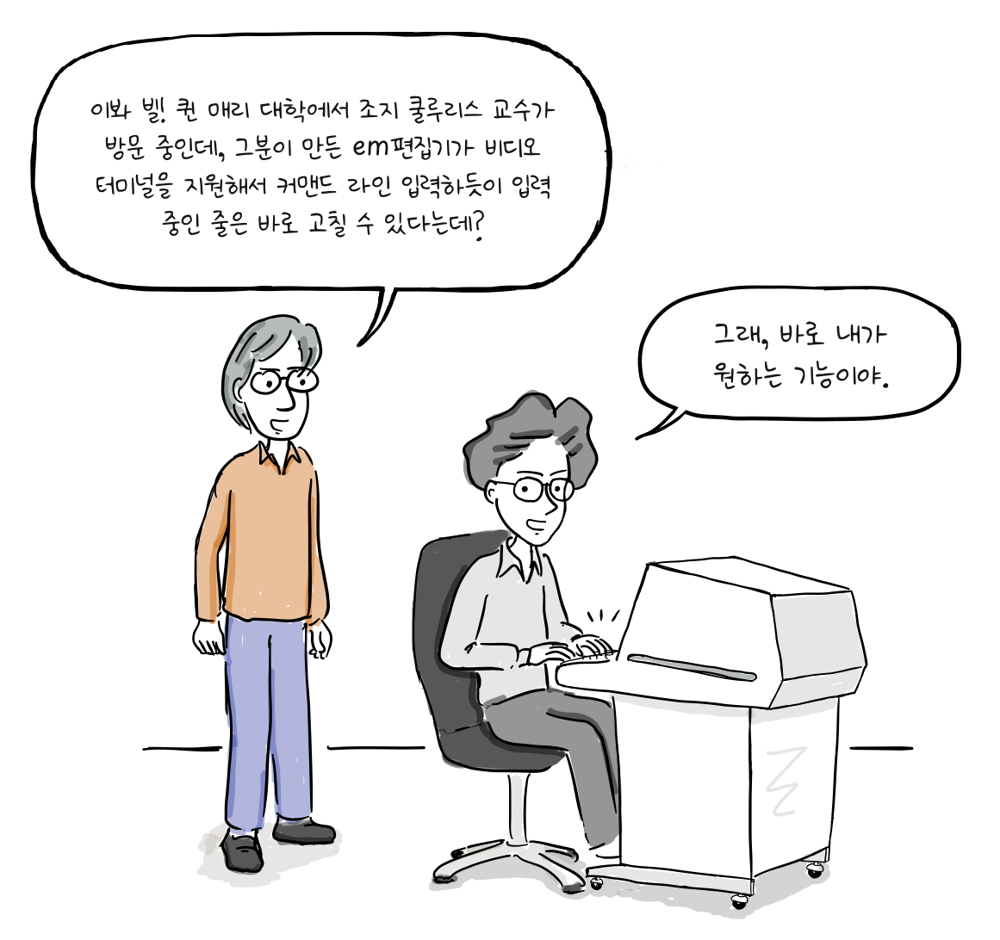

<!-- dialogue: chuck-em-news -->
> 이봐 빌! 퀸 매리 대학에서 조지 쿨루리스 교수가 방문 중인데, 그분이 만든 em편집기가 비디오 터미널을 지원해서 커맨드 라인 입력하듯이 입력 중인 줄은 바로 고칠 수 있다는데?
<!-- /dialogue -->

<!-- dialogue: bill-em-reaction -->
> 그래, 바로 내가 원하는 기능이야.
<!-- /dialogue -->

:::

:::panel rounded="true" style="border-width: 3px;border-color: black;"

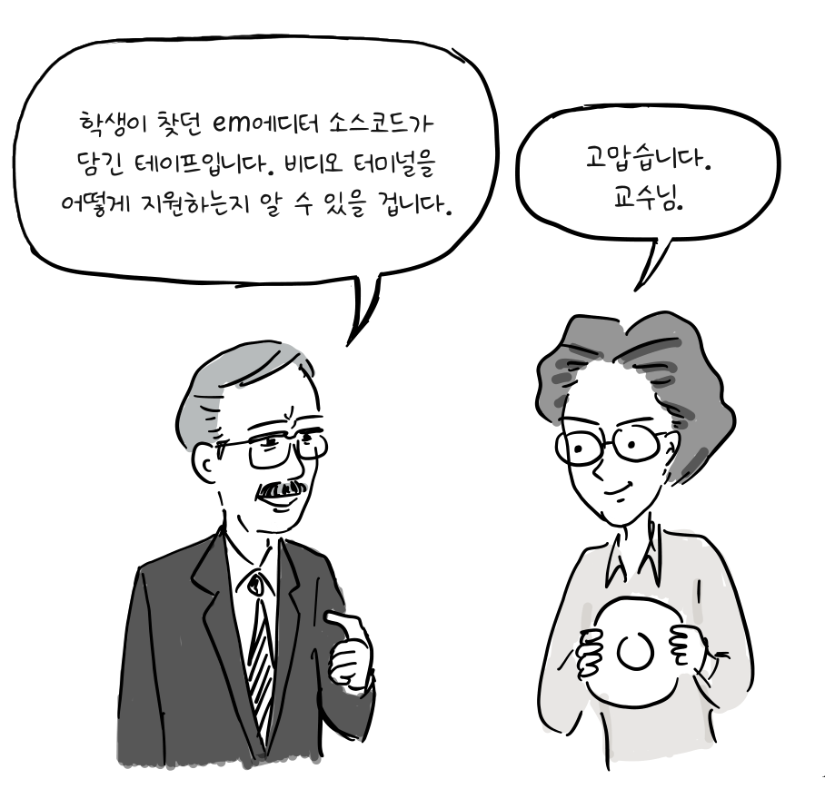

<!-- dialogue: coulouris-tape -->
> 학생이 찾던 em에디터 소스코드가 담긴 테이프입니다. 비디오 터미널을 어떻게 지원하는지 알 수 있을 겁니다.
<!-- /dialogue -->

<!-- dialogue: bill-thanks -->
> 고맙습니다. 교수님.
<!-- /dialogue -->

:::

:::panel rounded="true" style="border-width: 3px;border-color: black;"

빌 조이와 척 핼리는 em을 바탕으로 ex를 개발했다. 1977년에는 조이가 ex에 전체 화면 비주얼 편집 모드를 추가했다. 이것이 vi로 이어졌다.[&lbrack;2&rbrack;][2][&lbrack;3&rbrack;][3]

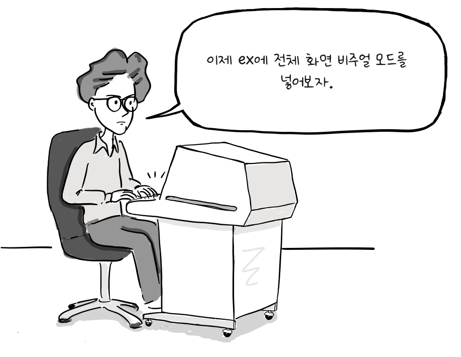

<!-- dialogue: bill-ex-plan -->
> 이제 ex에 전체 화면 비주얼 모드를 넣어보자.
<!-- /dialogue -->

:::

:::panel rounded="true" style="border-width: 3px;border-color: black;"

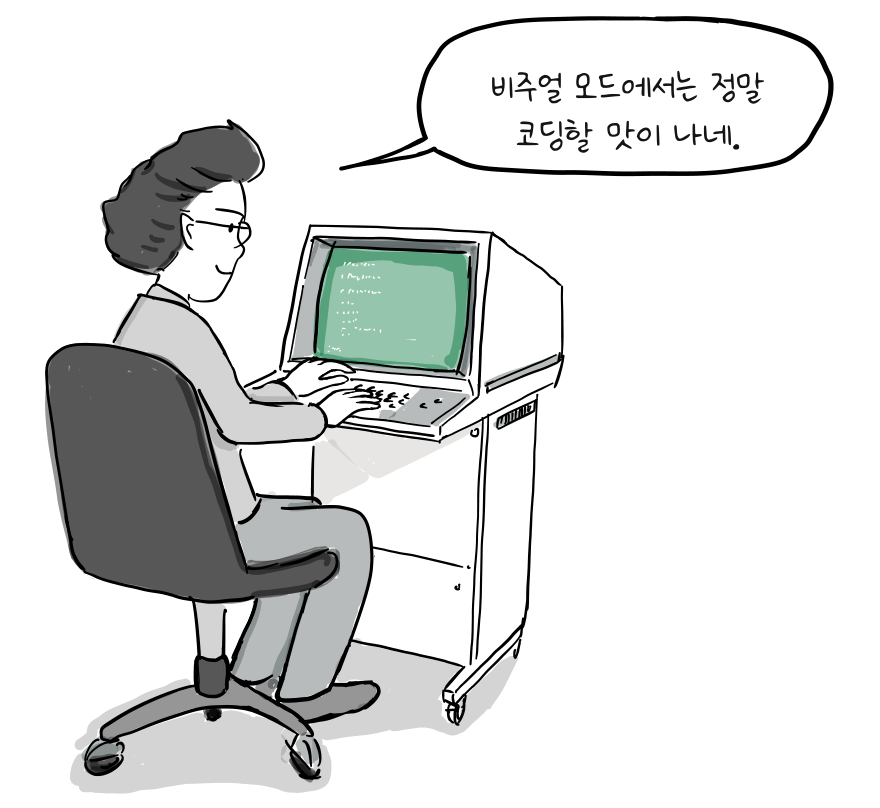

<!-- dialogue: bill-visual-mode -->
> 비주얼 모드에서는 정말 코딩할 맛이 나네.
<!-- /dialogue -->

이후 BSD 유닉스 사용자들이 비주얼 편집 모드를 선호하게 되어 결국, vi라는 이름으로 비주얼 편집 모드가 바로 실행되도록 하였다. 참고로, 아직까지 vi에디터에는 ex모드를 지원하고 있다.[&lbrack;3&rbrack;][3]

:::

**미국 서부 유닉스 사용자 그룹**

:::panel rounded="true" style="border-width: 3px;border-color: black;"

켄 톰슨은 또한 유닉스를 가르치는 일에도 앞장섰다. 미국 서부 유닉스 사용자 그룹(West Coast Unix Users Group)의 초기 모임에서 여러 차례 저녁 시간을 들여 커널 소스코드를 한 줄씩 설명했다.[&lbrack;1&rbrack;][1]

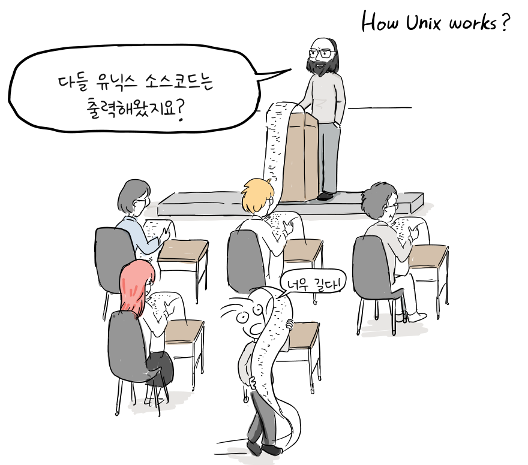

<!-- dialogue: ken-source-printouts -->
> 다들 유닉스 소스코드는 출력해왔지요?
<!-- /dialogue -->

<!-- dialogue: student-long-printout -->
> 너무 길다!
<!-- /dialogue -->

:::

:::panel
이처럼 소스 코드를 공유하고 지식을 나누는 전통은 BSD를 거쳐 훗날 자유/오픈소스 소프트웨어 공동체에도 이어졌다. 다만 당시 유닉스 소스와 초기 BSD 배포판은 AT&T 소스 라이선스 보유자를 대상으로 공유되었다.[&lbrack;1&rbrack;][1][&lbrack;2&rbrack;][2]

1976년 여름 말, 톰슨은 안식년을 마치고 벨 연구소로 돌아갔다.[&lbrack;2&rbrack;][2]

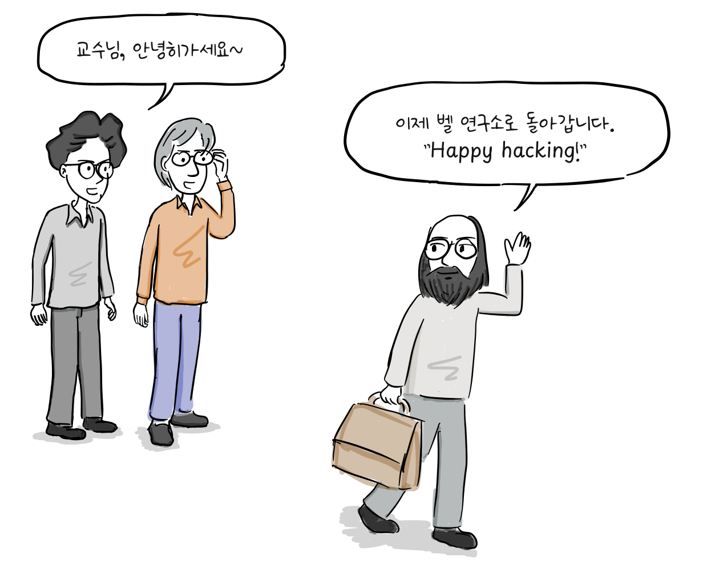

<!-- dialogue: bill-farewell -->
> 교수님, 안녕히 가세요~
<!-- /dialogue -->

<!-- dialogue: ken-farewell -->
> 이제 벨 연구소로 돌아갑니다. “Happy hacking!”
<!-- /dialogue -->

:::


## 참고 자료

1. Andrew Leonard, [BSD Unix: Power to the people, from the code](https://www.salon.com/2000/05/16/chapter_2_part_one/), 2000.
2. 마셜 커크 맥큐식, [「버클리 유닉스의 20년」 영문 원문](https://www.oreilly.com/openbook/opensources/book/kirkmck.html), 1999. 한국어판은 [『오픈 소스 : 오픈 소스 혁명의 목소리 Vol 1』, 한빛미디어](https://www.hanbit.co.kr/books/E5329835060?code=E5329835060), 2013.
3. [vi (text editor), Wikipedia](https://en.wikipedia.org/wiki/Vi_(text_editor))
4. [ed (text editor), Wikipedia](https://en.wikipedia.org/wiki/Ed_(text_editor))
5. George Coulouris, [Bits of History](https://www.coulouris.net/cs_history/em_story/). em의 개발과 1976년 버클리 방문에 대한 직접 회고.
6. [GNU ed 매뉴얼](https://www.gnu.org/software/ed/manual/ed_manual.html).

[1]: https://www.salon.com/2000/05/16/chapter_2_part_one/
[2]: https://www.oreilly.com/openbook/opensources/book/kirkmck.html
[3]: https://en.wikipedia.org/wiki/Vi_(text_editor)
[4]: https://en.wikipedia.org/wiki/Ed_(text_editor)
[5]: https://www.coulouris.net/cs_history/em_story/
[6]: https://www.gnu.org/software/ed/manual/ed_manual.html
