:::panel rounded="true" style="border-width: 3px;border-color: black;"

In 1975, Ken Thompson returned to his alma mater, UC Berkeley, for a sabbatical as a visiting professor. He was getting Unix Version 6 running on the new PDP-11/70.[&lbrack;2&rbrack;][2]

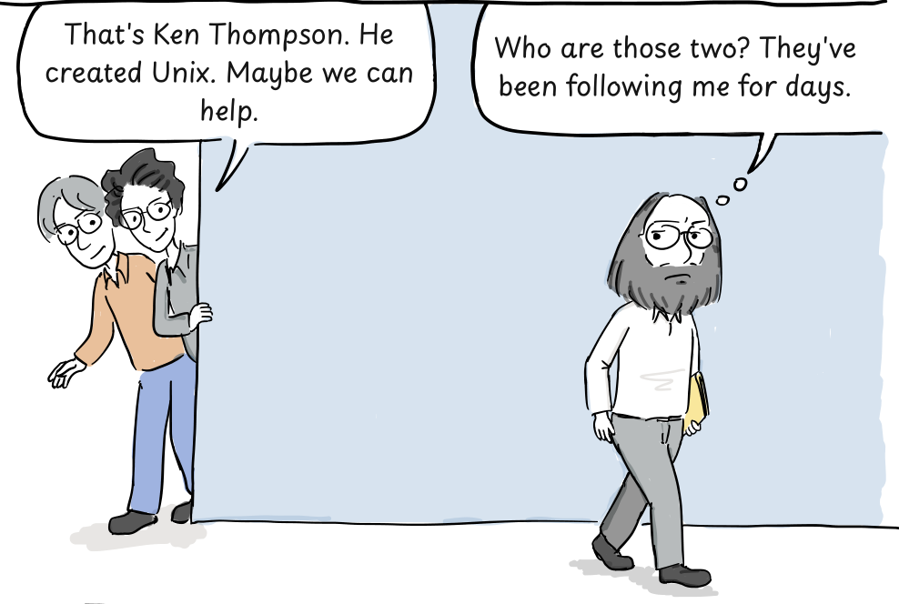

<!-- dialogue: bill-spot-ken -->
> That's Ken Thompson. He created Unix. Maybe we can help.
<!-- /dialogue -->

<!-- dialogue: ken-followers -->
> Who are those two? They've been following me for days.
<!-- /dialogue -->

:::

:::panel rounded="true" style="border-width: 3px;border-color: black;"

The PDP-11/70 machine room.

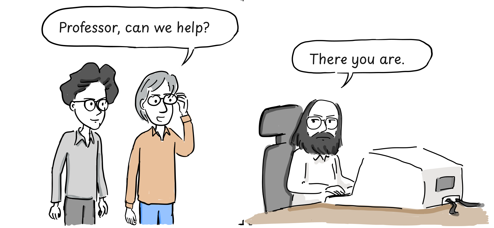

<!-- dialogue: bill-offer-help -->
> Professor, can we help?
<!-- /dialogue -->

<!-- dialogue: ken-welcome -->
> There you are.
<!-- /dialogue -->

:::

::::panels columns="2" label=""

:::panel rounded="true" style="border-width: 3px;border-color: black;padding: 0;"

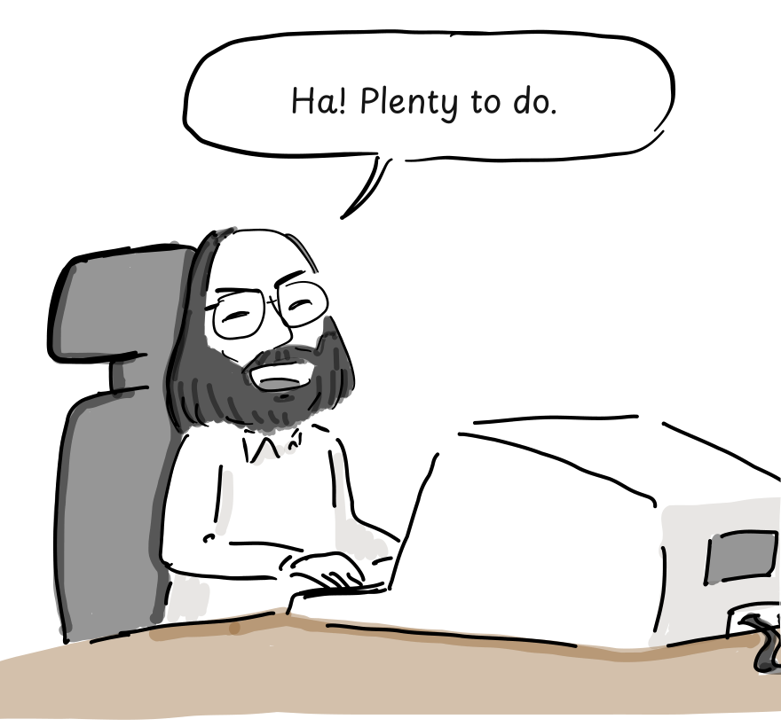

<!-- dialogue: ken-plenty-of-work -->
> Ha! Plenty to do.
<!-- /dialogue -->

:::

:::panel rounded="true" style="border-width: 3px;border-color: black;padding: 0;"

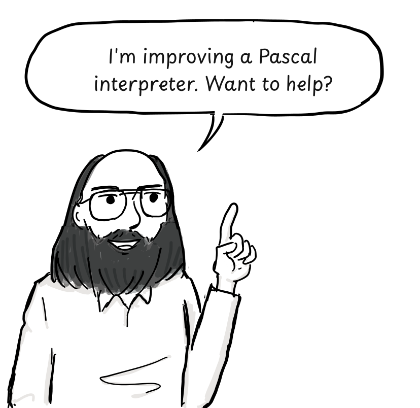

<!-- dialogue: ken-pascal-help -->
> I'm improving a Pascal interpreter. Want to help?
<!-- /dialogue -->

:::

::::

:::panel rounded="true" style="border-width: 3px;border-color: black;"

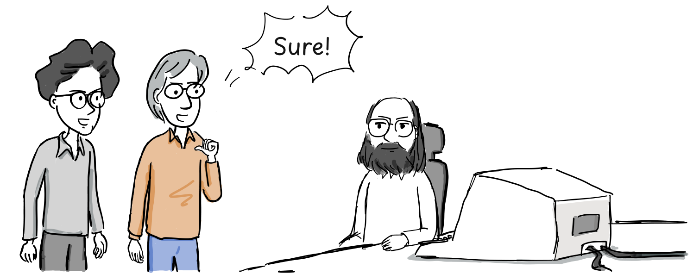

<!-- dialogue: bill-chuck-accept -->
> Sure!
<!-- /dialogue -->

Their improvements made the Pascal system faster to compile and run. It became a favorite among students.[&lbrack;2&rbrack;][2]

:::

**The birth of vi**

:::panel rounded="true" style="border-width: 3px;border-color: black;"

Unix came with [ed](https://en.wikipedia.org/wiki/Ed_(text_editor)), a line editor Thompson had written in 1969 during Unix's early development.[&lbrack;4&rbrack;][4]

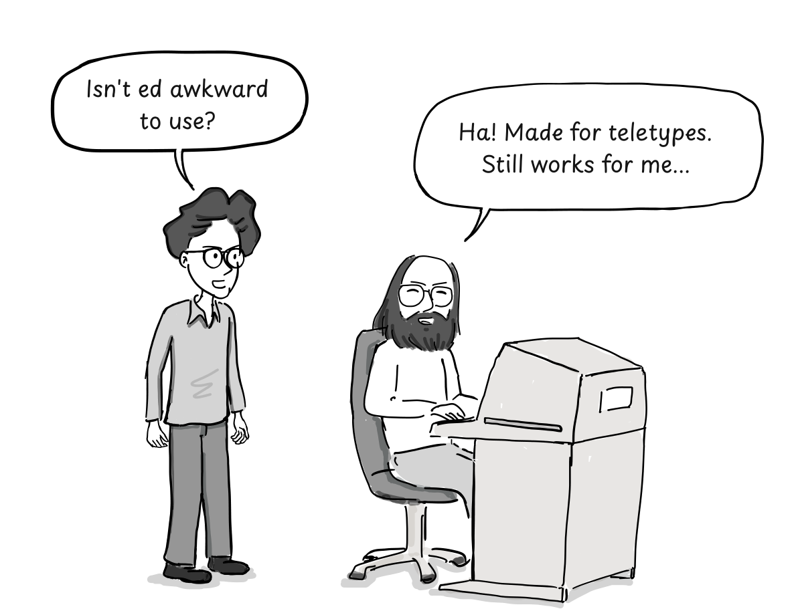

<!-- dialogue: bill-ed-question -->
> Isn't ed awkward to use?
<!-- /dialogue -->

<!-- dialogue: ken-ed-answer -->
> Ha! Made for teletypes. Still works for me...
<!-- /dialogue -->

:::

:::panel

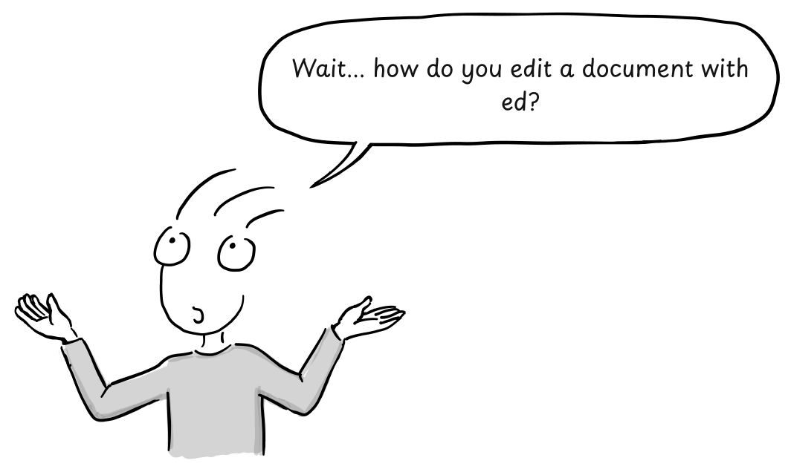

<!-- dialogue: guide-ed-question -->
> Wait... how do you edit a document with ed?
<!-- /dialogue -->

:::

Here is a short ed session. Commands, typed text, and output appear together. The `$` prompts belong to the shell; ed itself normally has no prompt.[&lbrack;6&rbrack;][6]

```text
$ ed
a
ed is the standard Unix text editor.
This is line number one.
.
,p
ed is the standard Unix text editor.
This is line number one.
2s/one/two/
,p
ed is the standard Unix text editor.
This is line number two.
w text
62
q
$ cat text
ed is the standard Unix text editor.
This is line number two.
```

The `a` command starts appending text. A period on a line by itself ends input. The command `,p` prints every line in the buffer.

To change `one` to `two` on the second line, you enter `2s/one/two/`. Instead of moving a cursor over the text, you specify the line and the substitution. Then `w text` saves the buffer to a file named `text`, reporting its size in bytes, and `q` quits.

The resulting file contains:

```text
ed is the standard Unix text editor.
This is line number two.
```

:::panel rounded="true" style="border-width: 3px;border-color: black;"

In the 1960s, memory was scarce and modems were slow. Many terminals printed onto paper rather than displaying text on a screen. A terse editor made sense in that setting.[&lbrack;4&rbrack;][4]

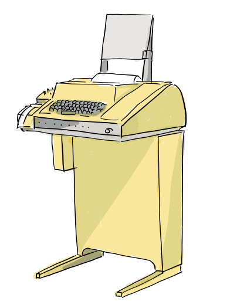

The Teletype Model 33, a widely used printing terminal.

:::

:::panel rounded="true" style="border-width: 3px;border-color: black;"

By the 1970s, terminals with CRT screens were becoming common. Unix users were still editing with ed.

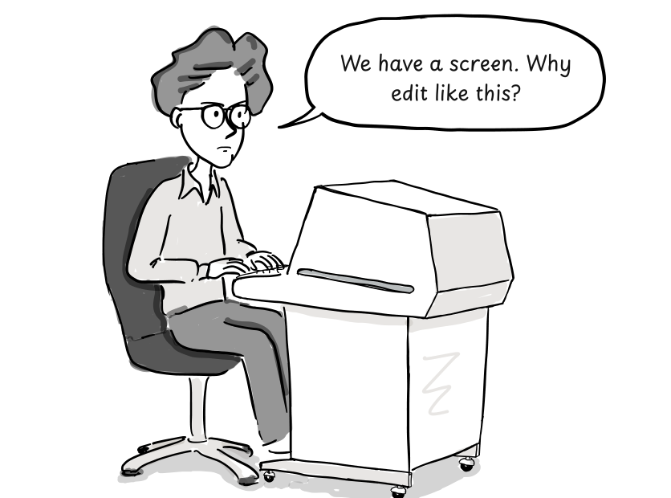

<!-- dialogue: bill-monitor -->
> We have a screen. Why edit like this?
<!-- /dialogue -->

:::

:::panel rounded="true" style="border-width: 3px;border-color: black;"

In the summer of 1976, George Coulouris visited Berkeley from Queen Mary College.[&lbrack;5&rbrack;][5]

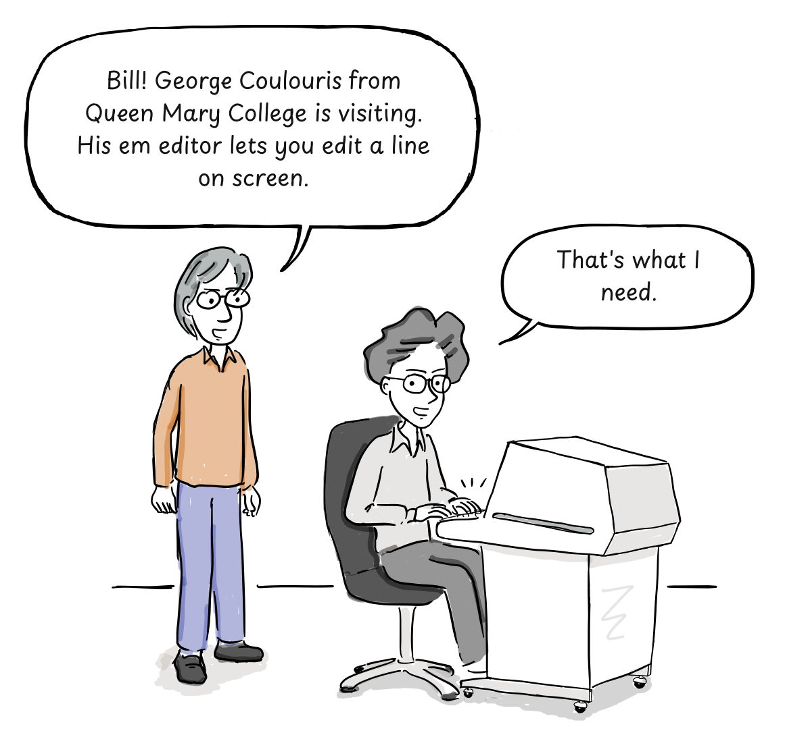

<!-- dialogue: chuck-em-news -->
> Bill! George Coulouris from Queen Mary College is visiting. His em editor lets you edit a line on screen.
<!-- /dialogue -->

<!-- dialogue: bill-em-reaction -->
> That's what I need.
<!-- /dialogue -->

:::

:::panel rounded="true" style="border-width: 3px;border-color: black;"

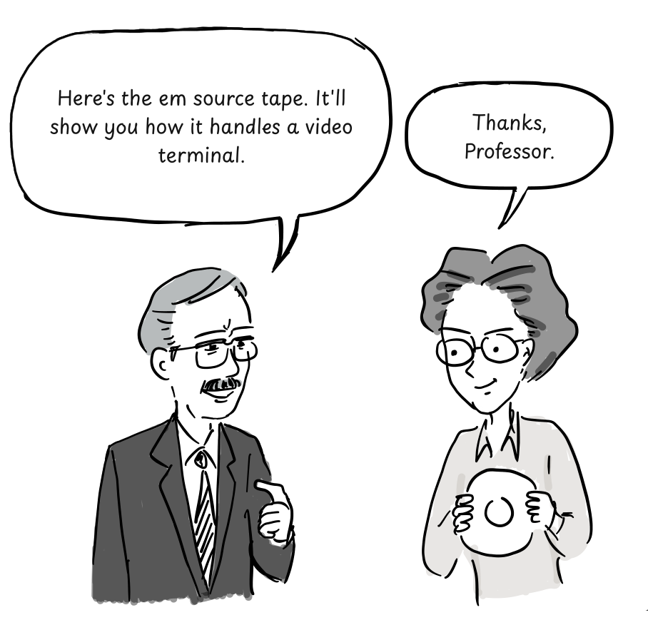

<!-- dialogue: coulouris-tape -->
> Here's the em source tape. It'll show you how it handles a video terminal.
<!-- /dialogue -->

<!-- dialogue: bill-thanks -->
> Thanks, Professor.
<!-- /dialogue -->

:::

:::panel rounded="true" style="border-width: 3px;border-color: black;"

Joy and Haley built on em to develop ex. In 1977, Joy added the full-screen visual mode that became vi.[&lbrack;2&rbrack;][2][&lbrack;3&rbrack;][3]

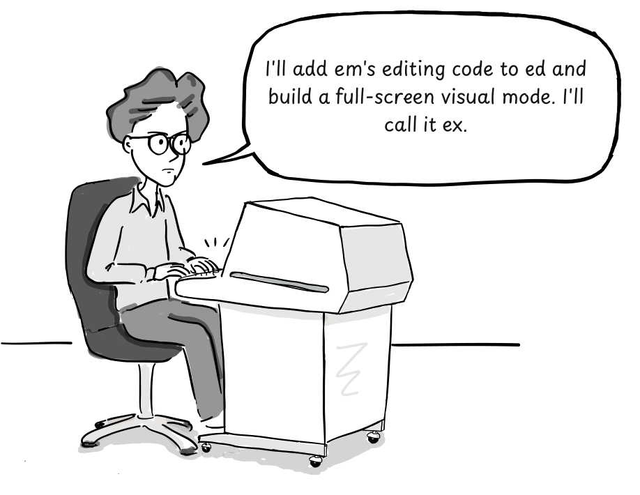

<!-- dialogue: bill-ex-plan -->
> Now I'll add a full-screen visual mode to ex.
<!-- /dialogue -->

:::

:::panel rounded="true" style="border-width: 3px;border-color: black;"

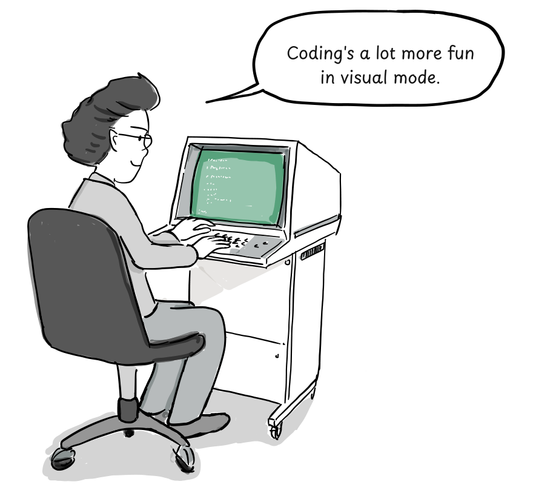

<!-- dialogue: bill-visual-mode -->
> Coding's a lot more fun in visual mode.
<!-- /dialogue -->

The visual mode proved popular with BSD users. Invoking the editor as `vi` eventually became a way to start directly in that mode. The underlying ex command mode is still part of vi.[&lbrack;3&rbrack;][3]

:::

**The West Coast Unix Users Group**

:::panel rounded="true" style="border-width: 3px;border-color: black;"

Back to Thompson's time at Berkeley, in 1975-1976.

Thompson also shared his knowledge of Unix. At early meetings of the West Coast Unix Users Group, he walked participants through the kernel source, line by line, over a series of evenings.[&lbrack;1&rbrack;][1]

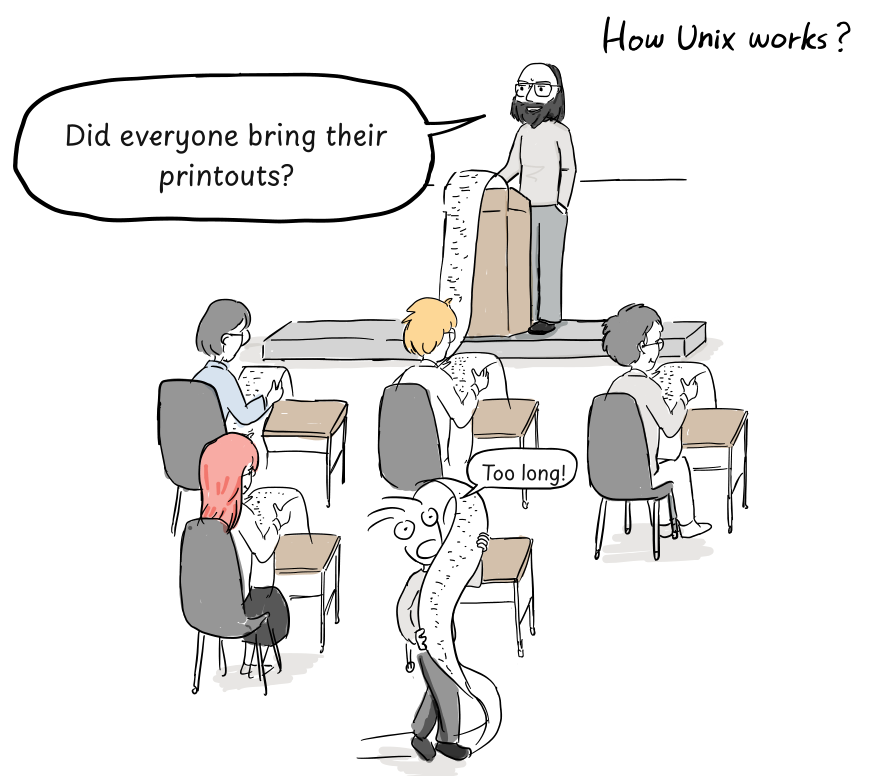

<!-- dialogue: ken-source-printouts -->
> Did everyone bring the Unix source?
<!-- /dialogue -->

<!-- dialogue: student-long-printout -->
> Too long!
<!-- /dialogue -->

:::

:::panel

That tradition of sharing code and explaining how it worked carried through BSD into the broader free and open source software community. At the time, however, Unix source and early BSD distributions were shared with holders of AT&T source licenses.[&lbrack;1&rbrack;][1][&lbrack;2&rbrack;][2]

At the end of the summer of 1976, Thompson returned to Bell Labs after his sabbatical.[&lbrack;2&rbrack;][2]

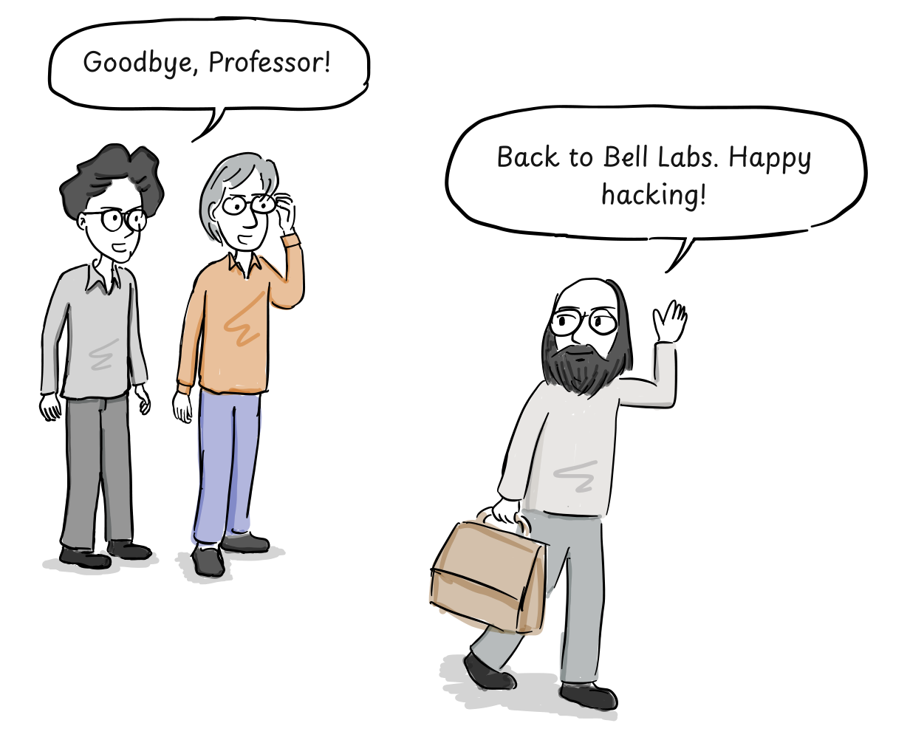

<!-- dialogue: bill-farewell -->
> Goodbye, Professor!
<!-- /dialogue -->

<!-- dialogue: ken-farewell -->
> Back to Bell Labs. Happy hacking!
<!-- /dialogue -->

:::

## References

1. Andrew Leonard, [BSD Unix: Power to the people, from the code](https://www.salon.com/2000/05/16/chapter_2_part_one/), 2000.
2. Marshall Kirk McKusick, [Twenty Years of Berkeley Unix](https://www.oreilly.com/openbook/opensources/book/kirkmck.html), in *Open Sources: Voices from the Open Source Revolution*, 1999. The Korean edition, referenced in the original comic, was published by [Hanbit Media](https://www.hanbit.co.kr/books/E5329835060?code=E5329835060) in 2013.
3. [vi (text editor), Wikipedia](https://en.wikipedia.org/wiki/Vi_(text_editor)).
4. [ed (text editor), Wikipedia](https://en.wikipedia.org/wiki/Ed_(text_editor)).
5. George Coulouris, [Bits of History](https://www.coulouris.net/cs_history/em_story/), a firsthand account of em and his 1976 visit to Berkeley.
6. [GNU ed manual](https://www.gnu.org/software/ed/manual/ed_manual.html).

[1]: https://www.salon.com/2000/05/16/chapter_2_part_one/
[2]: https://www.oreilly.com/openbook/opensources/book/kirkmck.html
[3]: https://en.wikipedia.org/wiki/Vi_(text_editor)
[4]: https://en.wikipedia.org/wiki/Ed_(text_editor)
[5]: https://www.coulouris.net/cs_history/em_story/
[6]: https://www.gnu.org/software/ed/manual/ed_manual.html
