- [BSD 유닉스 1화 – UC 버클리로 간 유닉스 코드](/ko/posts/11.%20BSD%20Unix%20Part%201%20-%20Unix%20Code%20Goes%20to%20UC%20Berkeley/)
- [BSD 유닉스 2화 – vi 에디터의 탄생](/ko/posts/12.%20BSD%20Unix%20Part%202%20-%20The%20Birth%20of%20the%20vi%20Editor/)

**BSD 유닉스의 시작**

:::panel rounded="true" style="border-width: 3px;border-color: black;"

1976년 켄 톰슨이 벨 연구소로 돌아가자, 빌 조이와 척 핼리는 유닉스 커널 내부를 직접 해킹하기 시작한다.

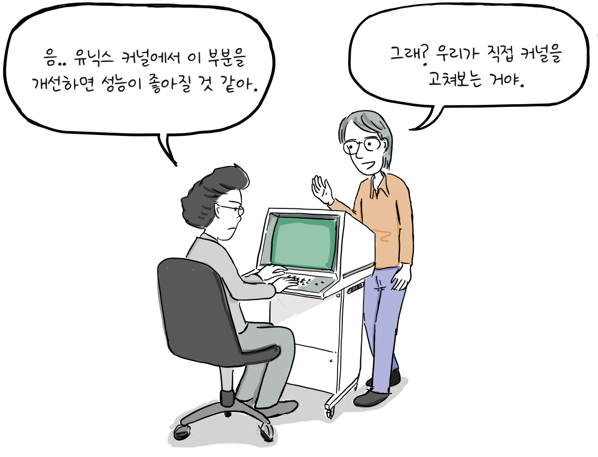

<!-- dialogue: bill-kernel-improvement -->
> 음.. 유닉스 커널에서 이 부분을 개선하면 성능이 좋아질 것 같아.
<!-- /dialogue -->

<!-- dialogue: chuck-kernel-reply -->
> 그래? 우리가 직접 커널을 고쳐보는 거야.
<!-- /dialogue -->

:::

:::panel rounded="true" style="border-width: 3px;border-color: black;"

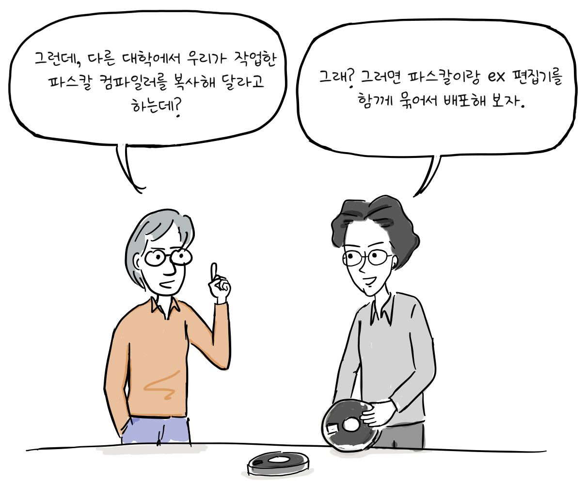

<!-- dialogue: chuck-pascal-requests -->
> 그런데, 다른 대학에서 우리가 작업한 파스칼 컴파일러를 복사해 달라고 하는데?
<!-- /dialogue -->

<!-- dialogue: bill-plan-distribution -->
> 그래? 그러면 파스칼이랑 ex 편집기를 함께 묶어서 배포해 보자.
<!-- /dialogue -->

:::

:::panel rounded="true" style="border-width: 3px;border-color: black;"

1977년 초, 빌 조이는 파스칼 시스템과 ex 편집기를 묶어 버클리 소프트웨어 배포판(BSD, Berkeley Software Distribution)을 만들었다. 초기 BSD는 독립적인 운영체제가 아니라 기존 유닉스에 추가로 설치하는 소프트웨어 모음이었다. 이후 약 1년 동안 30여 개의 복사본을 발송했다.[&lbrack;1&rbrack;][1]

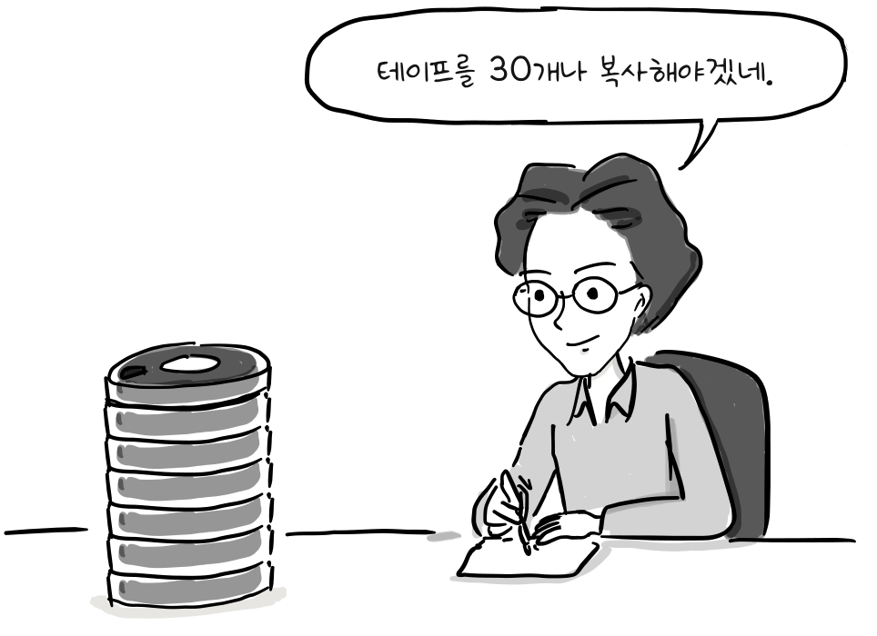

<!-- dialogue: bill-thirty-tapes -->
> 테이프를 30개나 복사해야겠네.
<!-- /dialogue -->

:::

:::panel rounded="true" style="border-width: 3px;border-color: black;"

당시 BSD는 지금처럼 자유롭게 재배포할 수 있는 소프트웨어가 아니었다. 배포를 받으려면 AT&T 유닉스 소스 라이선스가 필요했고, 버클리는 실비 수준으로 테이프와 배포 비용을 받았다.[&lbrack;2&rbrack;][2]

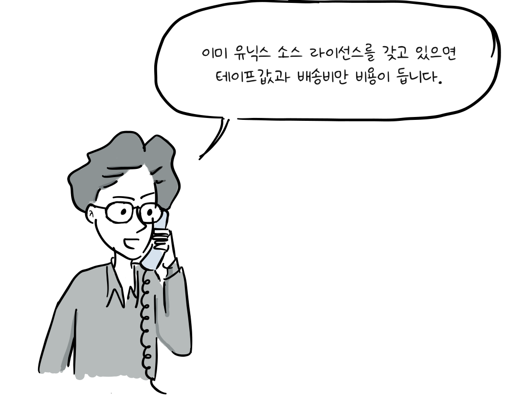

<!-- dialogue: bill-license-required -->
> 이미 유닉스 소스 라이선스를 갖고 있으면 테이프값과 배송비만 비용이 듭니다.
<!-- /dialogue -->

:::

:::panel rounded="true" style="border-width: 3px;border-color: black;"

버클리에는 연구용 소프트웨어를 서로 나누는 문화가 이미 자리 잡고 있었다. BSD도 그 전통을 이어갔다. 또한 이 당시 빌 조이가 BSD 유닉스를 실비만 받고 무료로 제공한 이유는 당시 버클리 대학이 갖고 있는 자유 스피치 운동, 히피 문화, 반전 운동에 영향을 받았다고 한다. [&lbrack;2&rbrack;][2]

:::

:::panel rounded="true" style="border-width: 3px;border-color: black;"

유닉스의 확산에는 대학과 연구기관이 소스코드를 포함한 유닉스를 적은 라이선스 비용으로 받을 수 있었다는 점도 크게 작용했다.[&lbrack;2&rbrack;][2][&lbrack;6&rbrack;][6]

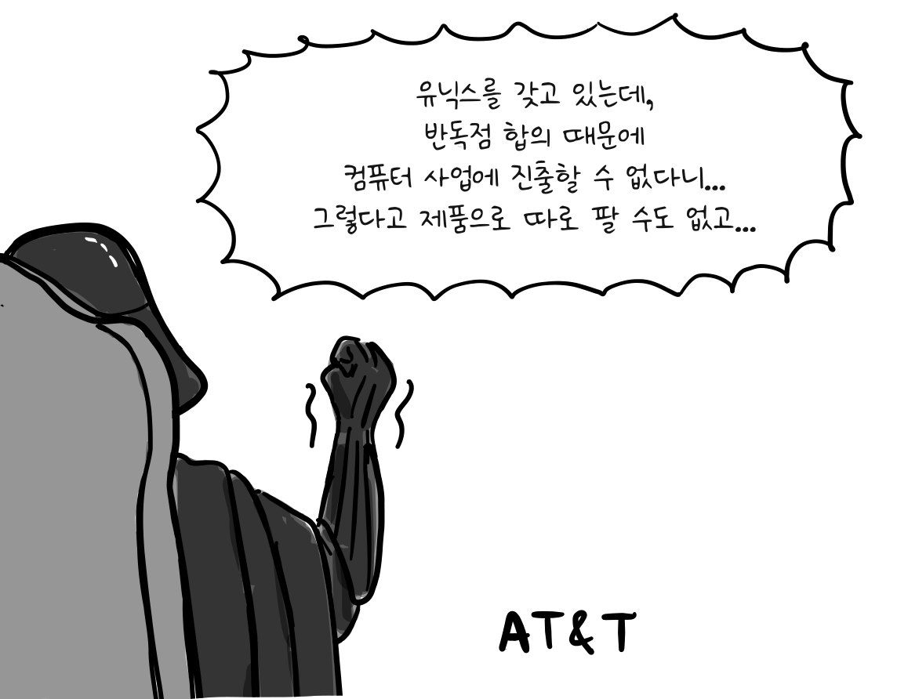

<!-- dialogue: att-business-restrictions -->
> 유닉스를 갖고 있는데,\
> 반독점 합의 때문에\
> 컴퓨터 사업에 진출할 수 없다니...\
> 그렇다고 제품으로 따로 팔 수도 없고...
<!-- /dialogue -->

:::

**두 번째 배포판 2BSD**

첫 번째 BSD가 배포된 뒤, 빌 조이는 사용자 피드백을 받아 파스칼 시스템을 개선했다. 여기에 vi 편집기(ex의 비주얼 모드)와 C 셸 등을 묶은 두 번째 배포판, 2BSD가 만들어졌다. 이후 약 1년 동안 75개 가까운 테이프가 발송되었다.[&lbrack;1&rbrack;][1][&lbrack;5&rbrack;][5]

빌 조이는 버그 수정뿐 아니라 배포 요청을 받는 일, 테이프 복사와 발송까지 도맡았다.

::::panels columns="2" label=""

:::panel rounded="true" style="border-width: 3px;border-color: black;padding: 0;"

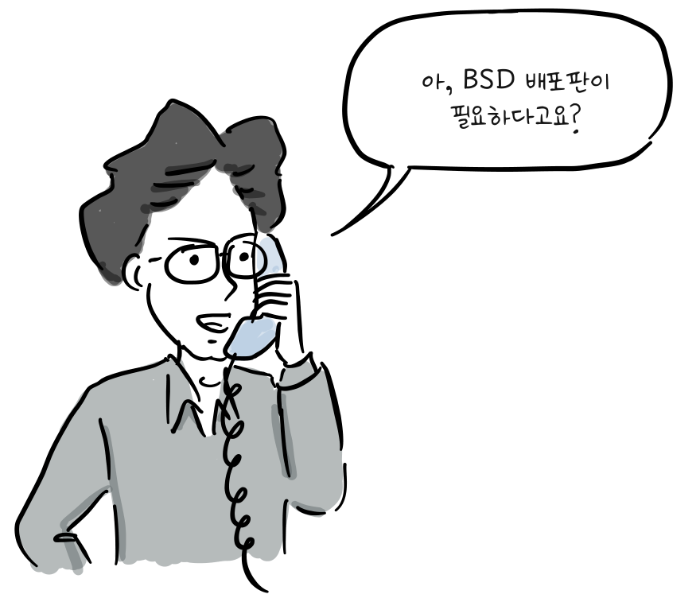

<!-- dialogue: bill-phone-order -->
> 아, BSD 배포판이 필요하다고요?
<!-- /dialogue -->

:::

:::panel rounded="true" style="border-width: 3px;border-color: black;padding: 0;"

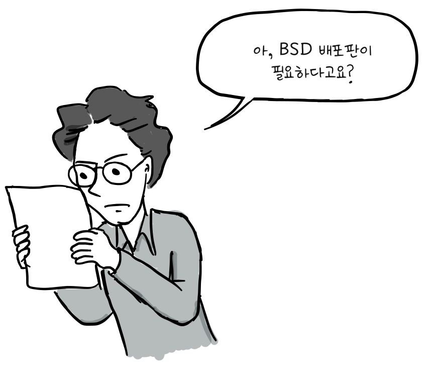

<!-- dialogue: bill-another-request -->
> 다른 대학교에서도 BSD 배포판을 보내달라고 하네.
<!-- /dialogue -->

:::

::::

:::panel rounded="true" style="border-width: 3px;border-color: black;"

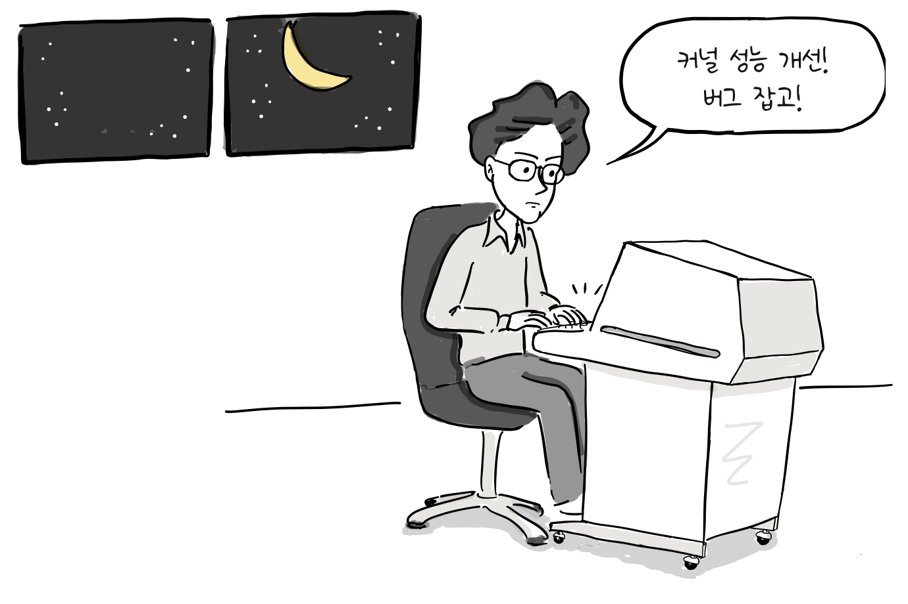

<!-- dialogue: bill-kernel-and-bugs -->
> 커널 성능 개선! 버그 잡고!
<!-- /dialogue -->

:::

:::panel rounded="true" style="border-width: 3px;border-color: black;"

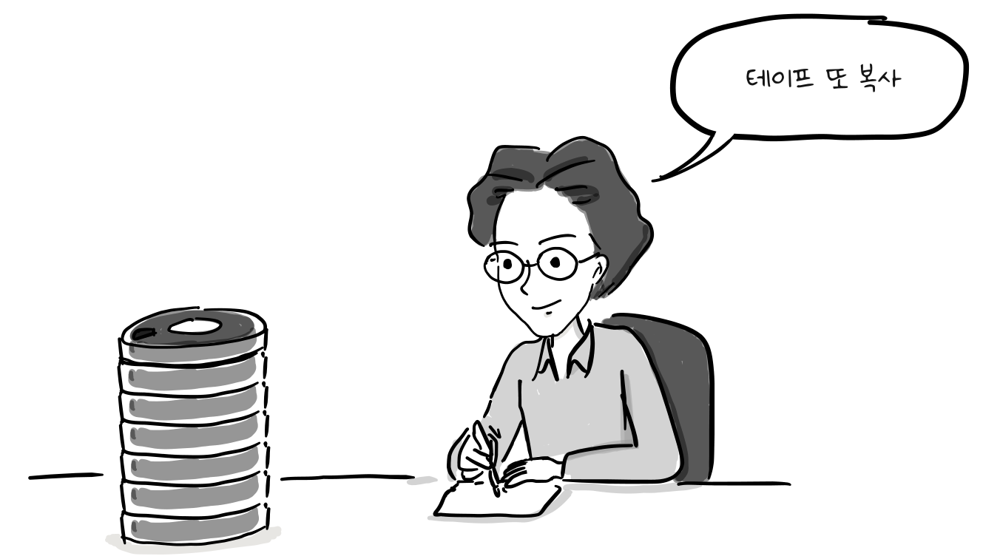

<!-- dialogue: bill-more-tapes -->
> 테이프 또 복사
<!-- /dialogue -->

:::

**1978년, 버클리에 들어온 VAX**

:::panel rounded="true" style="border-width: 3px;border-color: black;"

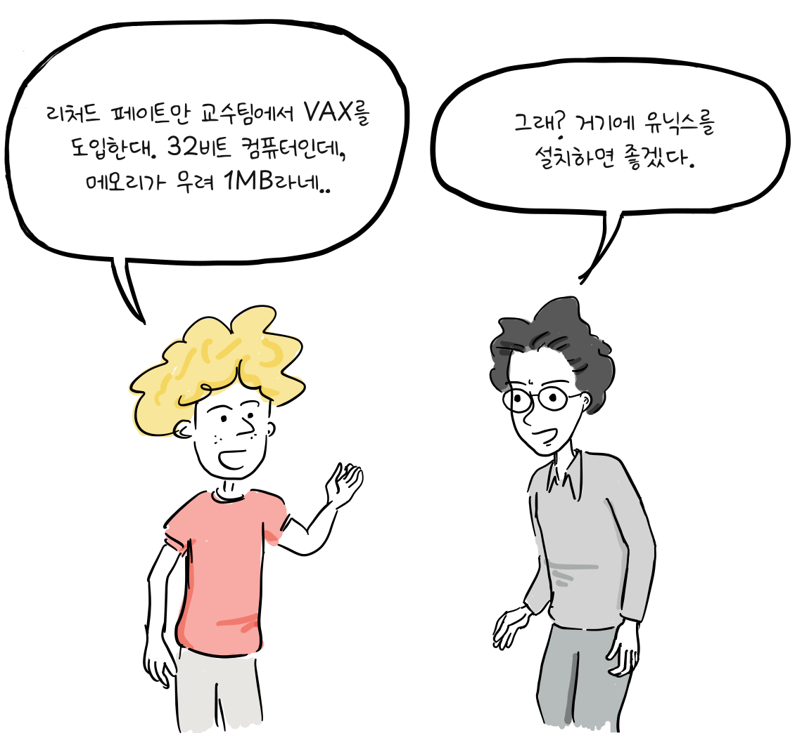

<!-- dialogue: colleague-vax-news -->
> 리처드 페이트만 교수팀에서 VAX를 도입한대. 32비트 컴퓨터인데, 메모리가 무려 1MB라네..
<!-- /dialogue -->

<!-- dialogue: bill-unix-on-vax -->
> 그래? 거기에 유닉스를 설치하면 좋겠다.
<!-- /dialogue -->

:::

:::panel rounded="true" style="border-width: 3px;border-color: black;"

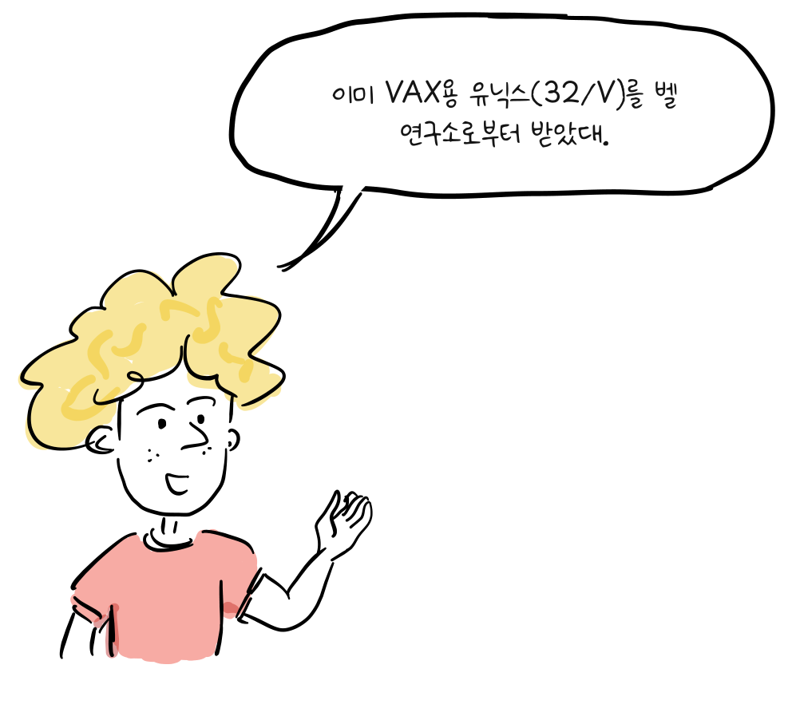

<!-- dialogue: colleague-unix-arrived -->
> 이미 VAX용 유닉스(32/V)를 벨 연구소로부터 받았대.
<!-- /dialogue -->

:::

:::panel rounded="true" style="border-width: 3px;border-color: black;"

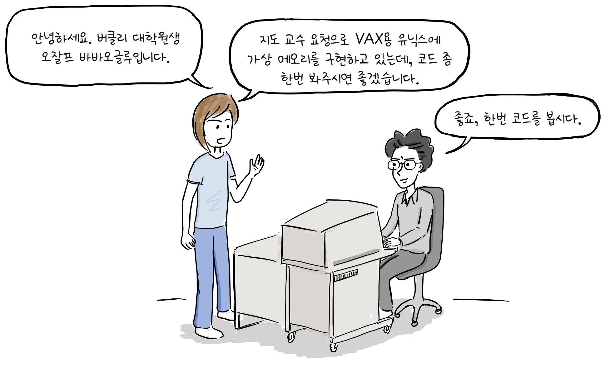

<!-- dialogue: ozalp-introduction -->
> 안녕하세요. 버클리 대학원생 오잘프 바바오글루입니다.
<!-- /dialogue -->

<!-- dialogue: ozalp-review-request -->
> 지도 교수 요청으로 VAX용 유닉스에 가상 메모리를 구현하고 있는데, 코드 좀 한번 봐주시면 좋겠습니다.
<!-- /dialogue -->

<!-- dialogue: bill-review-code -->
> 좋죠, 한번 코드를 봅시다.
<!-- /dialogue -->

오잘프는 도메니코 페라리 교수의 지도 아래 가상 메모리를 구현하고 있었다. 빌 조이는 이 코드를 32/V에 통합하고 버그를 잡는 작업에 합류했다.[&lbrack;1&rbrack;][1][&lbrack;4&rbrack;][4]

:::

:::panel rounded="true" style="border-width: 3px;border-color: black;"

당시 32/V는 VAX 하드웨어의 가상 메모리 기능을 활용하지 못해, 프로그램이 쓸 수 있는 공간이 실제 메모리 크기에 묶여 있었다. 리처드 페이트만 교수의 컴퓨터 대수학 시스템 [Macsyma](https://en.wikipedia.org/wiki/Macsyma) 연구에는 더 큰 주소 공간이 필요했다. Macsyma는 1960년대 말 MIT에서 개발되기 시작한 컴퓨터 대수학 시스템으로, 수식의 인수분해, 미분, 적분 등을 수행했다. 참고로, 가상 메모리는 디스크를 활용해 프로그램에 실제 메모리보다 큰 주소 공간을 제공한다.[&lbrack;1&rbrack;][1]

디버깅은 1978년 말 연말 휴가에도 계속되었다.

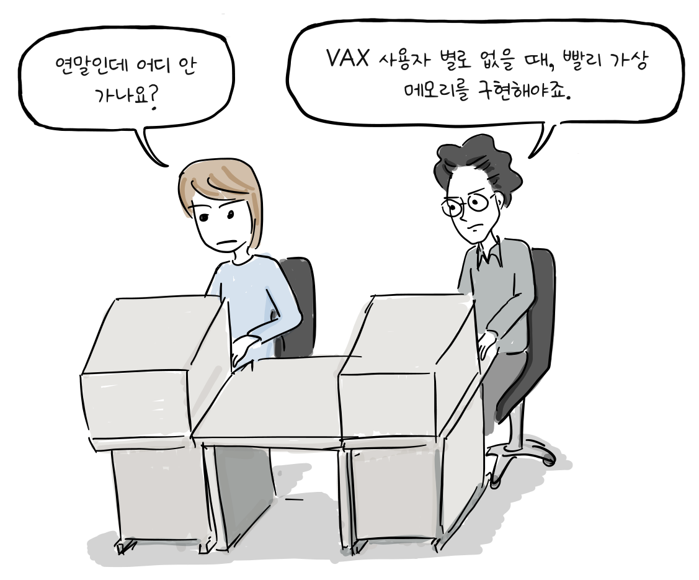

<!-- dialogue: ozalp-holiday-question -->
> 연말인데 어디 안 가나요?
<!-- /dialogue -->

<!-- dialogue: bill-quiet-vax -->
> VAX 사용자 별로 없을 때, 빨리 가상 메모리를 구현해야죠.
<!-- /dialogue -->

:::

:::panel rounded="true" style="border-width: 3px;border-color: black;"

1979년 1월, 대부분의 버그가 잡혔다.[&lbrack;1&rbrack;][1]

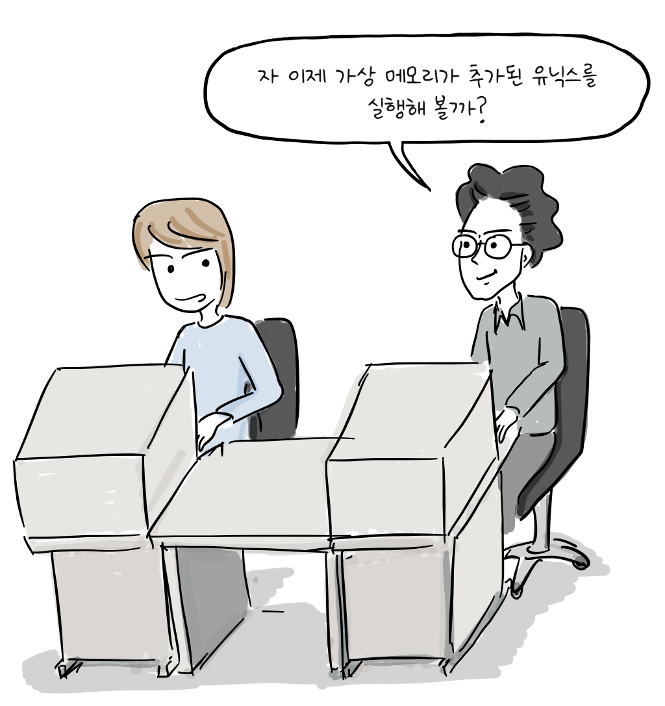

<!-- dialogue: bill-test-vm -->
> 자 이제 가상 메모리가 추가된 유닉스를 실행해 볼까?
<!-- /dialogue -->

:::

:::panel rounded="true" style="border-width: 3px;border-color: black;"

<!-- dialogue: bill-vm-working -->
> 드디어 문제 없이 잘 동작합니다.
<!-- /dialogue -->

:::

:::panel rounded="true" style="border-width: 3px;border-color: black;"

빌 조이는 ex와 vi, C 셸 등 2BSD의 도구를 VAX로 이식했고, 파스칼 시스템은 피터 케슬러와 마샬 커크 맥퀴식이 맡았다. 이 소프트웨어와 32/V의 기본 도구, 오잘프와 빌 조이가 함께 통합·디버깅한 가상 메모리 커널을 묶은 3BSD가 1979년 12월 배포되었다.[&lbrack;1&rbrack;][1]

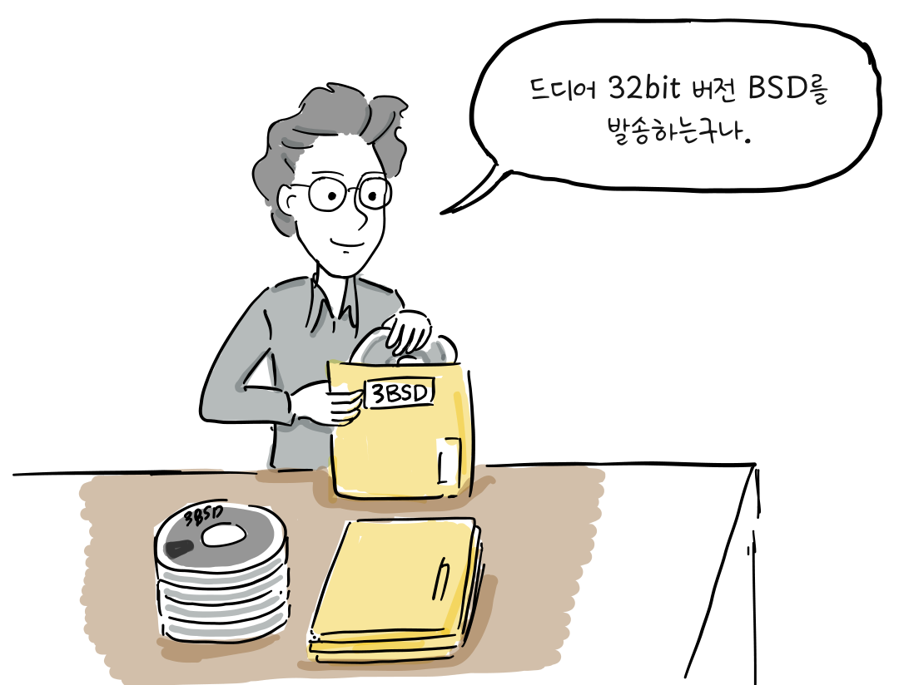

<!-- dialogue: bill-ship-3bsd -->
> 드디어 32bit 버전 BSD를 발송하는구나.
<!-- /dialogue -->

:::

:::panel rounded="true" style="border-width: 3px;border-color: black;"

미국 방위고등연구계획국(DARPA, Defense Advanced Research Projects Agency)의 연구기관들을 연결하는 ARPANET은 이미 1969년부터 운영되고 있었다.[&lbrack;3&rbrack;][3] 하지만 기관마다 컴퓨터와 운영체제가 달라 소프트웨어를 포팅하거나 다시 개발하는데 많은 비용이 들었다. DARPA는 그 대안으로 이식성이 높은 유닉스에 관심을 보였고, 버클리 대학이 여러 기관에 성공적으로 배포한 3BSD를 주목하기 시작했다.[&lbrack;1&rbrack;][1]

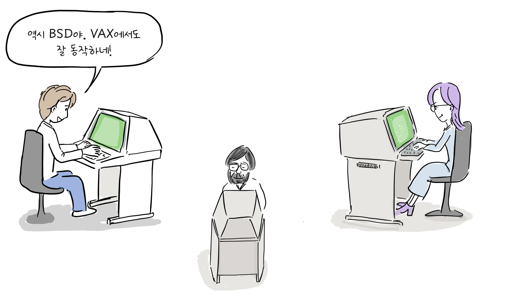

<!-- dialogue: researcher-bsd-on-vax -->
> 역시 BSD야. VAX에서도 잘 동작하네!
<!-- /dialogue -->

:::

끝.

*이 만화의 대사는 당시 기록을 바탕으로 재구성한 것으로, 실제 발언을 그대로 인용한 것은 아닙니다.*

**참고 문헌**

1. 마샬 커크 맥퀴식, [Twenty Years of Berkeley Unix][1], 1999. 한국어판: [버클리 유닉스의 20년, 《오픈소스 혁명의 목소리》, 한빛출판사](http://www.hanbit.co.kr/store/books/look.php?p_code=E5329835060), 2013.
2. Andrew Leonard, [BSD Unix: Power to the people, from the code][2], Salon, 2000.
3. SRI International, [ARPANET][3]. ARPANET의 기원과 1969년 첫 통신.
4. Ozalp Babaoglu, [개인 소개][4]. 버클리 대학원 시절의 유닉스 가상 메모리 연구.
5. The Unix Heritage Society (TUHS), [2BSD 원본 배포 아카이브][5]. `2bsd.tar.gz`의 설치 문서 `install.ms`와 소스코드.
6. Warren Toomey, [The Strange Birth and Long Life of Unix][6], IEEE Spectrum, 2011.

[1]: https://www.oreilly.com/openbook/opensources/book/kirkmck.html
[2]: https://www.salon.com/2000/05/16/chapter_2_part_one/
[3]: https://www.sri.com/hoi/arpanet/
[4]: https://www.cs.unibo.it/~babaoglu/
[5]: https://www.tuhs.org/Archive/Distributions/UCB/2BSD/
[6]: https://spectrum.ieee.org/the-strange-birth-and-long-life-of-unix
