- [BSD Unix, Part 1 - Unix Code Goes to UC Berkeley](/posts/11.%20BSD%20Unix%20Part%201%20-%20Unix%20Code%20Goes%20to%20UC%20Berkeley/)
- [BSD Unix, Part 2 - The Birth of the vi Editor](/posts/12.%20BSD%20Unix%20Part%202%20-%20The%20Birth%20of%20the%20vi%20Editor/)

**The beginning of BSD Unix**

:::panel rounded="true" style="border-width: 3px;border-color: black;"

When Ken Thompson returned to Bell Labs in 1976, Bill Joy and Chuck Haley began exploring the Unix kernel themselves.

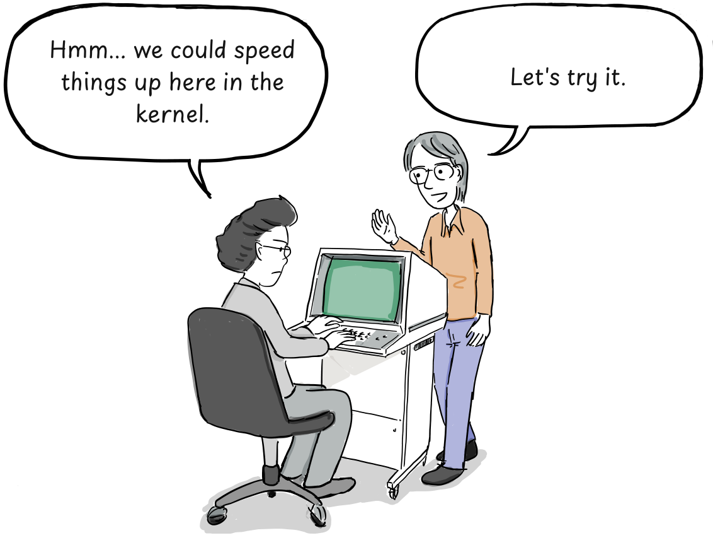

<!-- dialogue: bill-kernel-improvement -->
> Hmm... we could speed things up here in the kernel.
<!-- /dialogue -->

<!-- dialogue: chuck-kernel-reply -->
> Let's try it.
<!-- /dialogue -->

:::

:::panel rounded="true" style="border-width: 3px;border-color: black;"

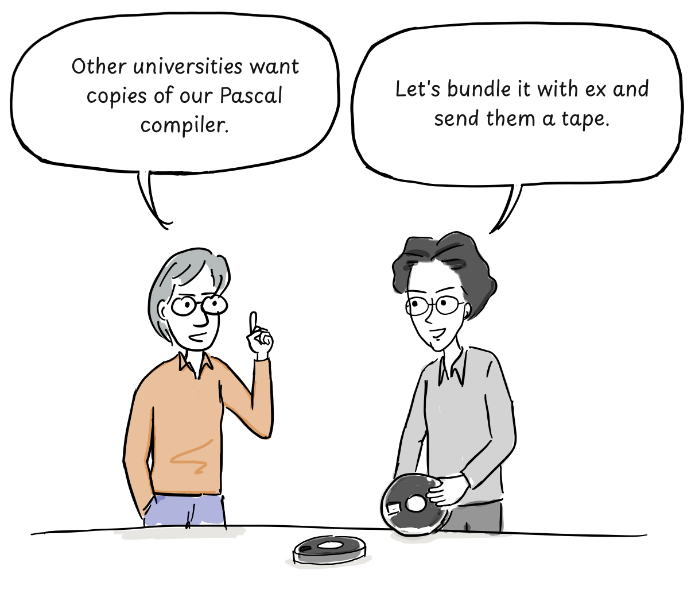

<!-- dialogue: chuck-pascal-requests -->
> Other universities want copies of our Pascal compiler.
<!-- /dialogue -->

<!-- dialogue: bill-plan-distribution -->
> Let's bundle it with ex and send them a tape.
<!-- /dialogue -->

:::

:::panel rounded="true" style="border-width: 3px;border-color: black;"

In early 1977, Bill Joy put together the Berkeley Software Distribution, or BSD, bundling the Pascal system with ex, a line editor developed from em. Early BSD was not a standalone operating system: it was a collection of software to install on an existing Unix system. About thirty copies were sent out over the following year.[&lbrack;1&rbrack;][1]

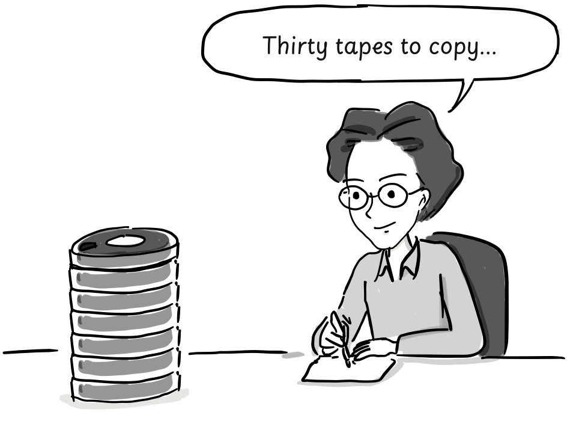

<!-- dialogue: bill-thirty-tapes -->
> Thirty tapes to copy...
<!-- /dialogue -->

:::

:::panel rounded="true" style="border-width: 3px;border-color: black;"

At the time, an AT&T Unix source license was needed to get BSD. Berkeley charged only for the tape and distribution.[&lbrack;2&rbrack;][2]

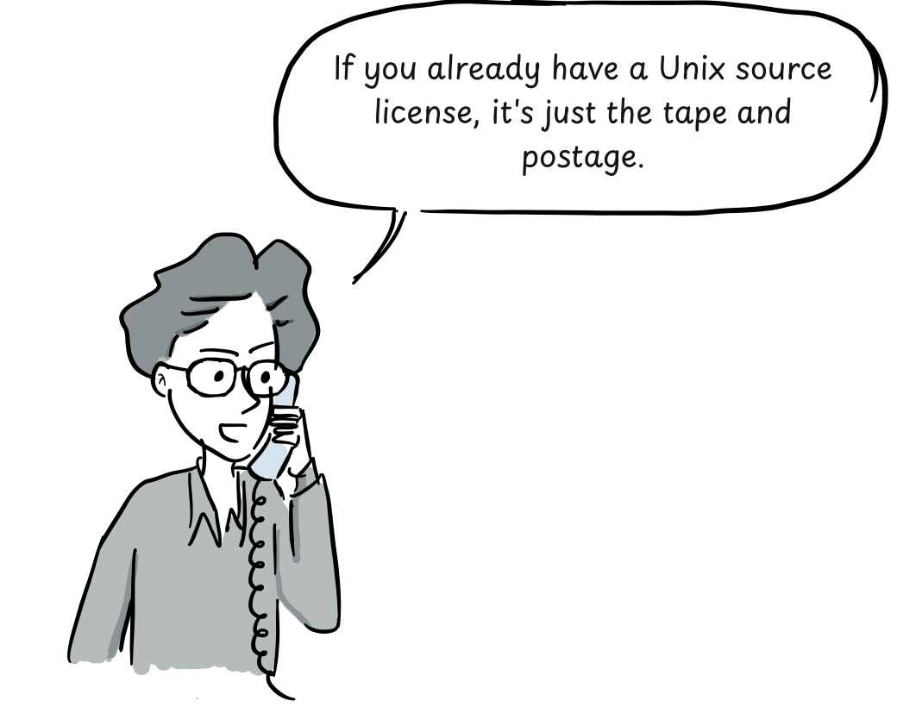

<!-- dialogue: bill-license-required -->
> If you already have a Unix source license, it's just the tape and postage.
<!-- /dialogue -->

:::

:::panel rounded="true" style="border-width: 3px;border-color: black;"

Berkeley already had a tradition of sharing research software. BSD carried it on. Berkeley's Free Speech Movement, hippie culture, and antiwar activism are also said to have influenced Joy's decision to charge so little.[&lbrack;2&rbrack;][2]

:::

:::panel rounded="true" style="border-width: 3px;border-color: black;"

Universities and research institutions could obtain Unix, including its source code, for a modest licensing fee. This also helped the system spread.[&lbrack;2&rbrack;][2][&lbrack;6&rbrack;][6]

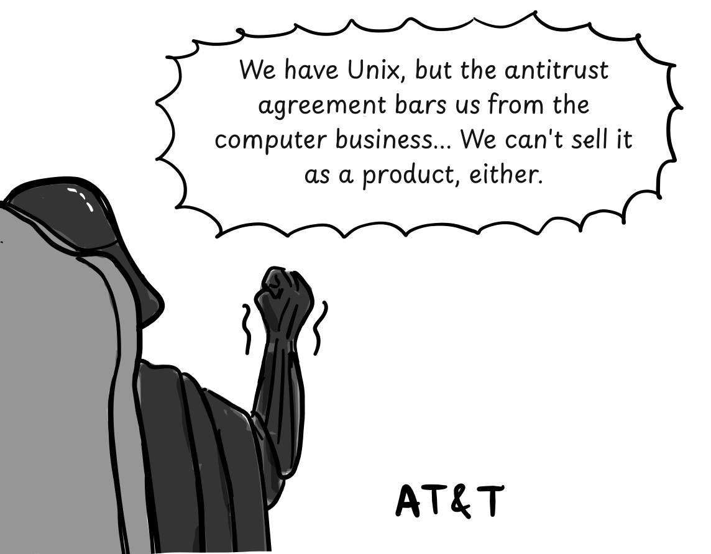

<!-- dialogue: att-business-restrictions -->
> We have Unix, but the antitrust agreement bars us from the computer business... We can't sell it as a product, either.
<!-- /dialogue -->

:::

**The second distribution: 2BSD**

After the first BSD distribution, Joy improved the Pascal system based on user feedback. He bundled it with vi (ex's visual mode), the C shell, and other tools to form the Second Berkeley Software Distribution, or 2BSD. Nearly seventy-five tapes were shipped over the following year.[&lbrack;1&rbrack;][1][&lbrack;5&rbrack;][5]

Joy did more than fix bugs. He handled every distribution request, copied BSD onto tapes, and mailed them out himself.

::::panels columns="2" label=""

:::panel rounded="true" style="border-width: 3px;border-color: black;padding: 0;"

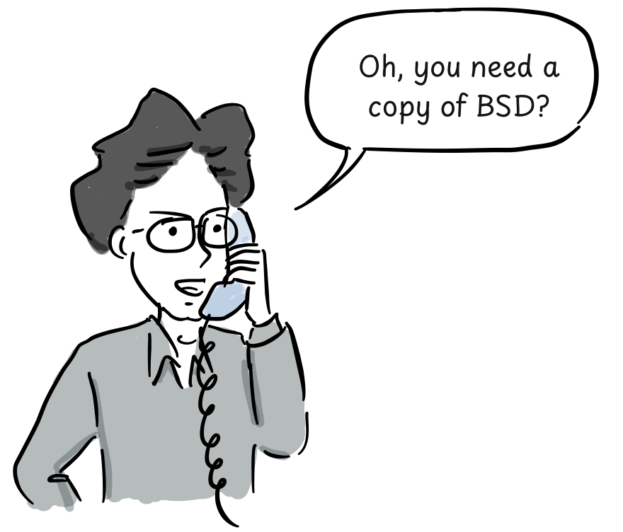

<!-- dialogue: bill-phone-order -->
> Oh, you need a copy of BSD?
<!-- /dialogue -->

:::

:::panel rounded="true" style="border-width: 3px;border-color: black;padding: 0;"

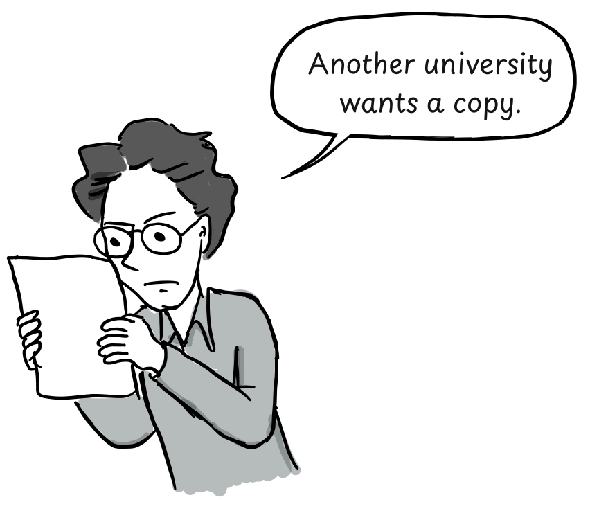

<!-- dialogue: bill-another-request -->
> Another university wants a copy.
<!-- /dialogue -->

:::

::::

:::panel rounded="true" style="border-width: 3px;border-color: black;"

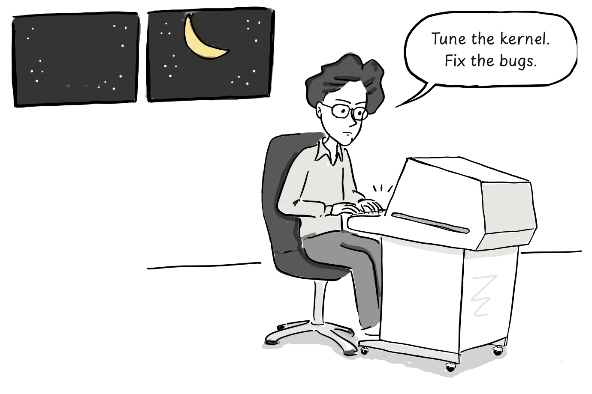

<!-- dialogue: bill-kernel-and-bugs -->
> Tune the kernel. Fix the bugs.
<!-- /dialogue -->

:::

:::panel rounded="true" style="border-width: 3px;border-color: black;"

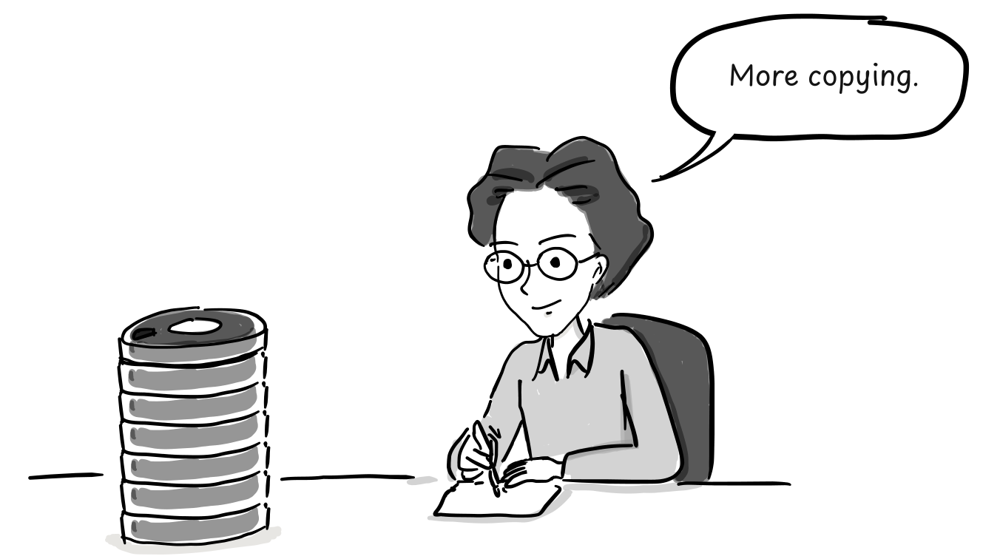

<!-- dialogue: bill-more-tapes -->
> More copying.
<!-- /dialogue -->

:::

**A VAX arrives at Berkeley, 1978**

:::panel rounded="true" style="border-width: 3px;border-color: black;"

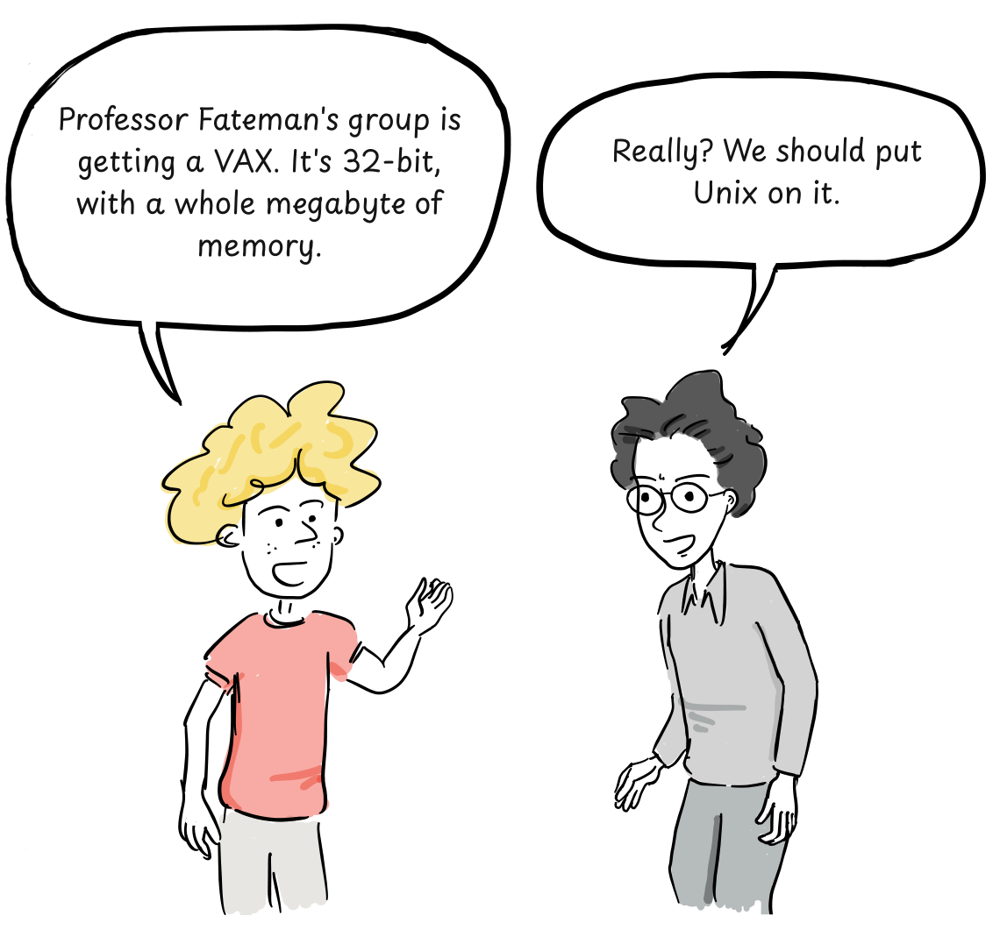

<!-- dialogue: colleague-vax-news -->
> Professor Fateman's group is getting a VAX. It's 32-bit, with a whole megabyte of memory.
<!-- /dialogue -->

<!-- dialogue: bill-unix-on-vax -->
> Really? We should put Unix on it.
<!-- /dialogue -->

:::

:::panel rounded="true" style="border-width: 3px;border-color: black;"

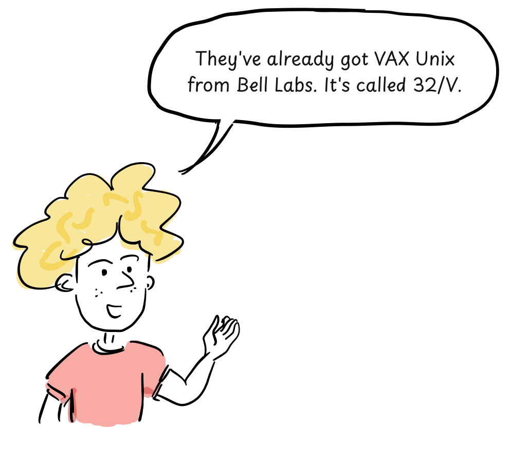

<!-- dialogue: colleague-unix-arrived -->
> They've already got VAX Unix from Bell Labs. It's called 32/V.
<!-- /dialogue -->

:::

:::panel rounded="true" style="border-width: 3px;border-color: black;"

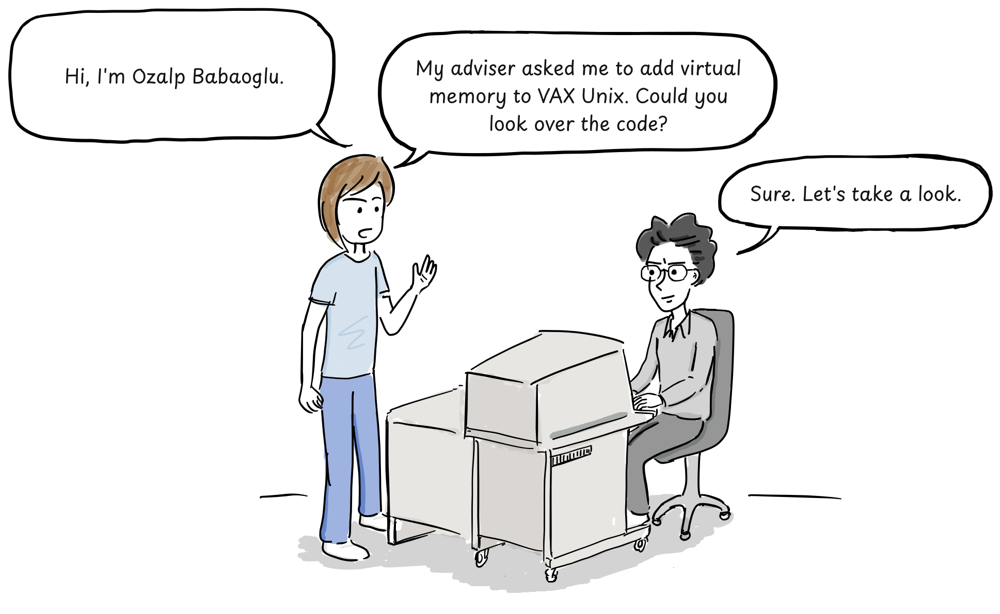

<!-- dialogue: ozalp-introduction -->
> Hi, I'm Ozalp Babaoglu.
<!-- /dialogue -->

<!-- dialogue: ozalp-review-request -->
> My adviser asked me to add virtual memory to VAX Unix. Could you look over the code?
<!-- /dialogue -->

<!-- dialogue: bill-review-code -->
> Sure. Let's take a look.
<!-- /dialogue -->

Babaoglu was a Berkeley graduate student working with Professor Domenico Ferrari. Joy helped him integrate the virtual-memory code into 32/V and debug it.[&lbrack;1&rbrack;][1][&lbrack;4&rbrack;][4]

:::

:::panel rounded="true" style="border-width: 3px;border-color: black;"

At the time, 32/V did not use the VAX hardware's virtual-memory capabilities. A program's address space was limited by physical memory, but Professor Richard Fateman's work on the computer algebra system [Macsyma](https://en.wikipedia.org/wiki/Macsyma) needed more. Virtual memory uses disk storage to give programs an address space larger than physical memory.[&lbrack;1&rbrack;][1]

Macsyma, developed at MIT beginning in the late 1960s, worked with symbolic expressions. It could factor expressions, compute derivatives, and perform integration.

Debugging continued through the holidays at the end of 1978.

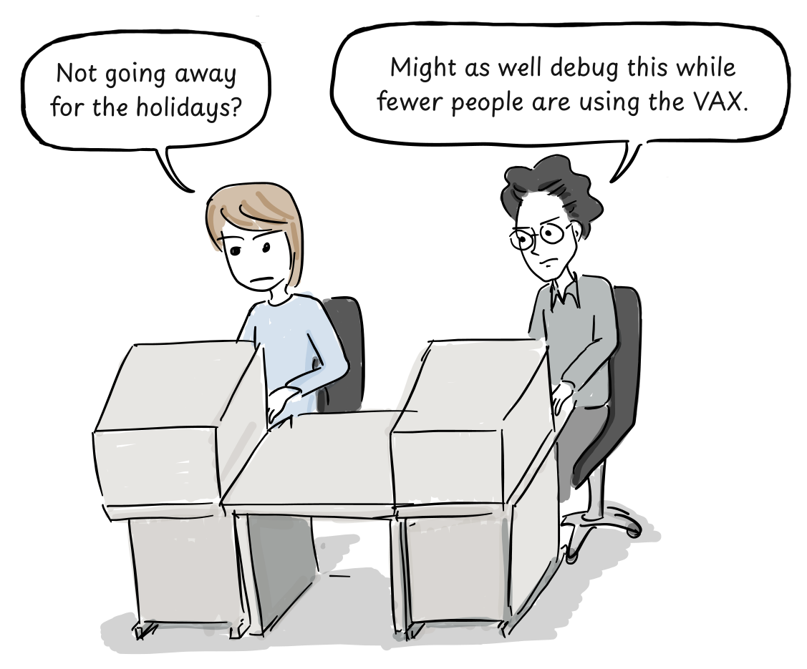

<!-- dialogue: ozalp-holiday-question -->
> Not going away for the holidays?
<!-- /dialogue -->

<!-- dialogue: bill-quiet-vax -->
> Might as well debug this while fewer people are using the VAX.
<!-- /dialogue -->

:::

:::panel rounded="true" style="border-width: 3px;border-color: black;"

By January 1979, most of the bugs had been fixed.[&lbrack;1&rbrack;][1]

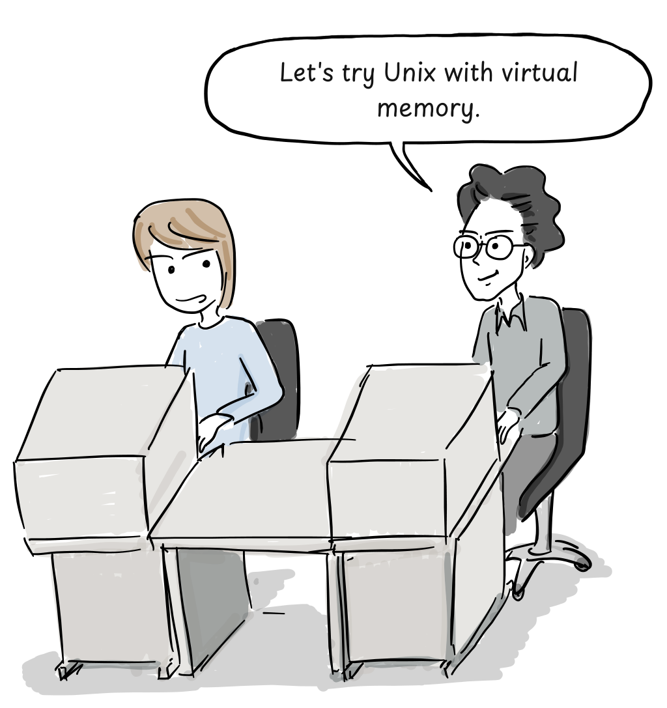

<!-- dialogue: bill-test-vm -->
> Let's try Unix with virtual memory.
<!-- /dialogue -->

:::

:::panel rounded="true" style="border-width: 3px;border-color: black;"

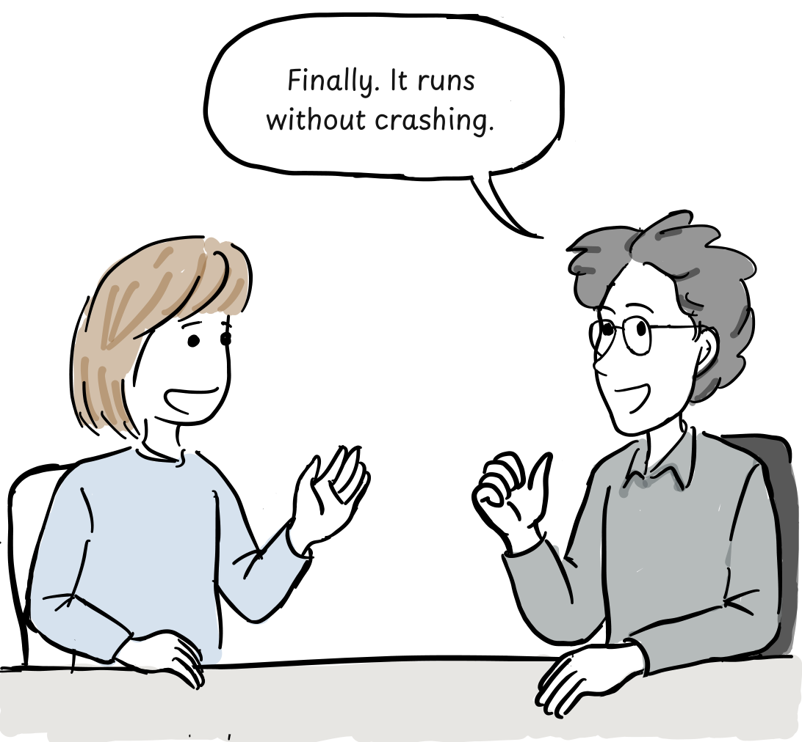

<!-- dialogue: bill-vm-working -->
> Finally. It runs without crashing.
<!-- /dialogue -->

:::

:::panel rounded="true" style="border-width: 3px;border-color: black;"

Joy ported ex, vi, the C shell, and other 2BSD tools to the VAX, while Peter Kessler and Marshall Kirk McKusick ported the Pascal system. These programs were bundled with the standard 32/V utilities and the virtual-memory kernel that Babaoglu and Joy had integrated and debugged. The result was 3BSD, which began shipping in December 1979.[&lbrack;1&rbrack;][1]

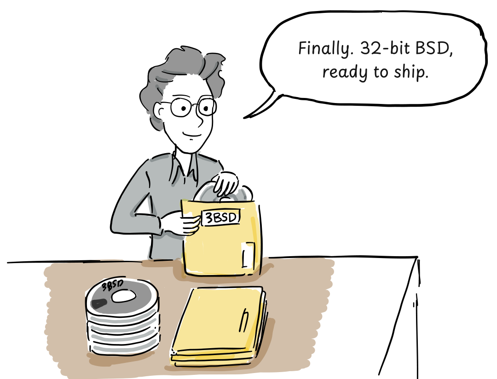

<!-- dialogue: bill-ship-3bsd -->
> At last, we can send these out.
<!-- /dialogue -->

:::

:::panel rounded="true" style="border-width: 3px;border-color: black;"

Since 1969, ARPANET had linked research institutions funded by DARPA, the Defense Advanced Research Projects Agency.[&lbrack;3&rbrack;][3] But these institutions used different computers and operating systems, so they often couldn't share software. Porting the existing software to new machines was also costly. DARPA became interested in Unix's portability, and took notice of Berkeley's successful distribution of 3BSD to research institutions.[&lbrack;1&rbrack;][1]

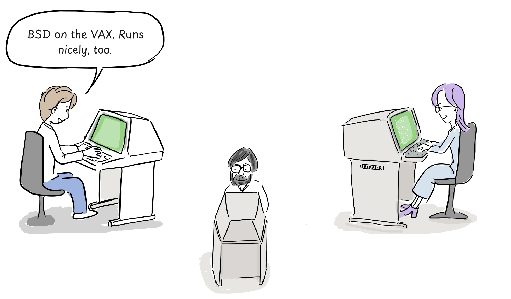

<!-- dialogue: researcher-bsd-on-vax -->
> BSD runs pretty well on this VAX.
<!-- /dialogue -->

:::

**References**

1. Marshall Kirk McKusick, [Twenty Years of Berkeley Unix][1], in *Open Sources: Voices from the Open Source Revolution*, 1999. [Korean edition, Hanbit Media](http://www.hanbit.co.kr/store/books/look.php?p_code=E5329835060), 2013.
2. Andrew Leonard, [BSD Unix: Power to the people, from the code][2], Salon, 2000.
3. SRI International, [ARPANET][3]. Its origins and the first transmission in 1969.
4. Ozalp Babaoglu, [Biographical note][4]. His Unix virtual-memory research as a Berkeley graduate student.
5. The Unix Heritage Society (TUHS), [Original 2BSD distribution archive][5]. The installation document `install.ms` and source code in `2bsd.tar.gz`.
6. Warren Toomey, [The Strange Birth and Long Life of Unix][6], IEEE Spectrum, 2011.

[1]: https://www.oreilly.com/openbook/opensources/book/kirkmck.html
[2]: https://www.salon.com/2000/05/16/chapter_2_part_one/
[3]: https://www.sri.com/hoi/arpanet/
[4]: https://www.cs.unibo.it/~babaoglu/
[5]: https://www.tuhs.org/Archive/Distributions/UCB/2BSD/
[6]: https://spectrum.ieee.org/the-strange-birth-and-long-life-of-unix
