- [BSD 유닉스 1화 – UC 버클리로 간 유닉스 코드](/ko/posts/11.%20BSD%20Unix%20Part%201%20-%20Unix%20Code%20Goes%20to%20UC%20Berkeley/)
- [BSD 유닉스 2화 – vi 에디터의 탄생](/ko/posts/12.%20BSD%20Unix%20Part%202%20-%20The%20Birth%20of%20the%20vi%20Editor/)
- [BSD 유닉스 3화 – BSD 유닉스 시작](/ko/posts/13.%20BSD%20Unix%20Part%203%20-%20The%20Beginning%20of%20BSD%20Unix/)

::::panels columns="2"
:::panel title="true" rounded="true" style="border-width: 3px;border-color: black;"
# BSD 유닉스 4화 - CSRG (Computer Systems  Research Group) 결성

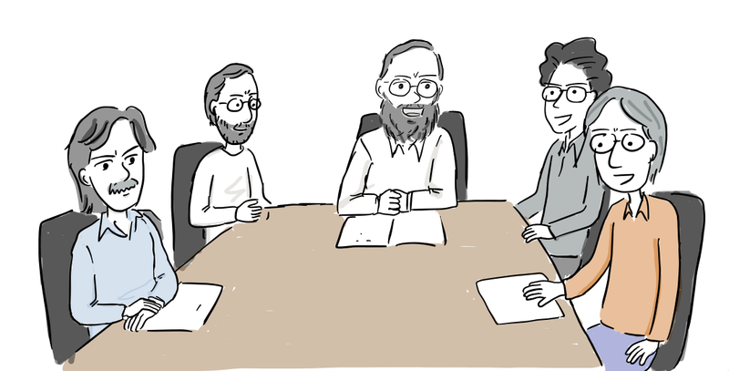

:::

:::panel rounded="true" style="border-width: 3px;border-color: black;"

1970년대 말, 미국방성 고등 방위 연구 계획국(DARPA, Defense Advanced Research Projects Agency)은 이미 구축된 [ARPANET][2]에서 연구기관 간 소프트웨어 공유를 개선하려 했다.

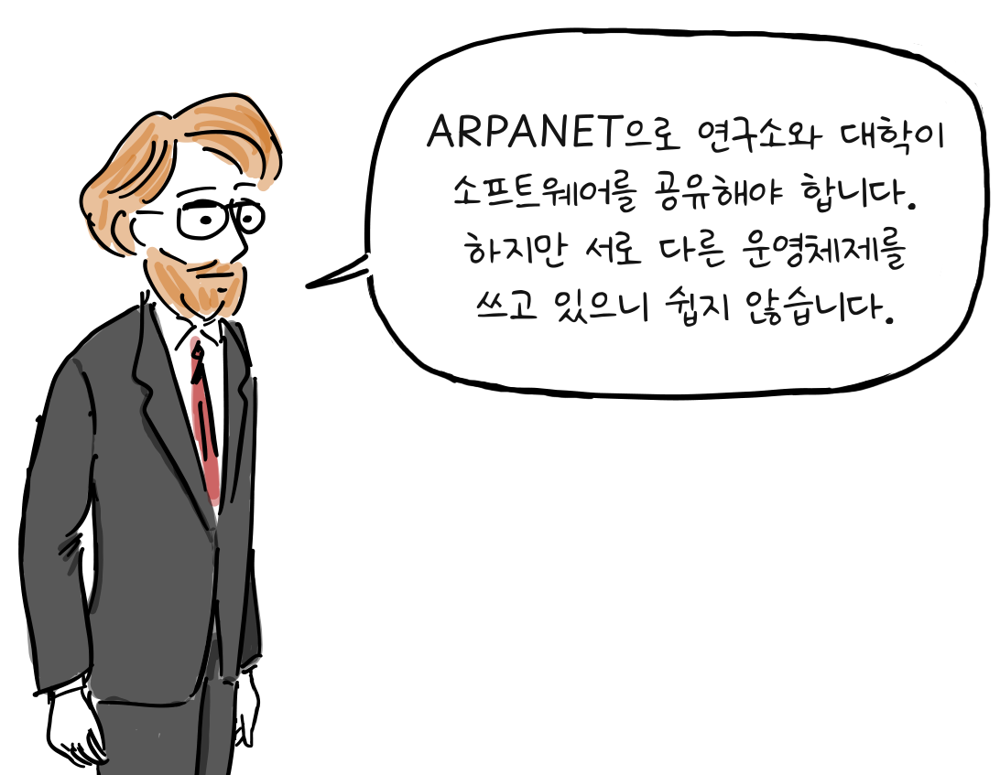

<!-- dialogue: darpa-research-cooperation -->
> 이 네트워크로 연구소와 대학이\
> 소프트웨어를 공유해야 합니다.\
> 하지만 서로 다른 운영체제를\
> 쓰고 있으니 쉽지 않습니다.
<!-- /dialogue -->

:::
::::

::::panels columns="2"
:::panel rounded="true" style="border-width: 3px;border-color: black;"

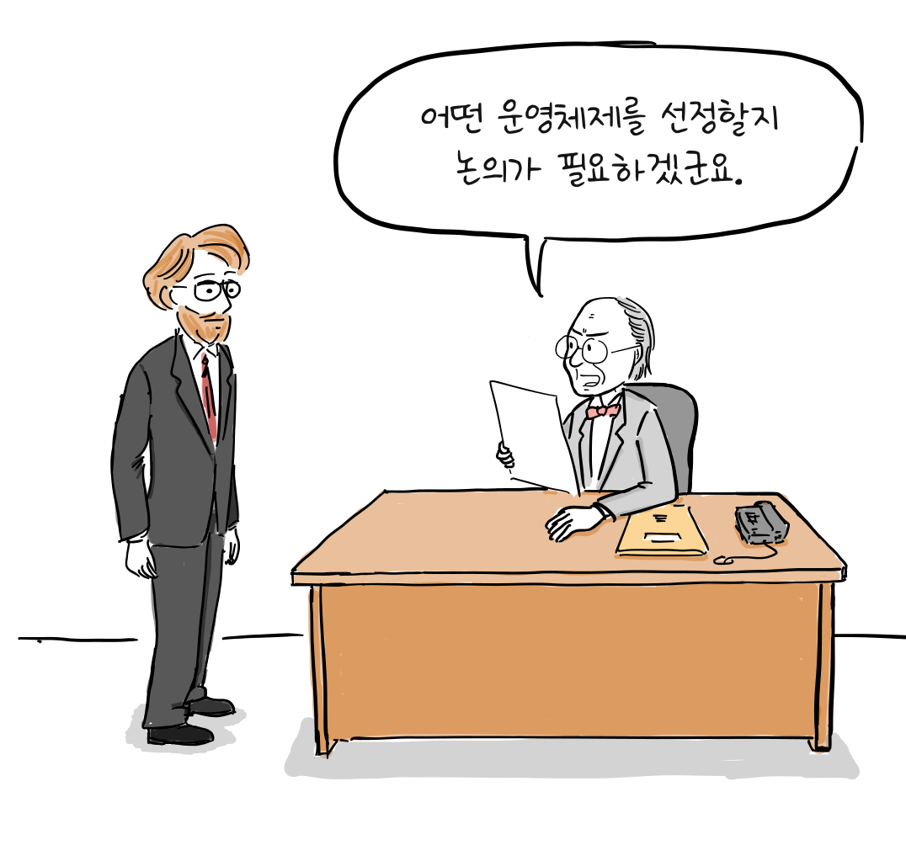

<!-- dialogue: darpa-os-choice -->
> 어떤 운영체제를 선정할지\
> 논의가 필요하겠군요.
<!-- /dialogue -->

:::

:::panel rounded="true" style="border-width: 3px;border-color: black;"

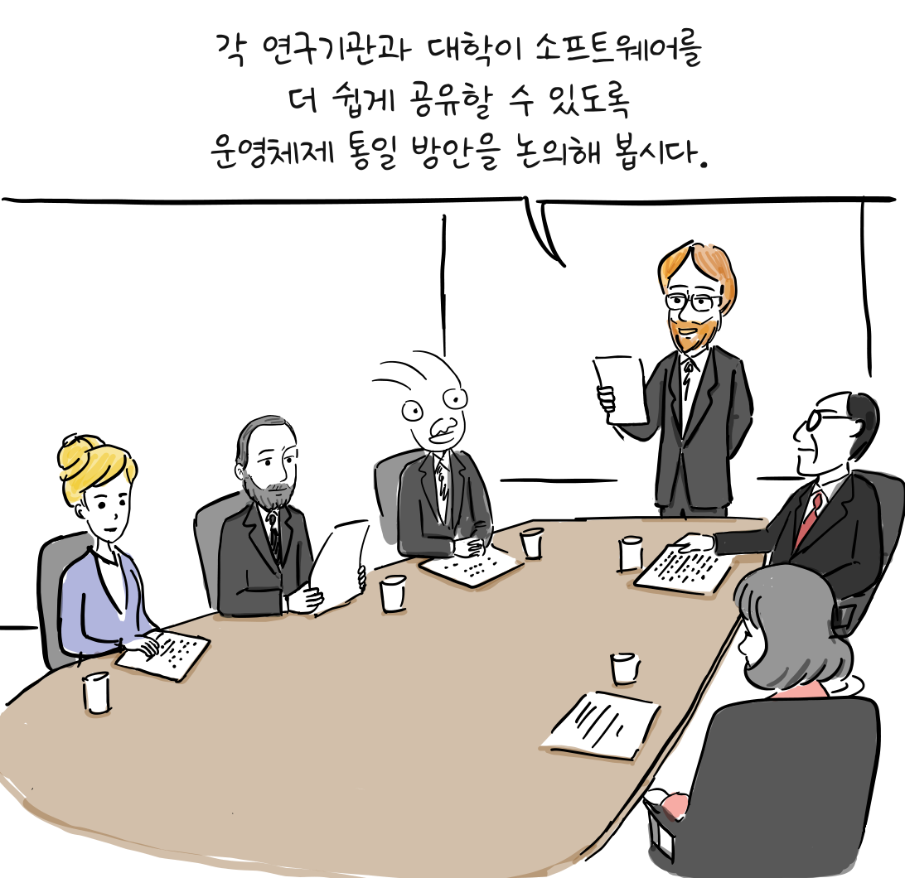

<!-- dialogue: darpa-meeting-agenda -->
> 아시다시피, 각 연구 기관에 있는 컴퓨터를\
> 교체할 시점이 다가오고 있습니다.
<!-- /dialogue -->

:::
::::

::::panels columns="2"
:::panel rounded="true" style="border-width: 3px;border-color: black;"

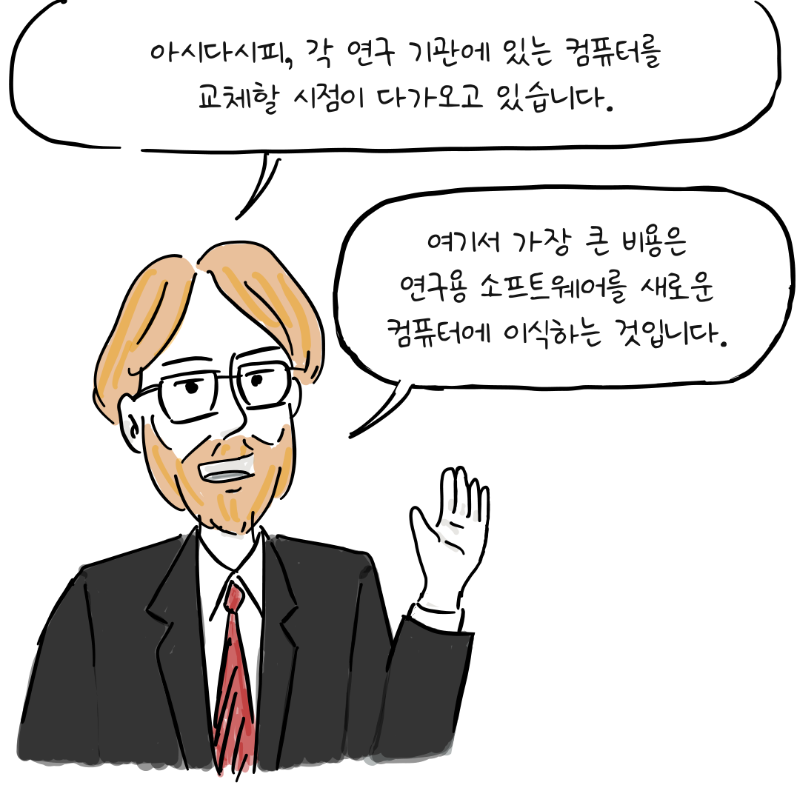

<!-- dialogue: darpa-replacement-cycle -->
> 여기서 가장 큰 비용은 연구용 소프트웨어를\
> 새로운 컴퓨터에 이식하는 것입니다.
<!-- /dialogue -->

<!-- dialogue: darpa-porting-cost -->
> 연구용 소프트웨어를\
> 쉽게 옮길 수 있는\
> 운영체제가 필요합니다.
<!-- /dialogue -->

:::

:::panel rounded="true" style="border-width: 3px;border-color: black;"

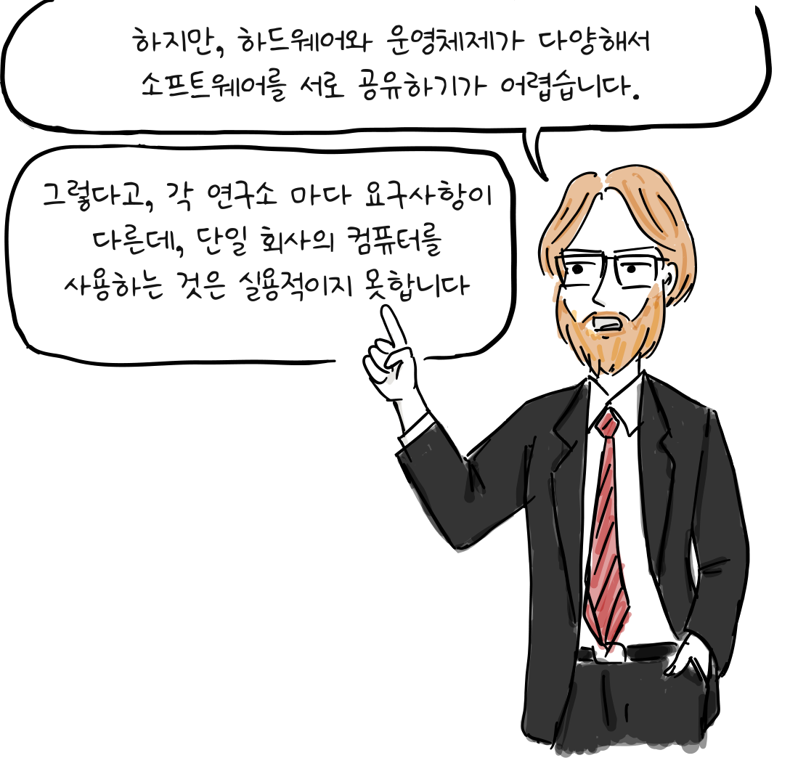

<!-- dialogue: darpa-software-sharing -->
> ARPANET이 있어도 하드웨어와 운영체제가 달라\
> 소프트웨어를 공유하기 어렵습니다.
<!-- /dialogue -->

<!-- dialogue: darpa-single-vendor -->
> 그렇다고, 각 연구소마다 요구사항이\
> 다른데, 단일 회사의 컴퓨터를\
> 사용하는 것은 실용적이지 못합니다
<!-- /dialogue -->

:::
::::

::::panels columns="2"
:::panel rounded="true" style="border-width: 3px;border-color: black;"

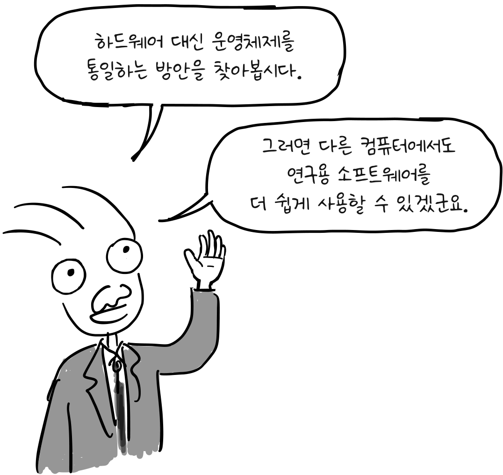

<!-- dialogue: researcher-common-os -->
> 연구기관들이 함께 사용할 수\
> 있는 운영체제가 필요합니다.
<!-- /dialogue -->

<!-- dialogue: researcher-shared-software -->
> 그러면 다른 컴퓨터에서도\
> 연구용 소프트웨어를\
> 더 쉽게 사용할 수 있겠군요.
<!-- /dialogue -->

:::

:::panel rounded="true" style="border-width: 3px;border-color: black;"

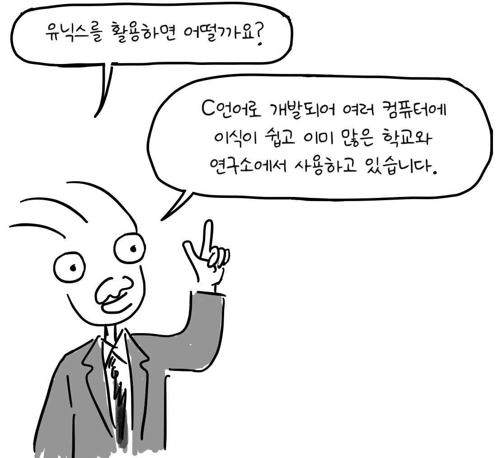

<!-- dialogue: researcher-unix-proposal -->
> 유닉스를 활용하면 어떨까요?
<!-- /dialogue -->

<!-- dialogue: researcher-unix-portability -->
> C언어로 개발되어 다양한 컴퓨터에\
> 이식이 쉽고 이미 여러 대학과\
> 연구소에서 사용하고 있습니다.
<!-- /dialogue -->

:::
::::

::::panels columns="2"
:::panel rounded="true" style="border-width: 3px;border-color: black;"

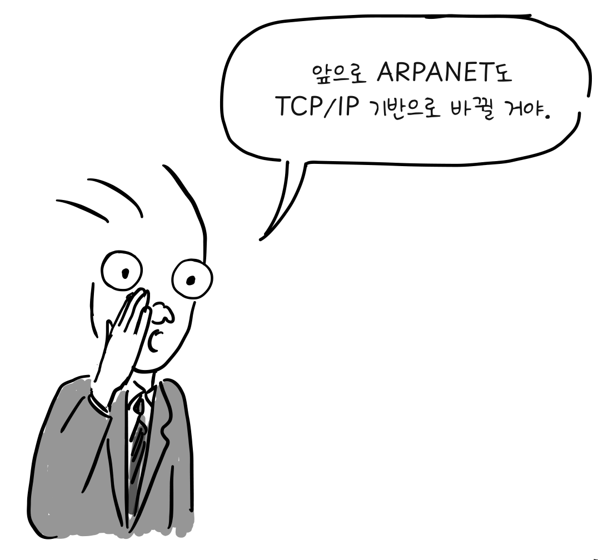

<!-- dialogue: researcher-existing-arpanet -->
> 그나저나, 앞으로 ARPANET도\
> TCP/IP 기반으로 바뀔 거야.
<!-- /dialogue -->

:::

:::panel rounded="true" style="border-width: 3px;border-color: black;"

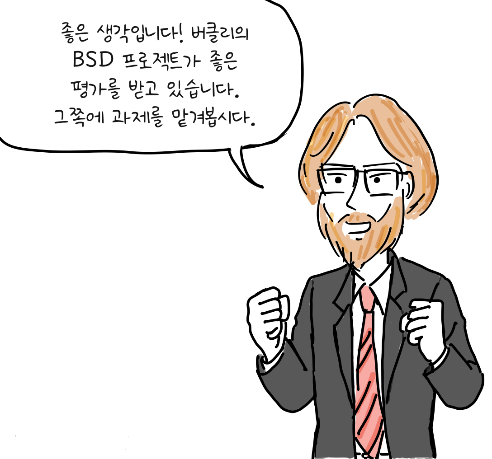

<!-- dialogue: darpa-berkeley-proposal -->
> 좋은 생각입니다! 버클리의\
> BSD 프로젝트가 좋은\
> 평가를 받고 있습니다.\
> 그쪽에 과제를 맡겨봅시다.
<!-- /dialogue -->

:::
::::

:::panel rounded="true" style="border-width: 3px;border-color: black;"

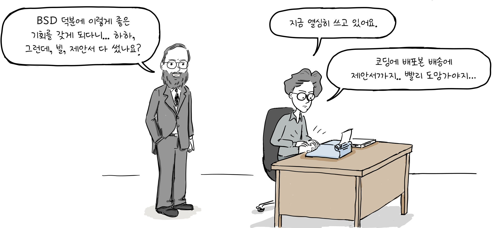

<!-- dialogue: fabry-proposal-question -->
> BSD 덕분에 이렇게 좋은\
> 기회를 갖게 되다니... 하하,\
> 그런데, 빌, 제안서 다 썼나요?
<!-- /dialogue -->

<!-- dialogue: bill-proposal-answer -->
> 지금 열심히 쓰고 있어요.
<!-- /dialogue -->

<!-- dialogue: bill-proposal-aside -->
> 코딩에 배포본 배송에\
> 제안서까지.. 빨리 도망가야지…
<!-- /dialogue -->

:::

::::panels columns="2"
:::panel rounded="true" style="border-width: 3px;border-color: black;"

마침내 1980년 4월 밥 패브리 교수는 미국방성 고등 방위 연구 계획국(DARPA)과 유닉스 향상에 대한 계약을 체결한다.

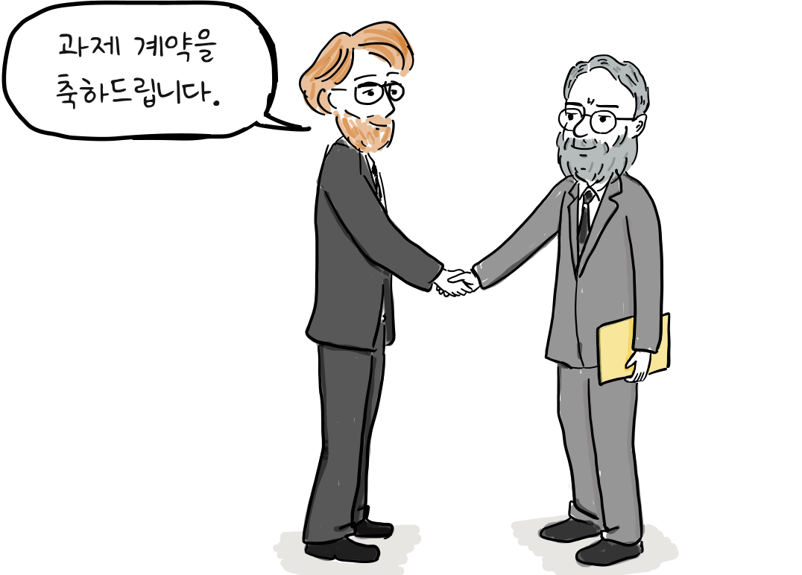

<!-- dialogue: darpa-contract-congratulations -->
> 과제 계약을\
> 축하드립니다.
<!-- /dialogue -->

:::

:::panel rounded="true" style="border-width: 3px;border-color: black;"

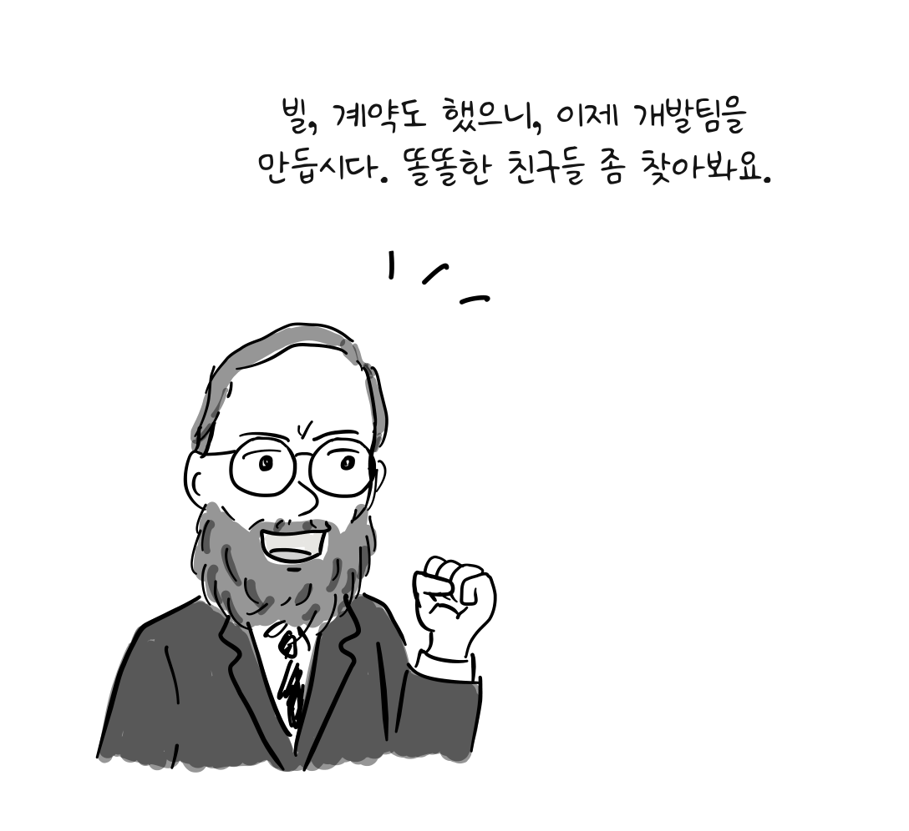

<!-- dialogue: fabry-recruit-team -->
> 빌, 계약도 했으니, 이제 개발팀을\
> 만듭시다. 똘똘한 친구들 좀 찾아봐요.
<!-- /dialogue -->

:::
::::

:::panel rounded="true" style="border-width: 3px;border-color: black;"

버클리대 [밥 패브리](https://en.wikipedia.org/wiki/Bob_Fabry) 교수는 UC 버클리 대학 내에 CSRG(Computer Systems Research Group)라는 연구 그룹을 만들어 과제를 수행하게 된다. 후일 CSRG를 이끌게 되는 [키스 보스틱(Keith Bostic)](https://en.wikipedia.org/wiki/Keith_Bostic_(software_engineer)), [빌 조이(Bill Joy)](https://en.wikipedia.org/wiki/Bill_Joy), [마셜 커크 매큐직(Marshall Kirk McKusick)](https://en.wikipedia.org/wiki/Marshall_Kirk_McKusick), [사무엘 J 래플러(Samuel J Leffler)](https://en.wikipedia.org/wiki/Sam_Leffler), [마이클 J. 캐럴스(Michael J. Karels)](https://en.wikipedia.org/wiki/Mike_Karels) 등이 과제에 참여했다.

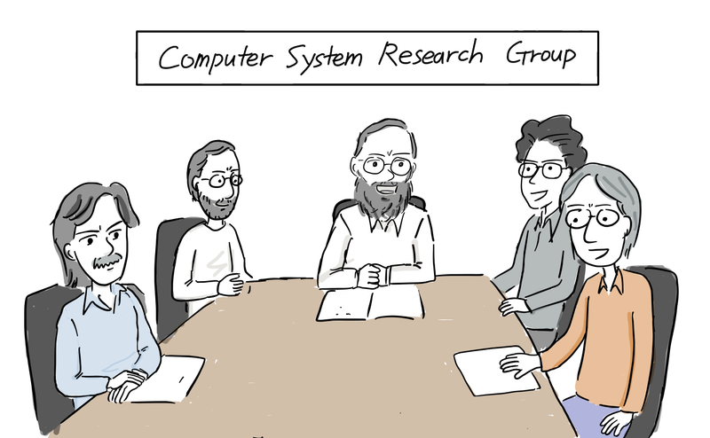

:::

:::panel rounded="true" style="border-width: 3px;border-color: black;"

물론, 과제를 수행하는 일은 쉽지 않았다. 패브리 교수는 연구원들이 개발에 집중하도록 대학의 관료주의에 맞서고 AT&T와의 갈등을 조율했으며, DARPA의 연구비 지원이 이어지도록 도왔다.

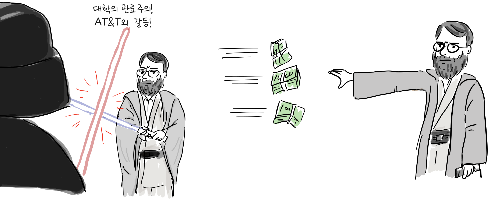

<!-- dialogue: fabry-administration-and-licensing -->
> 대학의 관료주의!\
> AT&T와 갈등!
<!-- /dialogue -->

:::

:::panel rounded="true" style="border-width: 3px;border-color: black;"

1980년 10월 출시된 4BSD에는 작업 제어, 자동 리부팅, 1K 블록 파일시스템 등이 포함되었다. AT&T와 합의한 조건에 따라 유닉스 소스코드도 함께 배포했으며, 약 9개월 동안 150개 가까이가 배송되었다.

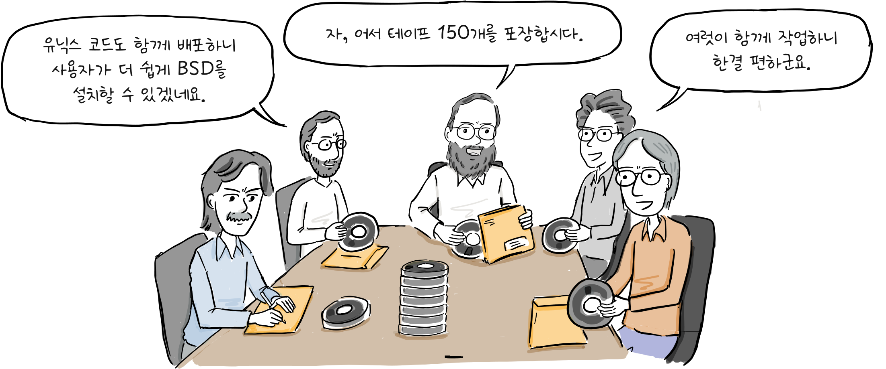

<!-- dialogue: researcher-unix-included -->
> 유닉스 코드도 함께 배포하니\
> 사용자가 더 쉽게 BSD를\
> 설치할 수 있겠네요.
<!-- /dialogue -->

<!-- dialogue: fabry-pack-tapes -->
> 자, 어서 테이프 150개를 포장합시다.
<!-- /dialogue -->

<!-- dialogue: bill-shared-work -->
> 여럿이 함께 작업하니\
> 한결 편하군요.
<!-- /dialogue -->

:::

::::panels columns="2"
:::panel rounded="true" style="border-width: 3px;border-color: black;"

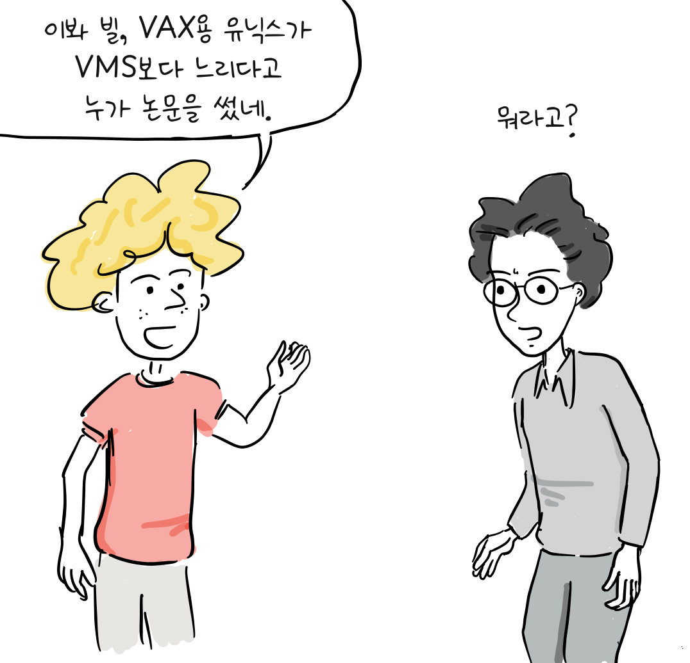

<!-- dialogue: colleague-vms-benchmark -->
> 이봐 빌, VAX용 유닉스가\
> VMS보다 느리다고\
> 누가 논문을 썼네.
<!-- /dialogue -->

<!-- dialogue: bill-benchmark-surprise -->
> 뭐라고?
<!-- /dialogue -->

:::

:::panel rounded="true" style="border-width: 3px;border-color: black;"

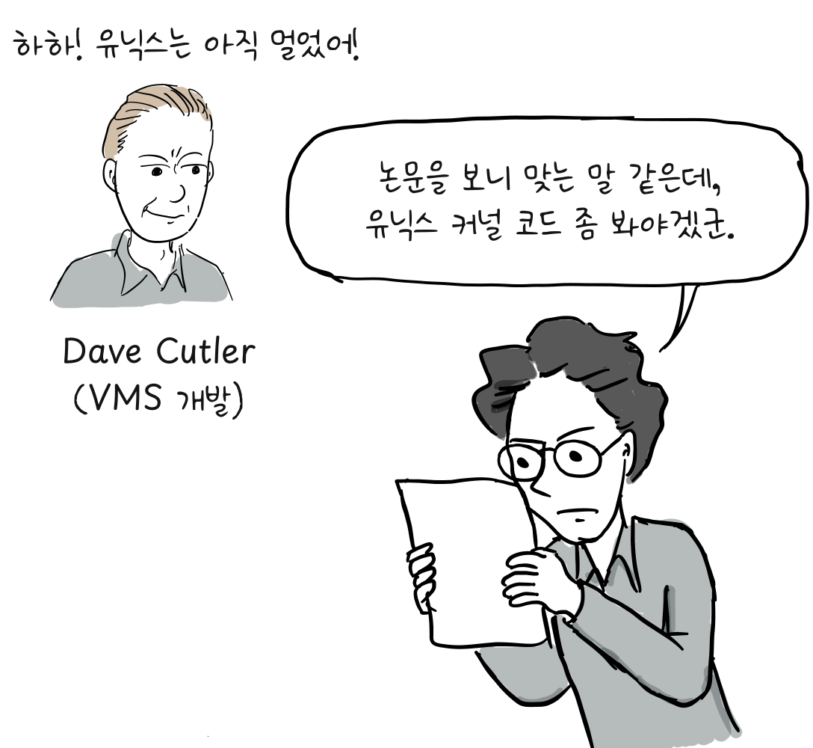

<!-- dialogue: dave-cutler-taunt -->
> 하하! 유닉스는 아직 멀었어!
<!-- /dialogue -->

<!-- dialogue: dave-cutler-label -->
> Dave Cutler\
> (VMS 개발)
<!-- /dialogue -->

<!-- dialogue: bill-read-benchmark -->
> 논문을 보니 맞는 말 같은데,\
> 유닉스 커널 코드 좀 봐야겠군.
<!-- /dialogue -->

:::
::::

참고: SRI의 데이비드 캐슈턴(David Kashtan)은 VAX에서 유닉스와 VMS의 성능을 비교했다. 이 결과를 계기로 빌 조이는 커널을 개선했고, 같은 벤치마크에서 VMS에 버금가는 성능을 얻었다. 출처: [참고문헌 1번](#reference-1).

:::panel rounded="true" style="border-width: 3px;border-color: black;"

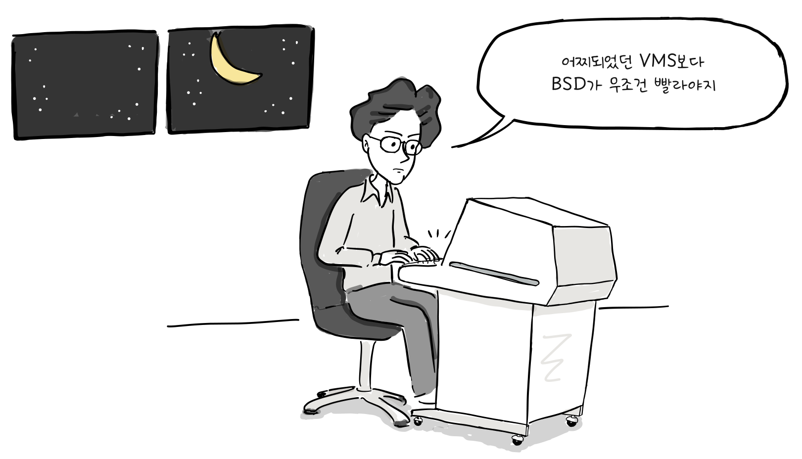

<!-- dialogue: bill-tuning-goal -->
> 어찌되었던 VMS보다\
> BSD가 무조건 빨라야지
<!-- /dialogue -->

:::

:::panel rounded="true" style="border-width: 3px;border-color: black;"

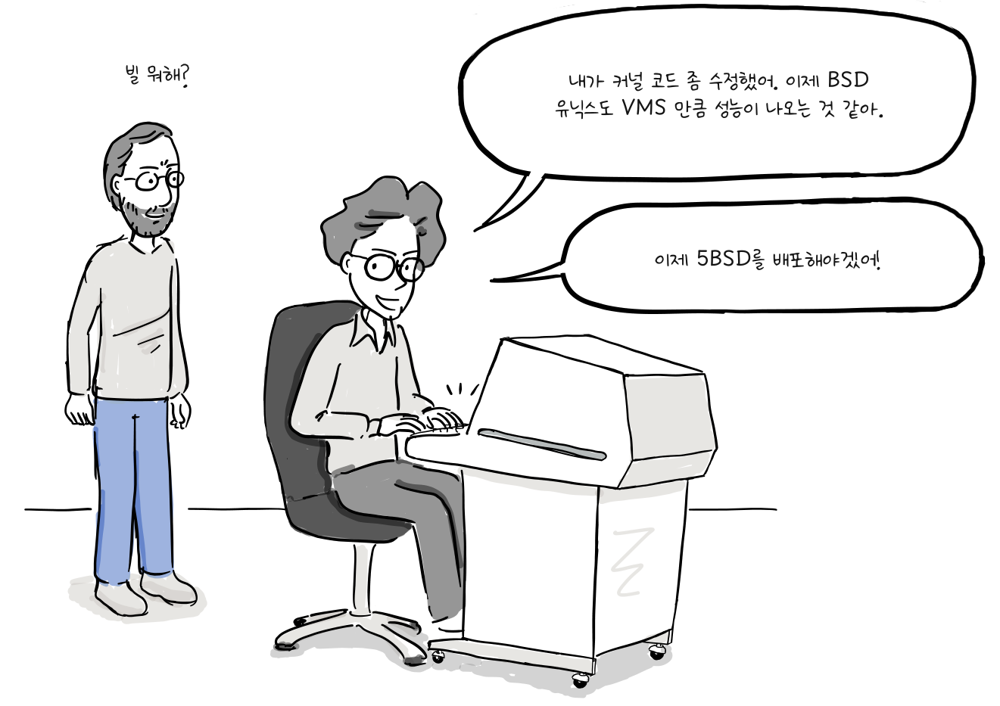

<!-- dialogue: colleague-bill-working -->
> 빌 뭐해?
<!-- /dialogue -->

<!-- dialogue: bill-kernel-performance -->
> 내가 커널 코드 좀 수정했어. 이제 BSD\
> 유닉스도 VMS 만큼 성능이 나오는 것 같아.
<!-- /dialogue -->

<!-- dialogue: bill-next-release -->
> 이제 5BSD를 배포해야겠어!
<!-- /dialogue -->

:::

::::panels columns="2"
:::panel rounded="true" style="border-width: 3px;border-color: black;"

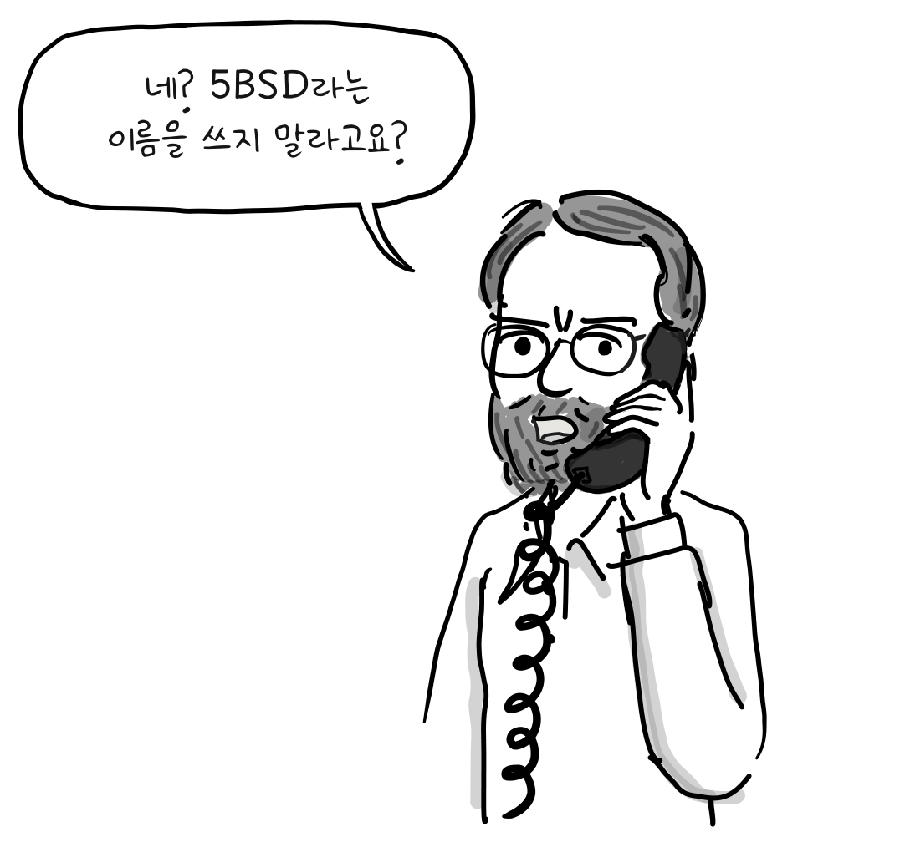

<!-- dialogue: fabry-5bsd-objection -->
> 네? 5BSD라는\
> 이름을 쓰지 말라고요?
<!-- /dialogue -->

:::

:::panel rounded="true" style="border-width: 3px;border-color: black;"

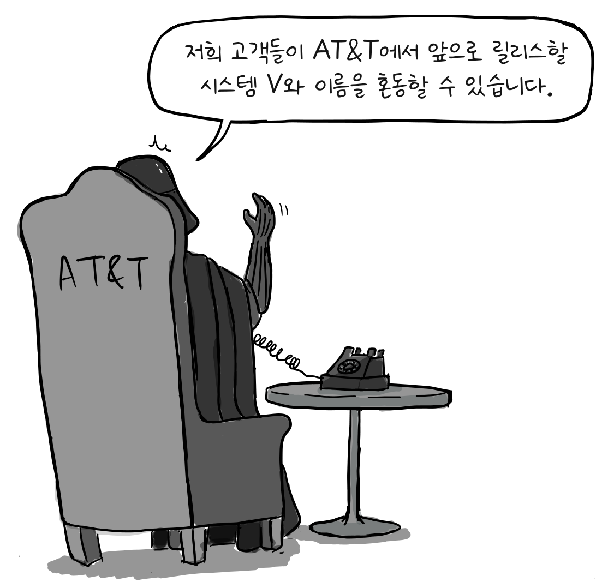

<!-- dialogue: att-customer-confusion -->
> 저희 고객들이 AT&T에서 앞으로 릴리스할\
> 시스템 V와 이름을 혼동할 수 있습니다.
<!-- /dialogue -->

:::
::::

:::panel rounded="true" style="border-width: 3px;border-color: black;"

BSD는 많은 코드를 추가하고 수정했지만, 여전히 AT&T의 유닉스 코드를 포함하고 있었다. 따라서 배포와 사용에는 AT&T의 라이선스 조건이 적용되었다.

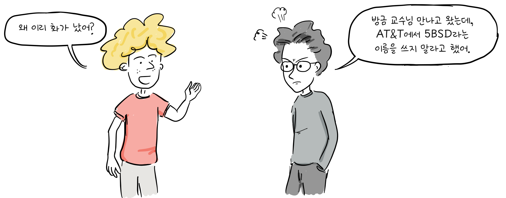

<!-- dialogue: colleague-bill-frustrated -->
> 왜 이리 화가 났어?
<!-- /dialogue -->

<!-- dialogue: bill-name-rejected -->
> 방금 교수님 만나고 왔는데,\
> AT&T에서 5BSD라는\
> 이름을 쓰지 말라고 했어.
<!-- /dialogue -->

:::

::::panels columns="2"
:::panel rounded="true" style="border-width: 3px;border-color: black;"

결국 성능을 개선한 다음 배포판은 5BSD 대신 4.1BSD라는 이름으로 1981년 6월 출시된다. [1][1]

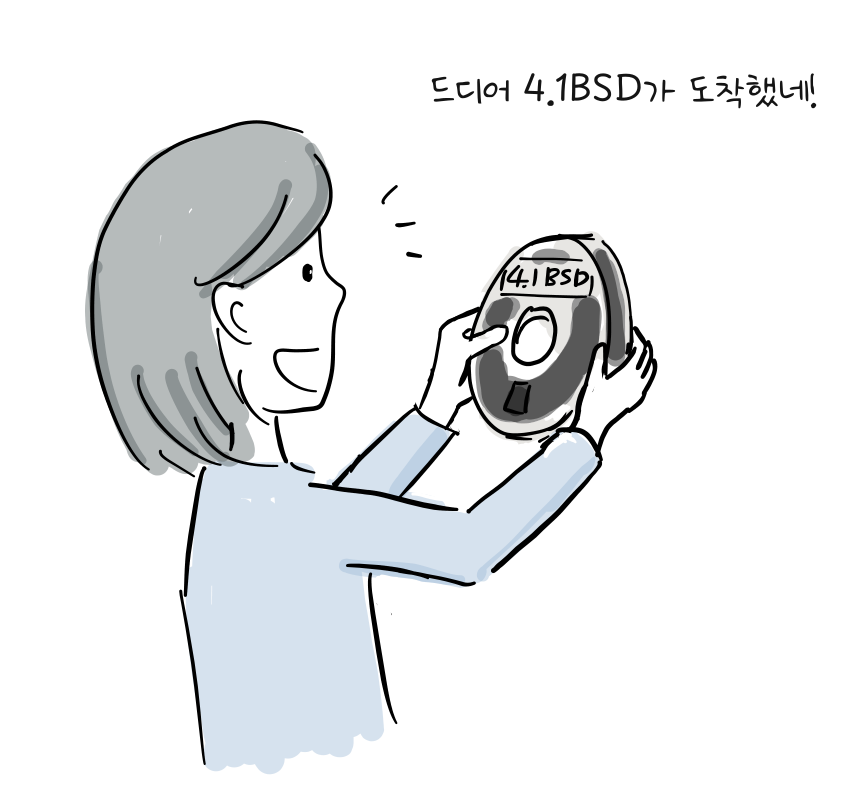

<!-- dialogue: user-41bsd-arrived -->
> 드디어 4.1BSD가 도착했네!
<!-- /dialogue -->

:::

:::panel rounded="true" style="border-width: 3px;border-color: black;"

이처럼 유닉스는 벨 연구소에서 개발되었지만, 소스코드와 함께 배포되었기 때문에 누구나 소스 코드를 고칠 수 있었다. 그 결과, 수많은 외부 기여자가 새로운 기능과 개선 사항을 더하면서 유닉스는 빠르게 발전할 수 있었다.

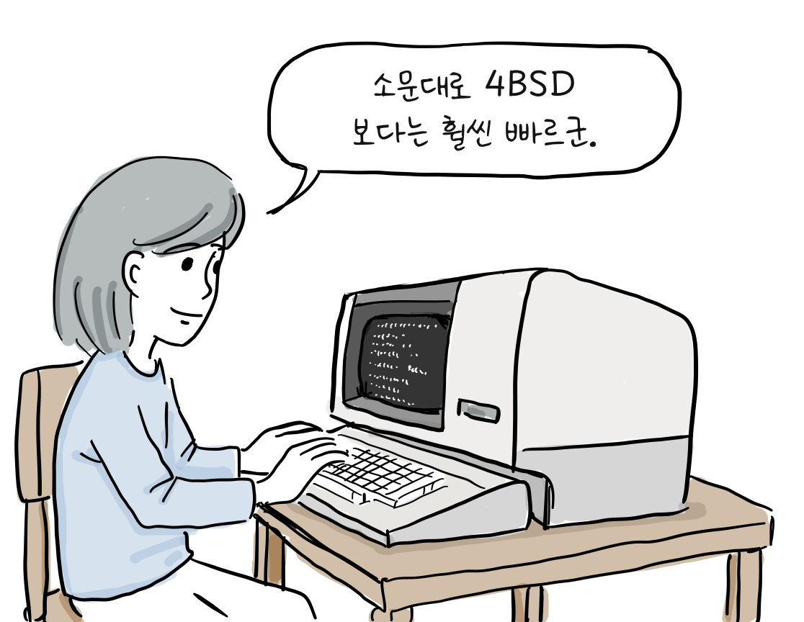

<!-- dialogue: user-41bsd-faster -->
> 소문대로 4BSD\
> 보다는 훨씬 빠르군.
<!-- /dialogue -->

:::
::::

**참고 문헌**

1. 마샬 커크 맥퀴식, [Twenty Years of Berkeley Unix][1], 《Open Sources: Voices from the Open Source Revolution》, 1999. DARPA 계약, CSRG, 4BSD와 4.1BSD의 개발 및 배포. [한국어판: 《오픈소스 혁명의 목소리》, 한빛출판사](http://www.hanbit.co.kr/store/books/look.php?p_code=E5329835060), 2013.
2. SRI International, [ARPANET][2]. 1969년의 첫 통신과 연구기관을 연결한 네트워크의 역사.
3. Andrew Leonard, [BSD Unix: Power to the people, from the code][3], Salon, 2000.
4. The Unix Heritage Society, [System V][4]. System V Release 1의 첫 출시: 1983년 1월.

[1]: https://www.oreilly.com/openbook/opensources/book/kirkmck.html
[2]: https://www.sri.com/hoi/arpanet/
[3]: https://www.salon.com/2000/05/16/chapter_2_part_one/
[4]: https://wiki.tuhs.org/doku.php?id=systems:sys5
