- [BSD Unix, Part 1 - Unix Code Goes to UC Berkeley](/posts/11.%20BSD%20Unix%20Part%201%20-%20Unix%20Code%20Goes%20to%20UC%20Berkeley/)
- [BSD Unix, Part 2 - The Birth of the vi Editor](/posts/12.%20BSD%20Unix%20Part%202%20-%20The%20Birth%20of%20the%20vi%20Editor/)
- [BSD Unix, Part 3 - The Beginning of BSD Unix](/posts/13.%20BSD%20Unix%20Part%203%20-%20The%20Beginning%20of%20BSD%20Unix/)

::::panels columns="2"
:::panel title="true" rounded="true" style="border-width: 3px;border-color: black;"
# BSD Unix, Part 4 CSRG (Computer Systems Research Group)

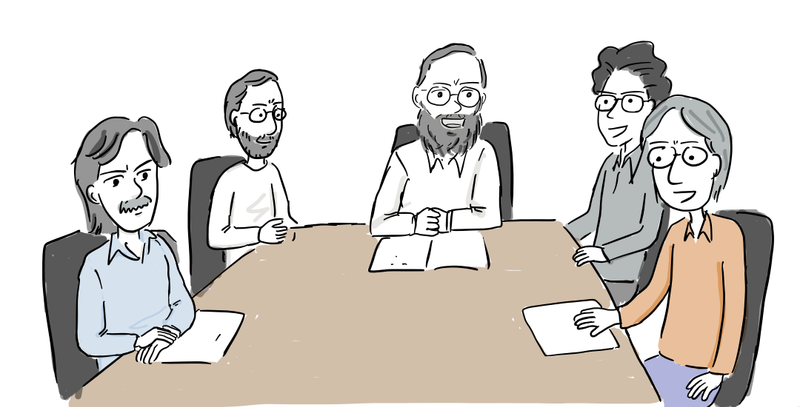

:::

:::panel rounded="true" style="border-width: 3px;border-color: black;"

In the late 1970s, the Defense Advanced Research Projects Agency (DARPA) wanted research institutions to share software more easily over [ARPANET][2].

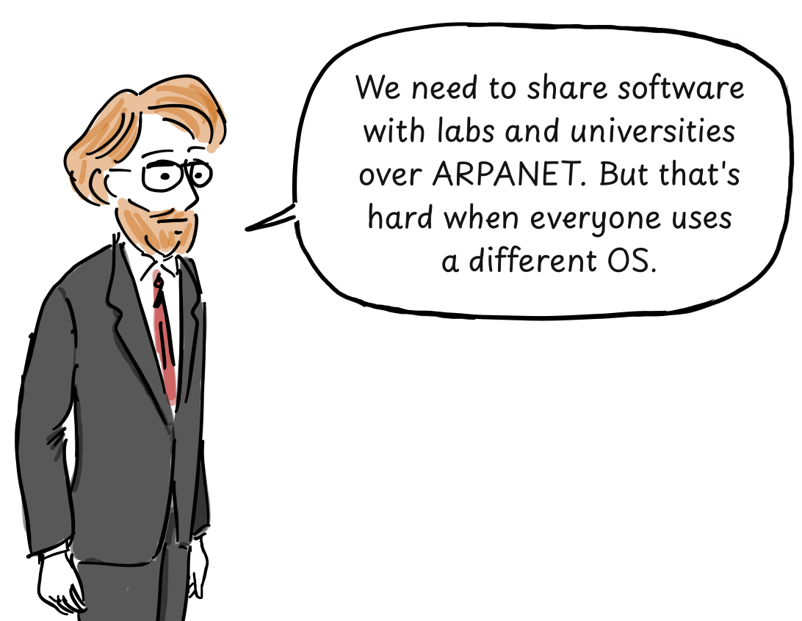

<!-- dialogue: darpa-research-cooperation -->
> We need to share software\
> with labs and universities\
> over ARPANET. But that's\
> hard when everyone uses\
> a different OS.
<!-- /dialogue -->

:::
::::

::::panels columns="2"
:::panel rounded="true" style="border-width: 3px;border-color: black;"

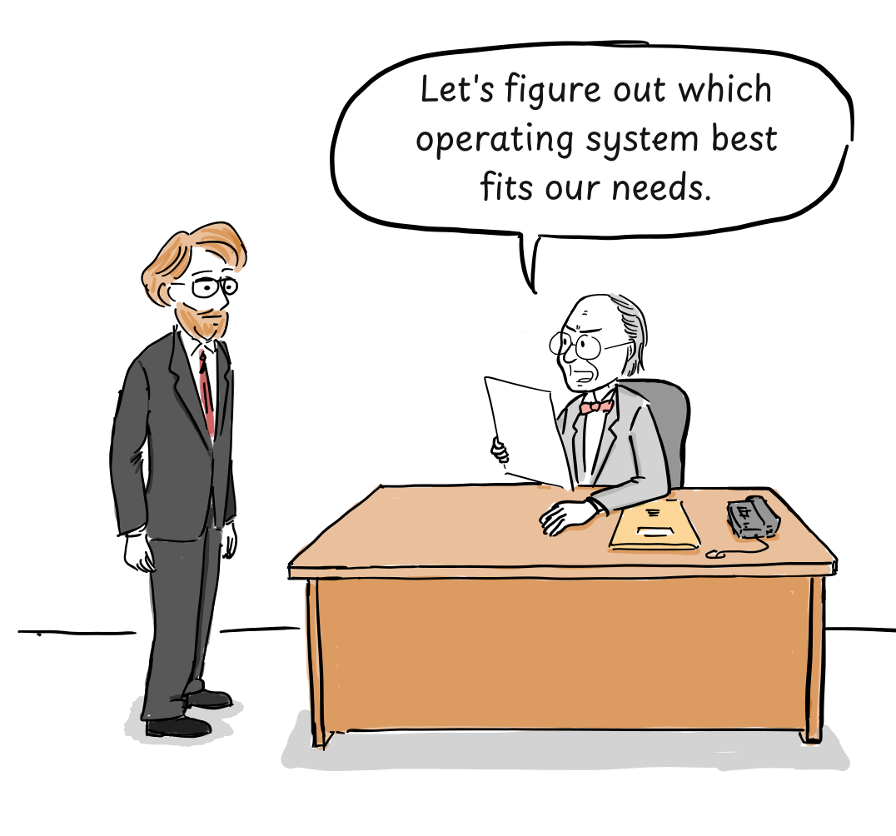

<!-- dialogue: darpa-os-choice -->
> Let's figure out which\
> operating system best\
> fits our needs.
<!-- /dialogue -->

:::

:::panel rounded="true" style="border-width: 3px;border-color: black;"

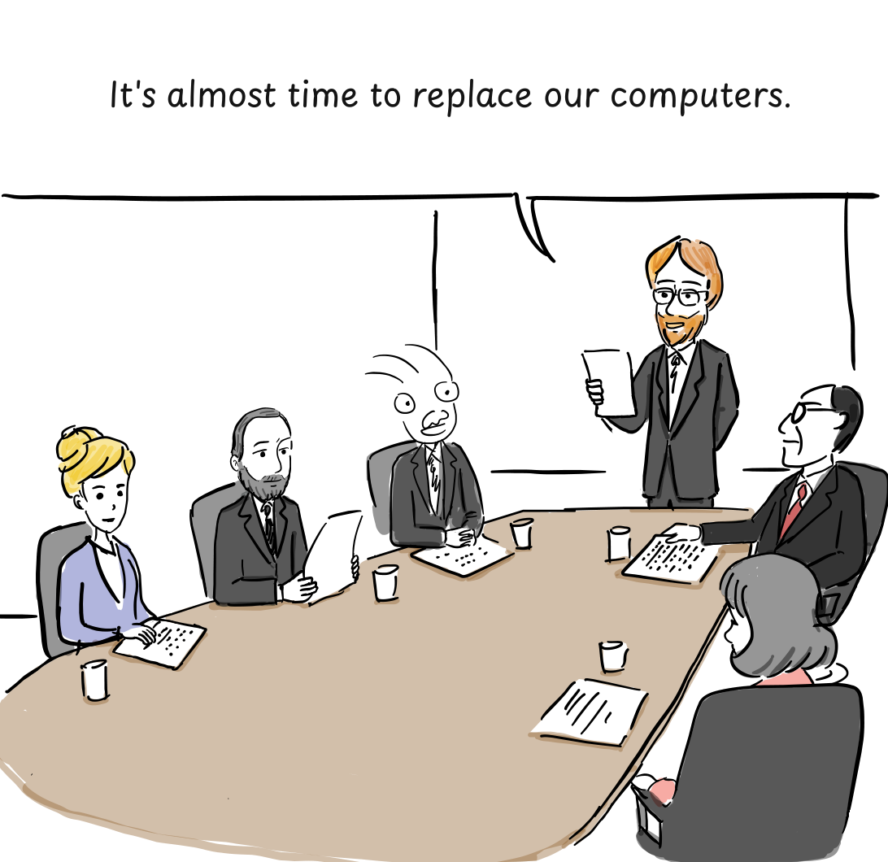

<!-- dialogue: darpa-meeting-agenda -->
> It's almost time to replace our computers.
<!-- /dialogue -->

:::
::::

::::panels columns="2"
:::panel rounded="true" style="border-width: 3px;border-color: black;"

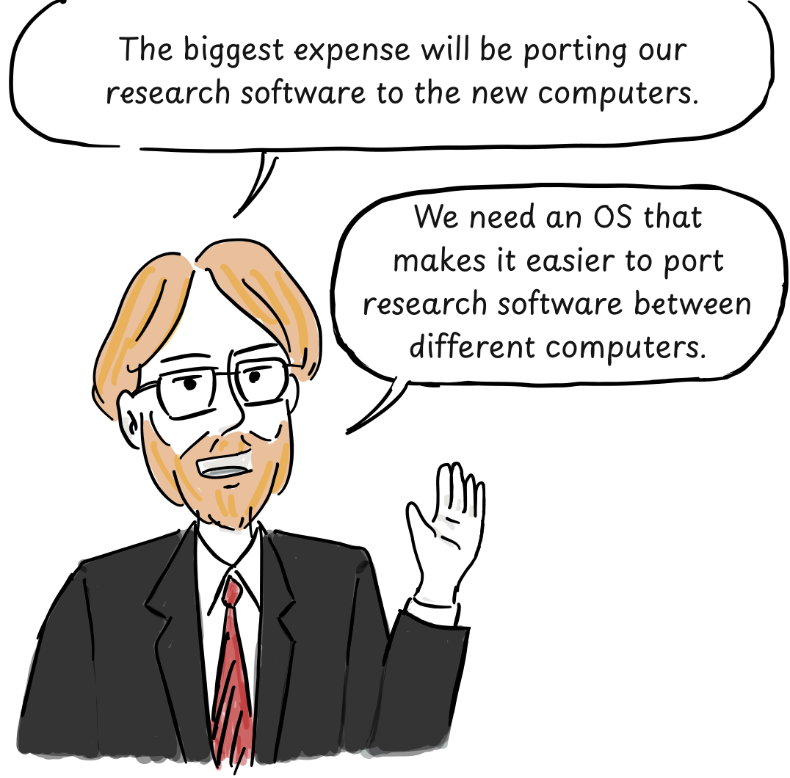

<!-- dialogue: darpa-replacement-cycle -->
> The biggest expense will be porting our\
> research software to the new computers.
<!-- /dialogue -->

<!-- dialogue: darpa-porting-cost -->
> We need an OS that\
> makes it easier to port\
> research software between\
> different computers.
<!-- /dialogue -->

:::

:::panel rounded="true" style="border-width: 3px;border-color: black;"

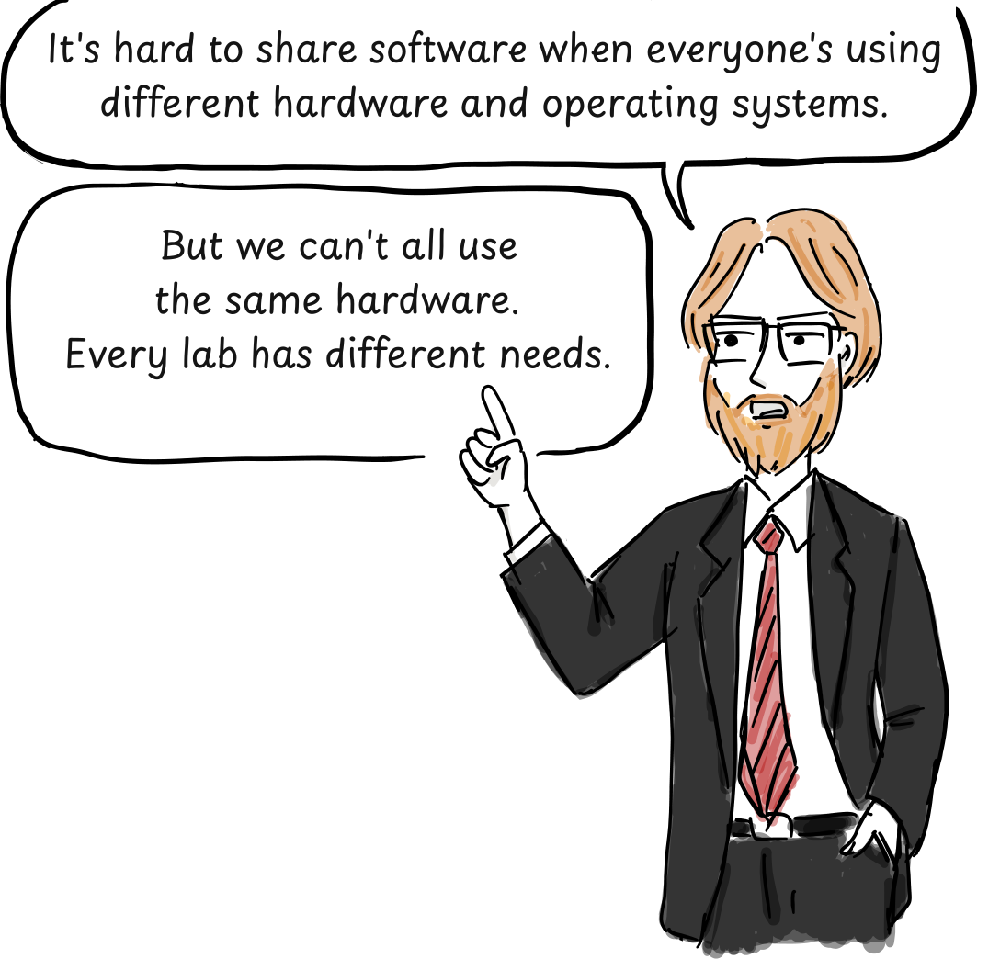

<!-- dialogue: darpa-software-sharing -->
> Even with ARPANET, sharing software is hard\
> when hardware and operating systems differ.
<!-- /dialogue -->

<!-- dialogue: darpa-single-vendor -->
> But we can't all use\
> the same hardware.\
> Every lab has different needs.
<!-- /dialogue -->

:::
::::

::::panels columns="2"
:::panel rounded="true" style="border-width: 3px;border-color: black;"

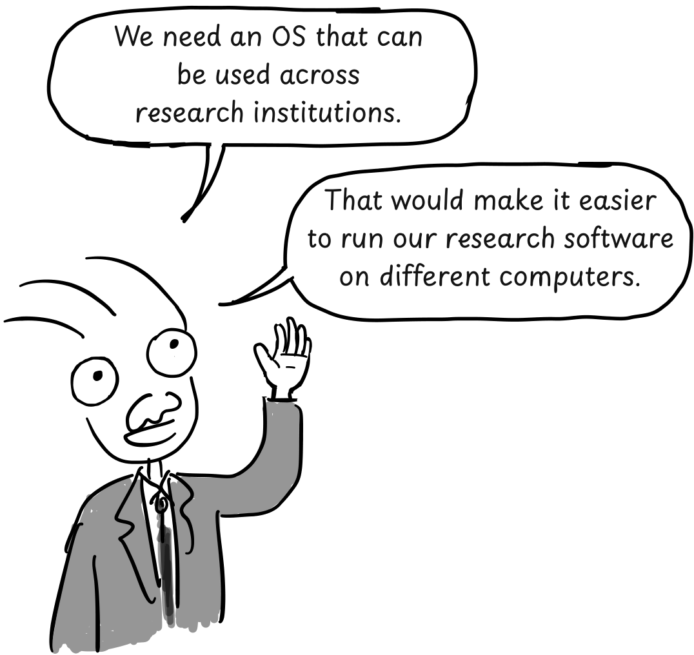

<!-- dialogue: researcher-common-os -->
> We need an OS that can\
> be used across\
> research institutions.
<!-- /dialogue -->

<!-- dialogue: researcher-shared-software -->
> That would make it easier\
> to run our research software\
> on different computers.
<!-- /dialogue -->

:::

:::panel rounded="true" style="border-width: 3px;border-color: black;"

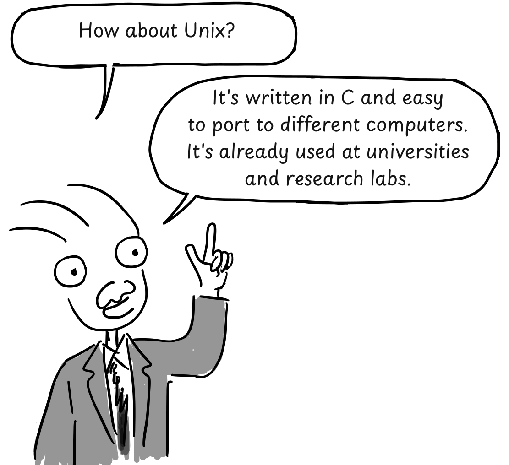

<!-- dialogue: researcher-unix-proposal -->
> How about Unix?
<!-- /dialogue -->

<!-- dialogue: researcher-unix-portability -->
> It's written in C and easy\
> to port to different computers.\
> It's already used at universities\
> and research labs.
<!-- /dialogue -->

:::
::::

::::panels columns="2"
:::panel rounded="true" style="border-width: 3px;border-color: black;"

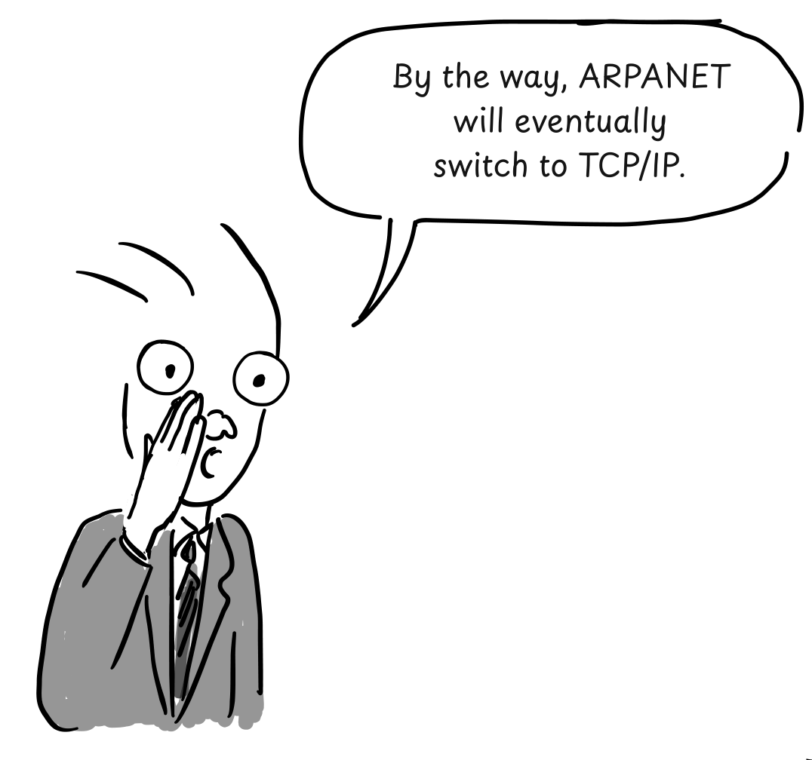

<!-- dialogue: researcher-existing-arpanet -->
> By the way, ARPANET\
> will eventually\
> switch to TCP/IP.
<!-- /dialogue -->

:::

:::panel rounded="true" style="border-width: 3px;border-color: black;"

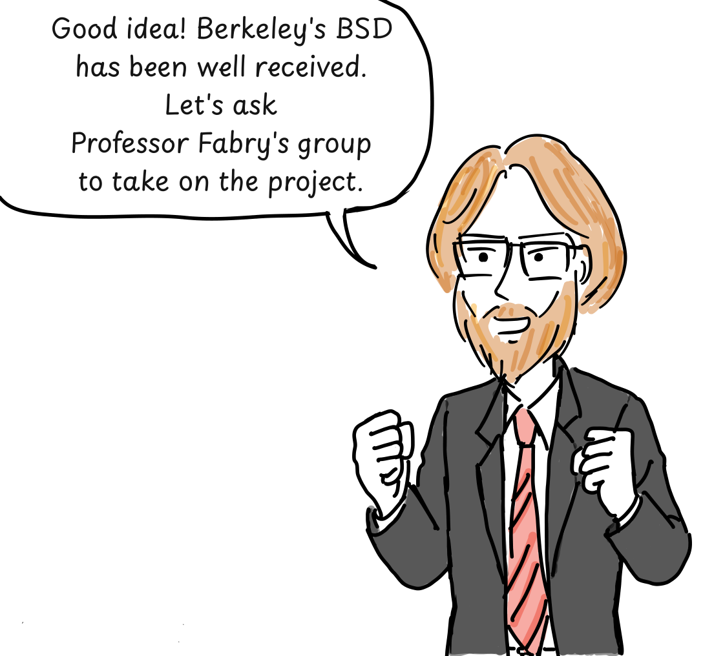

<!-- dialogue: darpa-berkeley-proposal -->
> Good idea! Berkeley's BSD\
> has been well received.\
> Let's ask\
> Professor Fabry's group\
> to take on the project.
<!-- /dialogue -->

:::
::::

:::panel rounded="true" style="border-width: 3px;border-color: black;"

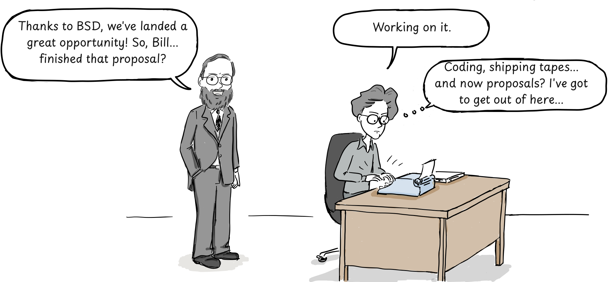

<!-- dialogue: fabry-proposal-question -->
> Thanks to BSD, we've landed a\
> great opportunity! So, Bill...\
> finished that proposal?
<!-- /dialogue -->

<!-- dialogue: bill-proposal-answer -->
> Working on it.
<!-- /dialogue -->

<!-- dialogue: bill-proposal-aside -->
> Coding, shipping tapes...\
> and now proposals? I've got\
> to get out of here...
<!-- /dialogue -->

:::

::::panels columns="2"
:::panel rounded="true" style="border-width: 3px;border-color: black;"

In April 1980, Professor Bob Fabry signed a contract with DARPA to improve Unix.

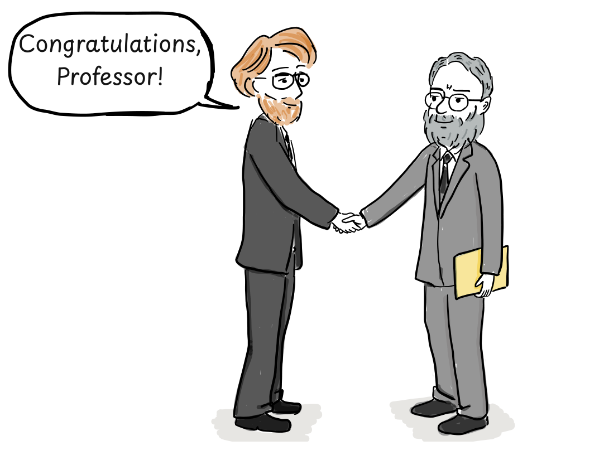

<!-- dialogue: darpa-contract-congratulations -->
> Congratulations,\
> Professor!
<!-- /dialogue -->

:::

:::panel rounded="true" style="border-width: 3px;border-color: black;"

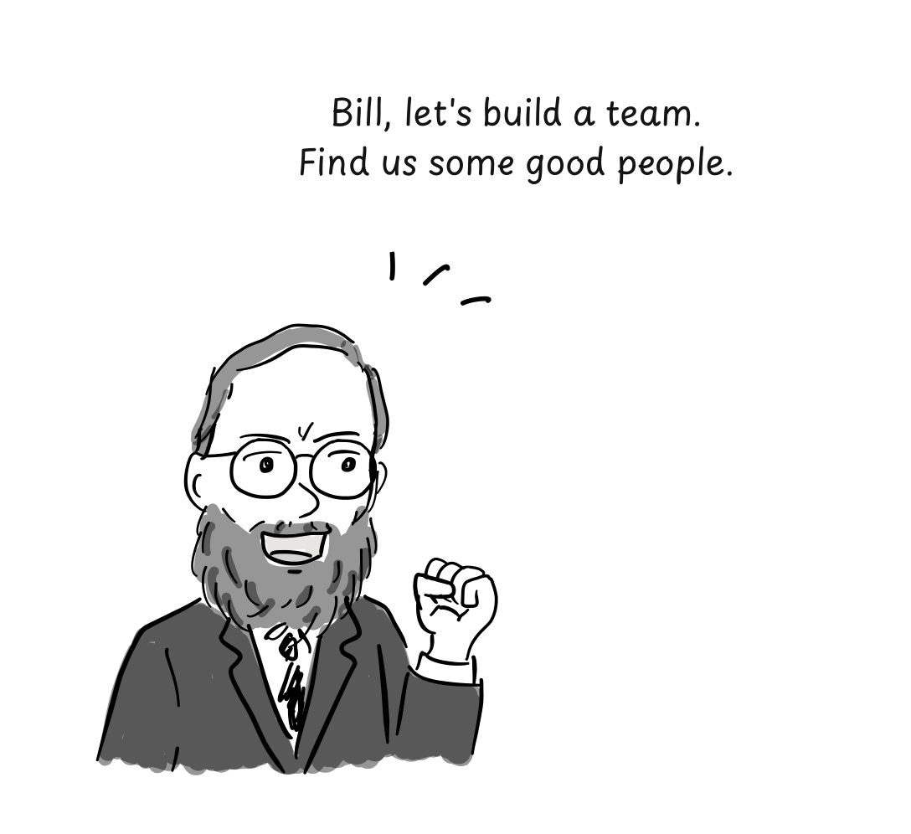

<!-- dialogue: fabry-recruit-team -->
> Bill, let's build a team.\
> Find us some good people.
<!-- /dialogue -->

:::
::::

:::panel rounded="true" style="border-width: 3px;border-color: black;"

[Bob Fabry](https://en.wikipedia.org/wiki/Bob_Fabry) established the Computer Systems Research Group (CSRG) at UC Berkeley to carry out the work. Over time, its contributors included [Keith Bostic](https://en.wikipedia.org/wiki/Keith_Bostic_(software_engineer)), [Bill Joy](https://en.wikipedia.org/wiki/Bill_Joy), [Marshall Kirk McKusick](https://en.wikipedia.org/wiki/Marshall_Kirk_McKusick), [Samuel J. Leffler](https://en.wikipedia.org/wiki/Sam_Leffler), and [Michael J. Karels](https://en.wikipedia.org/wiki/Mike_Karels)—researchers who would play leading roles in CSRG.

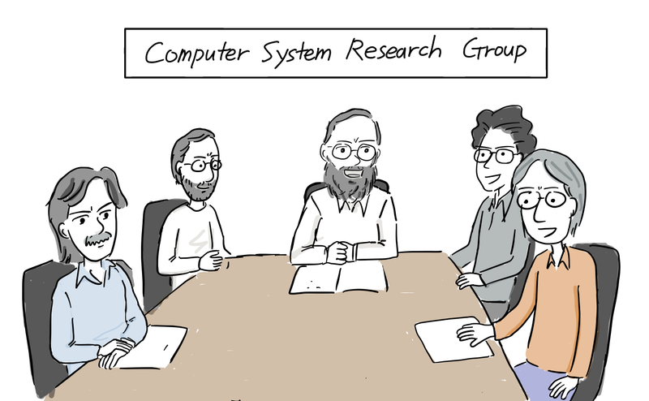

:::

:::panel rounded="true" style="border-width: 3px;border-color: black;"

Keeping the work going wasn't easy. Fabry dealt with university bureaucracy and disputes with AT&T, and helped keep DARPA funding coming so the researchers could concentrate on development.

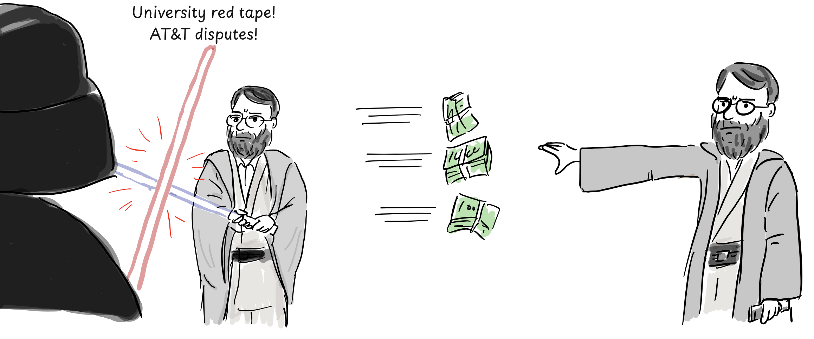

<!-- dialogue: fabry-administration-and-licensing -->
> University red tape!\
> AT&T disputes!
<!-- /dialogue -->

:::

:::panel rounded="true" style="border-width: 3px;border-color: black;"

Released in October 1980, 4BSD added job control, automatic rebooting, and a filesystem with 1 KB blocks. Under an agreement with AT&T, Unix source code was included in the distribution. Nearly 150 copies shipped in about nine months.

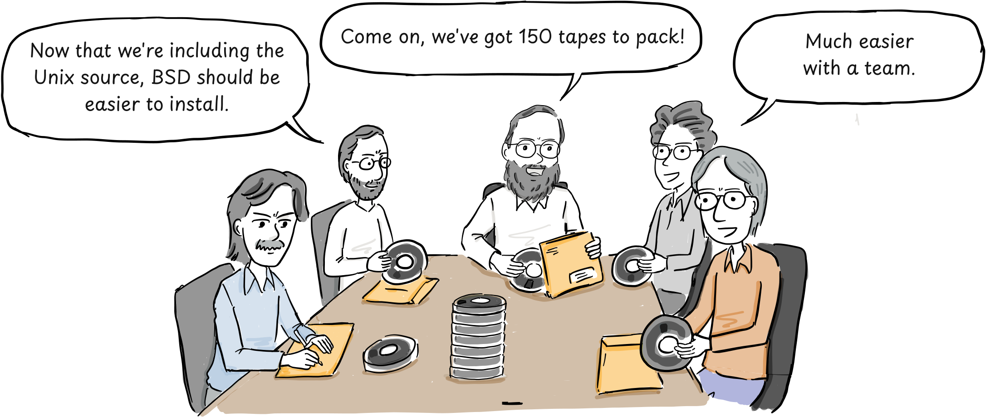

<!-- dialogue: researcher-unix-included -->
> Now that we're including the\
> Unix source, BSD should be\
> easier to install.
<!-- /dialogue -->

<!-- dialogue: fabry-pack-tapes -->
> Come on, we've got 150 tapes to pack!
<!-- /dialogue -->

<!-- dialogue: bill-shared-work -->
> Much easier\
> with a team.
<!-- /dialogue -->

:::

::::panels columns="2"
:::panel rounded="true" style="border-width: 3px;border-color: black;"

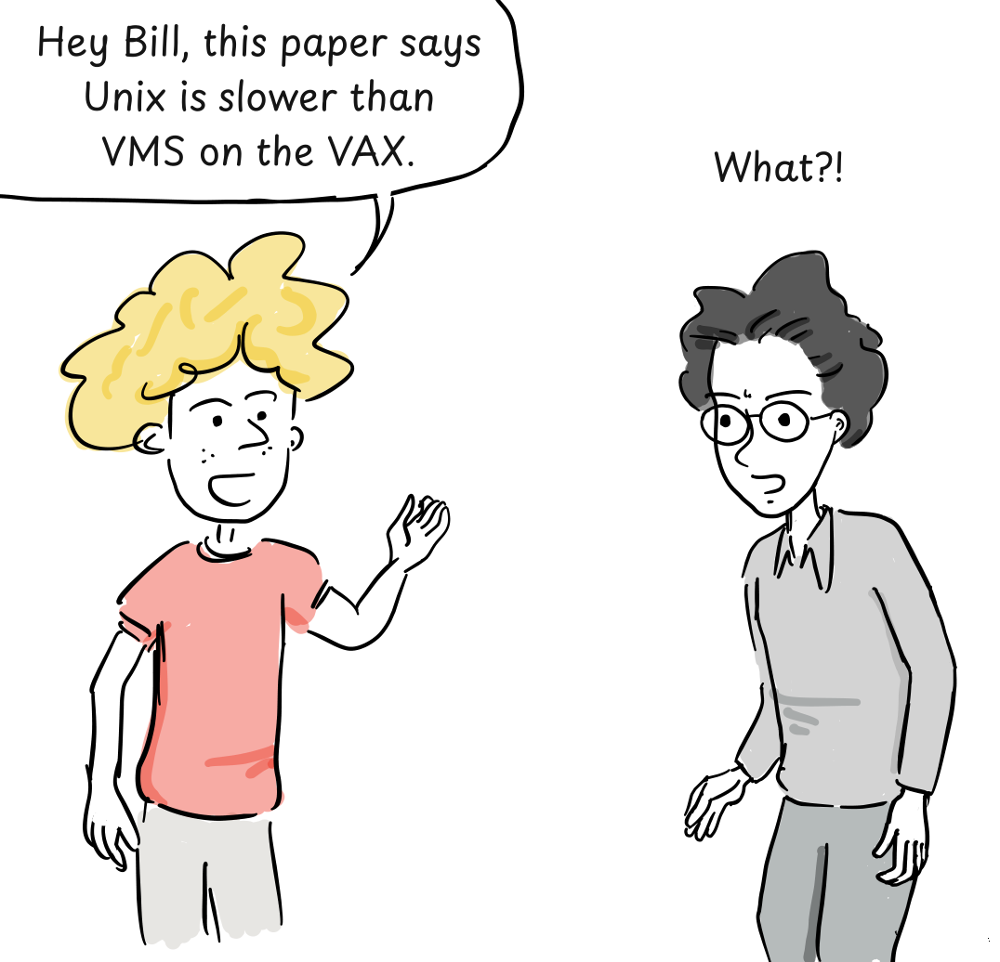

<!-- dialogue: colleague-vms-benchmark -->
> Hey Bill, this paper says\
> Unix is slower than\
> VMS on the VAX.
<!-- /dialogue -->

<!-- dialogue: bill-benchmark-surprise -->
> What?!
<!-- /dialogue -->

:::

:::panel rounded="true" style="border-width: 3px;border-color: black;"

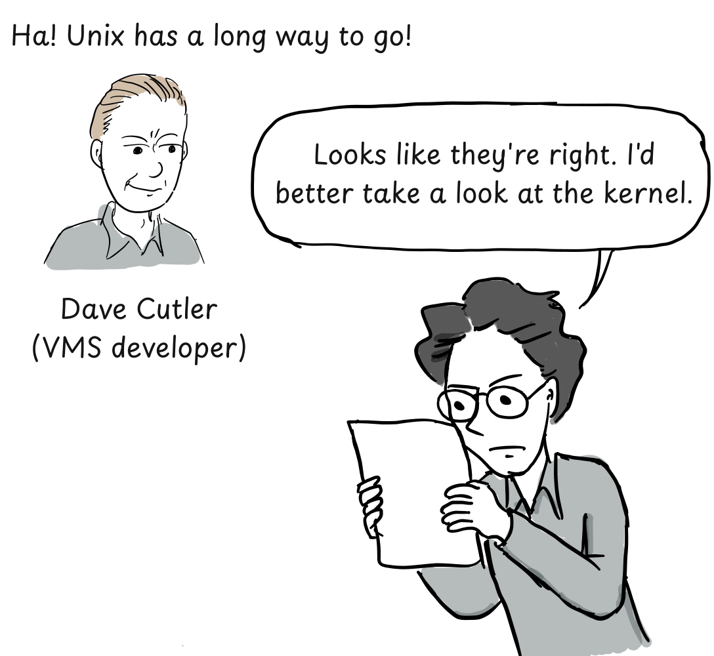

<!-- dialogue: dave-cutler-taunt -->
> Ha! Unix has a long way to go!
<!-- /dialogue -->

<!-- dialogue: dave-cutler-label -->
> Dave Cutler\
> (VMS developer)
<!-- /dialogue -->

<!-- dialogue: bill-read-benchmark -->
> Looks like they're right. I'd\
> better take a look at the kernel.
<!-- /dialogue -->

:::
::::

Note: SRI's David Kashtan compared Unix and VMS performance on the VAX. Bill Joy responded by improving the kernel, reaching performance comparable to VMS on the same benchmark. See [reference 1](#reference-1).

:::panel rounded="true" style="border-width: 3px;border-color: black;"

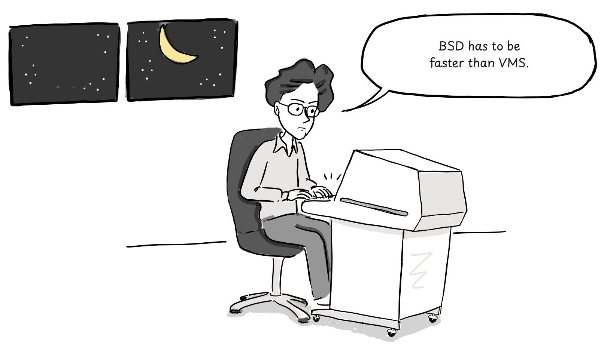

<!-- dialogue: bill-tuning-goal -->
> BSD has to be\
> faster than VMS.
<!-- /dialogue -->

:::

:::panel rounded="true" style="border-width: 3px;border-color: black;"

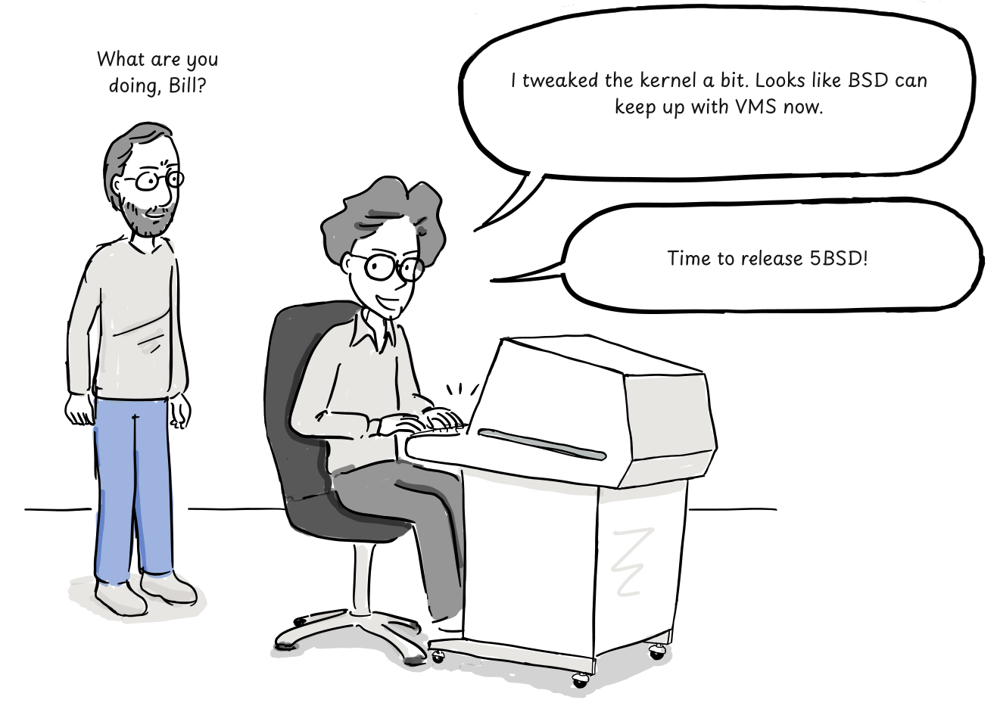

<!-- dialogue: colleague-bill-working -->
> What are you\
> doing, Bill?
<!-- /dialogue -->

<!-- dialogue: bill-kernel-performance -->
> I tweaked the kernel a bit. Looks like BSD can\
> keep up with VMS now.
<!-- /dialogue -->

<!-- dialogue: bill-next-release -->
> Time to release 5BSD!
<!-- /dialogue -->

:::

::::panels columns="2"
:::panel rounded="true" style="border-width: 3px;border-color: black;"

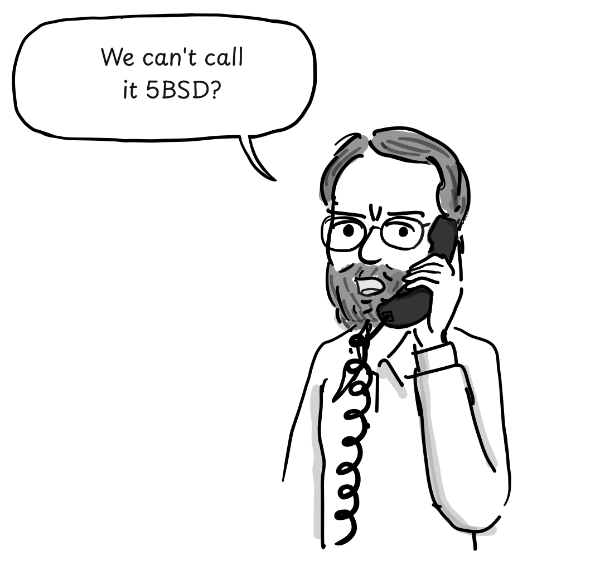

<!-- dialogue: fabry-5bsd-objection -->
> We can't call\
> it 5BSD?
<!-- /dialogue -->

:::

:::panel rounded="true" style="border-width: 3px;border-color: black;"

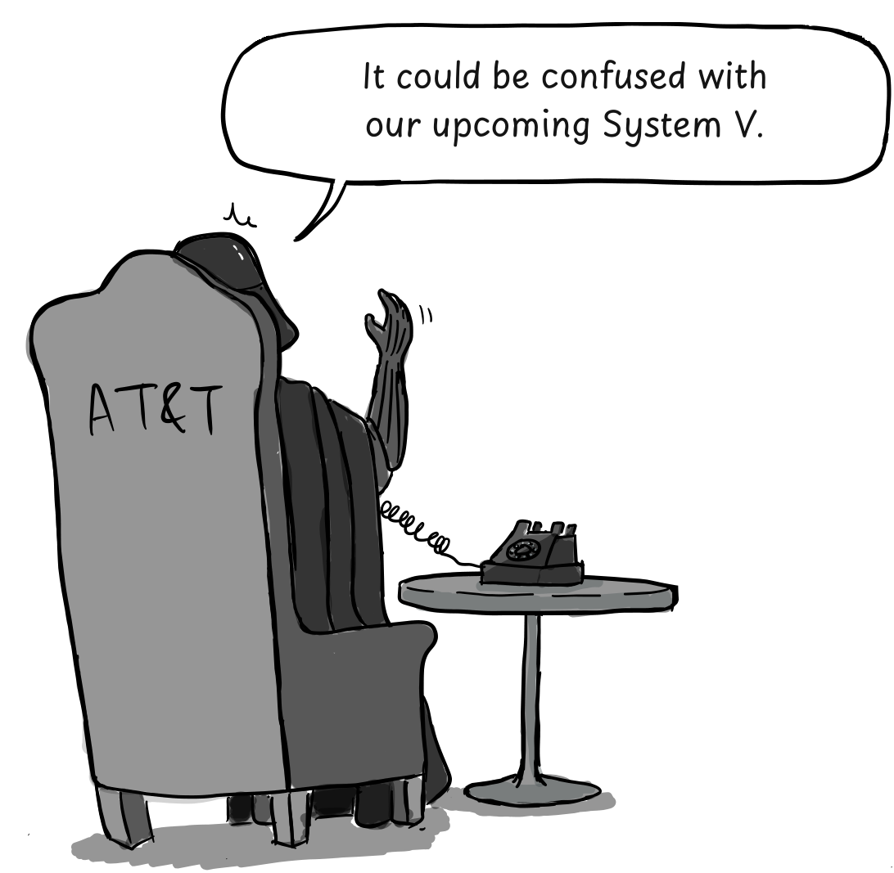

<!-- dialogue: att-customer-confusion -->
> It could be confused with\
> our upcoming System V.
<!-- /dialogue -->

:::
::::

:::panel rounded="true" style="border-width: 3px;border-color: black;"

BSD added and changed a great deal of code, but it still included AT&T's Unix code. Distribution and use therefore remained subject to AT&T's license terms.

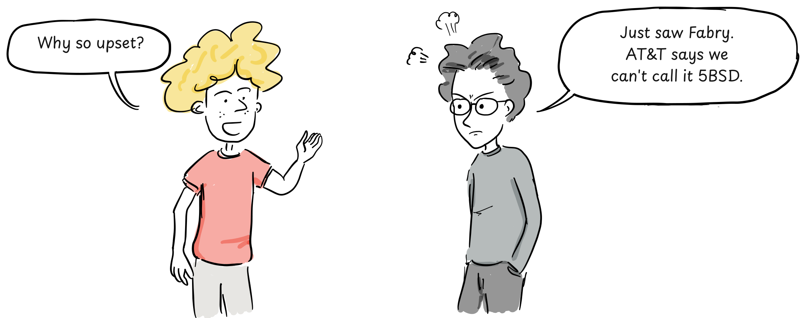

<!-- dialogue: colleague-bill-frustrated -->
> Why so upset?
<!-- /dialogue -->

<!-- dialogue: bill-name-rejected -->
> Just saw Fabry.\
> AT&T says we\
> can't call it 5BSD.
<!-- /dialogue -->

:::

::::panels columns="2"
:::panel rounded="true" style="border-width: 3px;border-color: black;"

The faster release finally arrived in June 1981 as 4.1BSD, not 5BSD.[1][1]

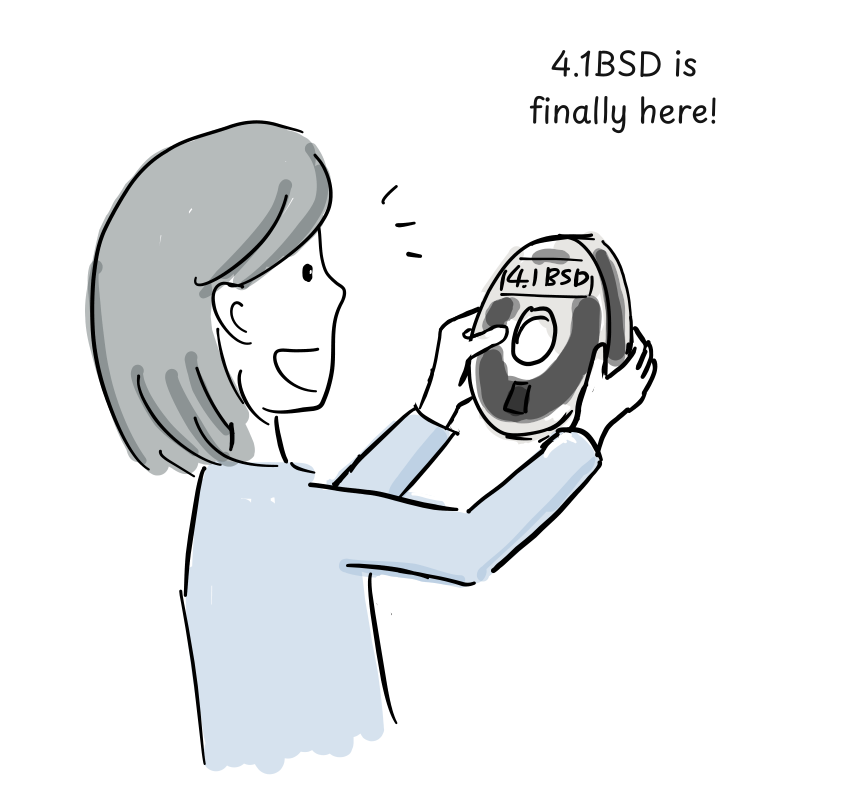

<!-- dialogue: user-41bsd-arrived -->
> 4.1BSD is\
> finally here!
<!-- /dialogue -->

:::

:::panel rounded="true" style="border-width: 3px;border-color: black;"

Unix began at Bell Labs, but distributing its source let users study and modify the code. Many outside contributors added new features and improvements, helping Unix evolve rapidly.

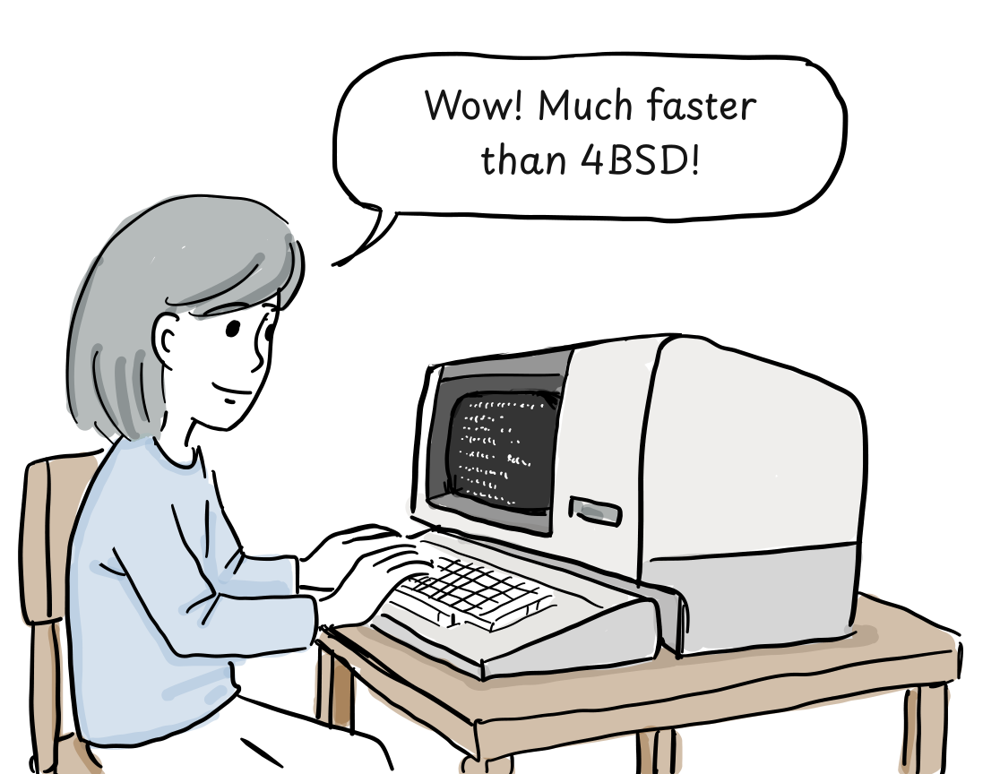

<!-- dialogue: user-41bsd-faster -->
> Wow! Much faster\
> than 4BSD!
<!-- /dialogue -->

:::
::::

**References**

1. Marshall Kirk McKusick, [Twenty Years of Berkeley Unix][1], in *Open Sources: Voices from the Open Source Revolution*, 1999. DARPA's contract, CSRG, and the development and distribution of 4BSD and 4.1BSD. [Korean edition, Hanbit Media](http://www.hanbit.co.kr/store/books/look.php?p_code=E5329835060), 2013.
2. SRI International, [ARPANET][2]. The first connection in 1969 and the network linking research institutions.
3. Andrew Leonard, [BSD Unix: Power to the people, from the code][3], *Salon*, 2000.
4. The Unix Heritage Society, [System V][4]. System V Release 1 first shipped in January 1983.

[1]: https://www.oreilly.com/openbook/opensources/book/kirkmck.html
[2]: https://www.sri.com/hoi/arpanet/
[3]: https://www.salon.com/2000/05/16/chapter_2_part_one/
[4]: https://wiki.tuhs.org/doku.php?id=systems:sys5
