- [BSD 유닉스 1화 – UC 버클리로 간 유닉스 코드](/ko/posts/11.%20BSD%20Unix%20Part%201%20-%20Unix%20Code%20Goes%20to%20UC%20Berkeley/)
- [BSD 유닉스 2화 – vi 에디터의 탄생](/ko/posts/12.%20BSD%20Unix%20Part%202%20-%20The%20Birth%20of%20the%20vi%20Editor/)
- [BSD 유닉스 3화 – BSD 유닉스 시작](/ko/posts/13.%20BSD%20Unix%20Part%203%20-%20The%20Beginning%20of%20BSD%20Unix/)
- [BSD 유닉스 4화 – 4.1BSD](/ko/posts/14.%20BSD%20Unix%20Part%204%20-%20The%20Formation%20of%20CSRG/)

::::panels columns="2"
:::panel title="true" rounded="true" style="border-width: 3px;border-color: black;"

# BSD 유닉스 5화
## TCP/IP 개발

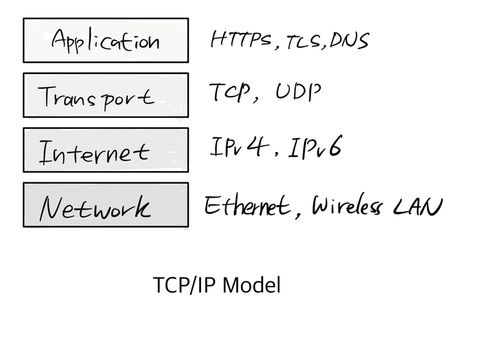

:::

:::panel rounded="true" style="border-width: 3px;border-color: black;"

## TCP/IP 코드를 BSD에 적용

TCP/IP는 빈트 서프(Vint Cerf)와 밥 칸(Bob Kahn)이 이끈 공동 연구를 통해 설계되었다. 이후 미국 국방고등연구계획국(DARPA)은 BBN(Bolt Beranek and Newman)에 VAX용 유닉스의 TCP/IP 구현을 맡겼다.

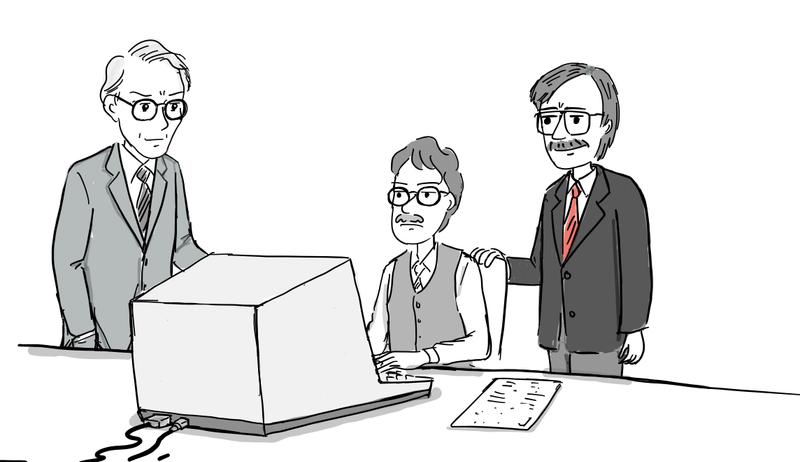

:::
::::

::::panels columns="2"
:::panel narration="boxed" rounded="true" style="border-width: 3px;border-color: black;"

UC 버클리대학의 CSRG(Computer Systems Research Group)는 BBN의 초기 TCP/IP 코드를 BSD에 적용하기 시작했는데, 빌 조이와 사무엘 래플러는 BSD가 여러 네트워크 프로토콜을 지원할 수 있도록 네트워크 코드의 내부 구조와 인터페이스를 재설계했다.

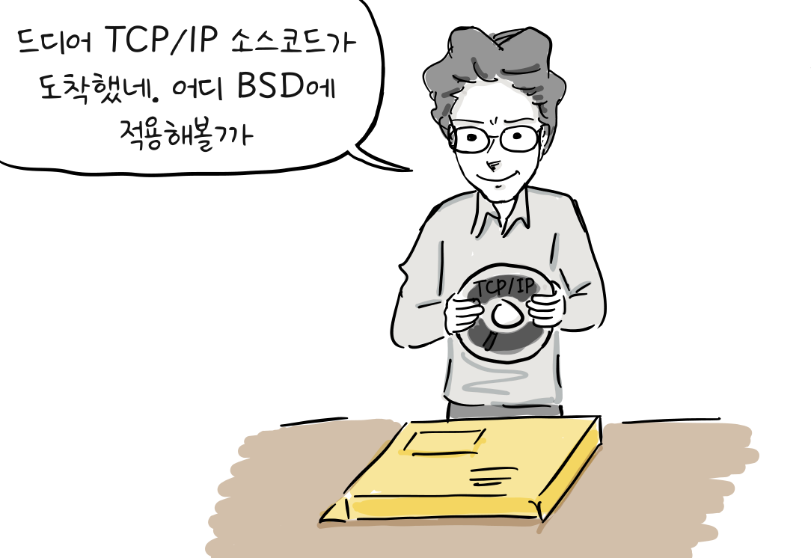

<!-- dialogue: bill-tcp-ip-arrived -->
> 드디어 TCP/IP 소스코드가 도착했네. 어디 BSD에 적용해볼까
<!-- /dialogue -->

:::

:::panel rounded="true" style="border-width: 3px;border-color: black;" 

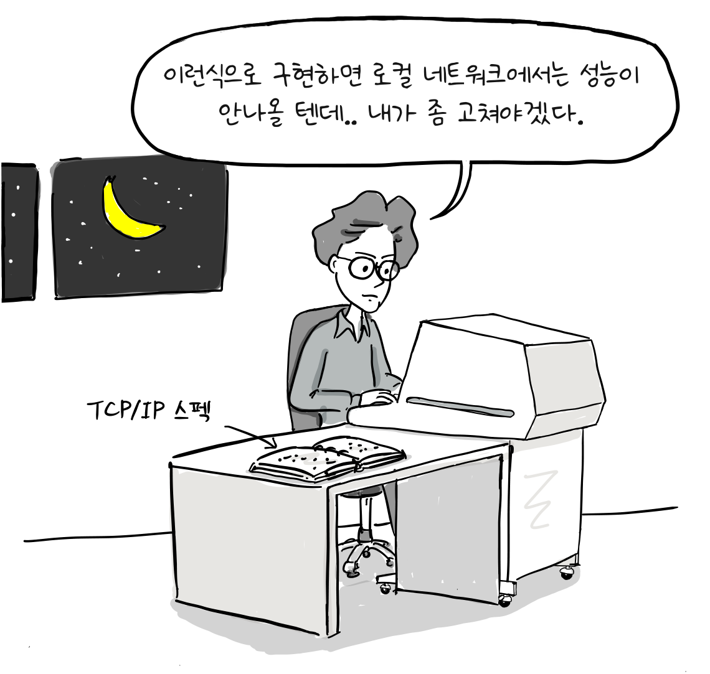

<!-- dialogue: bill-local-network -->
> 이런식으로 구현하면 로컬 네트워크에서는 성능이 안나올 텐데.. 내가 좀 고쳐야겠다.
<!-- /dialogue -->

:::
::::

:::panel rounded="true" style="border-width: 3px;border-color: black;"

## 1980년대 초 TCP/IP 회의

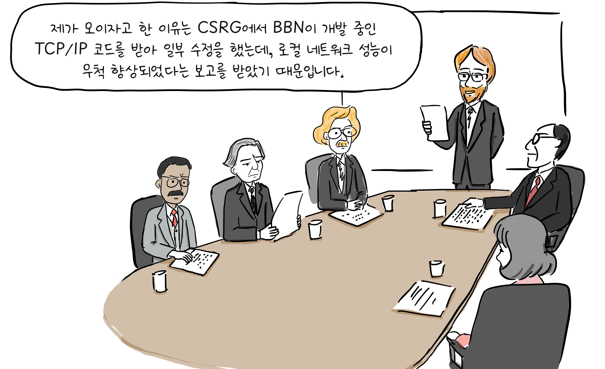

<!-- dialogue: darpa-performance-report -->
> 제가 모이자고 한 이유는 CSRG에서 BBN이 개발 중인 TCP/IP 코드를 받아 일부 수정을 했는데, 로컬 네트워크 성능이 무척 향상되었다는 보고를 받았기 때문입니다.
<!-- /dialogue -->

:::

:::panel rounded="true" style="border-width: 3px;border-color: black;"

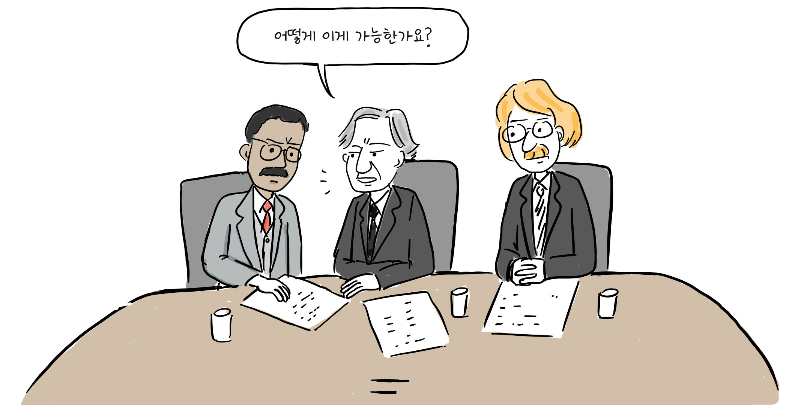

<!-- dialogue: participant-how-possible -->
> 어떻게 이게 가능한가요?
<!-- /dialogue -->

:::

:::panel rounded="true" style="border-width: 3px;border-color: black;"

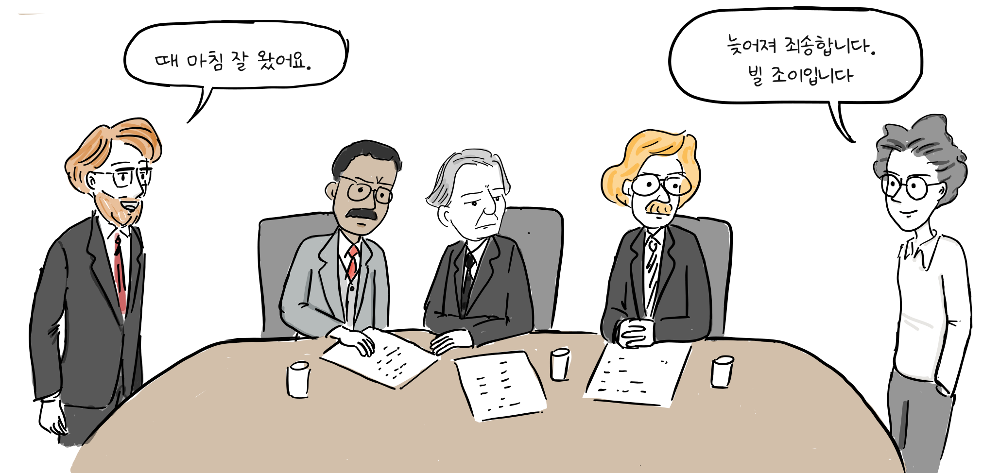

<!-- dialogue: bill-late-arrival -->
> 늦어져 죄송합니다.\
> 빌 조이입니다
<!-- /dialogue -->

<!-- dialogue: darpa-welcome -->
> 때 마침 잘 왔어요.
<!-- /dialogue -->

:::

:::panel rounded="true" style="border-width: 3px;border-color: black;"

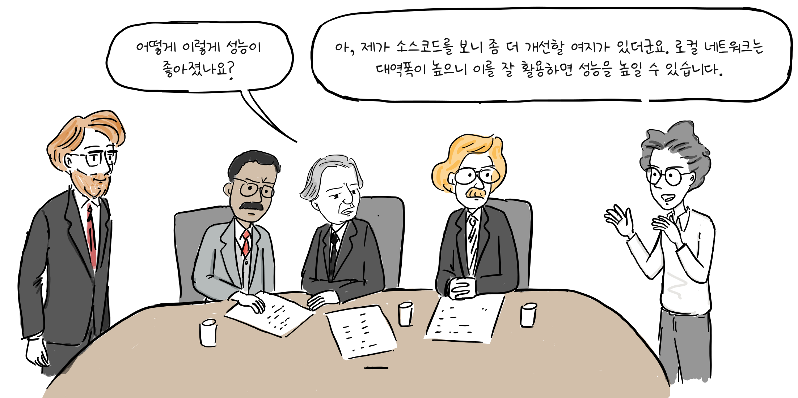

<!-- dialogue: darpa-how-faster -->
> 어떻게 이렇게 성능이 좋아졌나요?
<!-- /dialogue -->

<!-- dialogue: bill-bandwidth-explanation -->
> 아, 제가 소스코드를 보니 좀 더 개선할 여지가 있더군요. 로컬 네트워크는 대역폭이 높으니 이를 잘 활용하면 성능을 높일 수 있습니다.
<!-- /dialogue -->

:::

:::panel rounded="true" style="border-width: 3px;border-color: black;"

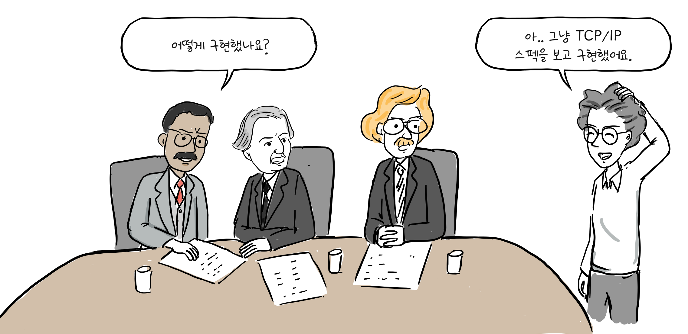

<!-- dialogue: how-to-implement -->
> 어떻게 구현했나요?
<!-- /dialogue -->

<!-- dialogue: refer-to-tcpip -->
> 아.. 그냥 TCP/IP 스펙을 보고 구현했어요.
<!-- /dialogue -->

:::

:::panel rounded="true" style="border-width: 3px;border-color: black;"

실제 BSD의 네트워크 코드는 BBN의 초기 구현을 바탕으로 CSRG가 크게 다듬은 결과였다. 훗날 4.3BSD를 준비하던 1985년에는 BBN의 후속 구현과 독립적인 비교 평가도 이뤄졌다. BBN 쪽은 혼잡 처리에 강점이 있었지만, 버클리 쪽은 더 효율적이고 모든 시험을 통과했다. DARPA는 버클리 구현을 유지하기로 했고, 4.3BSD는 1986년 6월에 나왔다.

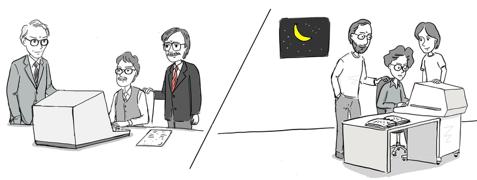

:::

:::panel rounded="true" style="border-width: 3px;border-color: black;"

이보다 앞선 1982년, 빌 조이는 썬 마이크로시스템스 공동 창업에 참여하며 CSRG를 떠났다.

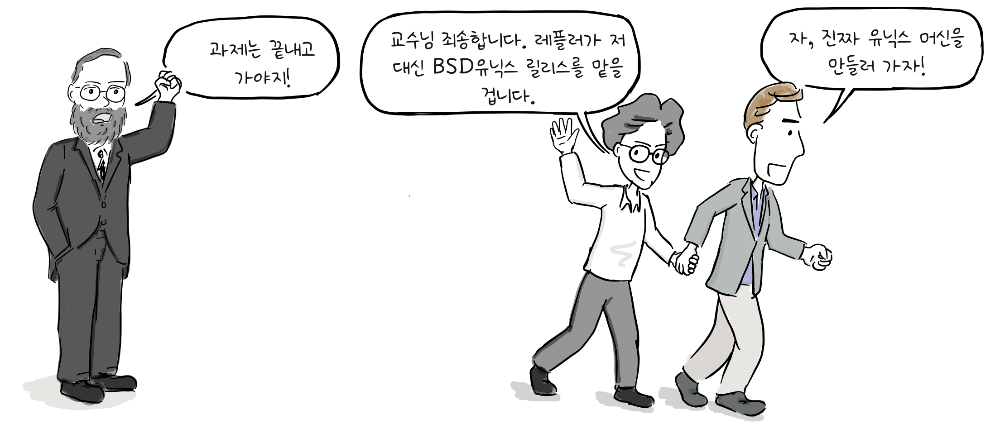

<!-- dialogue: fabry-finish-project-sun -->
> 과제는 끝내고 가야지!
<!-- /dialogue -->

<!-- dialogue: bill-leffler-handoff -->
> 교수님 죄송합니다. 레플러가 저 대신 BSD유닉스 릴리스를 맡을 겁니다.
<!-- /dialogue -->

<!-- dialogue: sun-unix-machine -->
> 자, 진짜 유닉스 머신을 만들러 가자!
<!-- /dialogue -->

:::

::::panels columns="2"
:::panel narration="boxed" rounded="true" style="border-width: 3px;border-color: black;"

빌 조이는 썬으로 옮기는 동안에도 IPC 구현을 다듬고, 다른 기종으로 이식하기 쉽도록 BSD 커널의 하드웨어 의존 코드를 분리하는 작업을 마무리했다.

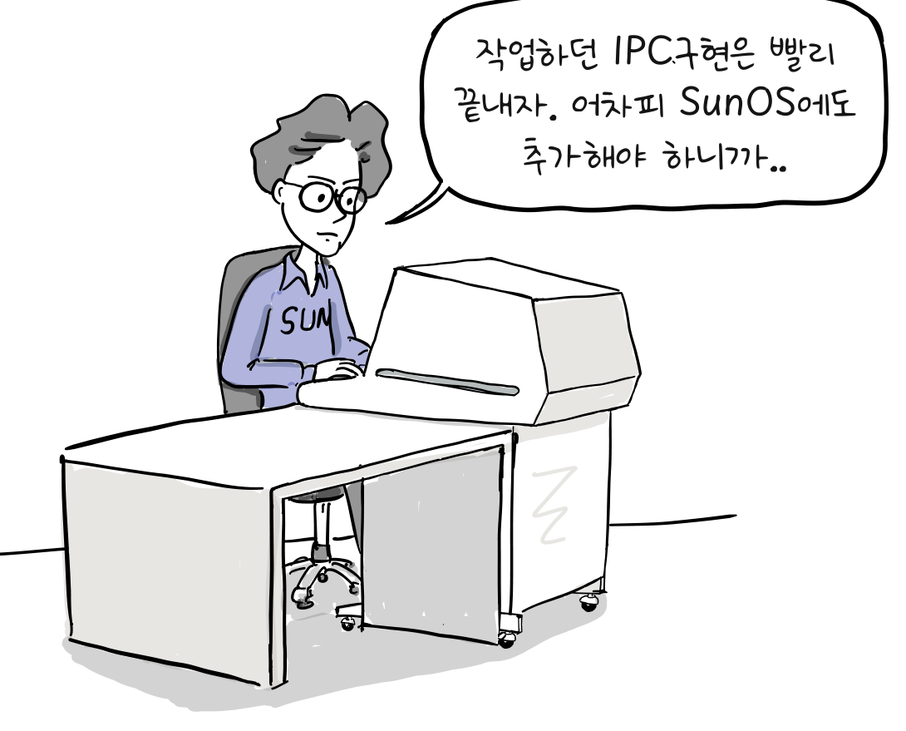

<!-- dialogue: bill-finish-ipc -->
> 작업하던 IPC구현은 빨리 끝내자. 어차피 SunOS에도 추가해야 하니까..
<!-- /dialogue -->

:::

:::panel rounded="true" style="border-width: 3px;border-color: black;"

빌 조이의 뒤를 이은 사무엘 J. 래플러(Samuel J. Leffler)는 새 시그널 기능을 구현하고, 마셜 커크 매큐직(Marshall Kirk McKusick)이 구현한 새 파일시스템과 CSRG가 개선한 TCP/IP 등을 추가해 1983년 8월에 4.2BSD를 공개한다.

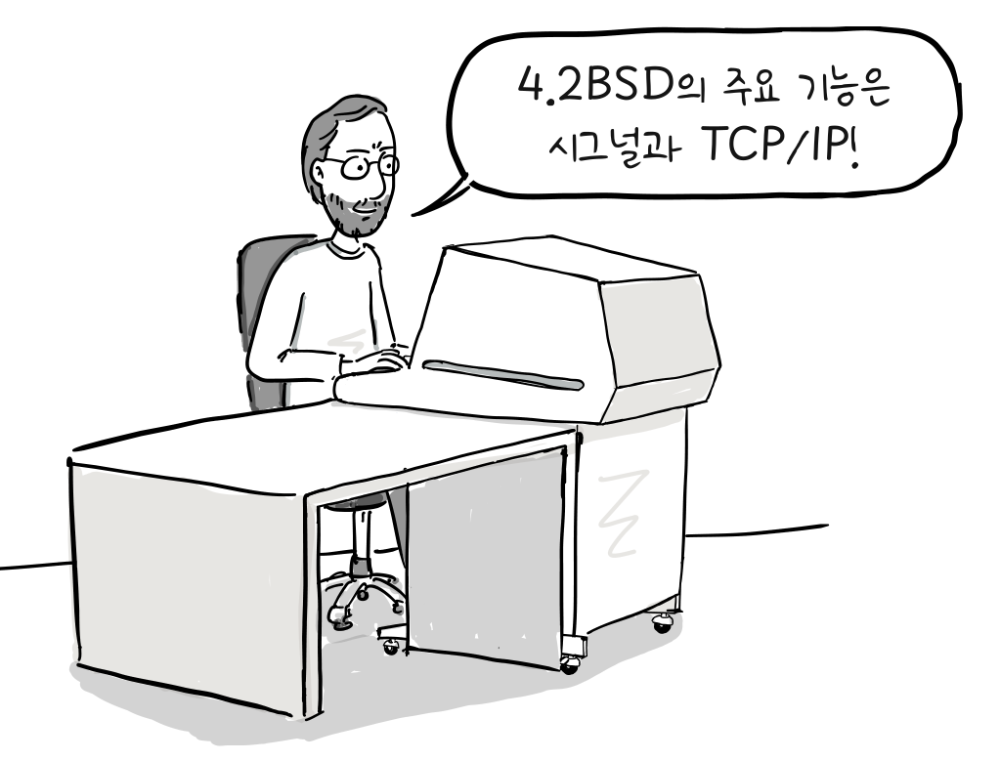

<!-- dialogue: leffler-release-features -->
> 4.2BSD의 주요 기능은 시그널과 TCP/IP!
<!-- /dialogue -->

:::
::::

:::panel rounded="true" style="border-width: 3px;border-color: black;"

4.2BSD를 완성한 래플러가 루카스필름(Lucasfilm)으로 옮긴 뒤에는 마이클 J. 캐럴스(Michael J. Karels)가 개발을 맡았다.

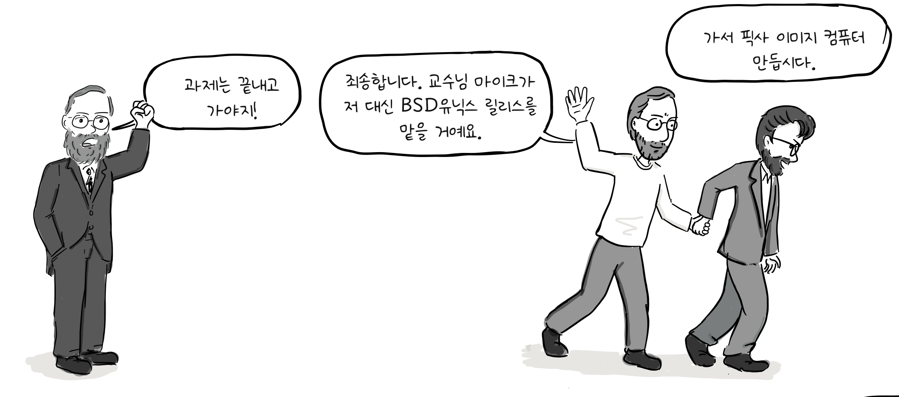

<!-- dialogue: fabry-finish-project-lucas -->
> 과제는 끝내고 가야지!
<!-- /dialogue -->

<!-- dialogue: leffler-karels-handoff -->
> 죄송합니다. 교수님 마이크가 저 대신 BSD유닉스 릴리스를 맡을 거예요.
<!-- /dialogue -->

<!-- dialogue: lucas-workstation -->
> 가서 픽사 이미지 컴퓨터 만듭시다.
<!-- /dialogue -->

:::

::::panels columns="2" ratios="45:55"
:::panel rounded="true" style="border-width: 3px;border-color: black;"

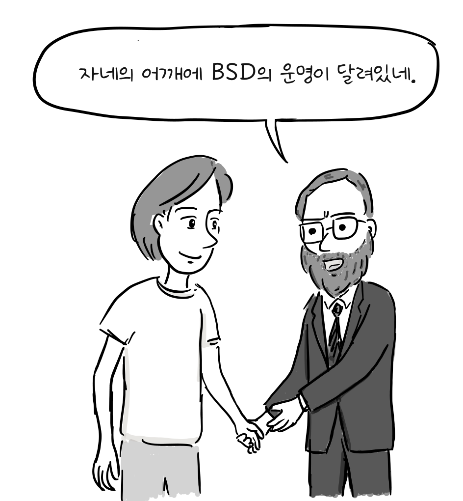

<!-- dialogue: fabry-bsd-future -->
> 자네의 어깨에 BSD의 운명이 달려있네.
<!-- /dialogue -->

:::

:::panel rounded="true" style="border-width: 3px;border-color: black;"

4.2BSD는 출시 후 18개월 안에 사이트 라이선스가 1,000건을 넘었다. 당시 AT&T의 시스템 V에 없던 TCP/IP와 새 파일시스템은 4.2BSD의 강점이었다.

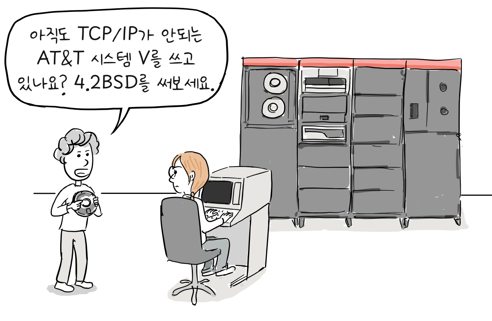

<!-- dialogue: user-promote-42bsd -->
> 아직도 TCP/IP가 안되는 AT&T 시스템 V를 쓰고 있나요? 4.2BSD를 써보세요.
<!-- /dialogue -->

:::
::::

:::panel rounded="true" style="border-width: 3px;border-color: black;"

BSD에서 발전한 네트워크 기능은 이후 AT&T의 유닉스에도 도입된다.

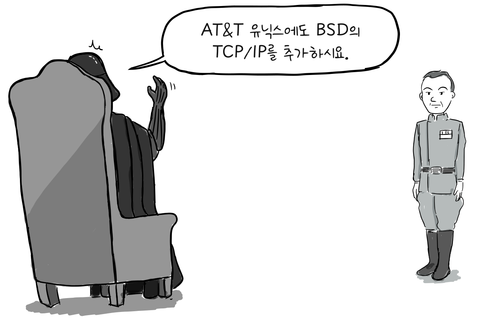

<!-- dialogue: att-add-tcp-ip -->
> AT&T 유닉스에도 BSD의 TCP/IP를 추가하시요.
<!-- /dialogue -->

:::

::::panels columns="2" ratios="40:60"
:::panel rounded="true" style="border-width: 3px;border-color: black;"

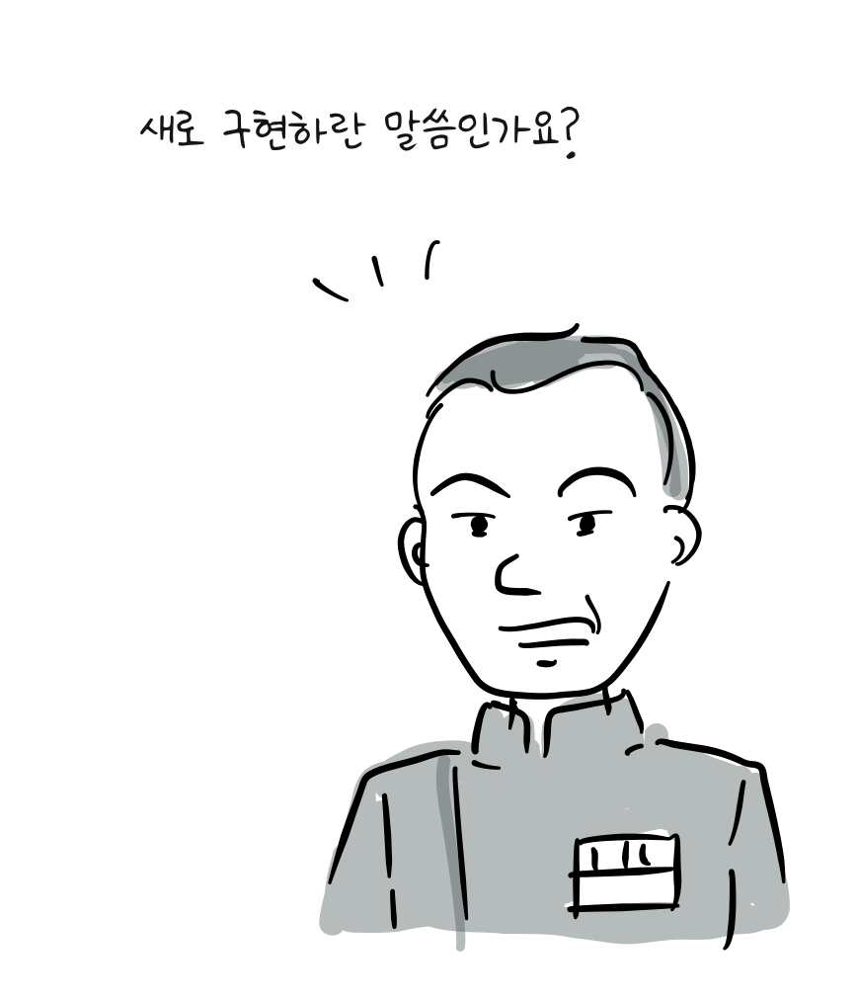

<!-- dialogue: employee-reimplement -->
> 새로 구현하란 말씀인가요?
<!-- /dialogue -->

:::

:::panel rounded="true" style="border-width: 3px;border-color: black;"

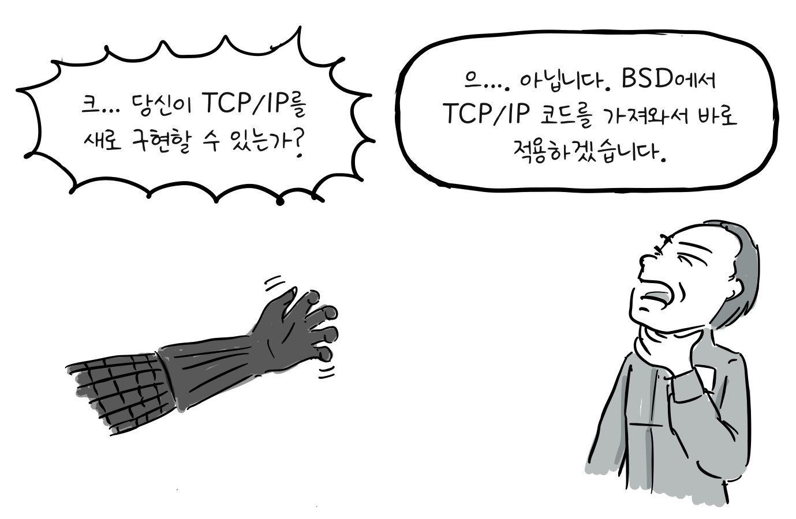

<!-- dialogue: att-reimplementation-challenge -->
> 크… 당신이 TCP/IP를\
> 새로 구현할 수 있는가?
<!-- /dialogue -->

<!-- dialogue: employee-reuse-bsd -->
> 으…. 아닙니다. BSD에서 TCP/IP 코드를 가져와서 바로 적용하겠습니다.
<!-- /dialogue -->

:::
::::

※ 인물들의 대사는 이해를 돕기 위해 재구성한 것으로, 실제 발언을 그대로 옮긴 것이 아닙니다.

※ TCP/IP 회의 장면은 빌 조이의 친구이자 썬 마이크로시스템즈의 수석연구원이었던 존 게이지(John Gage)의 회고를 바탕으로 재구성했다. BBN의 롭 거위츠(Rob Gurwitz)는 BBN 코드가 작동하지 않았다는 주장에 반박했다. 또한 관련 DARPA 회의에 참석했지만, 빌 조이가 “아주 간단해요. 프로토콜을 읽고 코드를 쓰면 돼요”라고 말한 기억은 없다고 밝혔다. ([출처](#reference-1))

**참고 문헌**

- ANDREW LEONARD, [BSD Unix: Power to the people, from the code](https://www.salon.com/2000/05/16/chapter_2_part_one/), 2000
- 마샬 커크 맥퀴식, [버클리 유닉스의 20년, 오픈소스 혁명의 목소리, 한빛출판사](http://www.hanbit.co.kr/store/books/look.php?p_code=E5329835060), 2013
- Marshall Kirk McKusick, [Twenty Years of Berkeley Unix: From AT&T-Owned to Freely Redistributable](https://www.oreilly.com/openbook/opensources/book/kirkmck.html), 1999
- Robert F. Gurwitz, [VAX-UNIX Networking Support Project — Implementation Description (IEN 168)](https://history.rfc-editor.org/ien/ien168.txt), 1981
- Computer History Museum, [Internet History of 1970s](https://www.computerhistory.org/internethistory/1970s/)
- Pixar, [Our Story](https://www.pixar.com/our-story)
- [RFC 1122: Requirements for Internet Hosts — Communication Layers](https://www.rfc-editor.org/rfc/rfc1122.html), 1989
- 현대 프로토콜 예시: [IPv6 (RFC 1883)](https://www.rfc-editor.org/rfc/rfc1883.html), 1995; [TLS 1.0 (RFC 2246)](https://www.rfc-editor.org/rfc/rfc2246.html), 1999
- [컴퓨터 시스템 연구 그룹 - 위키백과, 우리 모두의 백과사전](https://ko.wikipedia.org/wiki/%EC%BB%B4%ED%93%A8%ED%84%B0_%EC%8B%9C%EC%8A%A4%ED%85%9C_%EC%97%B0%EA%B5%AC_%EA%B7%B8%EB%A3%B9)
- *The Design and Implementation of the 4.4BSD Operating System*, [2.1.13. Network Implementation](https://docs.freebsd.org/en/books/design-44bsd/#overview-network-implementation)
