- [BSD Unix, Part 1 - Unix Code Goes to UC Berkeley](/posts/11.%20BSD%20Unix%20Part%201%20-%20Unix%20Code%20Goes%20to%20UC%20Berkeley/)
- [BSD Unix, Part 2 - The Birth of the vi Editor](/posts/12.%20BSD%20Unix%20Part%202%20-%20The%20Birth%20of%20the%20vi%20Editor/)
- [BSD Unix, Part 3 - The Beginning of BSD Unix](/posts/13.%20BSD%20Unix%20Part%203%20-%20The%20Beginning%20of%20BSD%20Unix/)
- [BSD Unix, Part 4 - 4.1BSD](/posts/14.%20BSD%20Unix%20Part%204%20-%20The%20Formation%20of%20CSRG/)

::::panels columns="2"
:::panel title="true" rounded="true" style="border-width: 3px;border-color: black;"

# BSD Unix, Part 5
## Bringing TCP/IP to BSD

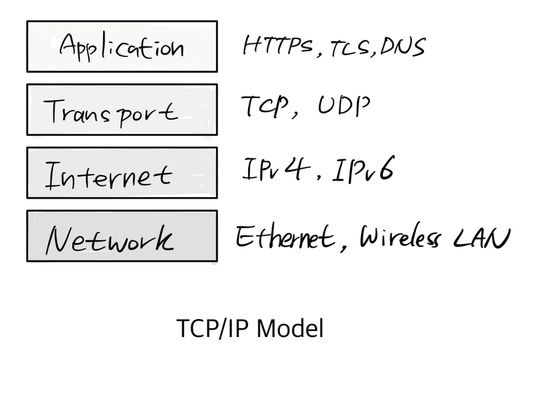

:::

:::panel rounded="true" style="border-width: 3px;border-color: black;"

## Integrating TCP/IP Code into BSD

TCP/IP emerged from collaborative research led by Vint Cerf and Bob Kahn. The Defense Advanced Research Projects Agency (DARPA) later contracted Bolt Beranek and Newman (BBN) to implement the protocols for Unix on the VAX.

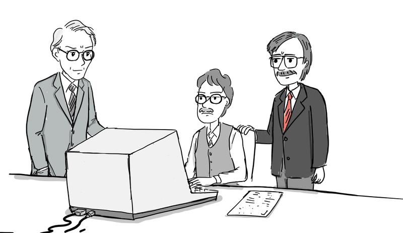

:::
::::

::::panels columns="2"
:::panel narration="boxed" rounded="true" style="border-width: 3px;border-color: black;"

At UC Berkeley, the Computer Systems Research Group (CSRG) integrated BBN's early TCP/IP code into BSD. Bill Joy and Samuel Leffler improved the code and redesigned BSD's networking architecture and interfaces to support multiple network protocols.

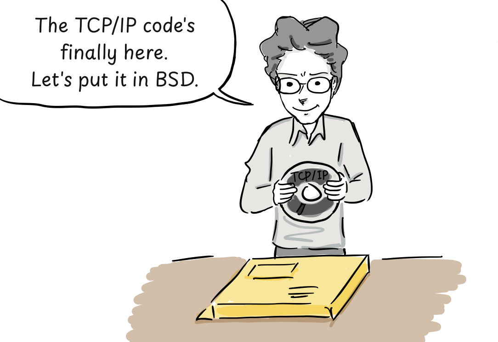

<!-- dialogue: bill-tcp-ip-arrived -->
> The TCP/IP code's finally here.\
> Let's put it in BSD.
<!-- /dialogue -->

:::

:::panel rounded="true" style="border-width: 3px;border-color: black;"

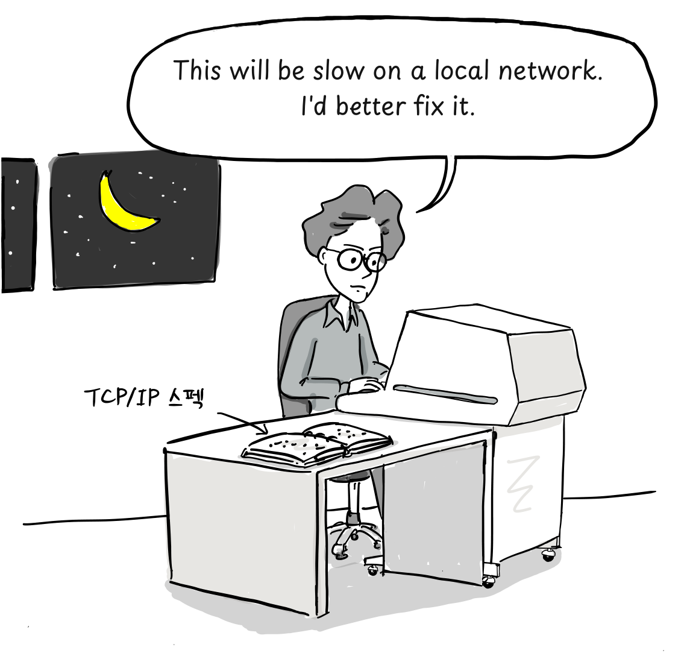

<!-- dialogue: bill-local-network -->
> This will be slow on a local network.\
> I'd better fix it.
<!-- /dialogue -->

:::
::::

:::panel rounded="true" style="border-width: 3px;border-color: black;"

## A TCP/IP meeting, early 1980s

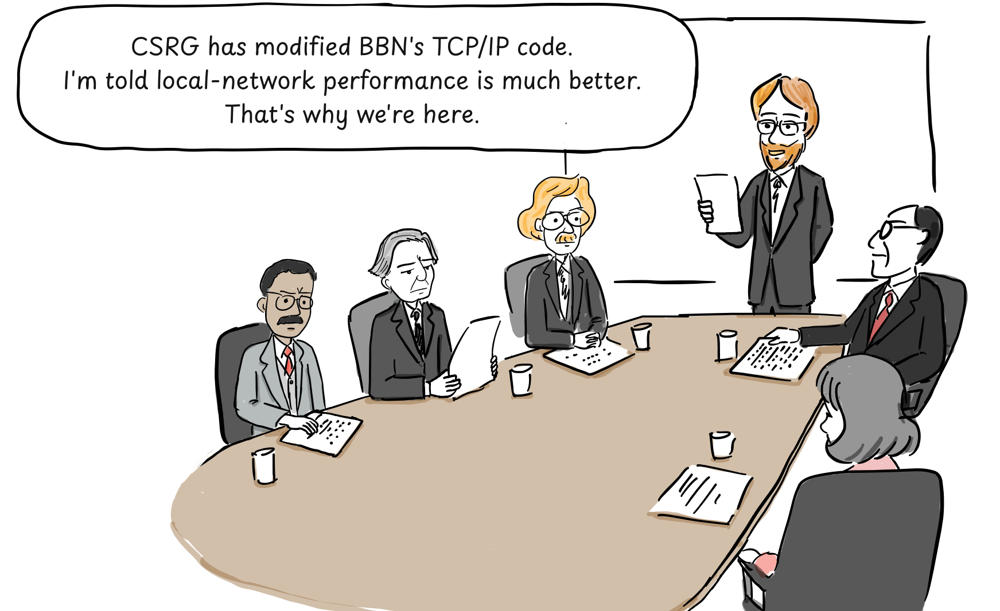

<!-- dialogue: darpa-performance-report -->
> CSRG has modified BBN's TCP/IP code.\
> I'm told local-network performance is much better.\
> That's why we're here.
<!-- /dialogue -->

:::

:::panel rounded="true" style="border-width: 3px;border-color: black;"

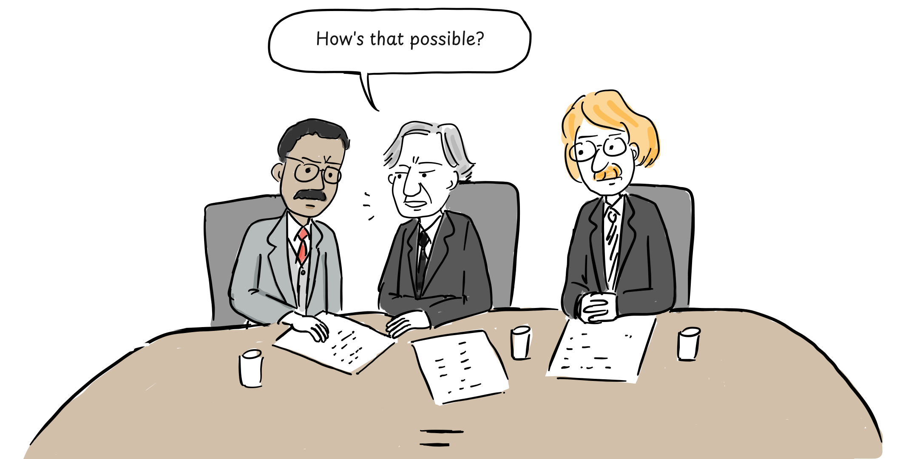

<!-- dialogue: participant-how-possible -->
> How's that possible?
<!-- /dialogue -->

:::

:::panel rounded="true" style="border-width: 3px;border-color: black;"

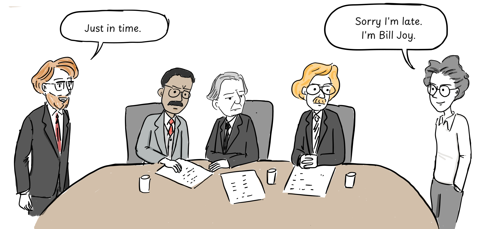

<!-- dialogue: bill-late-arrival -->
> Sorry I'm late.\
> I'm Bill Joy.
<!-- /dialogue -->

<!-- dialogue: darpa-welcome -->
> Just in time.
<!-- /dialogue -->

:::

:::panel rounded="true" style="border-width: 3px;border-color: black;"

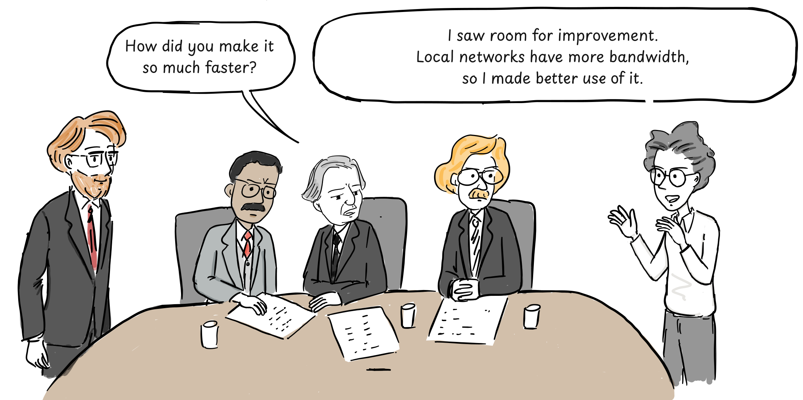

<!-- dialogue: darpa-how-faster -->
> How did you make it\
> so much faster?
<!-- /dialogue -->

<!-- dialogue: bill-bandwidth-explanation -->
> I saw room for improvement.\
> Local networks have more bandwidth,\
> so I made better use of it.
<!-- /dialogue -->

:::

:::panel rounded="true" style="border-width: 3px;border-color: black;"

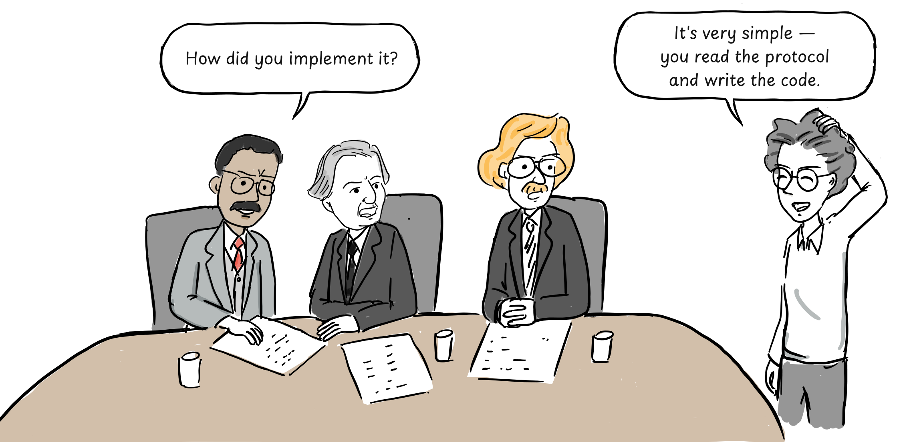

<!-- dialogue: how-to-implement -->
> How did you implement it?
<!-- /dialogue -->

<!-- dialogue: refer-to-tcpip -->
> It's very simple —\
> you read the protocol\
> and write the code.
<!-- /dialogue -->

:::

:::panel rounded="true" style="border-width: 3px;border-color: black;"

BSD's networking code was a substantial CSRG reworking of BBN's initial implementation. In 1985, during preparations for 4.3BSD, an independent evaluation compared Berkeley's code with BBN's newer version. BBN's code had strengths in congestion handling, but Berkeley's was more efficient and passed every test. DARPA chose to keep Berkeley's implementation, and 4.3BSD shipped in June 1986.

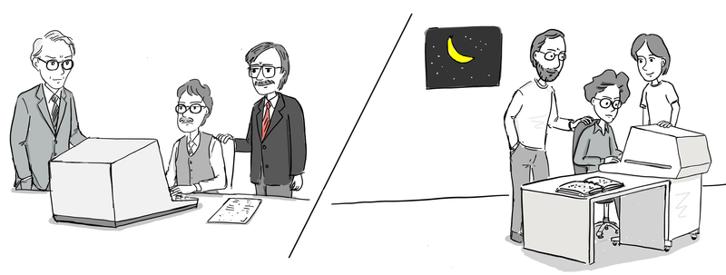

:::

:::panel rounded="true" style="border-width: 3px;border-color: black;"

Back in 1982, Joy had left CSRG to co-found Sun Microsystems.

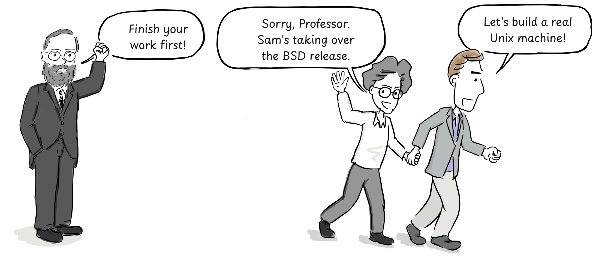

<!-- dialogue: fabry-finish-project-sun -->
> Finish your\
> work first!
<!-- /dialogue -->

<!-- dialogue: bill-leffler-handoff -->
> Sorry, Professor.\
> Sam's taking over\
> the BSD release.
<!-- /dialogue -->

<!-- dialogue: sun-unix-machine -->
> Let's build a real\
> Unix machine!
<!-- /dialogue -->

:::

::::panels columns="2"
:::panel narration="boxed" rounded="true" style="border-width: 3px;border-color: black;"

As he moved to Sun, Joy wrapped up work on interprocess communication (IPC) and isolated the kernel's hardware-dependent code, making BSD easier to port to other machines.

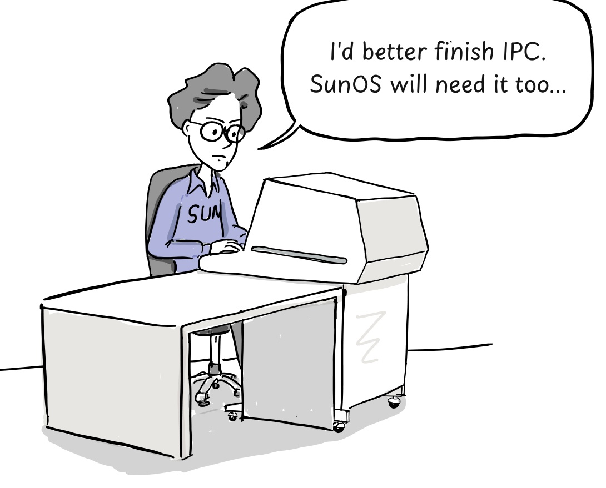

<!-- dialogue: bill-finish-ipc -->
> I'd better finish IPC.\
> SunOS will need it too...
<!-- /dialogue -->

:::

:::panel rounded="true" style="border-width: 3px;border-color: black;"

Joy's successor, Samuel J. Leffler, implemented new signal-handling features. Adding Marshall Kirk McKusick's new filesystem and CSRG's TCP/IP improvements, he released 4.2BSD in August 1983.

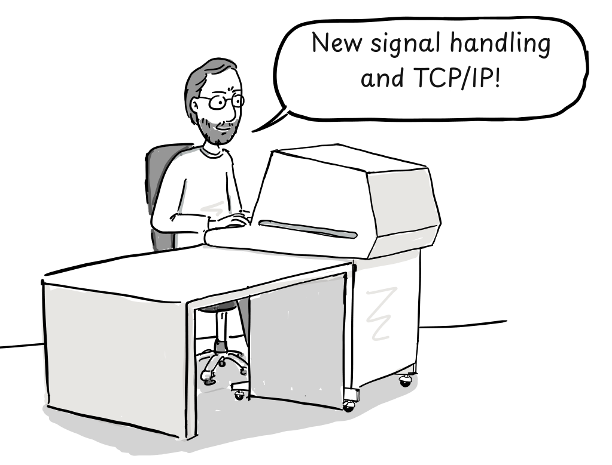

<!-- dialogue: leffler-release-features -->
> New signal handling\
> and TCP/IP!
<!-- /dialogue -->

:::
::::

:::panel rounded="true" style="border-width: 3px;border-color: black;"

After completing 4.2BSD, Leffler moved to Lucasfilm. Michael J. Karels took over development.

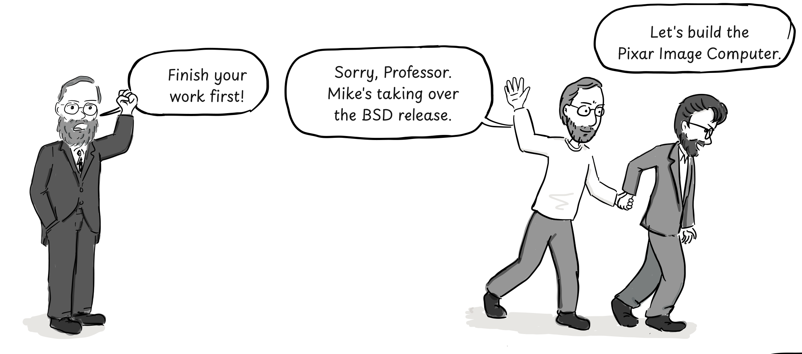

<!-- dialogue: fabry-finish-project-lucas -->
> Finish your\
> work first!
<!-- /dialogue -->

<!-- dialogue: leffler-karels-handoff -->
> Sorry, Professor.\
> Mike's taking over\
> the BSD release.
<!-- /dialogue -->

<!-- dialogue: lucas-workstation -->
> Let's build the\
> Pixar Image Computer.
<!-- /dialogue -->

:::

::::panels columns="2" ratios="45:55"
:::panel rounded="true" style="border-width: 3px;border-color: black;"

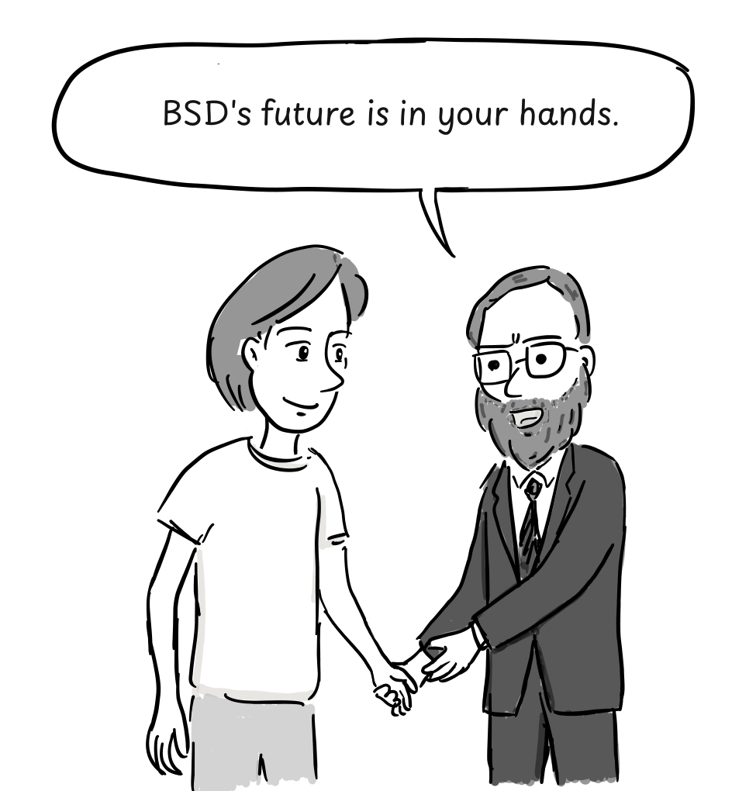

<!-- dialogue: fabry-bsd-future -->
> BSD's future is in your hands.
<!-- /dialogue -->

:::

:::panel rounded="true" style="border-width: 3px;border-color: black;"

Within eighteen months of its release, more than 1,000 site licenses for 4.2BSD had been issued. TCP/IP and the new filesystem gave it features AT&T's System V lacked at the time.

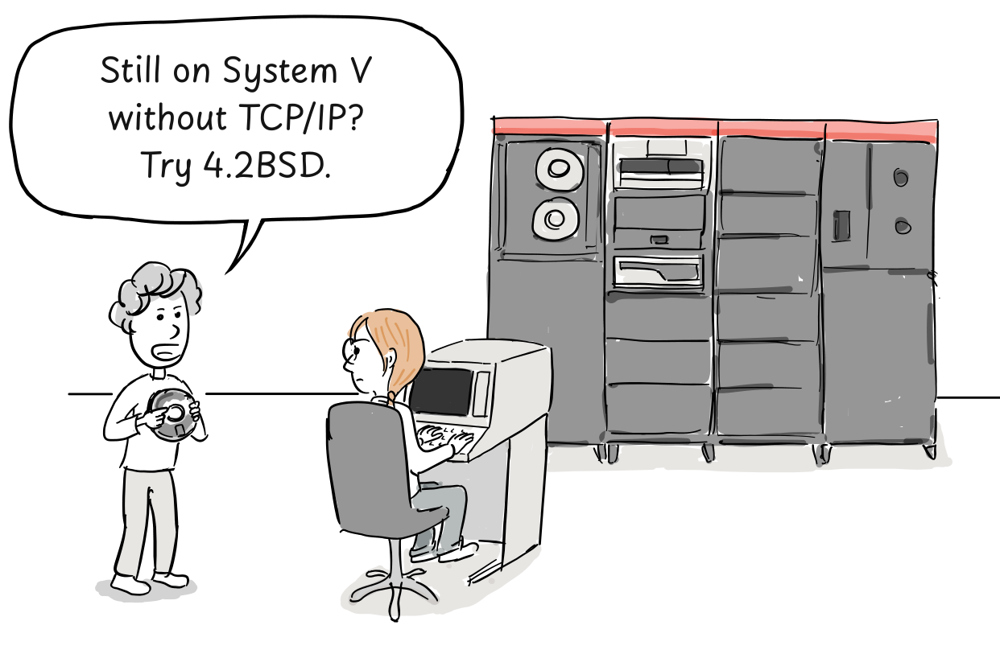

<!-- dialogue: user-promote-42bsd -->
> Still on System V\
> without TCP/IP?\
> Try 4.2BSD.
<!-- /dialogue -->

:::
::::

:::panel rounded="true" style="border-width: 3px;border-color: black;"

Networking features developed in BSD later found their way into AT&T's Unix too.

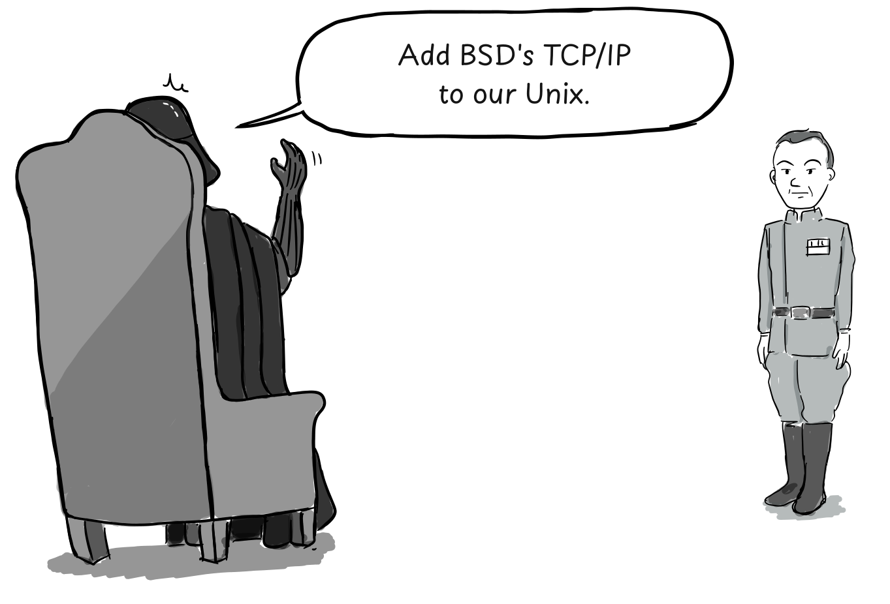

<!-- dialogue: att-add-tcp-ip -->
> Add BSD's TCP/IP\
> to our Unix.
<!-- /dialogue -->

:::

::::panels columns="2" ratios="40:60"
:::panel rounded="true" style="border-width: 3px;border-color: black;"

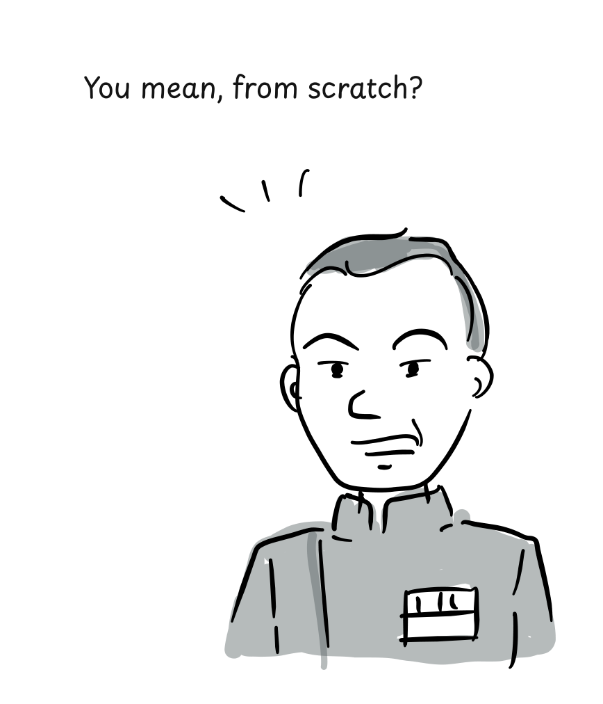

<!-- dialogue: employee-reimplement -->
> You mean, from scratch?
<!-- /dialogue -->

:::

:::panel rounded="true" style="border-width: 3px;border-color: black;"

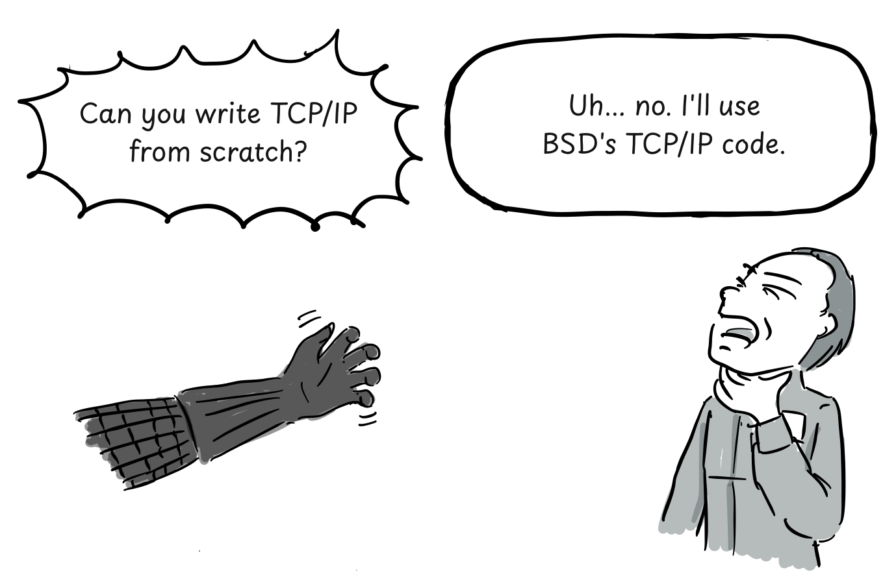

<!-- dialogue: att-reimplementation-challenge -->
> Can you write TCP/IP\
> from scratch?
<!-- /dialogue -->

<!-- dialogue: employee-reuse-bsd -->
> Uh... no. I'll use\
> BSD's TCP/IP code.
<!-- /dialogue -->

:::
::::

Note: The dialogue is dramatized, not a verbatim record of what these people said.

The TCP/IP meeting scene is a dramatization based on the recollections of John Gage, a friend of Bill Joy and former chief researcher at Sun Microsystems. BBN's Rob Gurwitz rejected the claim that BBN's code did not work. He said he had attended the relevant DARPA meetings but did not remember hearing Bill Joy say, "It's very simple — you read the protocol and write the code." ([Source](#reference-1))

**References**

- Andrew Leonard, [BSD Unix: Power to the people, from the code](https://www.salon.com/2000/05/16/chapter_2_part_one/), 2000.
- Marshall Kirk McKusick, [Twenty Years of Berkeley Unix, in *Open Sources: Voices from the Open Source Revolution* (Korean edition, Hanbit Media)](http://www.hanbit.co.kr/store/books/look.php?p_code=E5329835060), 2013.
- Marshall Kirk McKusick, [Twenty Years of Berkeley Unix: From AT&T-Owned to Freely Redistributable](https://www.oreilly.com/openbook/opensources/book/kirkmck.html), 1999.
- Robert F. Gurwitz, [VAX-UNIX Networking Support Project - Implementation Description (IEN 168)](https://history.rfc-editor.org/ien/ien168.txt), 1981.
- Computer History Museum, [Internet History of 1970s](https://www.computerhistory.org/internethistory/1970s/).
- Pixar, [Our Story](https://www.pixar.com/our-story).
- [RFC 1122: Requirements for Internet Hosts - Communication Layers](https://www.rfc-editor.org/rfc/rfc1122.html), 1989.
- Modern protocol examples: [IPv6 (RFC 1883)](https://www.rfc-editor.org/rfc/rfc1883.html), 1995; [TLS 1.0 (RFC 2246)](https://www.rfc-editor.org/rfc/rfc2246.html), 1999.
- [Computer Systems Research Group - Wikipedia](https://en.wikipedia.org/wiki/Computer_Systems_Research_Group)
- *The Design and Implementation of the 4.4BSD Operating System*, [2.1.13. Network Implementation](https://docs.freebsd.org/en/books/design-44bsd/#overview-network-implementation).
