- [BSD 유닉스 1화 – UC 버클리로 간 유닉스 코드](/ko/posts/11.%20BSD%20Unix%20Part%201%20-%20Unix%20Code%20Goes%20to%20UC%20Berkeley/)
- [BSD 유닉스 2화 – vi 에디터의 탄생](/ko/posts/12.%20BSD%20Unix%20Part%202%20-%20The%20Birth%20of%20the%20vi%20Editor/)
- [BSD 유닉스 3화 – BSD 유닉스 시작](/ko/posts/13.%20BSD%20Unix%20Part%203%20-%20The%20Beginning%20of%20BSD%20Unix/)
- [BSD 유닉스 4화 – CSRG(Computer Systems Research Group) 결성](/ko/posts/14.%20BSD%20Unix%20Part%204%20-%20The%20Formation%20of%20CSRG/)
- [BSD 유닉스 5화 – TCP/IP 개발](/ko/posts/15.%20BSD%20Unix%20Part%205%20-%20The%20Development%20of%20TCP-IP/)

::::panels columns="2" ratios="45:55"
:::panel title="true" rounded="true" style="border-width: 3px;border-color: black;"

# BSD 유닉스 6화
## 자유로의 투쟁

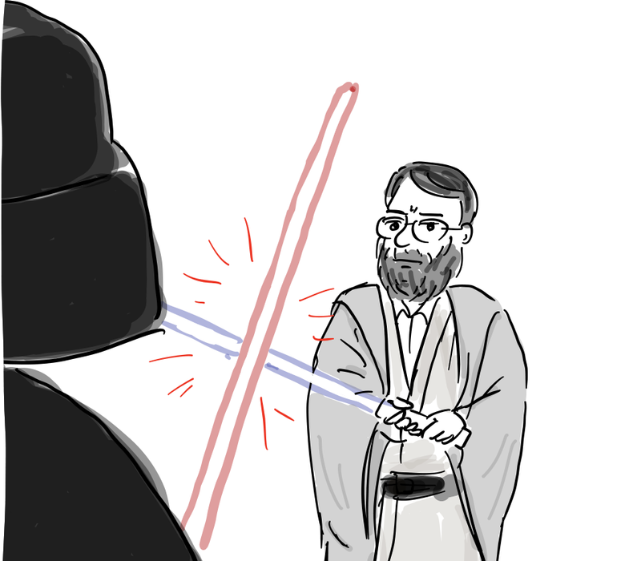

:::

:::panel rounded="true" style="border-width: 3px;border-color: black;"

1956년 반독점 소송의 합의로 AT&T가 상업용 컴퓨터 사업에 진출할 수 없었기 때문에 초기 유닉스는 저렴한 가격에 소스코드와 함께 제공되었다 [\[6\]][reference-6]. 일부 초기 라이선스는 가격이 $99에 불과했다 [\[1\]][reference-1].

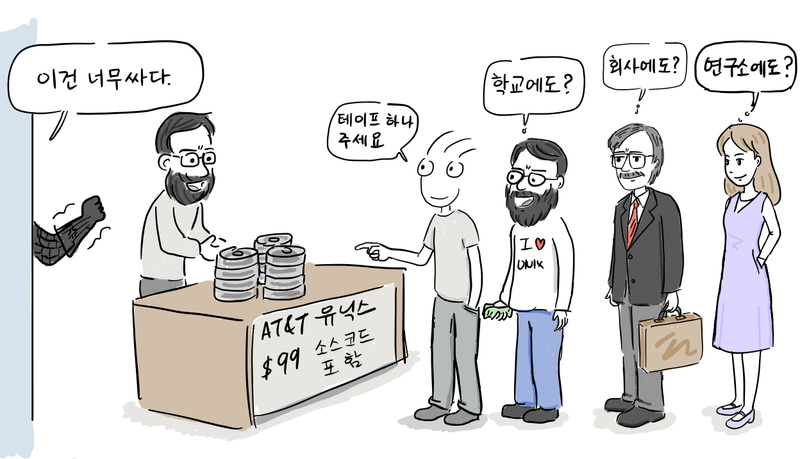

:::
::::

::::panels columns="2" ratios="45:55"
:::panel rounded="true" style="border-width: 3px;border-color: black;"

미국방성 [고등 방위 연구 계획국(DARPA)](https://ko.wikipedia.org/wiki/%EB%B0%A9%EC%9C%84%EA%B3%A0%EB%93%B1%EC%97%B0%EA%B5%AC%EA%B3%84%ED%9A%8D%EA%B5%AD)도 유닉스가 소스코드와 함께 배포되는 부분을 중요하게 생각했다. 이러한 이유로 인터넷 구축에 [DEC](https://ko.wikipedia.org/wiki/%EB%94%94%EC%A7%80%ED%84%B8_%EC%9D%B4%ED%81%85%EB%A8%BC%ED%8A%B8_%EC%BD%94%ED%8D%BC%EB%A0%88%EC%9D%B4%EC%85%98)가 개발한 [VMS](https://ko.wikipedia.org/wiki/OpenVMS) 대신 [BSD](https://ko.wikipedia.org/wiki/BSD) 유닉스를 선택했다[\[1\]][reference-1].

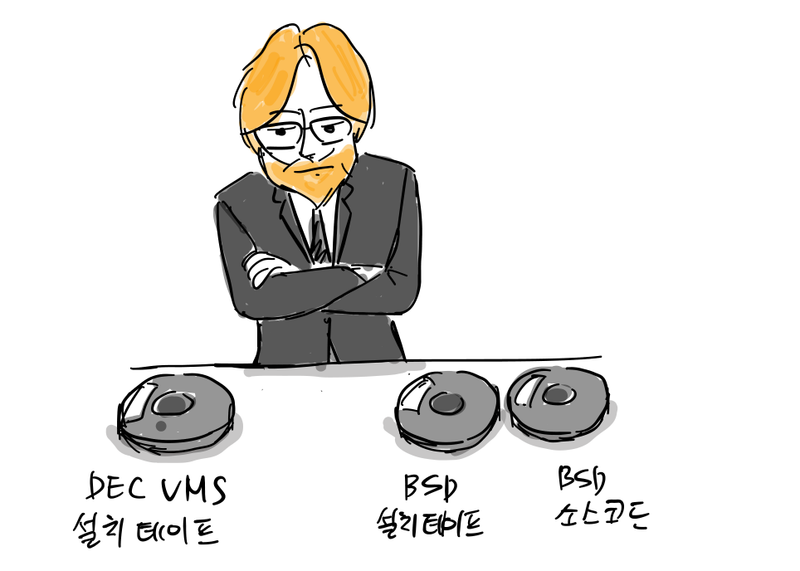

:::

:::panel rounded="true" style="border-width: 3px;border-color: black;"

하지만, 1984년 AT&T가 여러 회사로 쪼개지면서 유닉스를 상업적으로 판매할 수 있는 길이 열렸고, AT&T는 갑자기 유닉스 가격을 $99에서 $250,000로 올렸다[\[1\]][reference-1].

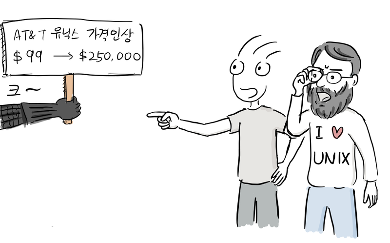

:::
::::

::::panels columns="2" ratios="45:55"
:::panel rounded="true" style="border-width: 3px;border-color: black;"

이때까지 BSD 사용하려면 AT&T 유닉스 라이선스를 갖고 있어야했다. 하지만, AT&T가 라이선스 가격을 올리자, 몇몇 회사들이 BSD 유닉스에서 네트워킹 코드만을 배포하기를 요청했다.

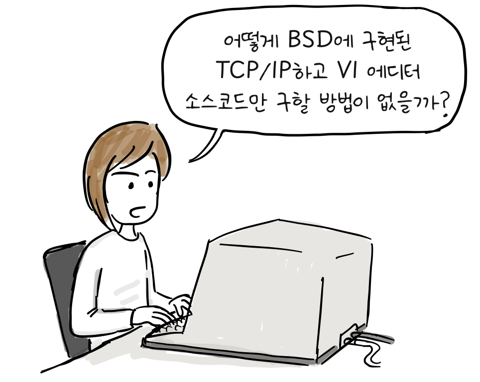

<!-- dialogue: user-request-code -->
> 어떻게 BSD에 구현된 TCP/IP하고 VI 에디터 소스코드만 구할 방법이 없을까?
<!-- /dialogue -->

:::

:::panel rounded="true" style="border-width: 3px;border-color: black;"

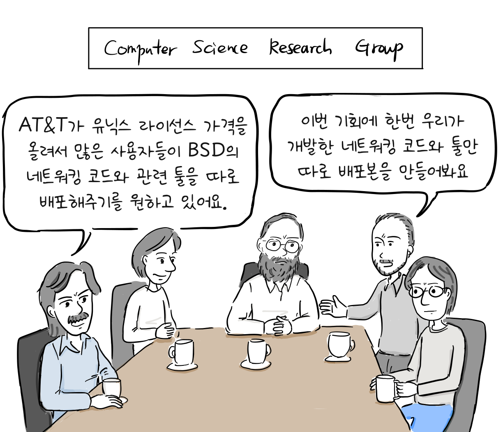

<!-- dialogue: researcher-networking-request -->
> AT&T가 유닉스 라이선스 가격을 올려서 많은 사용자들이 BSD의 네트워킹 코드와 관련 툴을 따로 배포해주기를 원하고 있어요.
<!-- /dialogue -->

<!-- dialogue: researcher-separate-release -->
> 이번 기회에 한번 우리가 개발한 네트워킹 코드와 툴만 따로 배포본을 만들어봐요
<!-- /dialogue -->

:::
::::

::::panels columns="2"
:::panel rounded="true" style="border-width: 3px;border-color: black;"

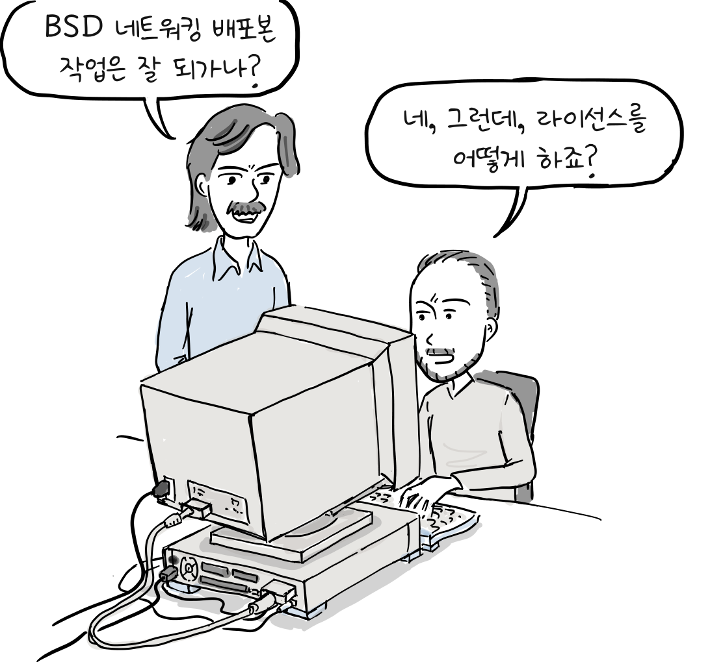

<!-- dialogue: researcher-release-progress -->
> BSD 네트워킹 배포본 작업은 잘 되가나?
<!-- /dialogue -->

<!-- dialogue: researcher-license-question -->
> 네, 그런데, 라이선스를 어떻게 하죠?
<!-- /dialogue -->

:::

:::panel rounded="true" style="border-width: 3px;border-color: black;"

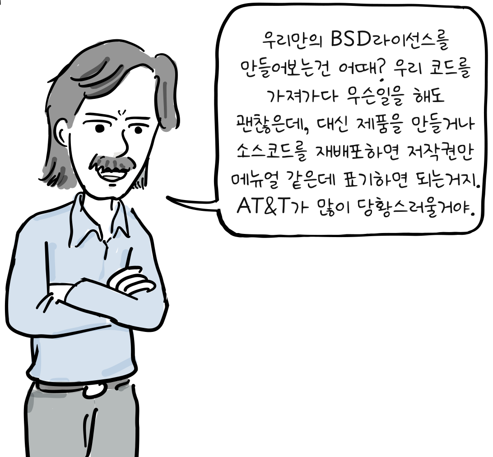

<!-- dialogue: researcher-bsd-license -->
> 우리만의 BSD라이선스를 만들어보는건 어때? 우리 코드를 가져가다 무슨일을 해도 괜찮은데, 대신 제품을 만들거나 소스코드를 재배포하면 저작권만 메뉴얼 같은데 표기하면 되는거지. AT&T가 많이 당황스러울거야.
<!-- /dialogue -->

:::
::::

::::panels columns="2"
:::panel rounded="true" style="border-width: 3px;border-color: black; "

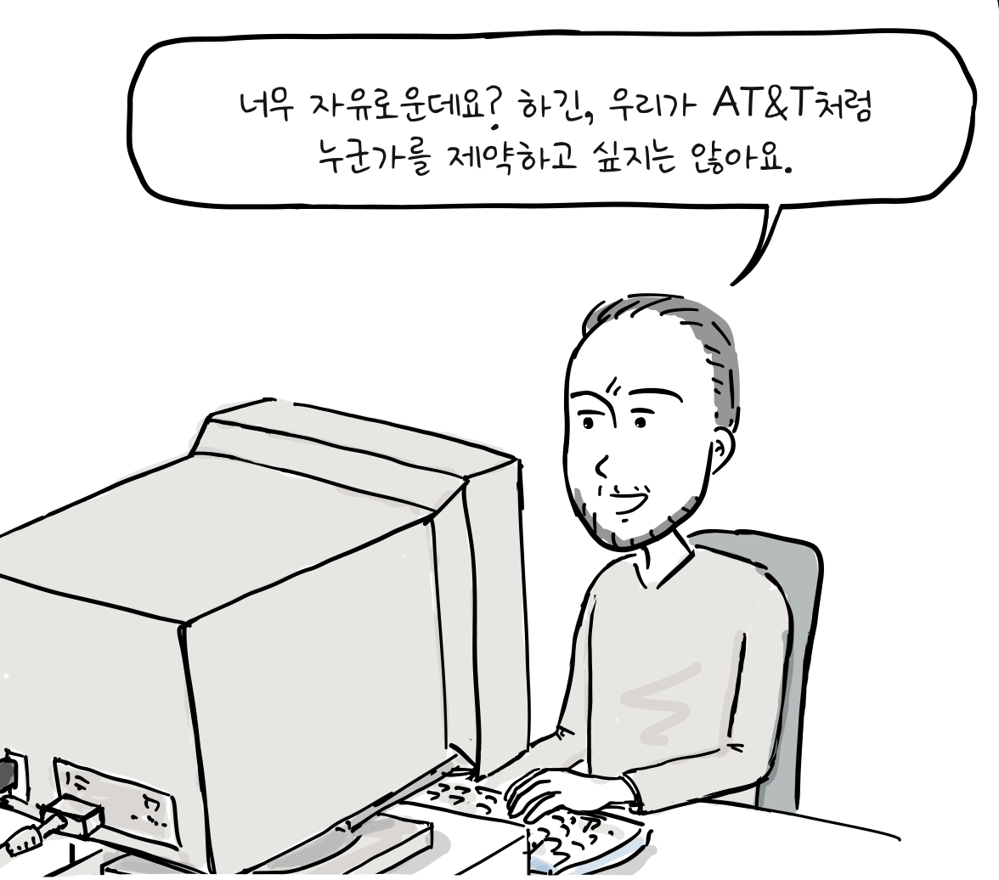

<!-- dialogue: researcher-too-free -->
> 너무 자유로운데요? 하긴, 우리가 AT&T처럼\
> 누군가를 제약하고 싶지는 않아요.
<!-- /dialogue -->

:::

:::panel rounded="true" style="border-width: 3px;border-color: black;"

[CSRG](https://en.wikipedia.org/wiki/Computer_Systems_Research_Group)는 BSD의 네트워킹 코드와 관련 유틸리티를 묶어 1989년 6월에 Networking Release 1(Net/1)을 공개했다. AT&T의 소스 라이선스 없이도 사용할 수 있도록 새롭게 BSD 라이선스를 만들었는데, 코드를 수정하거나 소스·바이너리 형태로 재배포해도 버클리에 로열티를 낼 필요가 없었다. 단, 소스의 저작권 고지를 유지하고 제품 문서에 UC 버클리와 기여자들의 코드 사용을 밝혀야 했다.

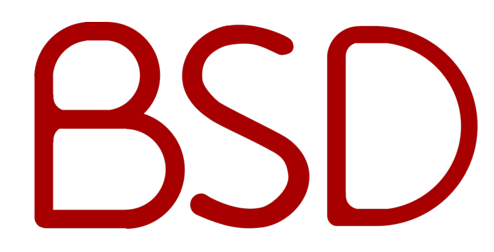

:::
::::

::::panels columns="2"
:::panel rounded="true" style="border-width: 3px;border-color: black;"

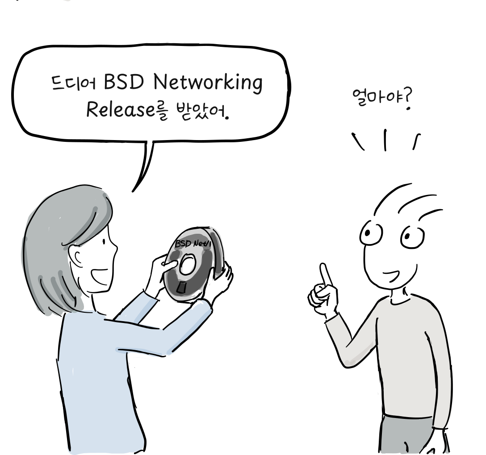

<!-- dialogue: user-received-net1 -->
> 드디어 BSD Networking Release를 받았어.
<!-- /dialogue -->

<!-- dialogue: user-net1-price -->
> 얼마야?
<!-- /dialogue -->

:::

:::panel rounded="true" style="border-width: 3px;border-color: black;"

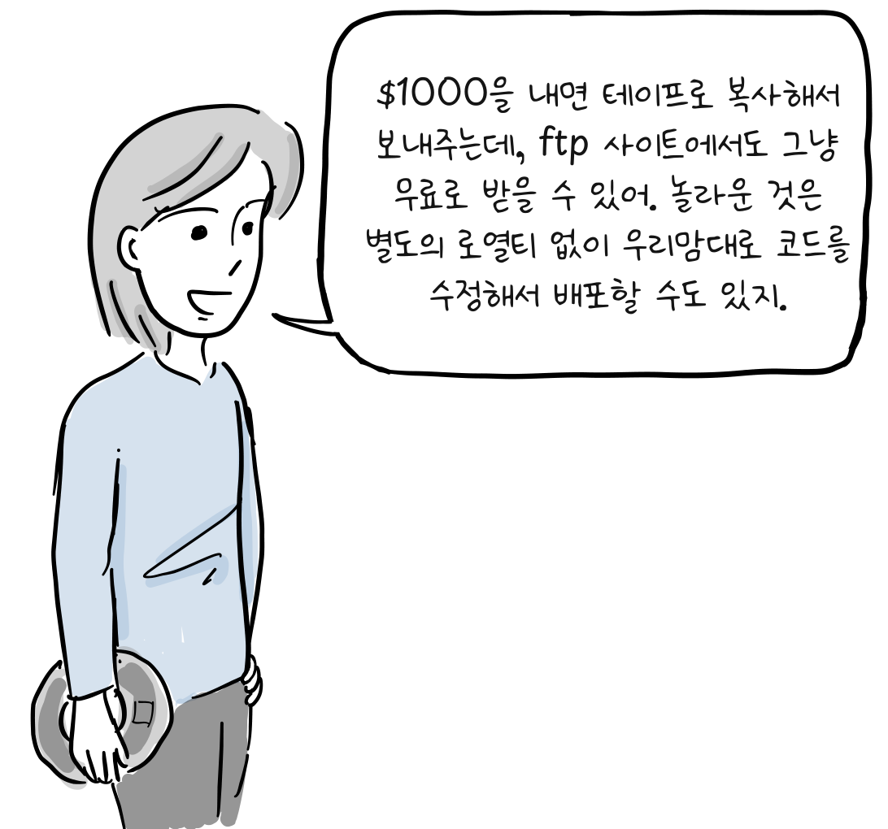

<!-- dialogue: user-tape-and-ftp -->
> $1000을 내면 테이프로 복사해서 보내주는데, ftp 사이트에서도 그냥 무료로 받을 수 있어. 놀라운 것은 별도의 로열티 없이 우리맘대로 코드를 수정해서 배포할 수도 있지.
<!-- /dialogue -->

:::
::::

::::panels columns="2"
:::panel rounded="true" style="border-width: 3px;border-color: black;"

## 한편, CSRG에서는

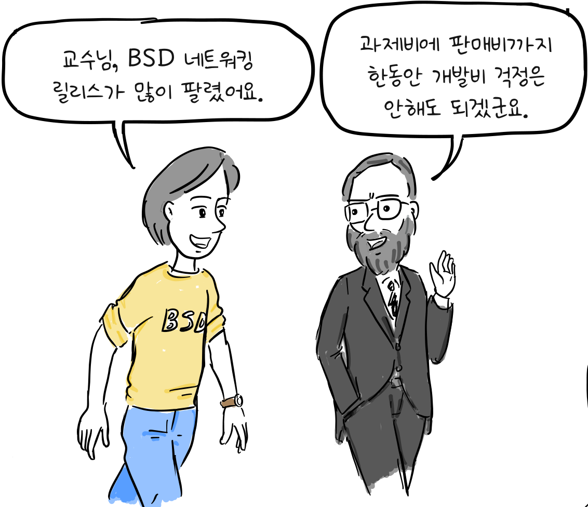

<!-- dialogue: researcher-release-sales -->
> 교수님, BSD 네트워킹\
> 릴리스가 많이 팔렸어요.
<!-- /dialogue -->

<!-- dialogue: professor-development-funds -->
> 과제비에 판매비까지 한동안 개발비 걱정은 안해도 되겠군요.
<!-- /dialogue -->

:::

:::panel rounded="true" style="border-width: 3px;border-color: black;"

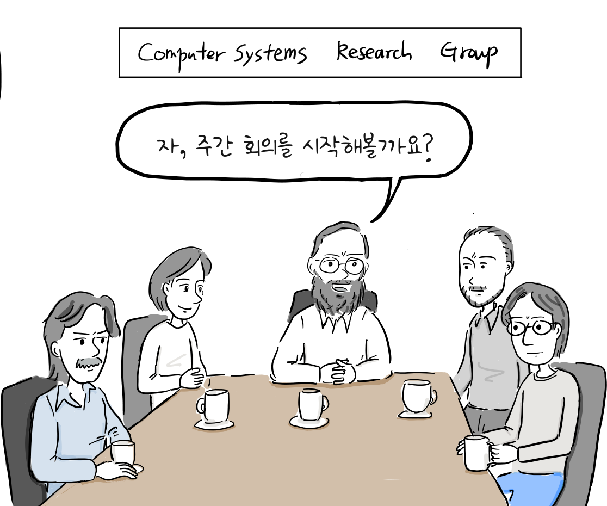

<!-- dialogue: professor-weekly-meeting -->
> 자, 주간 회의를 시작해볼까요?
<!-- /dialogue -->

:::
::::

::::panels columns="2"
:::panel rounded="true" style="border-width: 3px;border-color: black;"

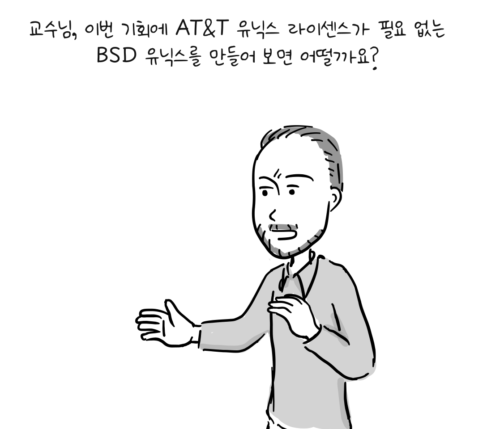

<!-- dialogue: researcher-free-bsd -->
> 교수님, 이번 기회에 AT&T 유닉스 라이센스가 필요 없는 BSD 유닉스를 만들어 보면 어떨까요?
<!-- /dialogue -->

:::

:::panel rounded="true" style="border-width: 3px;border-color: black;"

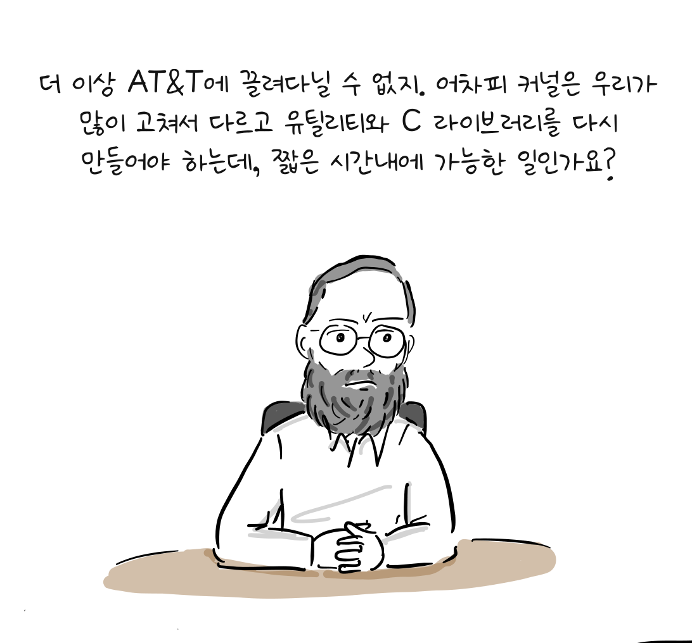

<!-- dialogue: professor-reimplementation-time -->
> 더 이상 AT&T에 끌려다닐 수 없지. 어차피 커널은 우리가 많이 고쳐서 다르고 유틸리티와 C 라이브러리를 다시 만들어야 하는데, 짧은 시간내에 가능한 일인가요?
<!-- /dialogue -->

:::
::::

::::panels columns="2" ratios="40:60"
:::panel rounded="true" style="border-width: 3px;border-color: black;"

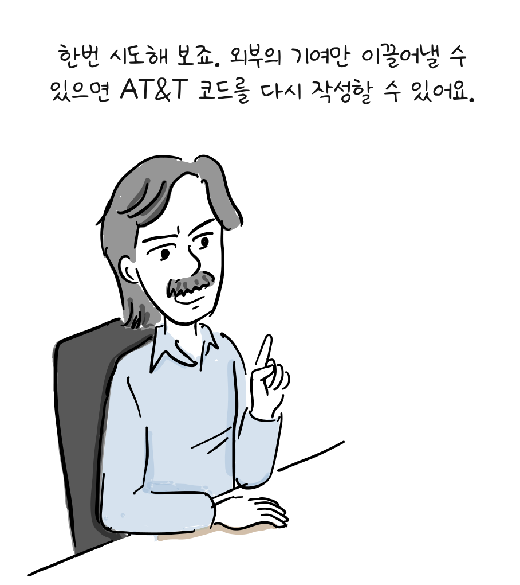

<!-- dialogue: researcher-external-contributors -->
> 한번 시도해 보죠. 외부의 기여만 이끌어낼 수 있으면 AT&T 코드를 다시 작성할 수 있어요.
<!-- /dialogue -->

:::

:::panel rounded="true" style="border-width: 3px;border-color: black;"

결국, CSRG는 AT&T가 작성한 툴과 C 라이브러리를 다시 작성하기로 결정한다. 다행히 외부 기여자의 참여로 18개월동안 대부분의 코드를 다시 작성할 수 있었다.

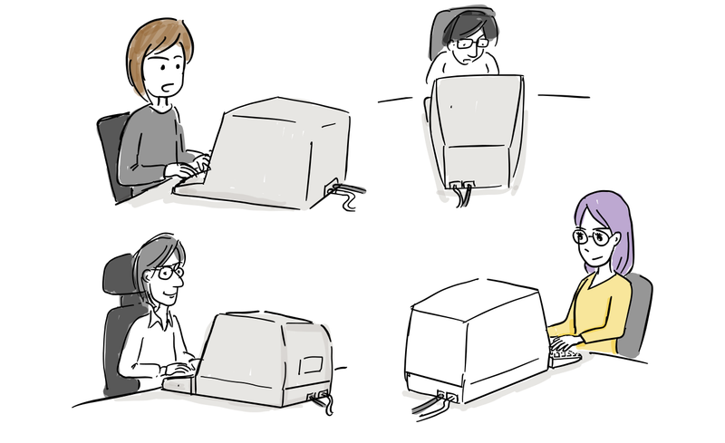

:::
::::

::::panels columns="2"
:::panel narration="boxed" rounded="true" style="border-width: 3px;border-color: black;"

AT&T 유닉스에서 작성된 대부분의 코드를 제거한 후, 1991년 6월에 드디어 완전히 자유로운 BSD유닉스가 출시된다. 여전히 복사 비용인 1000$만 내면 BSD 유닉스 소스코드를 테이프로 받을 수 있었고, 심지어 ftp 사이트에서 무료로 다운로드 받을 수 있었다.

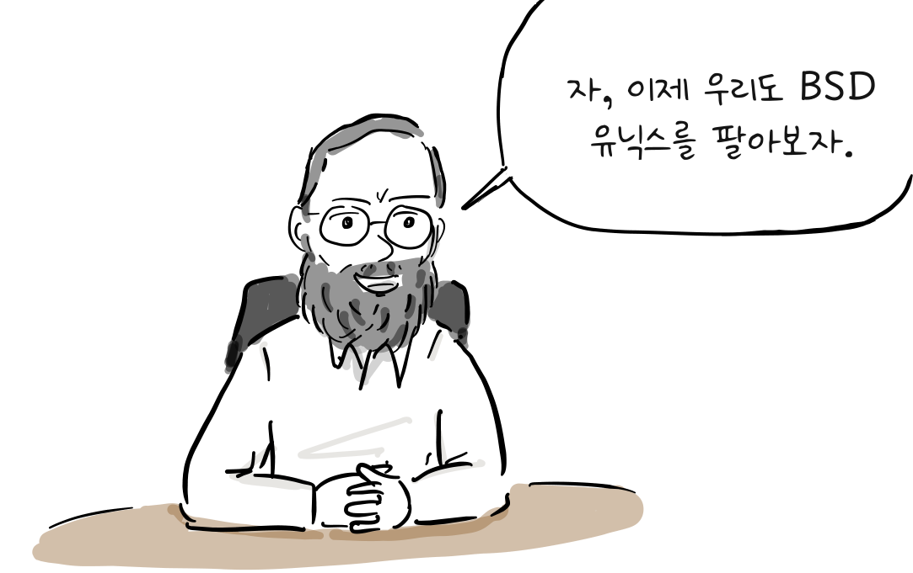

<!-- dialogue: professor-selling-bsd -->
> 자, 이제 우리도 BSD 유닉스를 팔아보자.
<!-- /dialogue -->

:::

:::panel rounded="true" style="border-width: 3px;border-color: black;"

[CSRG](https://en.wikipedia.org/wiki/Computer_Systems_Research_Group)는 BSD유닉스를 본격적으로 판매하기 위해 [BSDi](https://en.wikipedia.org/wiki/Berkeley_Software_Design)라는 회사를 설립한다. 캘리포니아 대학도 90년대 초부터 BSD 유닉스를 판매하기 시작했다. 이 당시 AT&T유닉스 보다 95%싸다고 광고를 했는데, 결국, AT&T의 심기를 건드리고 만다.

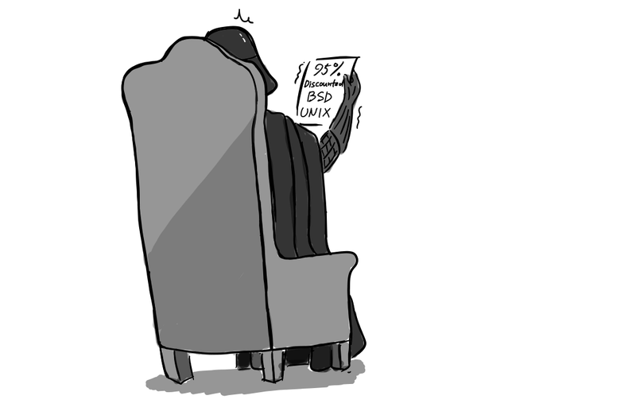

:::
::::

::::panels columns="2"
:::panel narration="boxed" rounded="true" style="border-width: 3px;border-color: black;"

## 제국의 역습

결국, 1992년 4월, AT&T의 자회사 USL은 BSDi를 상대로 소송을 제기한다. 이후 UC 버클리 대학도 소송 대상에 포함시켰다.

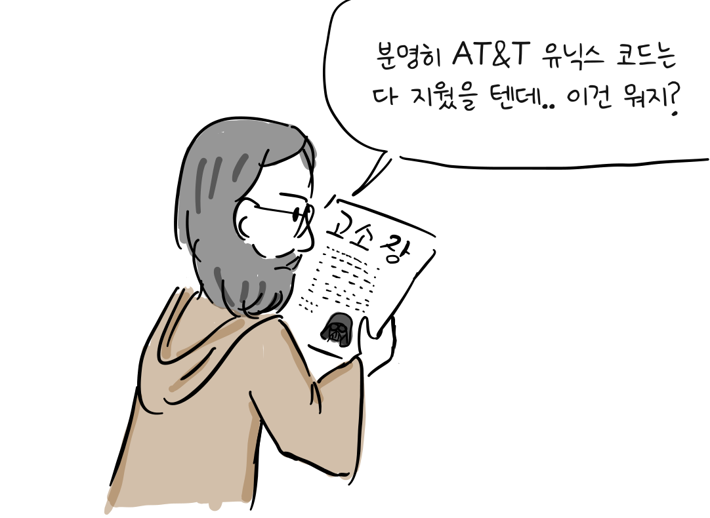

<!-- dialogue: researcher-lawsuit-surprise -->
> 분명히 AT&T 유닉스 코드는 다 지웠을 텐데.. 이건 뭐지?
<!-- /dialogue -->

:::

:::panel rounded="true" style="border-width: 3px;border-color: black;"

하지만, AT&T의 [유닉스 시스템V](https://ko.wikipedia.org/wiki/%EC%9C%A0%EB%8B%89%EC%8A%A4_%EC%8B%9C%EC%8A%A4%ED%85%9C_V) 역시 가상 메모리, TCP/IP, VI 등 BSD 유닉스 코드가 많이 포함되어 있었다. 애초에 BSD 라이선스는 저작권만 표기하면 누구나 맘대로 사용할 수 코드인데, AT&T는 소스코드에서 저작권 부분을 제거하고 자신들이 모든 코드를 만든 것 처럼 유닉스를 판매하였다.

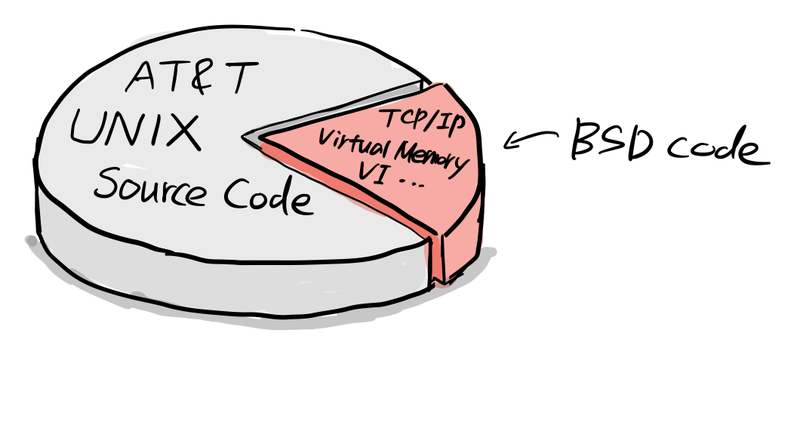

:::
::::

:::panel rounded="true" style="border-width: 3px;border-color: black;"

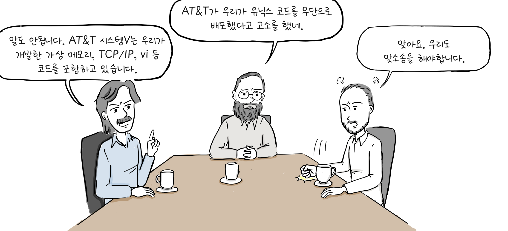

<!-- dialogue: professor-att-lawsuit -->
> AT&T가 우리가 유닉스 코드를 무단으로 배포했다고 고소를 했네.
<!-- /dialogue -->

<!-- dialogue: researcher-bsd-in-system-v -->
> 말도 안됩니다. AT&T 시스템V는 우리가 개발한 가상 메모리, TCP/IP, vi 등 코드를 포함하고 있습니다.
<!-- /dialogue -->

<!-- dialogue: researcher-countersuit -->
> 맞아요. 우리도\
> 맞소송을 해야합니다.
<!-- /dialogue -->

:::

:::panel rounded="true" style="border-width: 3px;border-color: black;"

결국, BSD 유닉스 측도 AT&T를 상대로 맞고소를 한다.

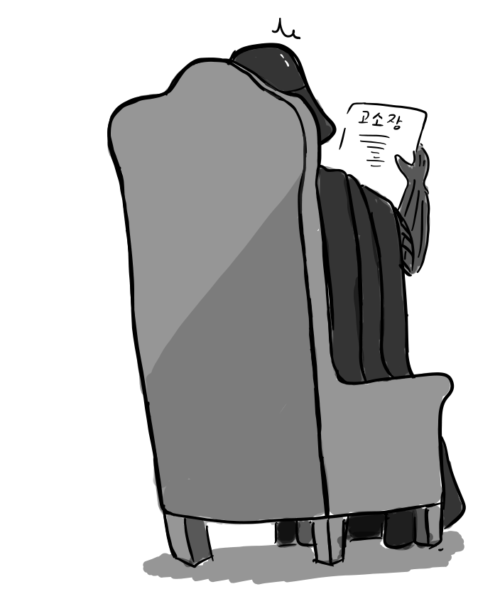

:::

:::panel rounded="true" style="border-width: 3px;border-color: black;"

 1994년 2월, CSRG가 일부 남아있던 AT&T 유닉스 코드를 제거하는 조건으로 각자 유닉스를 판매할 수 있도록 합의가 이루어졌다.

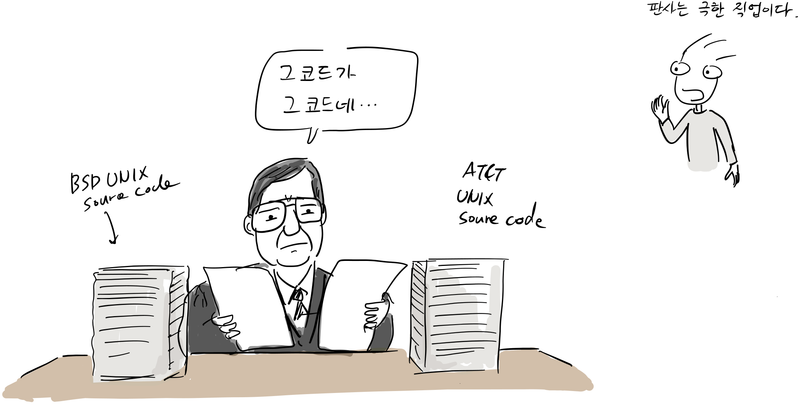

비록 BSD유닉스가 AT&T 유닉스 코드를 기반으로 개발되었지만 상당수 코드가 다시 개발되었고, AT&T 역시 BSD에서 개발한 TCP/IP, 가상 메모리, VI 코드를 가져다 쓰면서 임의로 저작권 표기를 삭제한 정황이 드러났기 때문이다. 하지만 소송 기간 동안 BSD 유닉스의 배포에는 법적 불확실성이 있었고 완전한 자유 소프트웨어로된 BSD 유닉스가 나오기까지 2년여의 시간을 낭비한 탓에 그 사이 리눅스가 성장할 여지를 주게 된다.

:::

:::panel style="width:412px;align:center;"

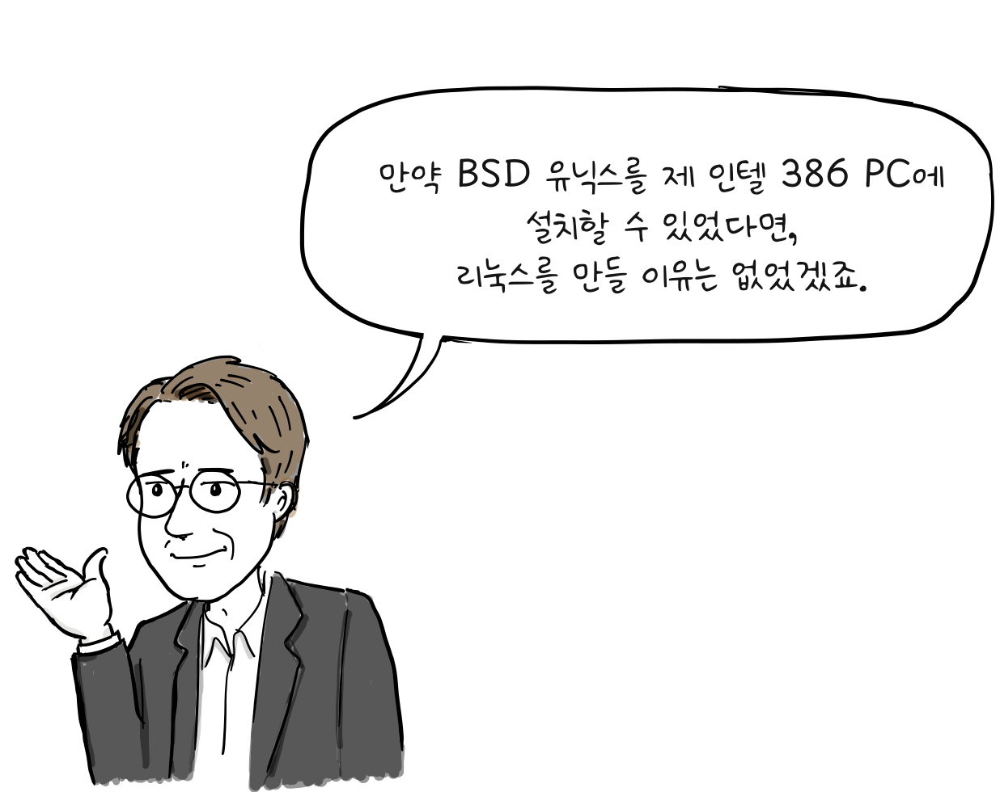

<!-- dialogue: linus-no-linux -->
> 만약 BSD 유닉스를 제 인텔 386 PC에\
> 설치할 수 있었다면,\
> 리눅스를 만들 이유는 없었겠죠.
<!-- /dialogue -->

:::

**6번째 이야기로 BSD 유닉스 이야기를 마무리합니다.**

# 참고 문헌

1. ANDREW LEONARD, [BSD Unix: Power to the people, from the code][reference-1], 2000
2. 마샬 커크 맥퀴식, [버클리 유닉스의 20년, 오픈소스 혁명의 목소리, 한빛출판사](http://www.hanbit.co.kr/store/books/look.php?p_code=E5329835060), 2013
3. [Computer Systems Research Group](https://en.wikipedia.org/wiki/Computer_Systems_Research_Group)
4. [The Design and Implementation of the 4.4BSD Operating System: Network Implementation](https://www.freebsd.org/doc/en/books/design-44bsd/overview-network-implementation.html)
5. Mike Linksvayer, [Interview with Linus Torvalds](https://gondwanaland.com/meta/history/interview.html), Meta Magazine, 1993
6. Federal Judicial Center, [The Breakup of "Ma Bell": United States v. AT&T][reference-6]
7. Dennis Ritchie, [Old Unix Licenses and Price Lists](https://www.nokia.com/bell-labs/about/dennis-m-ritchie/licenses.html)

[reference-1]: https://www.salon.com/2000/05/16/chapter_2_part_one/
[reference-6]: https://www.fjc.gov/history/spotlight-judicial-history/breakup-ma-bell
