- [BSD Unix, Part 1 - Unix Code Goes to UC Berkeley](/posts/11.%20BSD%20Unix%20Part%201%20-%20Unix%20Code%20Goes%20to%20UC%20Berkeley/)
- [BSD Unix, Part 2 - The Birth of the vi Editor](/posts/12.%20BSD%20Unix%20Part%202%20-%20The%20Birth%20of%20the%20vi%20Editor/)
- [BSD Unix, Part 3 - The Beginning of BSD Unix](/posts/13.%20BSD%20Unix%20Part%203%20-%20The%20Beginning%20of%20BSD%20Unix/)
- [BSD Unix, Part 4 - The Formation of CSRG](/posts/14.%20BSD%20Unix%20Part%204%20-%20The%20Formation%20of%20CSRG/)
- [BSD Unix, Part 5 - Bringing TCP/IP to BSD](/posts/15.%20BSD%20Unix%20Part%205%20-%20The%20Development%20of%20TCP-IP/)

::::panels columns="2" ratios="42:58"
:::panel title="true" rounded="true" style="border-width: 3px;border-color: black;"

# BSD Unix, Part 6
## The Struggle for Freedom

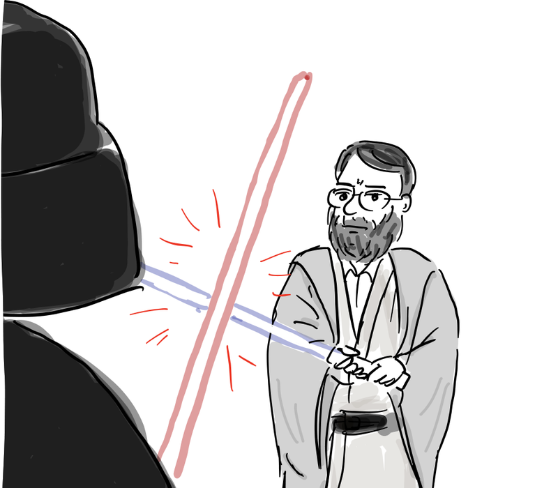

:::

:::panel rounded="true" style="border-width: 3px;border-color: black;"

Early Unix licenses cost just $99 a copy, with source code included. This was because of an agreement AT&T and IBM had made in the 1950s: IBM would stay out of the telephone business, and AT&T out of the computer business.

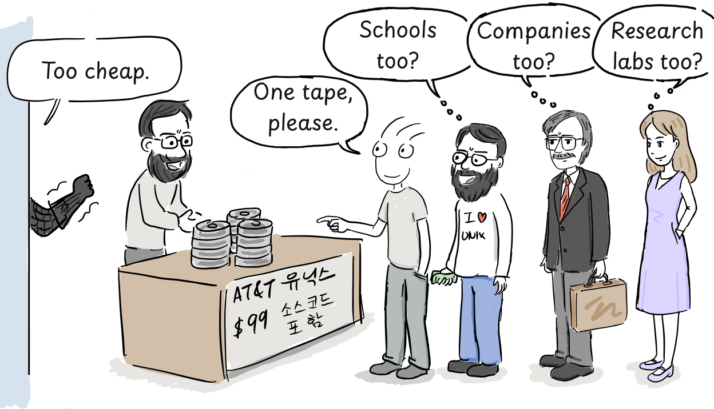

<!-- dialogue: licensing-cheap -->
> Too cheap.
<!-- /dialogue -->

<!-- dialogue: licensing-tape -->
> One tape,\
> please.
<!-- /dialogue -->

<!-- dialogue: licensing-schools -->
> Schools\
> too?
<!-- /dialogue -->

<!-- dialogue: licensing-companies -->
> Companies\
> too?
<!-- /dialogue -->

<!-- dialogue: licensing-labs -->
> Research\
> labs too?
<!-- /dialogue -->

:::
::::

::::panels columns="2" ratios="45:55"
:::panel rounded="true" style="border-width: 3px;border-color: black;"

[Defense Advanced Research Projects Agency (DARPA)](https://en.wikipedia.org/wiki/DARPA) also valued Unix's source-code availability. That was why it chose [BSD](https://en.wikipedia.org/wiki/Berkeley_Software_Distribution) Unix over [DEC](https://en.wikipedia.org/wiki/Digital_Equipment_Corporation)'s [VMS](https://en.wikipedia.org/wiki/OpenVMS) for building the Internet [1].

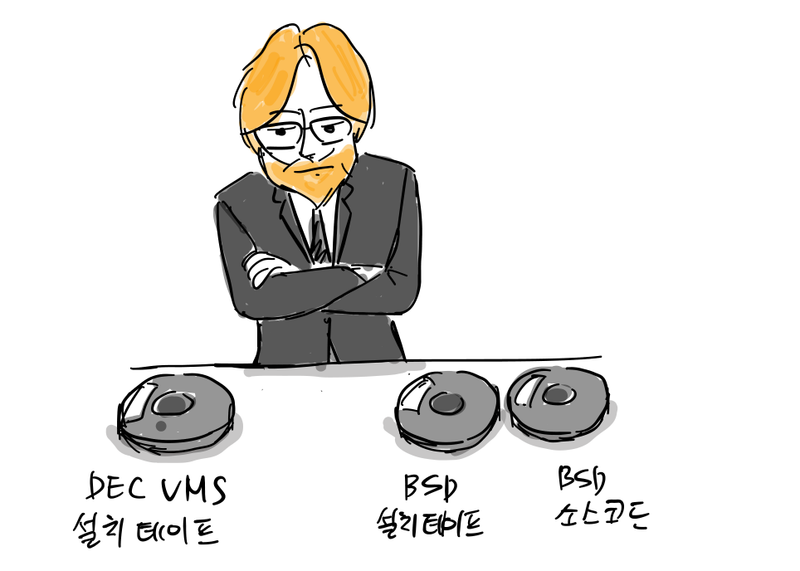

:::

:::panel rounded="true" style="border-width: 3px;border-color: black;"

But AT&T's breakup in 1984 opened the way for it to sell Unix commercially. AT&T abruptly raised the price from $99 to $250,000 [1].

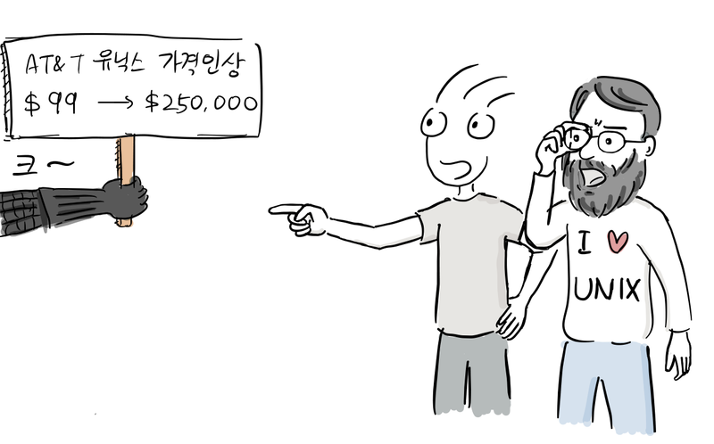

:::
::::

::::panels columns="2" ratios="45:55"
:::panel rounded="true" style="border-width: 3px;border-color: black;"

BSD still required an AT&T license. When fees rose, some companies wanted its networking code separately.

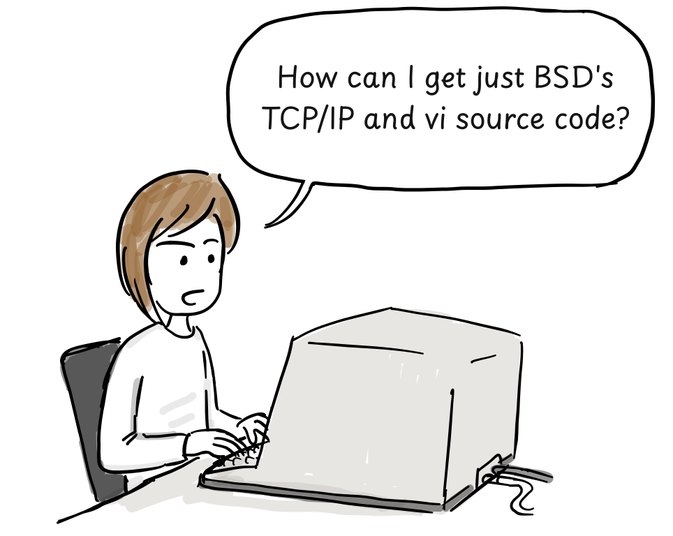

<!-- dialogue: user-request-code -->
> How can I get just BSD's\
> TCP/IP and vi source code?
<!-- /dialogue -->

:::

:::panel rounded="true" style="border-width: 3px;border-color: black;"

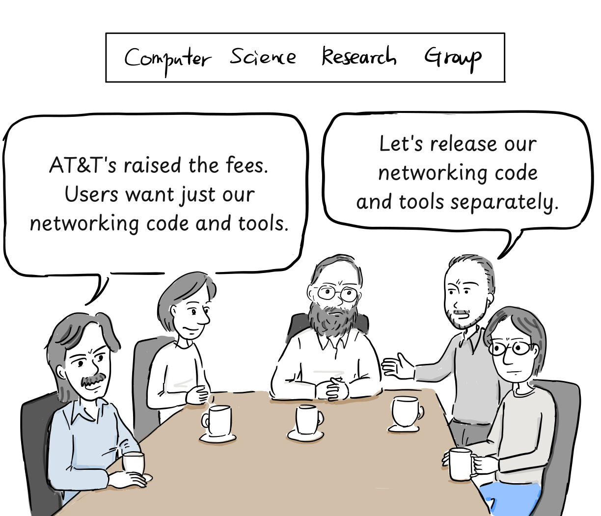

<!-- dialogue: researcher-networking-request -->
> AT&T's raised the fees.\
> Users want just our\
> networking code and tools.
<!-- /dialogue -->

<!-- dialogue: researcher-separate-release -->
> Let's release our\
> networking code\
> and tools separately.
<!-- /dialogue -->

:::
::::

::::panels columns="2"
:::panel rounded="true" style="border-width: 3px;border-color: black;"

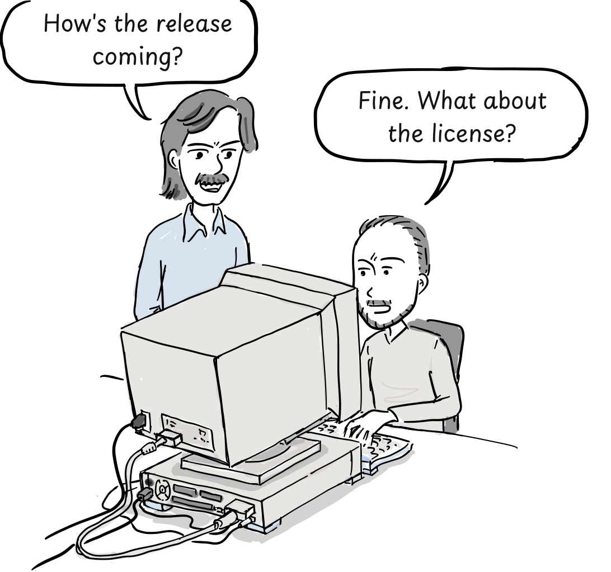

<!-- dialogue: researcher-release-progress -->
> How's the release\
> coming?
<!-- /dialogue -->

<!-- dialogue: researcher-license-question -->
> Fine. What about\
> the license?
<!-- /dialogue -->

:::

:::panel rounded="true" style="border-width: 3px;border-color: black;"

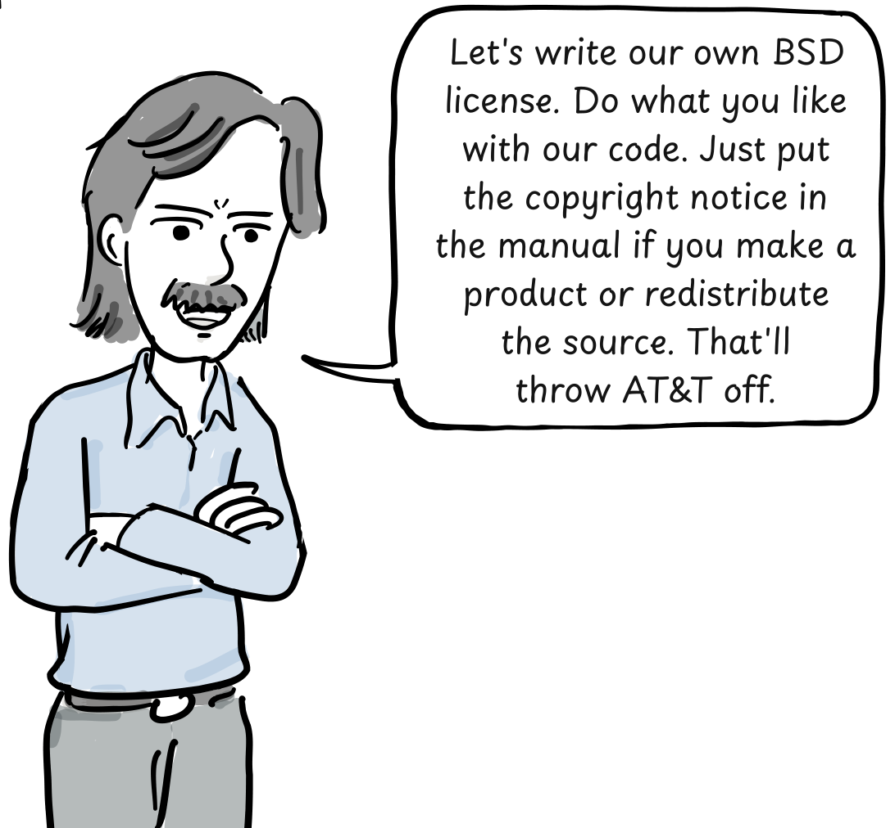

<!-- dialogue: researcher-bsd-license -->
> Let's write our own BSD\
> license. Do what you like\
> with our code. Just put\
> the copyright notice in\
> the manual if you make a\
> product or redistribute\
> the source. That'll\
> throw AT&T off.
<!-- /dialogue -->

:::
::::

::::panels columns="2"
:::panel rounded="true" style="border-width: 3px;border-color: black;"

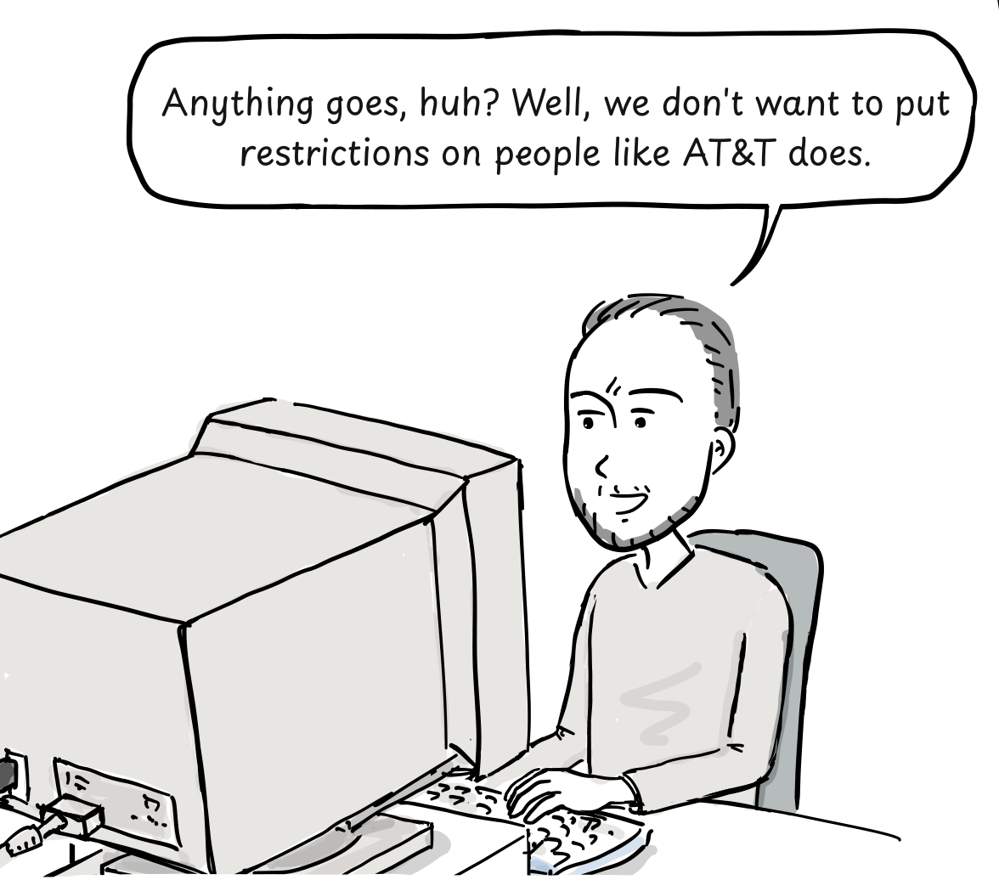

<!-- dialogue: researcher-too-free -->
> Anything goes, huh? Well, we don't want to put\
> restrictions on people like AT&T does.
<!-- /dialogue -->

:::

:::panel rounded="true" style="border-width: 3px;border-color: black;"

[CSRG](https://en.wikipedia.org/wiki/Computer_Systems_Research_Group) released its networking code and utilities as Networking Release 1 (Net/1) in June 1989. Its new BSD license allowed use without an AT&T source license. People could modify the code or redistribute it as source or binaries without paying Berkeley royalties. They had to retain the source copyright notices and credit UC Berkeley and its contributors in product documentation.

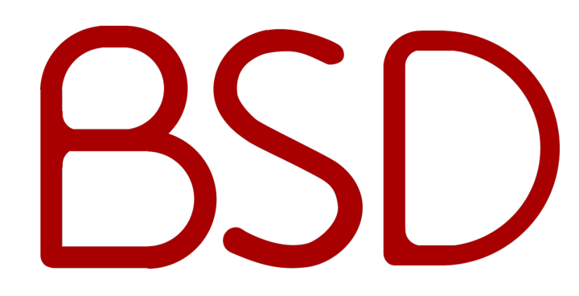

:::
::::

::::panels columns="2"
:::panel rounded="true" style="border-width: 3px;border-color: black;"

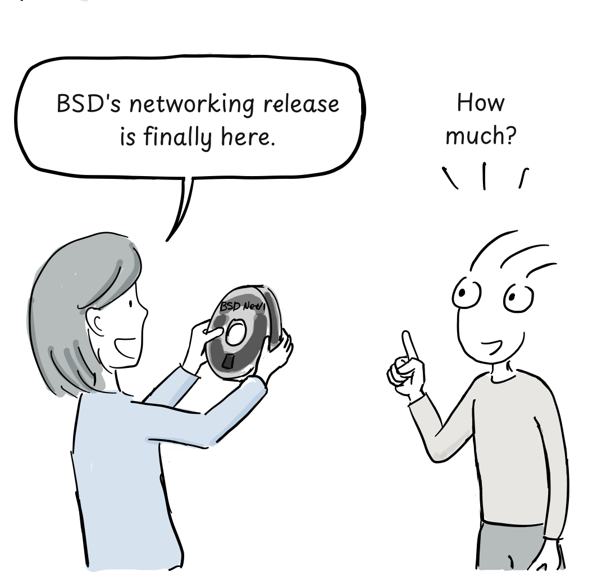

<!-- dialogue: user-received-net1 -->
> BSD's networking release\
> is finally here.
<!-- /dialogue -->

<!-- dialogue: user-net1-price -->
> How\
> much?
<!-- /dialogue -->

:::

:::panel rounded="true" style="border-width: 3px;border-color: black;"

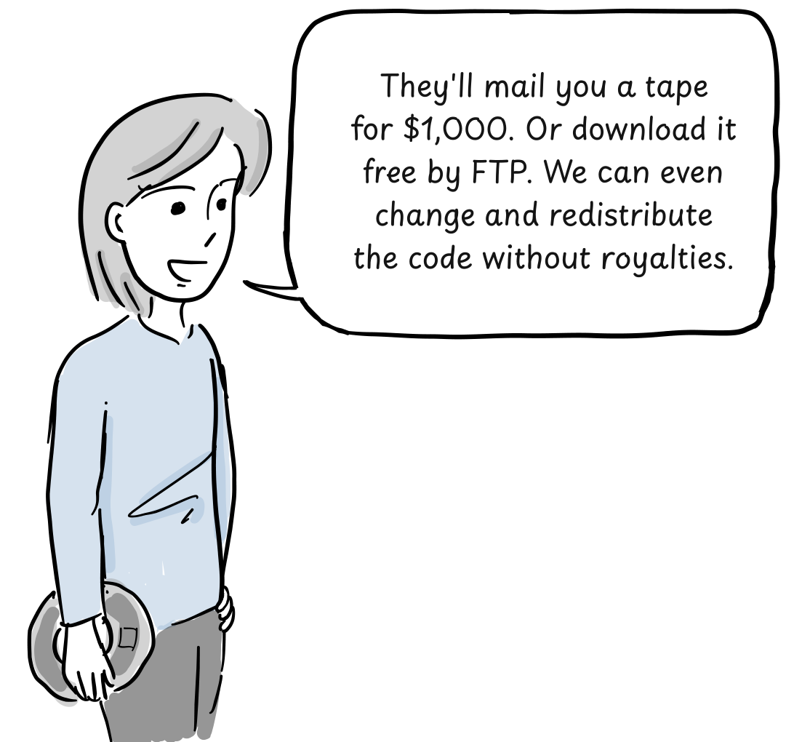

<!-- dialogue: user-tape-and-ftp -->
> They'll mail you a tape\
> for $1,000. Or download it\
> free by FTP. We can even\
> change and redistribute\
> the code without royalties.
<!-- /dialogue -->

:::
::::

::::panels columns="2"
:::panel rounded="true" style="border-width: 3px;border-color: black;"

## Meanwhile, at CSRG

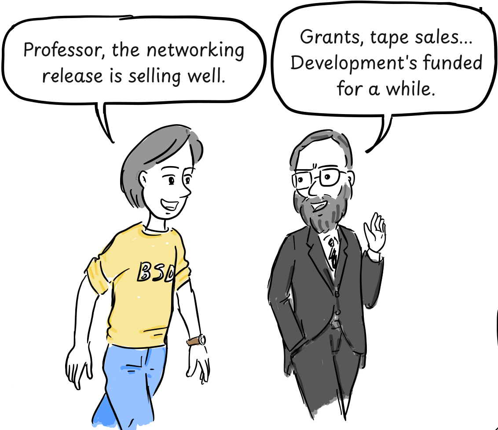

<!-- dialogue: researcher-release-sales -->
> Professor, the networking\
> release is selling well.
<!-- /dialogue -->

<!-- dialogue: professor-development-funds -->
> Grants, tape sales...\
> Development's funded\
> for a while.
<!-- /dialogue -->

:::

:::panel rounded="true" style="border-width: 3px;border-color: black;"

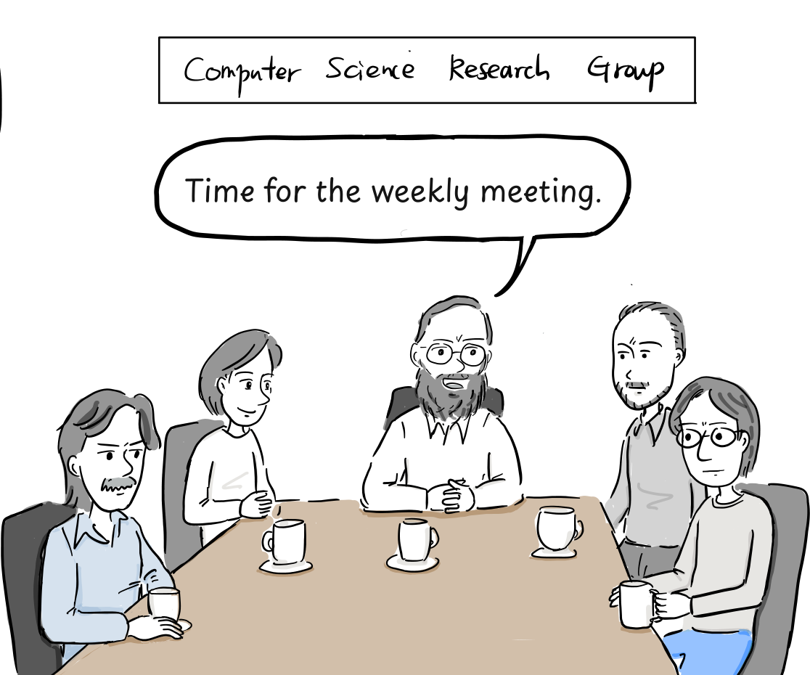

<!-- dialogue: professor-weekly-meeting -->
> Time for the weekly meeting.
<!-- /dialogue -->

:::
::::

::::panels columns="2"
:::panel rounded="true" style="border-width: 3px;border-color: black;"

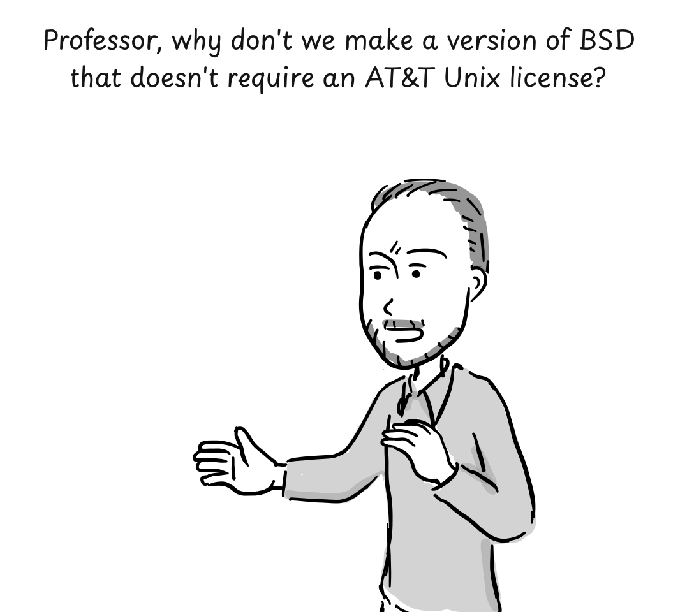

<!-- dialogue: researcher-free-bsd -->
> Professor, why don't we make a version of BSD\
> that doesn't require an AT&T Unix license?
<!-- /dialogue -->

:::

:::panel rounded="true" style="border-width: 3px;border-color: black;"

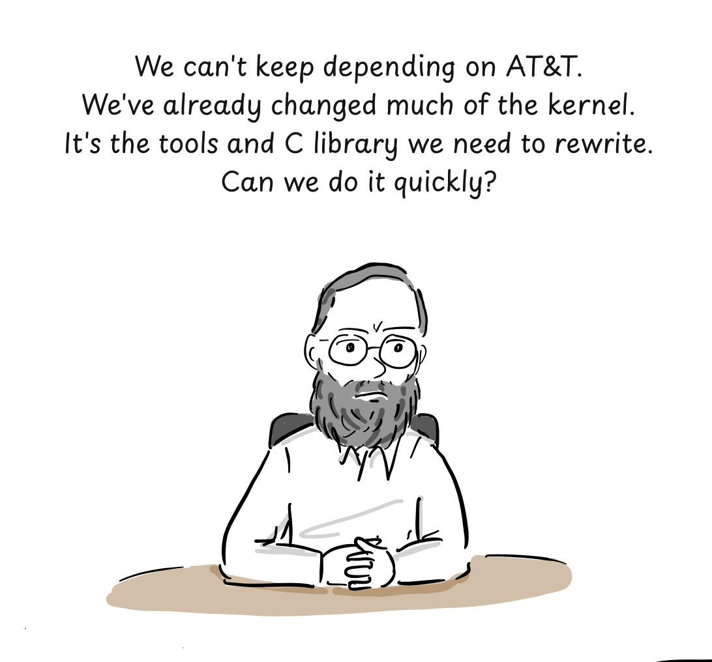

<!-- dialogue: professor-reimplementation-time -->
> We can't keep depending on AT&T.\
> We've already changed much of the kernel.\
> It's the tools and C library we need to rewrite.\
> Can we do it quickly?
<!-- /dialogue -->

:::
::::

::::panels columns="2" ratios="40:60"
:::panel rounded="true" style="border-width: 3px;border-color: black;"

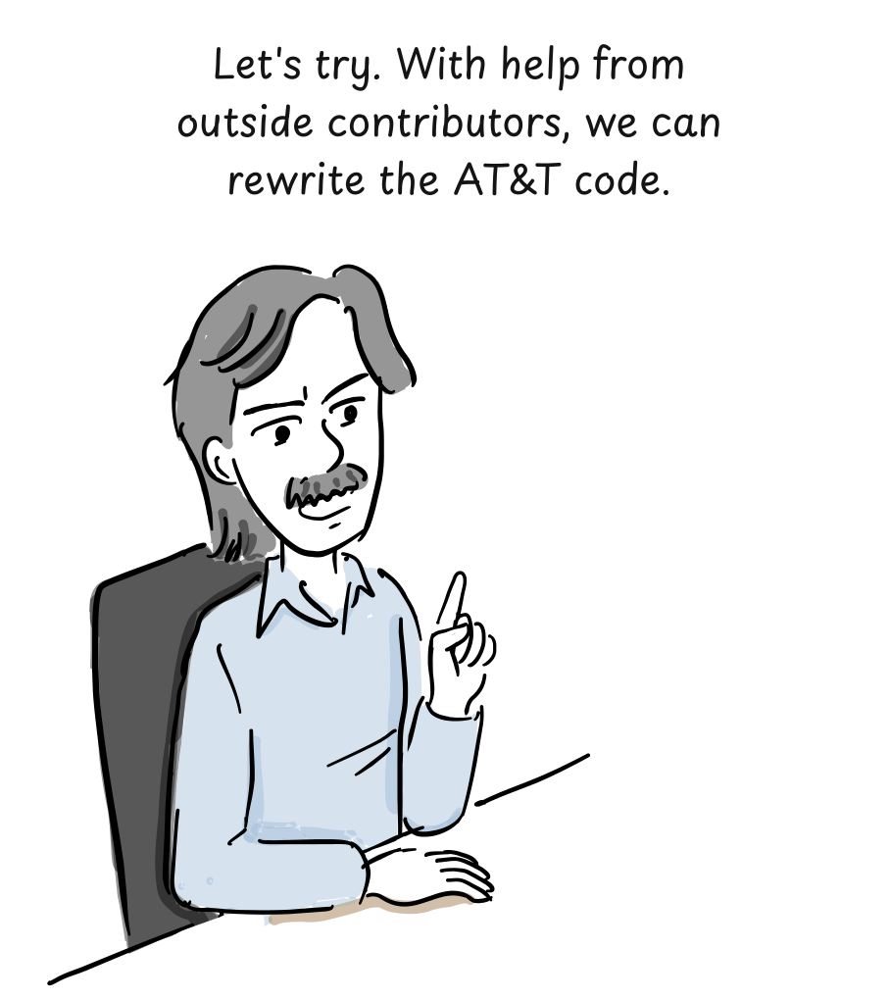

<!-- dialogue: researcher-external-contributors -->
> Let's try. With help from\
> outside contributors, we can\
> rewrite the AT&T code.
<!-- /dialogue -->

:::

:::panel rounded="true" style="border-width: 3px;border-color: black;"

CSRG decided to rewrite AT&T's tools and C library. With help from outside contributors, most of the code was rewritten in eighteen months.

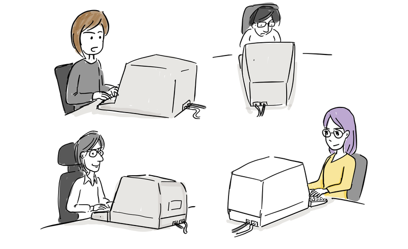

:::
::::

::::panels columns="2"
:::panel narration="boxed" rounded="true" style="border-width: 3px;border-color: black;"

With most of AT&T's Unix code removed, a completely free BSD Unix was finally released in June 1991. The source was still available on tape for the $1,000 copying fee, or as a free download by FTP.

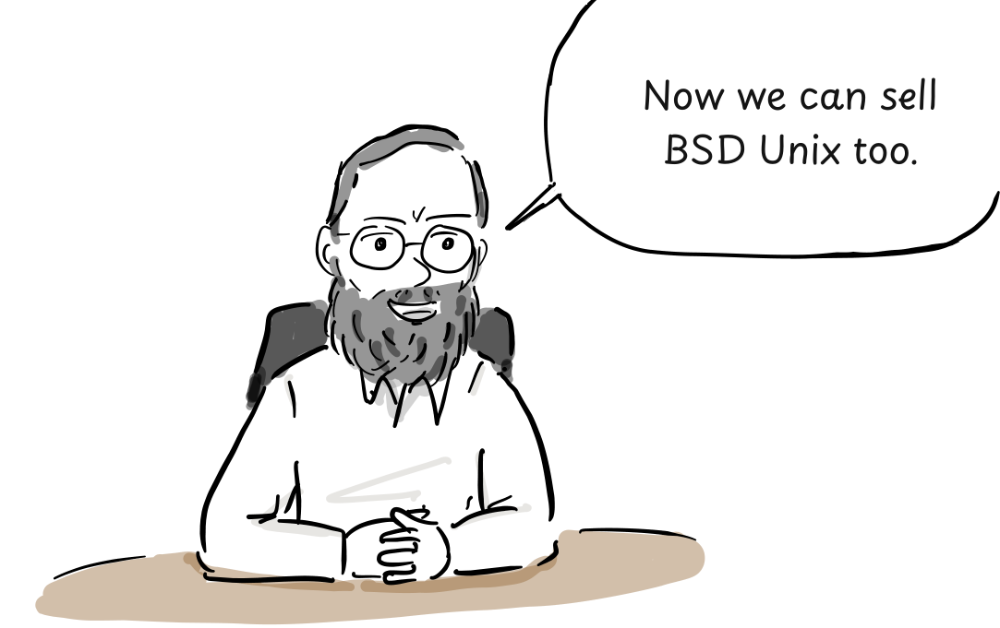

<!-- dialogue: professor-selling-bsd -->
> Now we can sell\
> BSD Unix too.
<!-- /dialogue -->

:::

:::panel rounded="true" style="border-width: 3px;border-color: black;"

[CSRG](https://en.wikipedia.org/wiki/Computer_Systems_Research_Group) founded a company called [BSDi](https://en.wikipedia.org/wiki/Berkeley_Software_Design) to sell BSD Unix commercially. The University of California also began selling BSD Unix in the early 1990s. An advertisement claimed it was 95% cheaper than AT&T Unix. That did not go down well with AT&T.

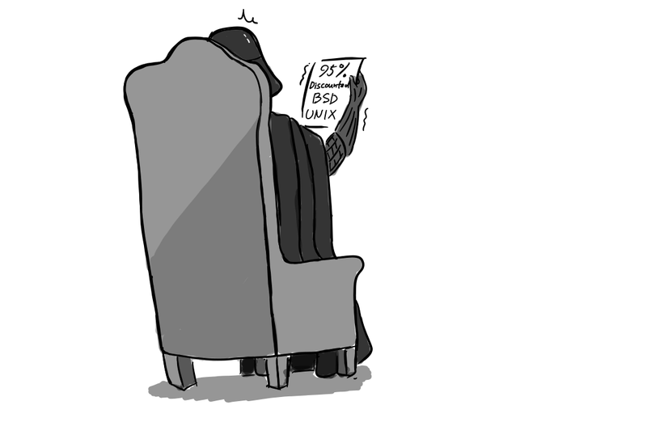

:::
::::

::::panels columns="2"
:::panel narration="boxed" rounded="true" style="border-width: 3px;border-color: black;"

## The Empire Strikes Back

In April 1992, AT&T subsidiary USL sued BSDi. UC Berkeley was added to the lawsuit later.

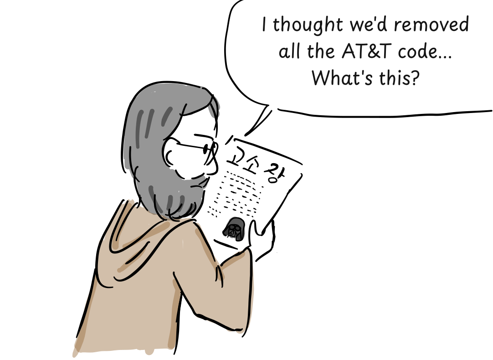

<!-- dialogue: researcher-lawsuit-surprise -->
> I thought we'd removed\
> all the AT&T code...\
> What's this?
<!-- /dialogue -->

:::

:::panel rounded="true" style="border-width: 3px;border-color: black;"

But AT&T's [Unix System V](https://en.wikipedia.org/wiki/UNIX_System_V) also included plenty of BSD code, such as virtual memory, TCP/IP and vi. The BSD license allowed anyone to use the code if they kept the copyright notices. AT&T removed those notices from the source and sold Unix as though it had written all the code itself.

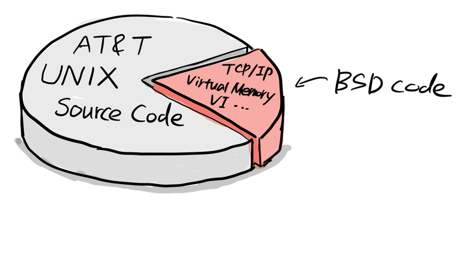

:::
::::

:::panel rounded="true" style="border-width: 3px;border-color: black;"

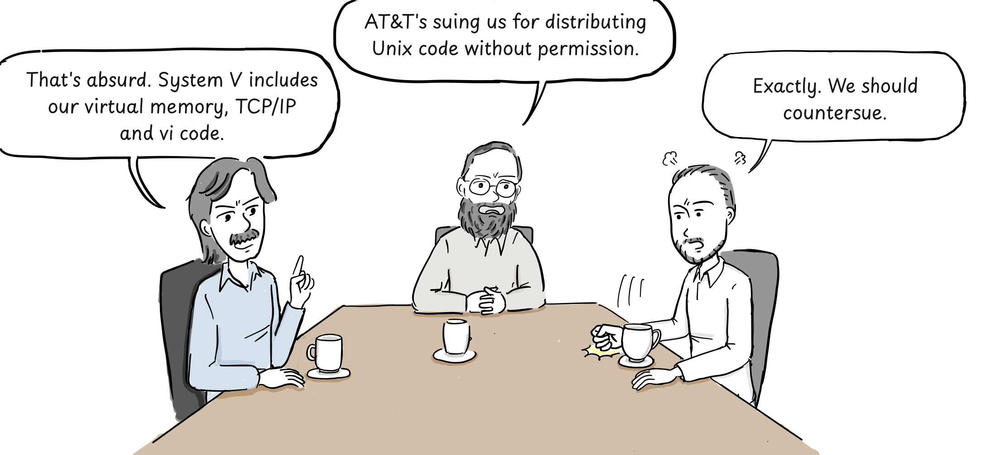

<!-- dialogue: professor-att-lawsuit -->
> AT&T's suing us for distributing\
> Unix code without permission.
<!-- /dialogue -->

<!-- dialogue: researcher-bsd-in-system-v -->
> That's absurd. System V includes\
> our virtual memory, TCP/IP\
> and vi code.
<!-- /dialogue -->

<!-- dialogue: researcher-countersuit -->
> Exactly. We should\
> countersue.
<!-- /dialogue -->

:::

:::panel rounded="true" style="border-width: 3px;border-color: black;"

The BSD side filed a countersuit against AT&T.

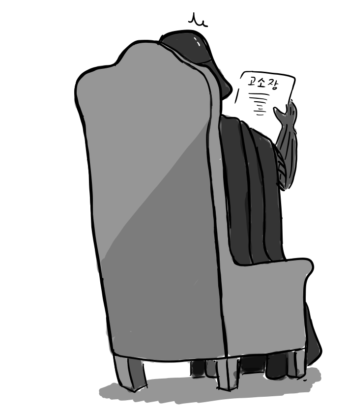

:::

:::panel rounded="true" style="border-width: 3px;border-color: black;"

In February 1994, the two sides agreed that each could sell Unix, provided CSRG removed some remaining AT&T Unix code.

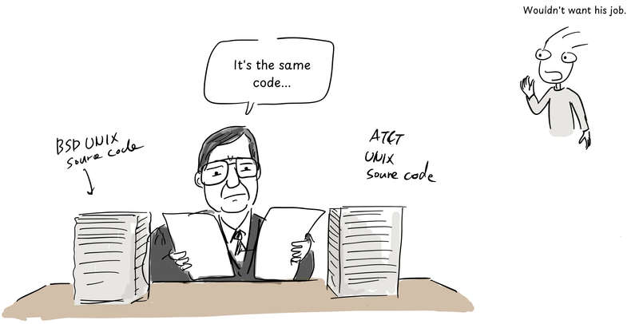

> It's the same code...\
> Wouldn't want his job.

Although BSD Unix began with AT&T's code, much of it had been rewritten, and evidence had emerged that AT&T had incorporated BSD's TCP/IP, virtual memory and vi code while removing copyright notices. But legal uncertainty hung over BSD distribution during the lawsuit, and the two years lost before a completely free BSD Unix appeared gave Linux room to grow.

:::

:::panel style="width:412px;align:center;"

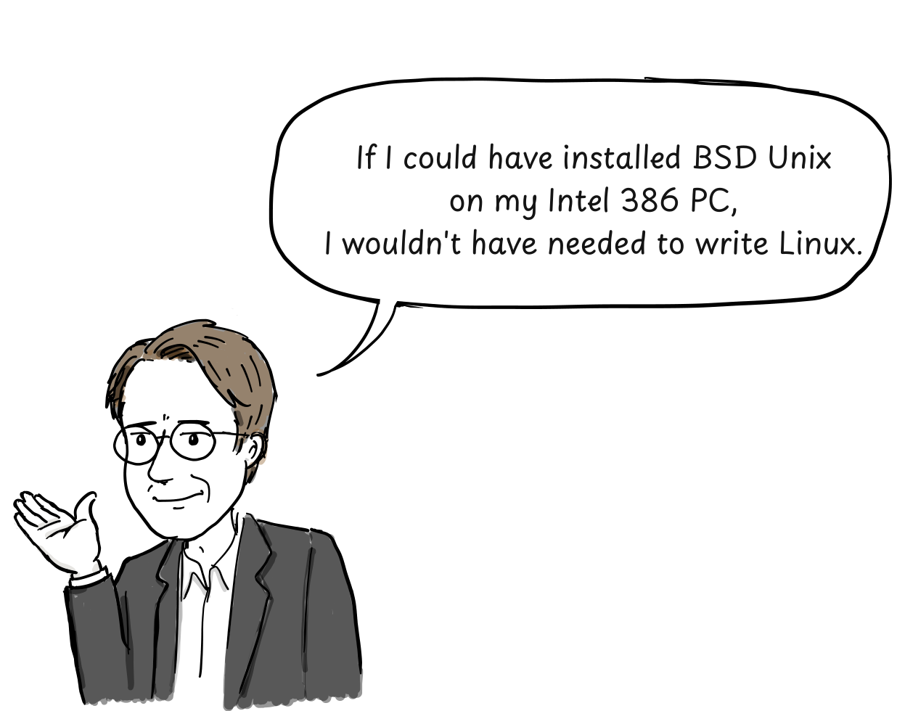

<!-- dialogue: linus-no-linux -->
> If I could have installed BSD Unix\
> on my Intel 386 PC,\
> I wouldn't have needed to write Linux.
<!-- /dialogue -->

:::

**That wraps up our six-part story of BSD Unix!**

# References

1. Andrew Leonard, [BSD Unix: Power to the people, from the code](https://www.salon.com/2000/05/16/chapter_2_part_one/), 2000
2. Marshall Kirk McKusick, [Twenty Years of Berkeley Unix, in Open Sources: Voices from the Open Source Revolution](http://www.hanbit.co.kr/store/books/look.php?p_code=E5329835060), Korean edition, Hanbit Media, 2013
3. [Computer Systems Research Group](https://en.wikipedia.org/wiki/Computer_Systems_Research_Group)
4. [The Design and Implementation of the 4.4BSD Operating System: Network Implementation](https://www.freebsd.org/doc/en/books/design-44bsd/overview-network-implementation.html)
5. Mike Linksvayer, [Interview with Linus Torvalds](https://gondwanaland.com/meta/history/interview.html), Meta Magazine, 1993
