::::panels columns="2"
:::panel title="true" rounded="true" style="border-width: 3px;border-color: black;"

# 라이온스 교수의 유닉스 해설서

:::

:::panel rounded="true" style="border-width: 3px;border-color: black;"

[존 라이온스(John Lions)](https://en.wikipedia.org/wiki/John_Lions) 교수는 호주 뉴사우스웨일스 대학교에서 [운영체제](https://ko.wikipedia.org/wiki/%EC%9A%B4%EC%98%81_%EC%B2%B4%EC%A0%9C)를 가르치고 있었다.

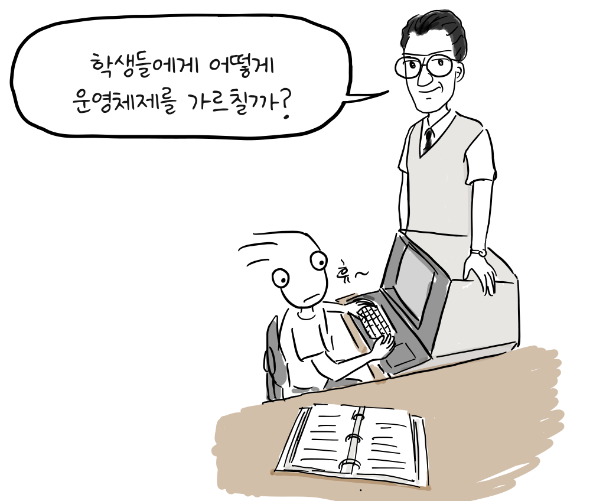

<!-- dialogue: lions-teaching-question -->
> 학생들에게 어떻게\
> 운영체제를 가르칠까?
<!-- /dialogue -->

:::
::::

::::panels columns="2"
:::panel rounded="true" style="border-width: 3px;border-color: black;"

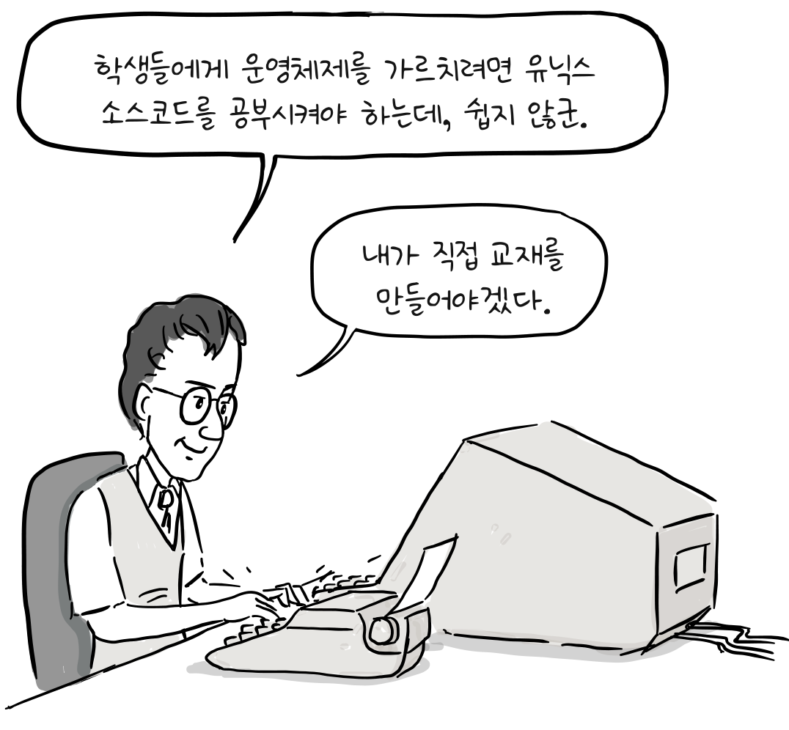

<!-- dialogue: lions-source-difficulty -->
> 학생들에게 운영체제를 가르치려면 유닉스\
> 소스코드를 공부시켜야 하는데, 쉽지 않군.
<!-- /dialogue -->

<!-- dialogue: lions-write-textbook -->
> 내가 직접 교재를\
> 만들어야겠다.
<!-- /dialogue -->

:::

:::panel rounded="true" style="border-width: 3px;border-color: black;"

1976년 5월, 라이온스 교수는 [AT&T 유닉스 버전6](https://en.wikipedia.org/wiki/Version_6_Unix)를 직접 분석해서 소스 코드를 설명하는 [유닉스 해설서](https://en.wikipedia.org/wiki/Lions%27_Commentary_on_UNIX_6th_Edition,_with_Source_Code)를 강의노트로 만든다.

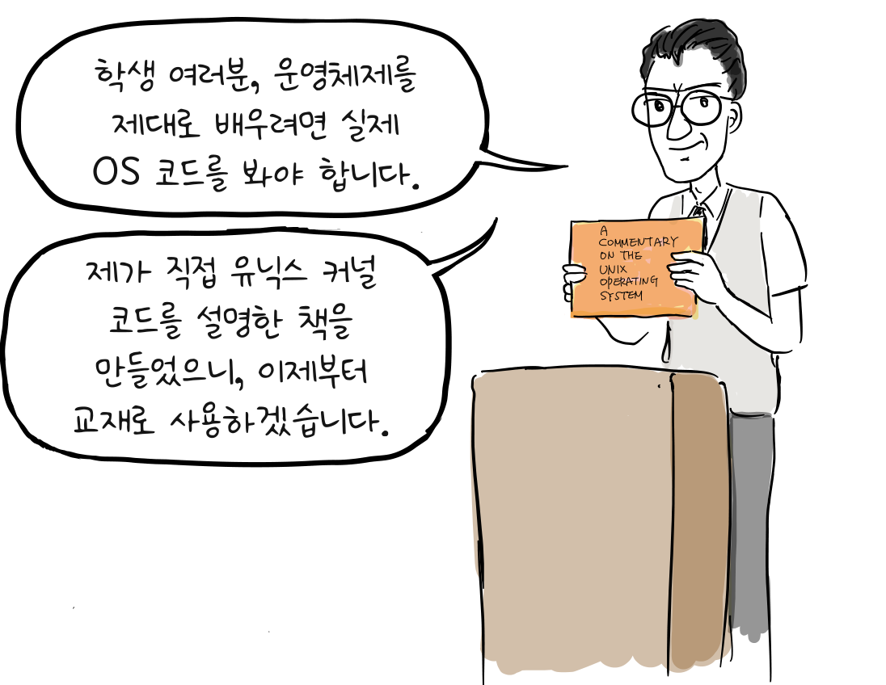

<!-- dialogue: lions-real-code -->
> 학생 여러분, 운영체제를\
> 제대로 배우려면 실제\
> OS 코드를 봐야 합니다.
<!-- /dialogue -->

<!-- dialogue: lions-use-textbook -->
> 제가 직접 유닉스 커널\
> 코드를 설명한 책을\
> 만들었으니, 이제부터\
> 교재로 사용하겠습니다.
<!-- /dialogue -->

:::
::::

:::panel style="padding: 12px;"
1977년에는 이 교재가 유닉스 라이선스를 보유한 다른 학교와 연구기관에도 배포된다[1][4]. 특히, AT&T 벨 연구소도 교재를 주문할 정도로 인기가 많았으며, 나중에는 벨 연구소가 직접 유닉스 해설서의 배포를 맡기도 했다[2].

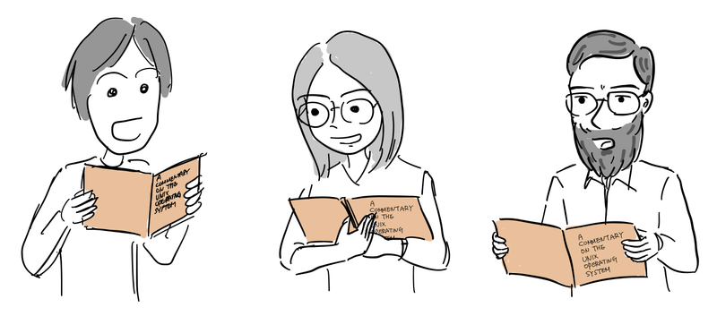

:::

::::panels columns="2"
:::panel rounded="true" style="border-width: 3px;border-color: black;"

초기에는 유닉스 소스코드를 학교 수업에서 공부할 수 있었지만, AT&T가 1979년 6월 USENIX 학회에서 발표한 버전7의 새 라이선스는 소스코드를 공개하거나 설명하는 수업을 제한했으며, 해설서의 배포도 엄격히 통제했다[5][6].

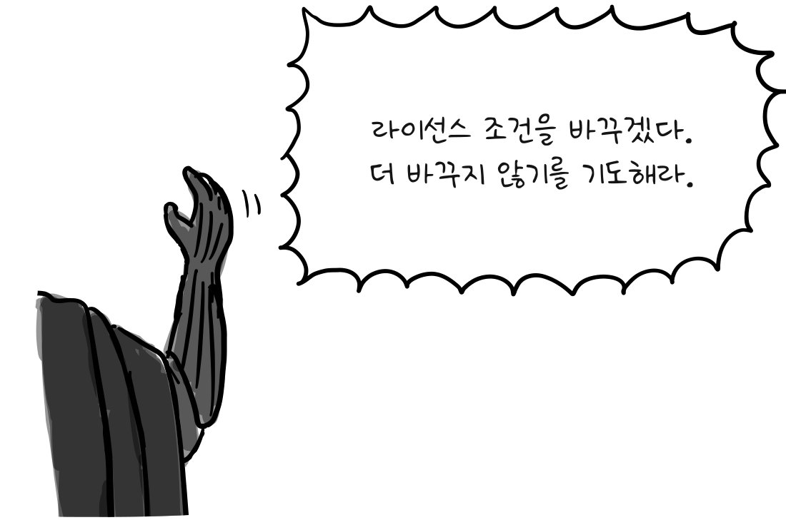

<!-- dialogue: empire-stop-source -->
> 라이선스 조건을 바꾸겠다.\
> 더 바꾸지 않기를 기도해라.
<!-- /dialogue -->

:::

:::panel rounded="true" style="border-width: 3px;border-color: black;"

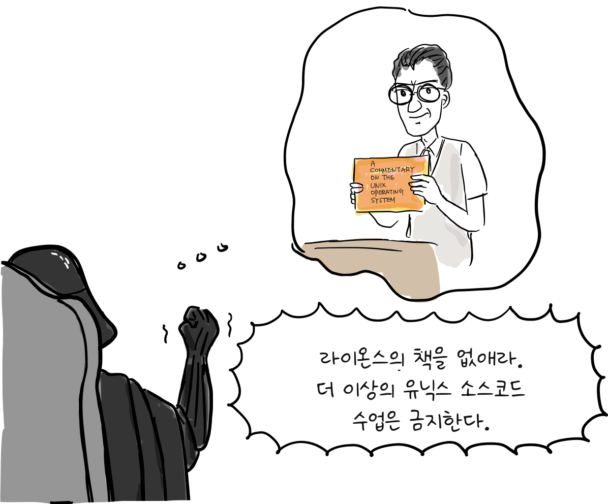

<!-- dialogue: empire-ban-commentary -->
> 라이온스의 책을 없애라.\
> 더 이상의 유닉스 소스코드\
> 수업은 금지한다.
<!-- /dialogue -->

:::
::::

:::panel

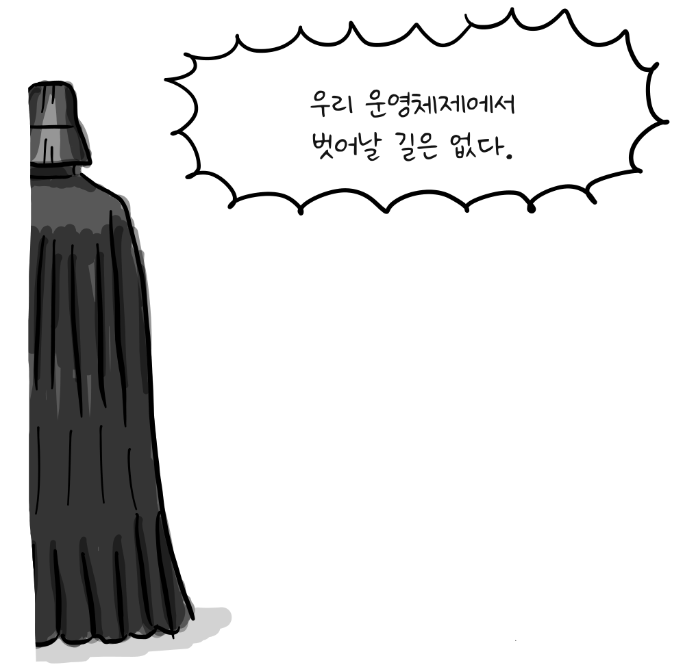

<!-- dialogue: empire-no-other-systems -->
> 우리 운영체제에서\
> 벗어날 길은 없다.
<!-- /dialogue -->

:::

:::panel

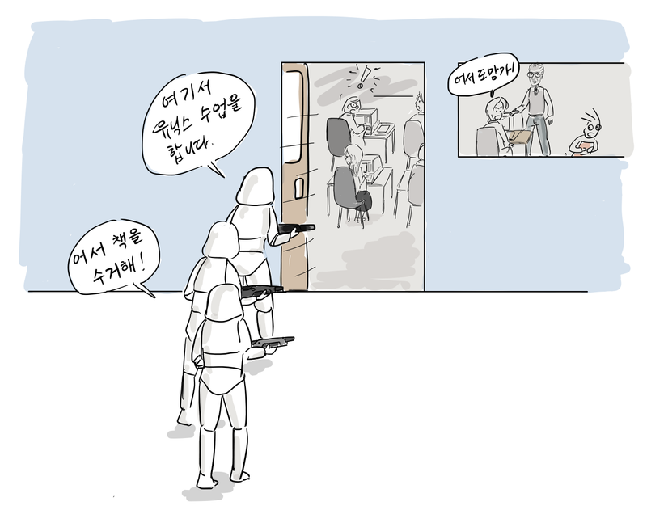

> 여기서 유닉스 수업을 합니다.\
> 어서 책을 수거해!\
> 어서 도망가

:::

:::panel rounded="true" style="border-width: 3px;border-color: black;"

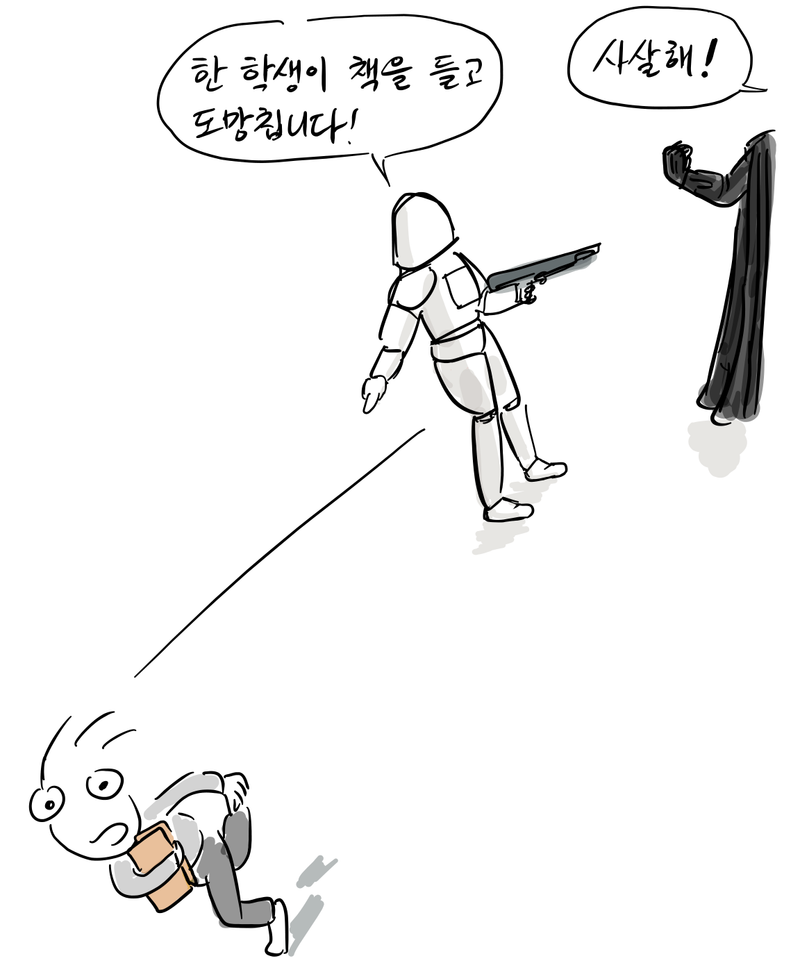

> 저 학생이 책을 가지고 있다!\
> 도망치게 두지 마라!

:::

:::panel rounded="true" style="border-width: 3px;border-color: black;"

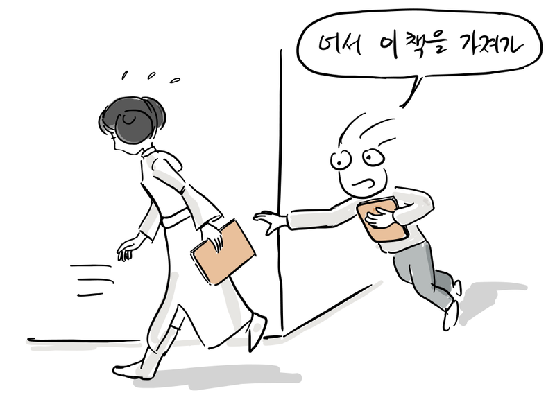

> 어서 이 책을 가져가

:::

:::panel

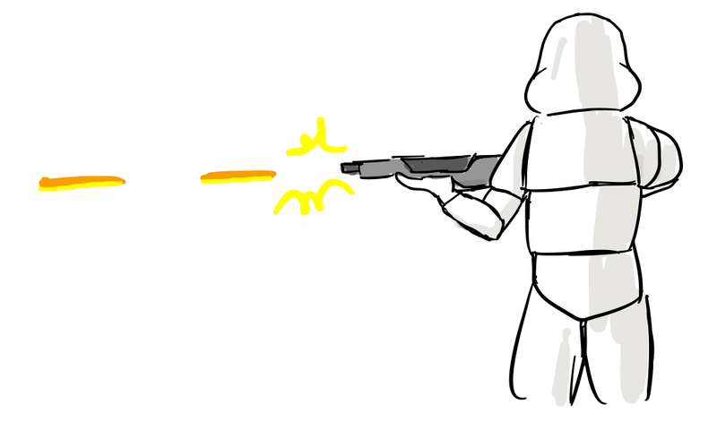

:::

:::panel rounded="true" style="border-width: 3px;border-color: black;"

> 윽!

:::

::::panels columns="2" ratios="41:59"
:::panel rounded="true" style="border-width: 3px;border-color: black;"

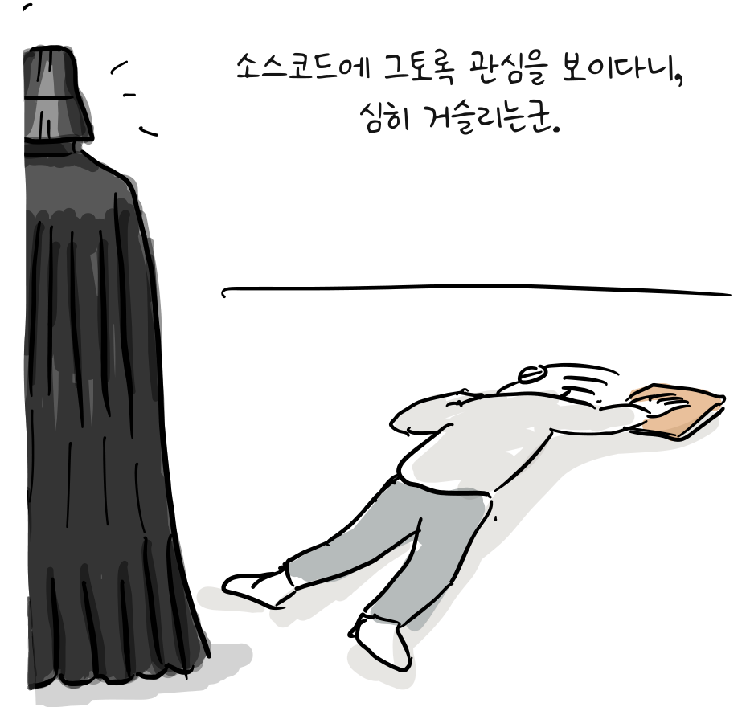

<!-- dialogue: empire-mock-reader -->
> 소스코드에 그토록 관심을 보이다니,\
> 심히 거슬리는군.
<!-- /dialogue -->

:::

:::panel rounded="true" style="border-width: 3px;border-color: black;"

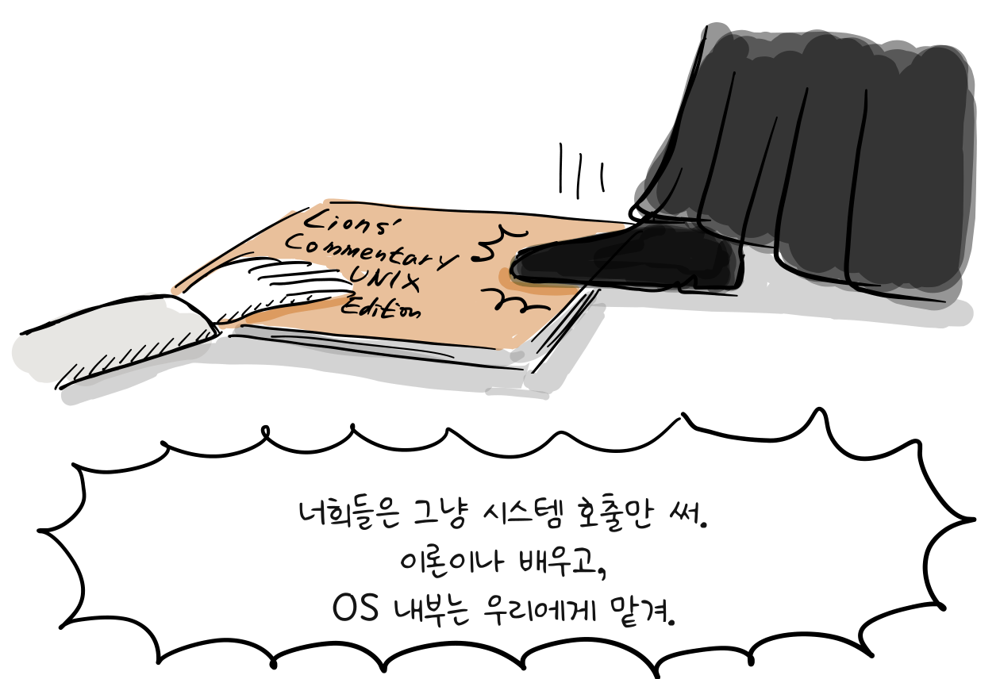

<!-- dialogue: empire-system-calls -->
> 너희들은 그냥 시스템 호출만 써.\
> 이론이나 배우고,\
> OS 내부는 우리에게 맡겨.
<!-- /dialogue -->

:::
::::

:::panel rounded="true" style="border-width: 3px;border-color: black;"

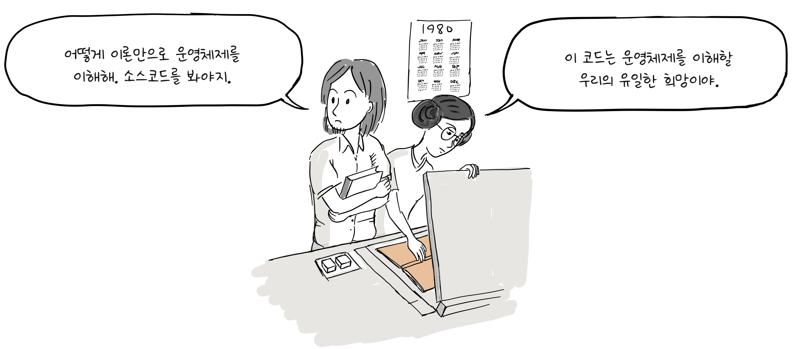

<!-- dialogue: student-needs-source -->
> 어떻게 이론만으로 운영체제를\
> 이해해. 소스코드를 봐야지.
<!-- /dialogue -->

<!-- dialogue: student-only-source -->
> 이 코드는 운영체제를 이해할\
> 우리의 유일한 희망이야.
<!-- /dialogue -->

:::

:::panel style="padding: 12px;"

정식 출판 전까지 약 20년간 전산학을 공부하는 수많은 학생들이 라이온스 교수의 유닉스 해설서를 불법으로 복사하여 공부하였고, 이는 또 다른 운영체제가 만들어지는 밑거름이 되었다[5][8].

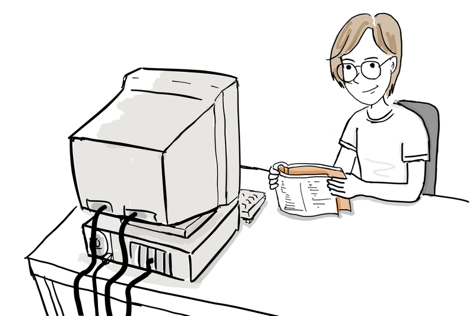

:::

:::panel rounded="true" style="border-width: 3px;border-color: black;"

그사이 여러 유닉스 관계자([Peter H. Salus](https://en.wikipedia.org/wiki/Peter_H._Salus), [Dennis Ritchie](https://ko.wikipedia.org/wiki/%EB%8D%B0%EB%8B%88%EC%8A%A4_%EB%A6%AC%EC%B9%98), Berny Goodheart 등)들이 책 출판을 허용해달라고 AT&T, [Novell](https://en.wikipedia.org/wiki/Novell), [the Santa Cruz Operation](https://en.wikipedia.org/wiki/Santa_Cruz_Operation)의 관계자들을 설득했다. 마침내 SCO가 출판을 허용했고, 라이온스 교수의 유닉스 해설서는 1996년 Peer-to-Peer Communications에서 정식으로 출판되었다[5][7].

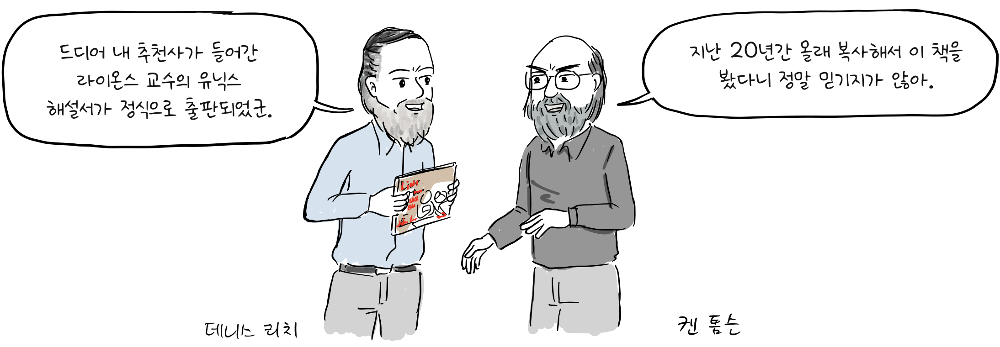

<!-- dialogue: ritchie-official-publication -->
> 드디어 내 추천사가 들어간\
> 라이온스 교수의 유닉스\
> 해설서가 정식으로 출판되었군.
<!-- /dialogue -->

<!-- dialogue: thompson-twenty-years -->
> 지난 20년간 몰래 복사해서 이 책을\
> 봤다니 정말 믿기지가 않아.
<!-- /dialogue -->

:::

:::panel style="padding: 12px;"

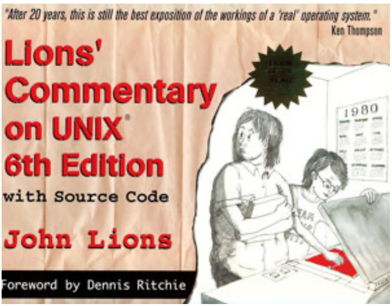

해설서의 재구성판은 [PDF](http://www.lemis.com/grog/Documentation/Lions/book.pdf)로 읽을 수 있으며, 정식 출판본은 [아마존](https://www.amazon.com/Lions-Commentary-Unix-John/dp/1573980137/)에서 구입할 수 있다. 참고로, Unix version 6 소스코드는 [TUHS](https://www.tuhs.org/Archive/Distributions/Research/Dennis_v6/)에서 다운로드 받을 수 있다.

:::

# 참고 문헌

1.  [Lions' Commentary on UNIX 6th Edition, with Source Code](https://en.wikipedia.org/wiki/Lions%27_Commentary_on_UNIX_6th_Edition,_with_Source_Code)
2.  John Lions, *Lions’ Commentary on UNIX 6th Edition, with Source Code*, Peer-to-Peer Communications, 1996 (ISBN 1-57398-013-7).
3.  [시스템 호출(System call)](https://ko.wikipedia.org/wiki/%EC%8B%9C%EC%8A%A4%ED%85%9C_%ED%98%B8%EC%B6%9C)
4.  [UNIX News, Vol. 2 No. 3, March 1977](https://archive.org/details/unix_news_march-1977/page/n3/mode/2up) — John Lions의 1977년 3월 11일 서신과 유닉스 라이선스 보유자를 위한 교재 배포 안내.
5.  Rachel Chalmers, [“Code critic”](https://www.salon.com/1999/11/30/lions_2/), *Salon*, 1999년 11월 30일 — 학생들과 Dennis Ritchie의 회고, 배포 제한과 정식 출판 과정.
6.  Peter H. Salus, [*The Daemon, the GNU and the Penguin*, Chapter 6: “1979”](https://web.archive.org/web/20100505072836/http://www.groklaw.net/article.php?story=20050502114023686), 2005 — 1979년 6월 USENIX에서 발표된 버전7 라이선스와 수업 제한.
7.  [Dennis Ritchie의 1995년 10월 22일 서신](https://github.com/DoctorWkt/IEEE_Milestone_Lions_Commentary/blob/main/Emails/dmr_to_wkt_1995_10_22.txt)과 [Peter H. Salus의 1996년 7월 12일 서신](https://github.com/DoctorWkt/IEEE_Milestone_Lions_Commentary/blob/main/Emails/salus_to_wkt_1996_06_12.txt) — Warren Toomey가 보존한 출판 허가 협의 기록.
8.  MIT, [“Xv6, a simple Unix-like teaching operating system”](https://pdos.csail.mit.edu/6.828/2017/xv6.html), “History and Background” — 라이온스 해설서를 활용한 운영체제 수업과 xv6의 배경.

