

::::panels columns="2"
:::panel title="true" rounded="true" style="border-width: 3px;border-color: black;"

# Lions' Commentary on Unix

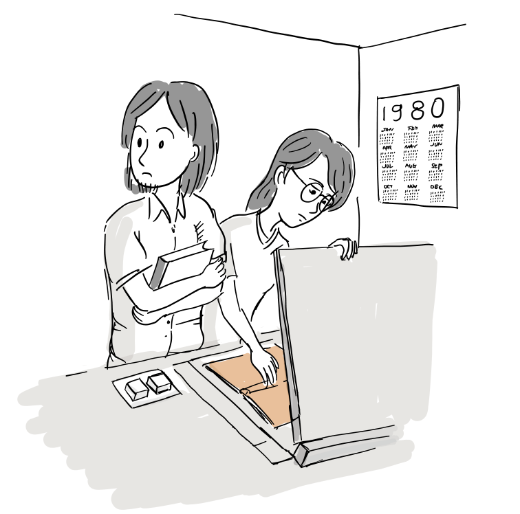

:::

:::panel rounded="true" style="border-width: 3px;border-color: black;"

[John Lions](https://en.wikipedia.org/wiki/John_Lions) was teaching [operating systems](https://en.wikipedia.org/wiki/Operating_system) at the University of New South Wales in Australia.

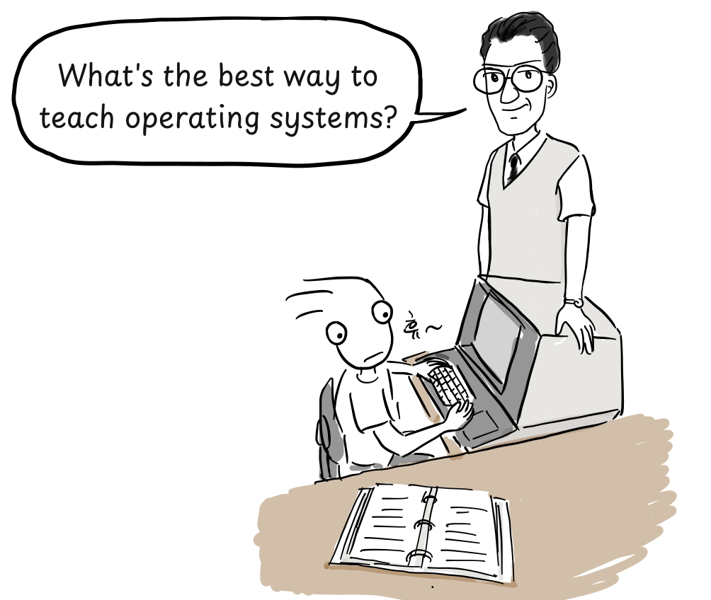

<!-- dialogue: lions-teaching-question -->
> What's the best way to\
> teach operating systems?
<!-- /dialogue -->

:::
::::

::::panels columns="2"
:::panel rounded="true" style="border-width: 3px;border-color: black;"

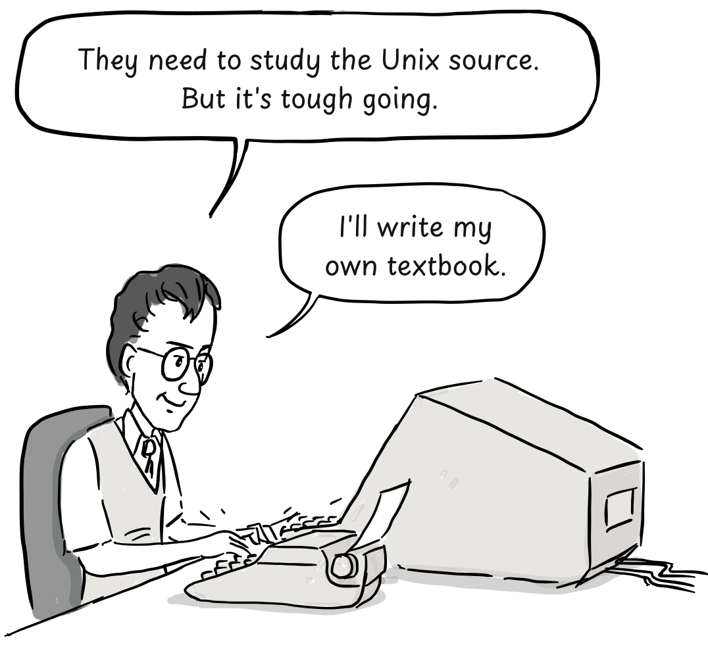

<!-- dialogue: lions-source-difficulty -->
> They need to study the Unix source.\
> But it's tough going.
<!-- /dialogue -->

<!-- dialogue: lions-write-textbook -->
> I'll write my\
> own textbook.
<!-- /dialogue -->

:::

:::panel rounded="true" style="border-width: 3px;border-color: black;"

In May 1976, Lions prepared lecture notes explaining the kernel source code of [AT&T's Unix Version 6](https://en.wikipedia.org/wiki/Version_6_Unix). These became his [Unix commentary](https://en.wikipedia.org/wiki/Lions%27_Commentary_on_UNIX_6th_Edition,_with_Source_Code).

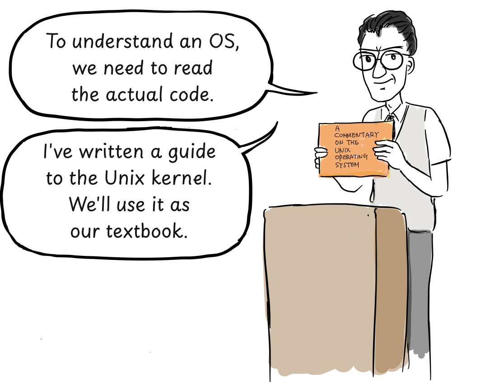

<!-- dialogue: lions-real-code -->
> To understand an OS,\
> we need to read\
> the actual code.
<!-- /dialogue -->

<!-- dialogue: lions-use-textbook -->
> I've written a guide\
> to the Unix kernel.\
> We'll use it as\
> our textbook.
<!-- /dialogue -->

:::
::::

:::panel style="padding: 12px;"

By 1977, the notes were circulating among other schools and research institutions with Unix licenses [1][4]. Even Bell Labs wanted copies and eventually took over distribution [2].

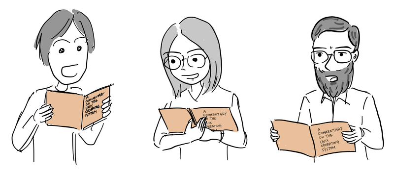

:::

::::panels columns="2"
:::panel rounded="true" style="border-width: 3px;border-color: black;"

Early on, Unix source could be studied in class. But at USENIX in June 1979, AT&T announced new Version 7 license terms restricting courses that disclosed or discussed source code. Distribution of Lions' book was tightly controlled as well [5][6].

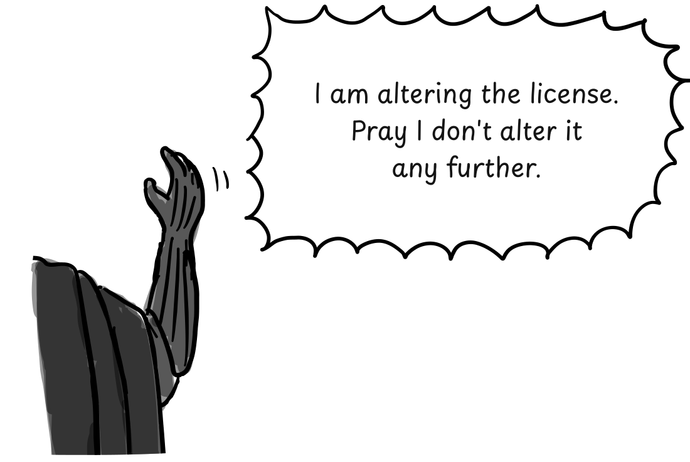

<!-- dialogue: empire-stop-source -->
> I am altering the license.\
> Pray I don't alter it\
> any further.
<!-- /dialogue -->

:::

:::panel rounded="true" style="border-width: 3px;border-color: black;"

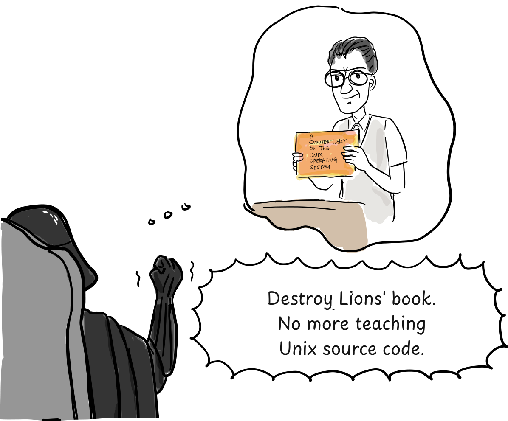

<!-- dialogue: empire-ban-commentary -->
> Destroy Lions' book.\
> No more teaching\
> Unix source code.
<!-- /dialogue -->

:::
::::

:::panel

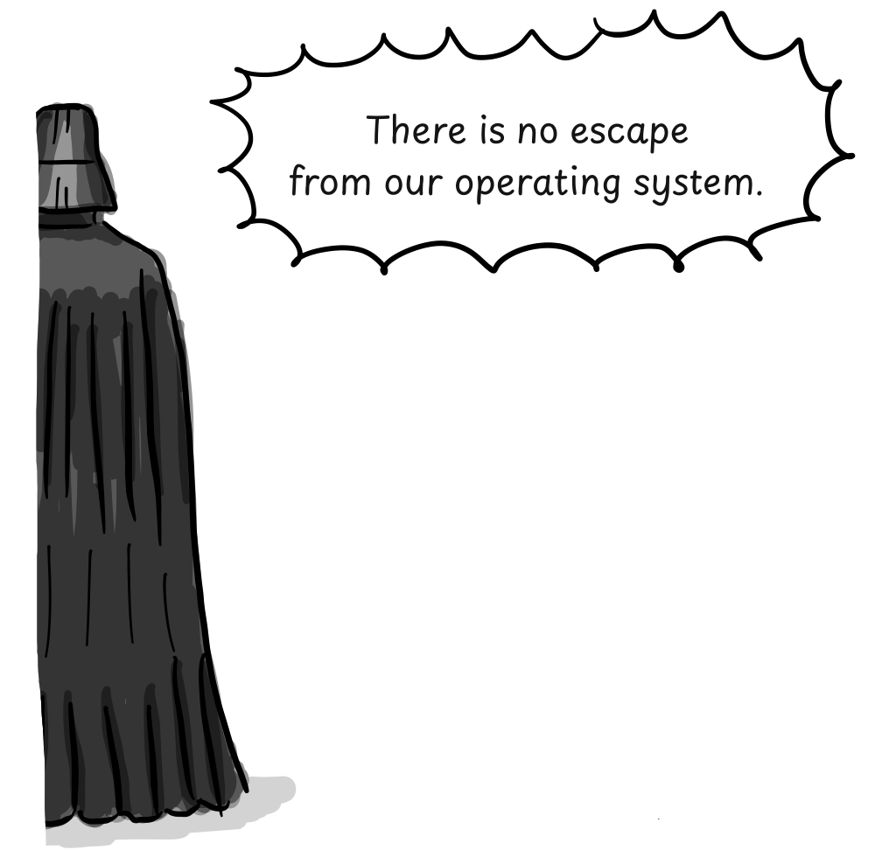

<!-- dialogue: empire-no-other-systems -->
> There is no escape\
> from our operating system.
<!-- /dialogue -->

:::

:::panel

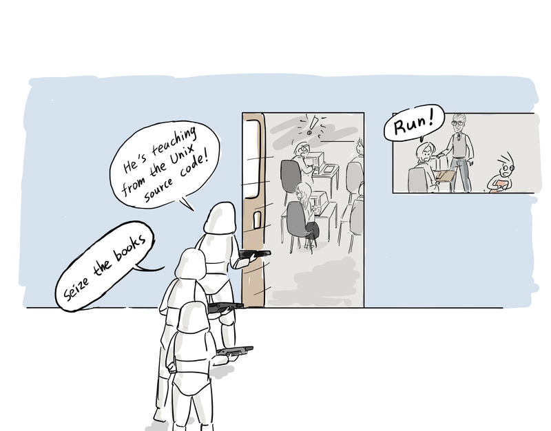

> He's teaching from the Unix source code!\
> Seize the books!\
> Run!

:::

:::panel rounded="true" style="border-width: 3px;border-color: black;"

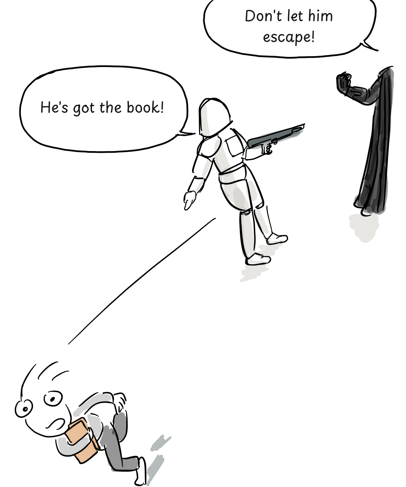

<!-- dialogue: soldier-book-alert -->
> He's got the book!
<!-- /dialogue -->

<!-- dialogue: vader-stop-escape -->
> Don't let him\
> escape!
<!-- /dialogue -->

:::

:::panel rounded="true" style="border-width: 3px;border-color: black;"

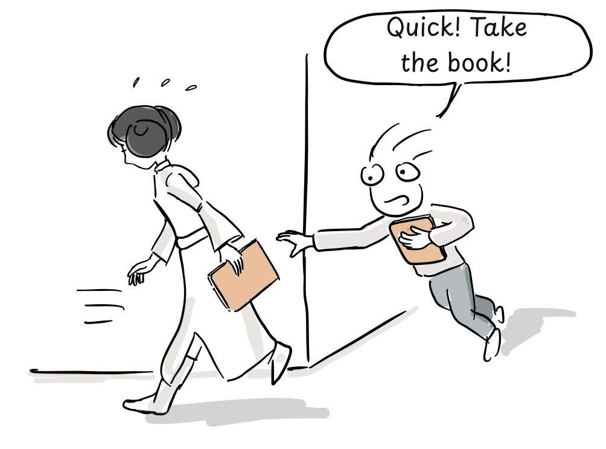

<!-- dialogue: student-pass-book -->
> Quick! Take\
> the book!
<!-- /dialogue -->

:::

:::panel

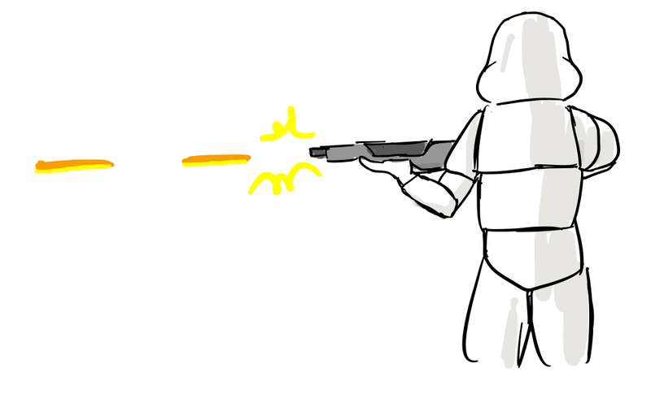

:::

:::panel rounded="true" style="border-width: 3px;border-color: black;"

> Ugh!

:::

::::panels columns="2" ratios="41:59"
:::panel rounded="true" style="border-width: 3px;border-color: black;"

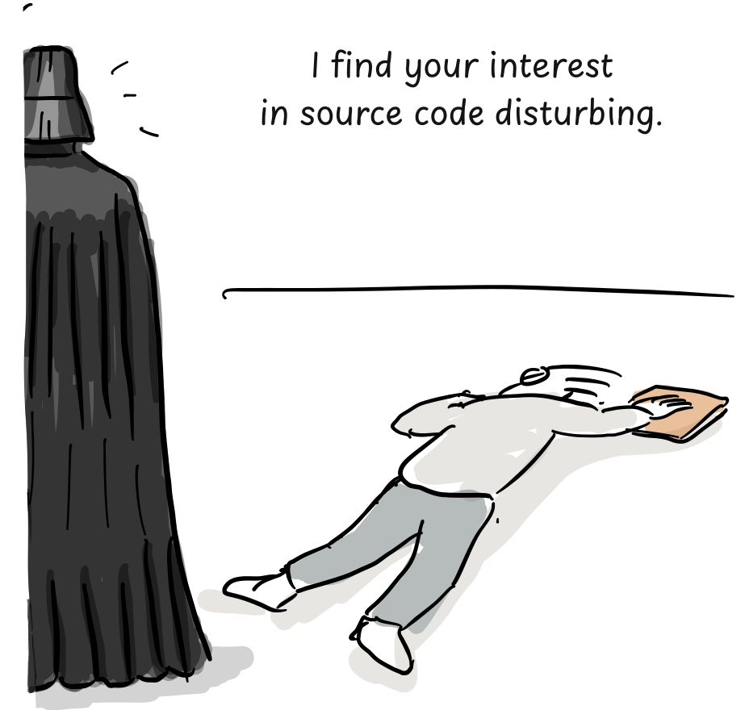

<!-- dialogue: empire-mock-reader -->
> I find your interest\
> in source code disturbing.
<!-- /dialogue -->

:::

:::panel rounded="true" style="border-width: 3px;border-color: black;"

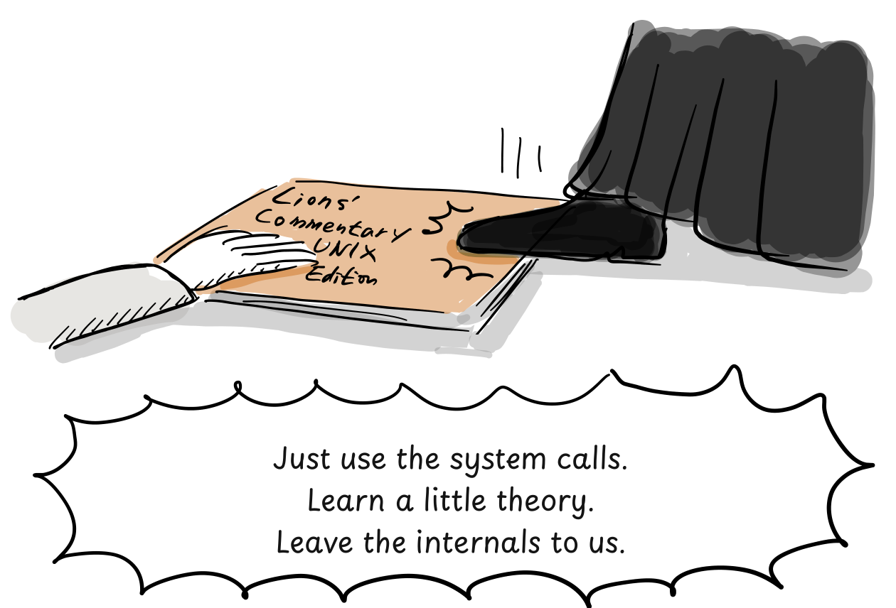

<!-- dialogue: empire-system-calls -->
> Just use the system calls.\
> Learn a little theory.\
> Leave the internals to us.
<!-- /dialogue -->

:::
::::

:::panel rounded="true" style="border-width: 3px;border-color: black;"

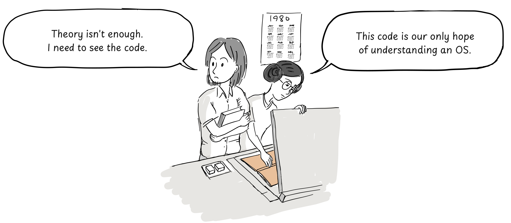

<!-- dialogue: student-needs-source -->
> Theory isn't enough.\
> I need to see the code.
<!-- /dialogue -->

<!-- dialogue: student-only-source -->
> This code is our only hope\
> of understanding an OS.
<!-- /dialogue -->

:::

:::panel style="padding: 12px;"

For roughly twenty years before the official edition appeared, computer-science students studied from unauthorized photocopies. The book helped a generation of students learn to build operating systems of their own [5][8].

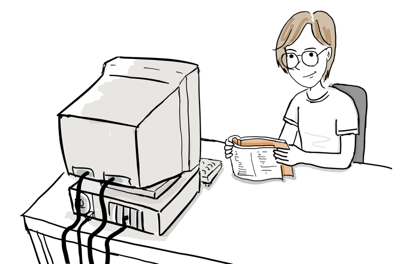

:::

:::panel rounded="true" style="border-width: 3px;border-color: black;"

Meanwhile, members of the Unix community, including [Peter H. Salus](https://en.wikipedia.org/wiki/Peter_H._Salus), [Dennis Ritchie](https://en.wikipedia.org/wiki/Dennis_Ritchie) and Berny Goodheart, kept asking AT&T, [Novell](https://en.wikipedia.org/wiki/Novell) and [the Santa Cruz Operation](https://en.wikipedia.org/wiki/Santa_Cruz_Operation) for permission to publish the book. SCO finally agreed. Peer-to-Peer Communications published the official edition in 1996 [5][7].

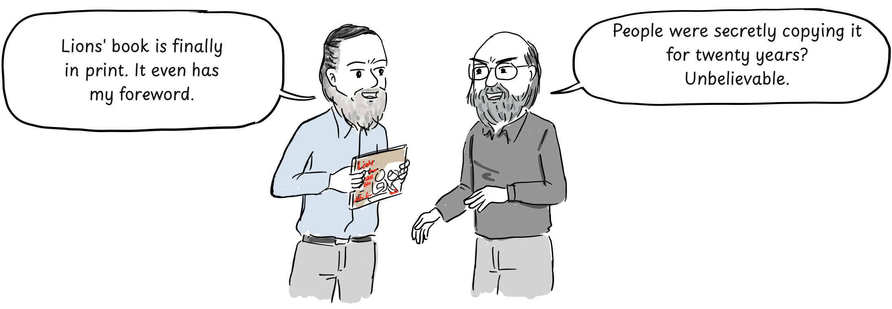

<!-- dialogue: ritchie-official-publication -->
> Lions' book is finally\
> in print. It even has\
> my foreword.
<!-- /dialogue -->

<!-- dialogue: thompson-twenty-years -->
> People were secretly copying it\
> for twenty years?\
> Unbelievable.
<!-- /dialogue -->

:::

:::panel style="padding: 12px;"

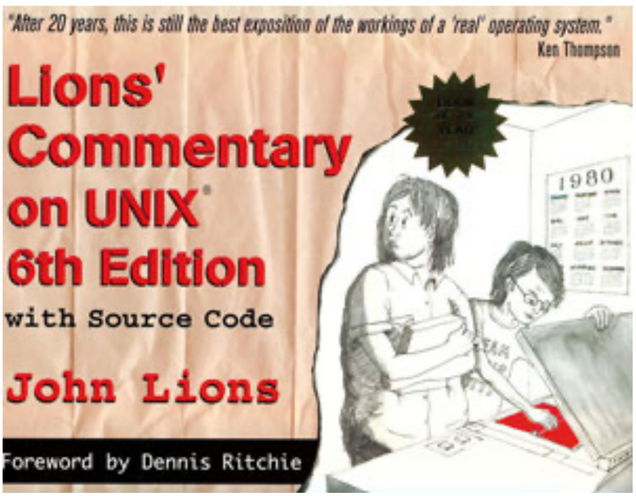

You can read a reconstructed version of the commentary as a [PDF](http://www.lemis.com/grog/Documentation/Lions/book.pdf), or order a print copy on [Amazon](https://www.amazon.com/Lions-Commentary-Unix-John/dp/1573980137/). The Unix Version 6 source code is available separately from [TUHS](https://www.tuhs.org/Archive/Distributions/Research/Dennis_v6/).

:::

# References

1.  [Lions' Commentary on UNIX 6th Edition, with Source Code](https://en.wikipedia.org/wiki/Lions%27_Commentary_on_UNIX_6th_Edition,_with_Source_Code)
2.  John Lions, *Lions' Commentary on UNIX 6th Edition, with Source Code*, Peer-to-Peer Communications, 1996 (ISBN 1-57398-013-7).
3.  [System call](https://en.wikipedia.org/wiki/System_call)
4.  [UNIX News, Vol. 2 No. 3, March 1977](https://archive.org/details/unix_news_march-1977/page/n3/mode/2up) - John Lions's March 11, 1977 letter and the announcement of book distribution to Unix licensees.
5.  Rachel Chalmers, ["Code critic"](https://www.salon.com/1999/11/30/lions_2/), *Salon*, November 30, 1999 - recollections from students and Dennis Ritchie, distribution restrictions, and the path to publication.
6.  Peter H. Salus, [*The Daemon, the GNU and the Penguin*, Chapter 6: "1979"](https://web.archive.org/web/20100505072836/http://www.groklaw.net/article.php?story=20050502114023686), 2005 - the Version 7 license terms announced at USENIX in June 1979 and restrictions on classroom use.
7.  [Dennis Ritchie's October 22, 1995 letter](https://github.com/DoctorWkt/IEEE_Milestone_Lions_Commentary/blob/main/Emails/dmr_to_wkt_1995_10_22.txt) and [Peter H. Salus's July 12, 1996 letter](https://github.com/DoctorWkt/IEEE_Milestone_Lions_Commentary/blob/main/Emails/salus_to_wkt_1996_06_12.txt) - publication-permission correspondence preserved by Warren Toomey.
8.  MIT, ["Xv6, a simple Unix-like teaching operating system"](https://pdos.csail.mit.edu/6.828/2017/xv6.html), "History and Background" - teaching with Lions's commentary and the background to xv6.
