::::panels columns="2" ratios="41:59"
:::panel title="true" rounded="true" style="border-width: 3px;border-color: black;"

# 386BSD의 탄생

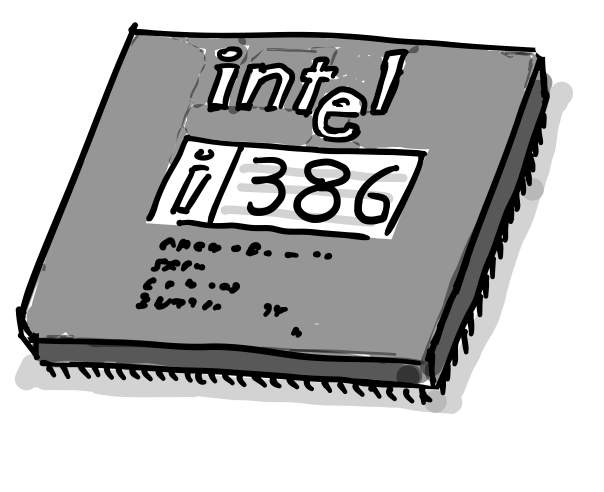

:::

:::panel narration="boxed" rounded="true" style="border-width: 3px;border-color: black;"

1989년 윌리암 졸리츠(William Jolitz), 린 졸리츠(Lynne) 부부는 인텔 386 PC에 BSD 유닉스를 포팅하기 시작한다[\[4\]][reference-4].

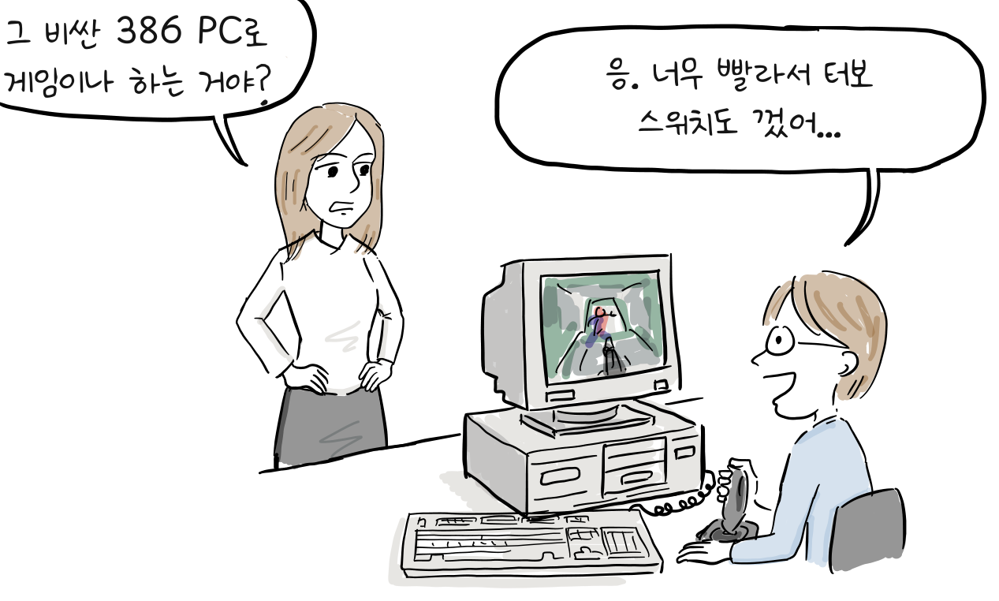

<!-- dialogue: lynne-dos-games -->
> 그 비싼 386 PC로\
> 게임이나 하는 거야?
<!-- /dialogue -->

<!-- dialogue: william-turbo-switch -->
> 응. 너무 빨라서 터보\
> 스위치도 껐어...
<!-- /dialogue -->

참고로 [인텔 80386 CPU](https://ko.wikipedia.org/wiki/%EC%9D%B8%ED%85%94_80386)를 채용한 [컴퓨터는 컴팩에서 1986년에 처음 출시했다](http://www.computerhistory.org/timeline/1986/#169ebbe2ad45559efbc6eb35720789b1).

:::
::::

::::panels columns="2"
:::panel rounded="true" style="border-width: 3px;border-color: black;"

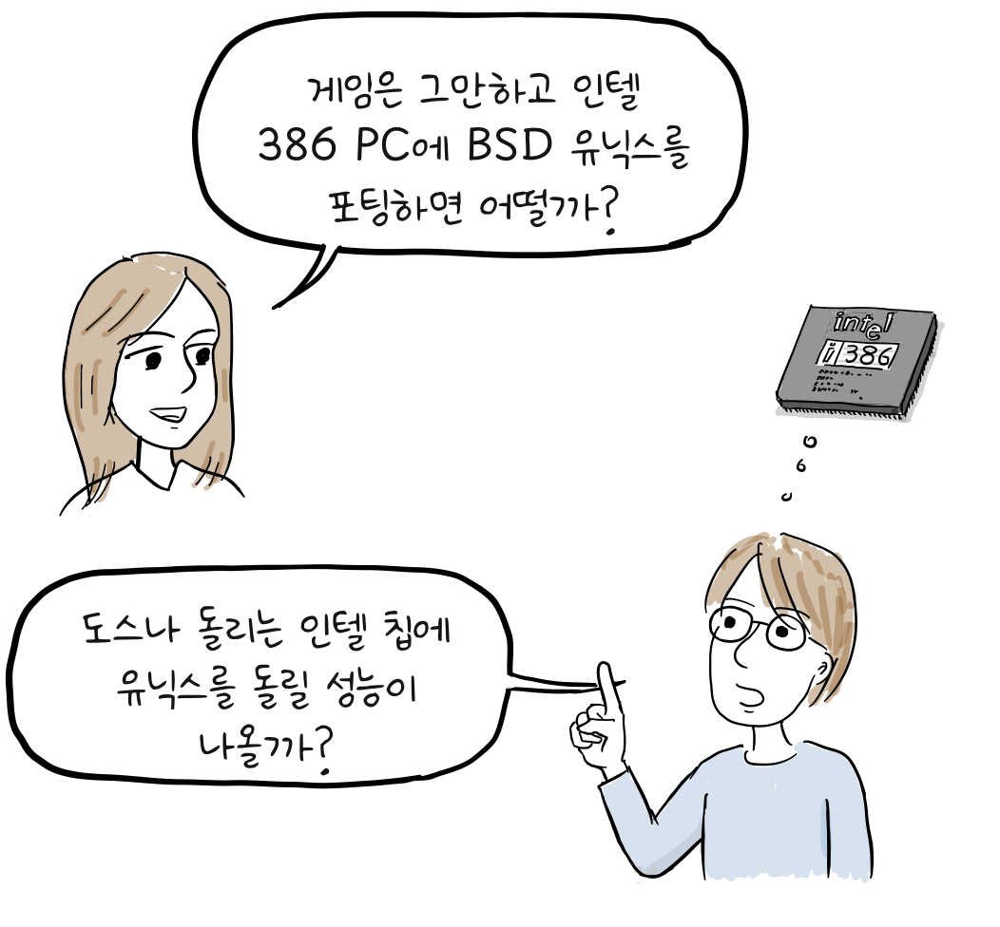

<!-- dialogue: lynne-port-bsd -->
> 게임은 그만하고 인텔\
> 386 PC에 BSD 유닉스를\
> 포팅하면 어떨까?
<!-- /dialogue -->

<!-- dialogue: william-intel-doubt -->
> 도스나 돌리는 인텔 칩에\
> 유닉스를 돌릴 성능이\
> 나올까?
<!-- /dialogue -->

:::

:::panel rounded="true" style="border-width: 3px;border-color: black;"

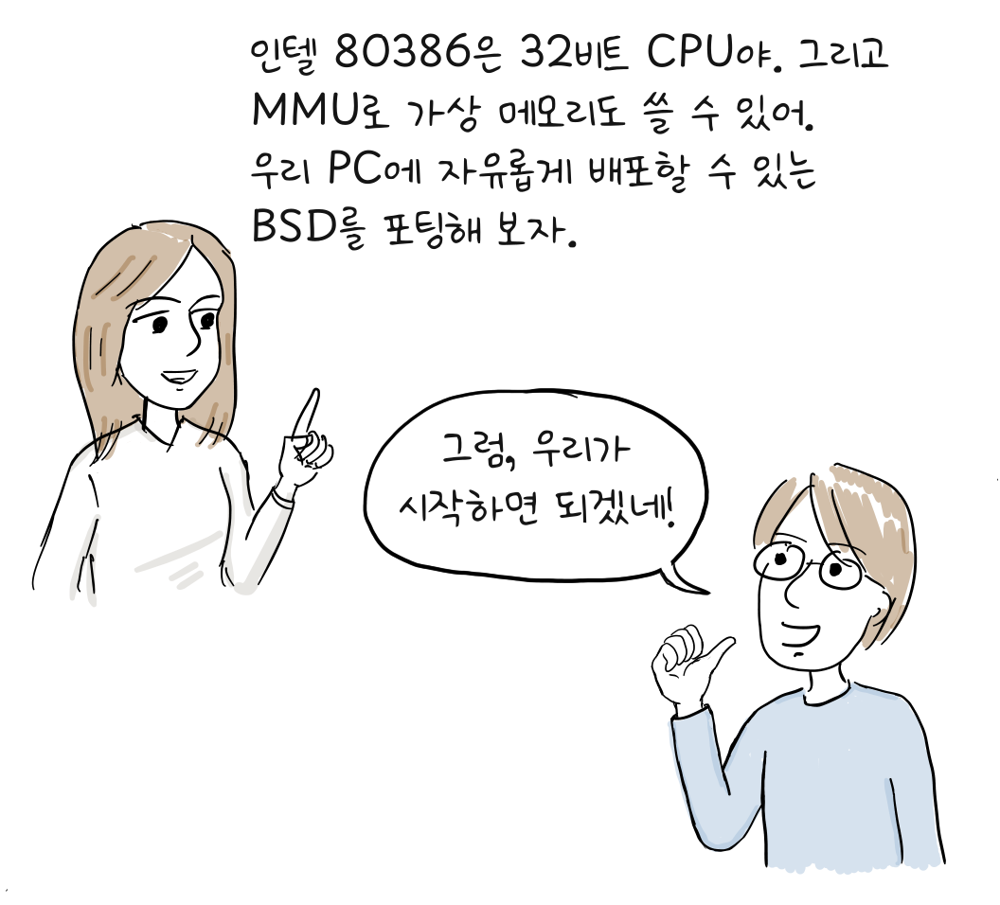

<!-- dialogue: lynne-386-features -->
> 인텔 80386은 32비트 CPU야. 그리고\
> MMU로 가상 메모리도 쓸 수 있어.\
> 우리 PC에 자유롭게 배포할 수 있는\
> BSD를 포팅해 보자.
<!-- /dialogue -->

<!-- dialogue: william-start-porting -->
> 그럼, 우리가\
> 시작하면 되겠네!
<!-- /dialogue -->

:::
::::

:::panel style="padding: 12px;"

1980년대 말은  썬마이크로시스템스, IBM, 휴렛팩커드(HP),  실리콘 그래픽스, 넥스트 등이 워크스테이션이라는 고성능 컴퓨터를 만들고 있었다. 이는 개인용이 아니라 연구 개발용으로 사용되는 컴퓨터로 일반인이 구입하기에는 가격이 비쌌다. 대부분 32비트 RISC계열 프로세서와 주변기기 연결을 위해 SCSI 인터페이스를 사용했으며, AT&T 유닉스 또는  BSD유닉스를 기반으로한 유닉스 계열 운영체제를 사용했다.

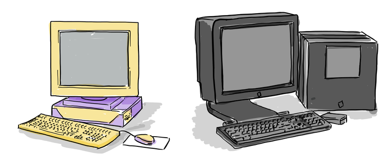

:::

::::panels columns="2"
:::panel rounded="true" style="border-width: 3px;border-color: black;"

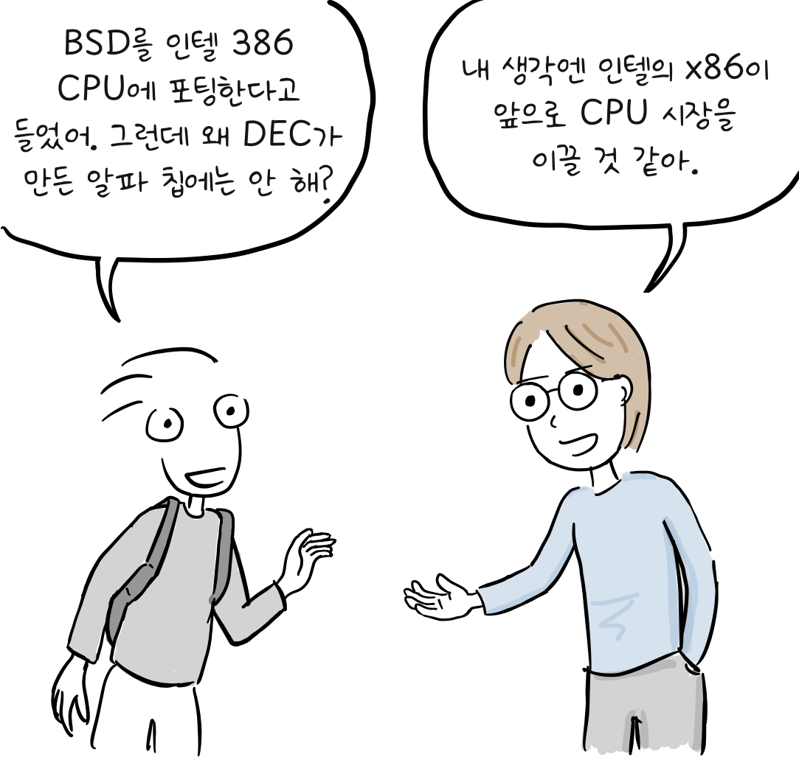

<!-- dialogue: colleague-alpha-chip -->
> BSD를 인텔 386\
> CPU에 포팅한다고\
> 들었어. 그런데 왜 DEC가\
> 만든 알파 칩에는 안 해?
<!-- /dialogue -->

<!-- dialogue: william-x86-future -->
> 내 생각엔 인텔의 x86이\
> 앞으로 CPU 시장을\
> 이끌 것 같아.
<!-- /dialogue -->

:::

:::panel rounded="true" style="border-width: 3px;border-color: black;"

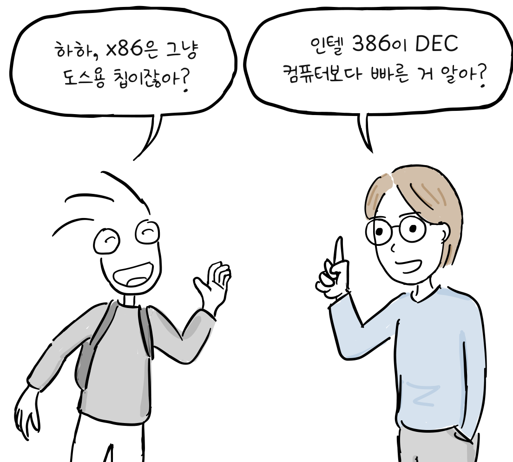

<!-- dialogue: colleague-dos-chip -->
> 하하, x86은 그냥\
> 도스용 칩이잖아?
<!-- /dialogue -->

<!-- dialogue: william-386-performance -->
> 인텔 386이 DEC\
> 컴퓨터보다 빠른 거 알아?
<!-- /dialogue -->

:::
::::

::::panels columns="2" ratios="45:55"
:::panel rounded="true" style="border-width: 3px;border-color: black;"

<!-- dialogue: william-performance-doubling -->
> 내가 인텔 엔지니어들과 이야기를 나눈 적이\
> 있는데, 앞으로 10년 동안 18개월마다 성능을\
> 두 배로 올릴 수 있다는군[1].
<!-- /dialogue -->

> 정말?

:::

:::panel rounded="true" style="border-width: 3px;border-color: black;"

1980년대 말 인텔 386 PC가 보급되면서, 저렴한 PC에서도 32비트 처리와 페이징을 지원하는 [메모리 관리 장치(MMU)](https://ko.wikipedia.org/wiki/%EB%A9%94%EB%AA%A8%EB%A6%AC_%EA%B4%80%EB%A6%AC_%EC%9E%A5%EC%B9%98)의 기능을 활용할 수 있게 되었다. 당시 Xenix라는 상업용 유닉스도 존재했지만[\[7\]][reference-7], 졸리츠 부부는 이러한 386 PC에 자유롭게 배포할 수 있는 BSD를 구현했고[\[4\]][reference-4][\[5\]][reference-5], 이는 이후 FreeBSD와 NetBSD로 이어졌다[\[10\]][reference-10][\[11\]][reference-11]. 결과적으로 이들의 선택은 의미 있는 결실을 맺게 된다.

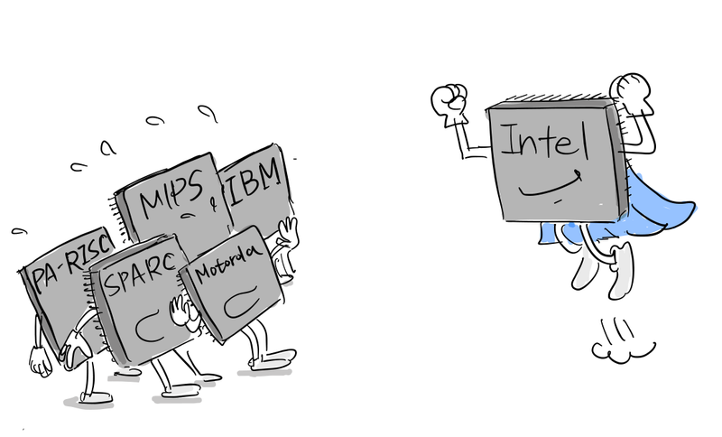

:::
::::

:::panel rounded="true" style="border-width: 3px;border-color: black;"

이들은 포팅 과정을 [닥터 돕스 저널(Dr. Dobb's Journal)](https://en.wikipedia.org/wiki/Dr._Dobb%27s_Journal)에 1991년 1월부터 1992년 7월까지 연재로 소개했다[\[9\]][reference-9].

<!-- dialogue: lynne-propose-articles -->
> 포팅 과정을 먼저 글로\
> 써 보자. 닥터 돕스 저널에\
> 연재하는 거야.
<!-- /dialogue -->

<!-- dialogue: william-before-release -->
> 글쎄, 아직 커널도 공개 안 했는데\
> 글부터 쓸 필요가 있을까?
<!-- /dialogue -->

:::

:::panel rounded="true" style="border-width: 3px;border-color: black;"

<!-- dialogue: lynne-share-work -->
> 남들도 우리 작업을\
> 보고 배울 수 있잖아.
<!-- /dialogue -->

<!-- dialogue: william-learned-from-unix -->
> 그러고 보니 나도 유닉스 버전 6\
> 코드를 보면서 많이 배웠지.
<!-- /dialogue -->

:::

:::panel style="padding: 12px;"

**Porting UNIX to the 386: A Practical Approach**

저자: **William F. Jolitz · Lynne Greer Jolitz**

닥터 돕스 저널(Dr. Dobb's Journal)에 실린 포팅 연재 기사 17편은 [386bsd.org](https://386bsd.org/)에서 읽을 수 있다[\[9\]].[reference-9].

1. [Designing the Software Specification](https://386bsd.org/releases/porting-unix-to-the-386-a-practical-approach-designing-the-software-specification-article) 연재의 첫 기사로, 80386용 버클리 유닉스인 386BSD의 설계 명세를 설명한다. **(1991년 1월)**
2. [Three Initial PC Utilities](https://386bsd.org/releases/porting-unix-to-the-386-three-initial-pc-utilities-getting-to-the-hardware-article) MS-DOS에서 GCC로 컴파일한 프로그램을 보호 모드로 실행하고, MS-DOS와 유닉스가 정보를 주고받을 수 있도록 디스크의 공유 영역에 파일을 복사하는 유틸리티를 소개한다. **(1991년 2월)**
3. [The Standalone System](https://386bsd.org/releases/porting-unix-to-the-386-the-standalone-system-creating-a-protectedmode-standalone-c-programming-environment-article) 보호 모드 프로그램 로더를 이용해 운영체제 커널 개발에 필요한 최소한의 80386 보호 모드 독립 실행형 C 프로그래밍 환경을 구성한다. **(1991년 3월)**
4. [Language Tools Cross Support](https://386bsd.org/releases/porting-unix-to-the-386-language-tools-cross-support-developing-the-initial-utilities-article) 386BSD의 부트스트랩에 필요한 초기 크로스 개발 도구를 만든다. **(1991년 4월)**
5. [The Initial Root Filesystem](https://386bsd.org/releases/porting-unix-to-the-386-the-initial-root-filesystem-completing-the-toolset-article) 386BSD 커널에 필요한 초기 루트 파일시스템을 개발한다. **(1991년 5월)**
6. [Research & The Commercial Sector](https://386bsd.org/releases/porting-unix-to-the-386-research-the-commercial-sector-where-does-bsd-fit-in-article) 연구용 운영체제와 상용 운영체제에 요구되는 사항과 그 차이를 살펴본다. **(1991년 6월)**
7. [A Stripped-Down Kernel](https://386bsd.org/releases/porting-unix-to-the-386-a-strippeddown-kernel-onto-the-initial-utilities-article) 자원을 효율적으로 활용하고 복잡성을 줄이는 독특한 재귀적 페이징 기능을 갖춘 386BSD의 기본 커널을 설명한다. **(1991년 7월)**
8. [The Basic Kernel](https://386bsd.org/releases/porting-unix-to-the-386-the-basic-kernel-overview-and-initialization-article) 386BSD 커널 서비스와 자료 구조의 초기화 과정을 설명한다. **(1991년 8월)**
9. [Multiprogramming and Multitasking I](https://386bsd.org/releases/porting-unix-to-the-386-the-basic-kernel-multiprogramming-and-multiprogramming-and-multitasking-part-one-article) 386BSD의 다중 프로그래밍 방식과 관련 규칙, 정의, 구성 방식을 개괄한다. **(1991년 9월)**
10. [Multiprogramming and Multitasking II](https://386bsd.org/releases/porting-unix-to-the-386-the-basic-kernel-multiprogramming-and-multiprogramming-and-multitasking-part-ii-article) 멀티태스킹으로 다중 프로그래밍을 구현하는 과정과 대안 구현, 절충점을 살펴본다. MS-DOS 같은 비유닉스 운영체제에 다중 프로그래밍을 추가하기 어려웠던 이유도 설명한다. **(1991년 10월)**
11. [Device Autoconfiguration](https://386bsd.org/releases/porting-unix-to-the-386-the-basic-kernel-device-autoconfiguration-device-autoconfiguration-article) 386BSD가 하드웨어 장치를 찾아내고, 해당 장치를 사용할 수 있도록 시스템을 자동으로 구성하는 방법을 설명한다. **(1991년 11월)**
12. [Unix Device Drivers I](https://386bsd.org/releases/porting-unix-to-the-386-device-drivers-drivers-for-the-basic-kernel-article) 386BSD 장치 드라이버의 구조와 운영체제 인터페이스를 설명하고, PC의 콘솔·디스크 드라이브·스케줄링용 타이머를 위한 최소한의 드라이버를 소개한다. **(1992년 2월)**
13. [Unix Device Drivers II](https://386bsd.org/releases/porting-unix-to-the-386-device-drivers-entering-exiting-and-entering-exiting-and-masking-processor-interrupts-article) 운영체제와의 인터페이스, 프로세서 인터럽트 처리의 진입과 종료, 인터럽트 마스킹을 설명한다. **(1992년 3월)**
14. [Unix Device Drivers III](https://386bsd.org/releases/porting-unix-to-the-386-device-drivers-getting-into-and-getting-into-and-out-of-interrupt-routines-article) 386BSD의 기본 장치 드라이버를 완성한다. **(1992년 4월)**
15. [Missing Pieces I](https://386bsd.org/releases/porting-unix-to-the-386-missing-pieces-part-1-completing-the-386bsd-kernel-article) 독점 코드의 제약이 없는 완전한 386 PC용 시스템을 만들기 위해 버클리 유닉스 NET/2를 보완한다. PC에서 동작하는 운영체제를 완성하는 데 필요한 나머지 기능의 구현 방법을 설명한다. **(1992년 5월)**
16. [Missing Pieces II](https://386bsd.org/releases/porting-unix-to-the-386-missing-pieces-part-ii-completing-the-386bsd-kernel-article) 독점 코드의 제약이 없는 완전한 386 PC용 시스템을 만들기 위해 버클리 유닉스 NET/2를 보완한다. PC에서 동작하는 운영체제를 완성하는 데 필요한 나머지 기능의 구현 방법을 설명한다. **(1992년 6월)**
17. [The Final Step](https://386bsd.org/releases/porting-unix-to-the-386-the-final-step-running-light-with-386bsd-article) 0.0 릴리스가 BSD 공동체에 미친 영향을 살펴보고, 0.1 릴리스의 설치 절차와 주요 특징을 소개한다. 연재의 마지막 기사다. **(1992년 7월)**

:::

::::panels columns="2"
:::panel rounded="true" style="border-width: 3px;border-color: black;"

리누스 토발즈도 이 연재 기사를 읽은 사람 중 하나였다. 그는 1993년 인터뷰에서, 개발을 시작할 당시 386BSD를 쓸 수 있었다면 리눅스는 탄생하지 않았을지도 모른다고 회고했다[\[2\]][reference-2].

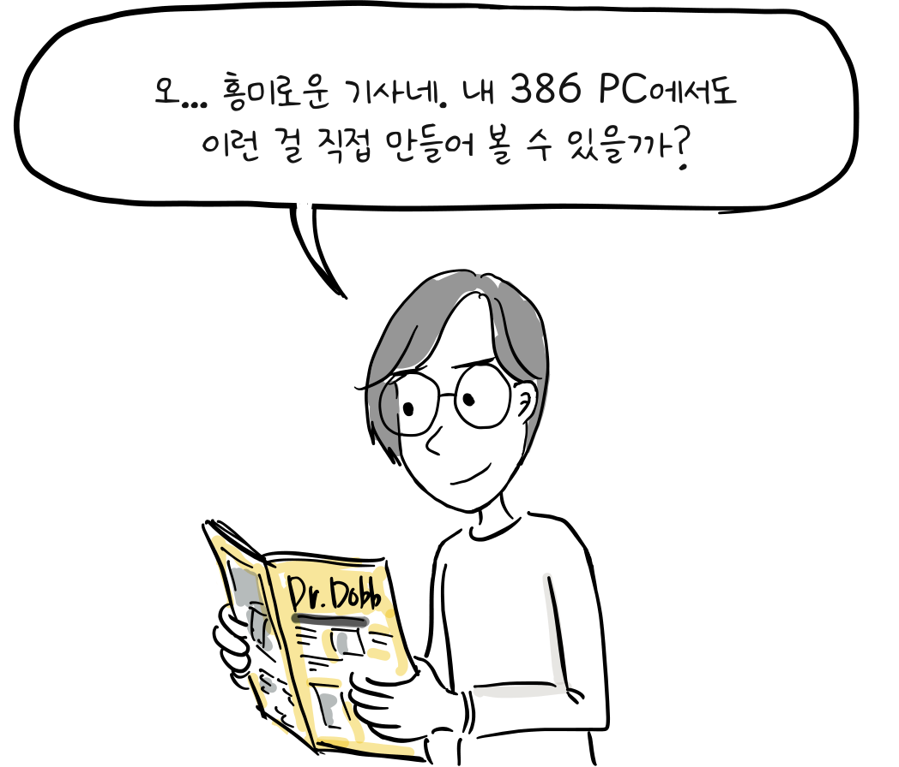

<!-- dialogue: linus-reading-articles -->
> 오... 흥미로운 기사네. 내 386 PC에서도\
> 이런 걸 직접 만들어 볼 수 있을까?
<!-- /dialogue -->

:::

:::panel rounded="true" style="border-width: 3px;border-color: black;"

리누스는 1991년 8월의 첫 공개 글에서 4월부터 운영체제를 만들고 있었다고 밝혔다[\[3\]][reference-3]. 같은 해 9월에는 리눅스 커널 0.01을 공개한다[\[13\]][reference-13]. 386BSD의 첫 번째 공개 배포보다 앞선 일이었다.

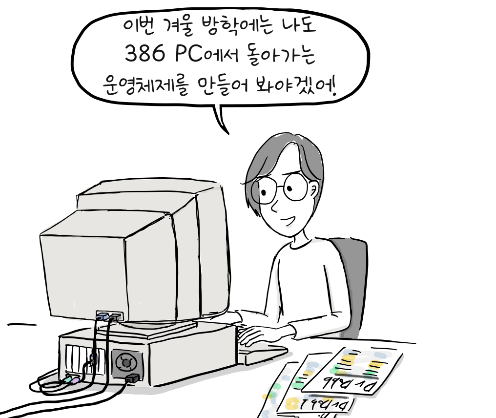

<!-- dialogue: linus-winter-kernel -->
> 이번 겨울 방학에는 나도\
> 386 PC에서 돌아가는\
> 운영체제를 만들어 봐야겠어!
<!-- /dialogue -->

:::
::::

:::panel rounded="true" style="border-width: 3px;border-color: black;"

졸리츠 부부는 1992년 3월에 386BSD 0.0을 공개하고, 같은 해 7월 14일에 0.1을 공개한다[\[4\]][reference-4][\[5\]][reference-5]. 다운로드한 배포본은 플로피 디스크 30장에 복사할 수 있었다. :-)

<!-- dialogue: lynne-download-count -->
> 지금까지 무려 25만 번이나\
> 다운로드해 갔어!
<!-- /dialogue -->

<!-- dialogue: william-download-expectation -->
> 수백 명 정도 다운로드할 줄\
> 알았는데...
<!-- /dialogue -->

:::

:::panel rounded="true" style="border-width: 3px;border-color: black;"

초기 386BSD는 저작권 표시 등 BSD 라이선스 조건을 지키면 자유롭게 수정하고 배포할 수 있었다[\[4\]][reference-4][\[5\]][reference-5]. 하지만 두 사람은 완성도를 높이는 데 공을 들였고, 다음 릴리스는 늦어지고 말았다[\[1\]][reference-1].

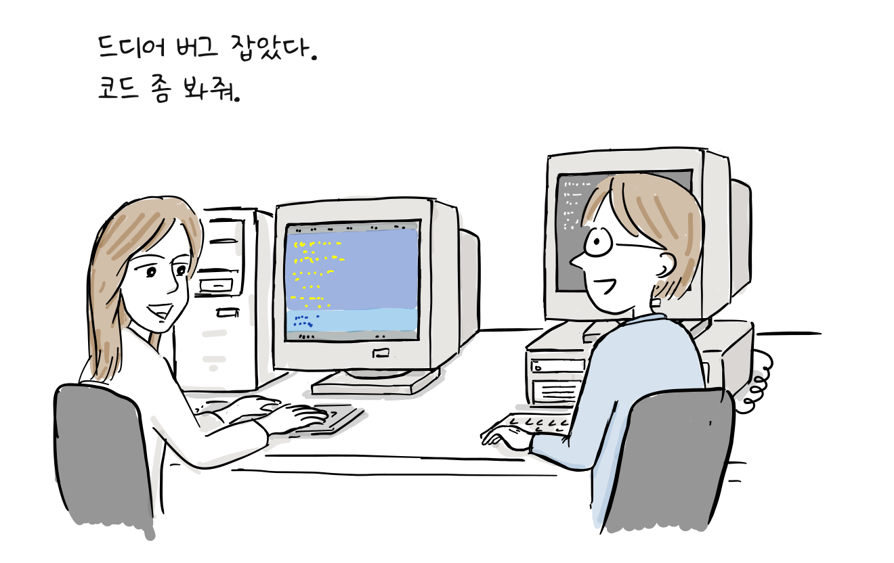

<!-- dialogue: lynne-review-fix -->
> 드디어 버그 잡았다.\
> 코드 좀 봐줘.
<!-- /dialogue -->

:::

::::panels columns="2" ratios="40:60"
:::panel rounded="true" style="border-width: 3px;border-color: black;"

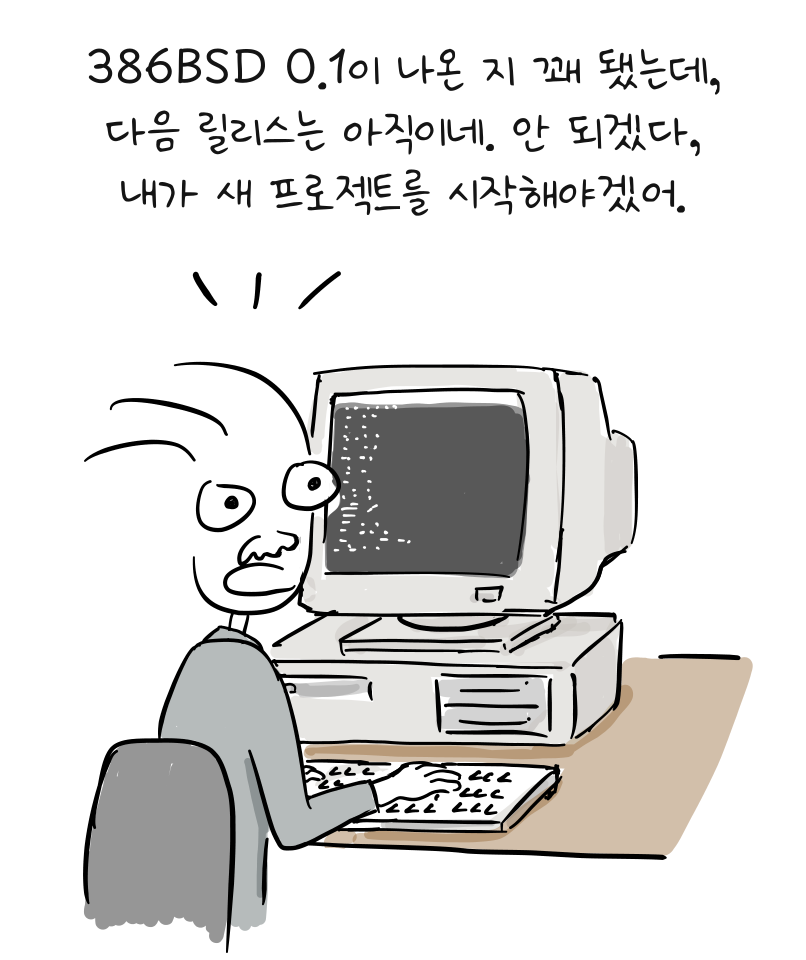

<!-- dialogue: user-start-project -->
> 386BSD 0.1이 나온 지 꽤 됐는데,\
> 다음 릴리스는 아직이네. 안 되겠다,\
> 내가 새 프로젝트를 시작해야겠어.
<!-- /dialogue -->

:::

:::panel rounded="true" style="border-width: 3px;border-color: black;"

1993년에는 386BSD 공동체에서 별도의 BSD 프로젝트들이 갈라져 나왔다. 새 버전의 공개가 늦어지고 외부 패치를 반영하기도 어려웠기 때문이다. NetBSD는 4월 20일에 첫 버전 0.8을 공개했고, FreeBSD도 같은 해 독립적인 프로젝트로 출발했다[\[10\]][reference-10][\[11\]][reference-11]. 일부 사용자는 리눅스를 선택했다[\[2\]][reference-2].

:::
::::

:::panel rounded="true" style="border-width: 3px;border-color: black;"

386BSD 0.1 공개 때의 열기는 계속 같은 곳에 머무르지 않았다. 
이후 1993년 12월에 386BSD 1.0이 공개되었는데, 안타깝게도 0.1 이후 18개월만에 릴리스된 것이라 그만 개발 모멘텀을 잃고 말았다.

<!-- dialogue: lynne-missing-users -->
> 그 많던 사용자는 다 어디에 갔지?
<!-- /dialogue -->

386BSD 1.0은 1994년에 닥터 돕스 저널의 CD-ROM으로 공개되었다[\[6\]][reference-6]. 그 무렵 FreeBSD와 NetBSD는 이미 자체 릴리스를 이어가고 있었다[\[10\]][reference-10][\[11\]][reference-11].

:::

:::panel style="padding: 12px;"

한편 리누스 토발즈는 외부 패치를 적극 받아들이고 자주 릴리스하면서, 많은 개발자가 참여하는 리눅스 공동체를 키워갔다[\[1\]][reference-1][\[2\]][reference-2].

비록 386BSD 자체는 주류 운영체제로 자리 잡지 못했지만, 졸리츠 부부의 작업은 FreeBSD와 NetBSD의 기반이 되었다[\[10\]][reference-10][\[11\]][reference-11]. 리눅스는 별도로 개발되었지만, 이들의 연재는 개발 초기의 리누스에게도 참고가 되었다[\[1\]][reference-1][\[2\]][reference-2].

:::

## 덧붙이는 이야기

* 모든 워크스테이션이 RISC를 사용한 것은 아니다. 넥스트는 [Motorola 68030](https://en.wikipedia.org/wiki/NeXT_Computer) 같은 CISC 프로세서를 사용했다.

* [Alpha](https://ko.wikipedia.org/wiki/DEC_%EC%95%8C%ED%8C%8C) 기반 워크스테이션은 [1992년 11월](https://en.wikipedia.org/wiki/DEC_3000_AXP)에 처음 소개되었다. 386 PC에 BSD 유닉스를 포팅하기 시작할 당시에는 아직 출시되지 않았다. 위 대화는 회고를 바탕으로 재구성한 장면으로, 정확한 시점은 확인되지 않았다[\[1\]][reference-1]. DEC 컴퓨터와의 성능 비교와 인텔의 성능 전망 역시 회고에서 전한 이야기이며, 비교 대상 컴퓨터의 모델은 명시되어 있지 않다.

* 졸리츠가 1992년 12월 28일에 남긴 기사 리스트에는 포팅 연재가 1991년 1월부터 1992년 7월까지 실렸다고 기록되어 있다[\[9\]][reference-9].

* 2016년에는 386BSD의 과거 소스가 [GitHub](https://github.com/386bsd/386bsd)에 공개되었다[\[12\]][reference-12].

# 참고 문헌

1.  Rachel Chalmers, [The unknown hackers][reference-1], Salon, May 17, 2000.
2.  Mike Linksvayer, [The Choice of a GNU Generation: An Interview With Linus Torvalds][reference-2], Meta Magazine, late 1993.
3.  Linus Torvalds, [What would you like to see most in minix?][reference-3], comp.os.minix, August 25, 1991.
4.  William F. Jolitz, [386BSD 0.0 Release Notes][reference-4], posted by John D. Irwin, March 12, 1992.
5.  William and Lynne Jolitz, [Announcing 386BSD Release 0.1][reference-5], posted July 19, 1992.
6.  Lynne Jolitz, [The Fun with 386BSD][reference-6], Jolitz Heritage archive.
7.  CBR Staff Writer, [Xenix 386, Unix V.3 to Merge, Microsoft, Interactive Agree][reference-7], January 22, 1987.
8.  Computer History Museum, [Alpha microprocessor, DEC, 1993][reference-8].
9.  Jolitz and Jolitz, [Which DDJ articles for 386BSD?][reference-9], December 28, 1992 (reply).
10. NetBSD Project, [History of the NetBSD Project][reference-10].
11. FreeBSD Project, [A Brief History of FreeBSD][reference-11].
12. [After 22 Years, 386BSD Gets an Update][reference-12], Slashdot, October 9, 2016.
13. [Linux kernel][reference-13], Wikipedia.

[reference-1]: https://www.salon.com/2000/05/17/386bsd/
[reference-2]: https://gondwanaland.com/meta/history/interview.html
[reference-3]: https://landley.net/history/mirror/linux/linus_post.html
[reference-4]: https://groups.google.com/g/comp.unix.bsd/c/TZ-gIRRHiXA/m/eAe6xqiqiU0J
[reference-5]: https://groups.google.com/g/comp.unix.bsd/c/zA8Jl89HSRo/m/DqMzaUUZ7wYJ
[reference-6]: https://web.archive.org/web/20180523112805/https://jolitz.telemuse.net/2lgj/on386bsd
[reference-7]: https://www.techmonitor.ai/technology/xenix_386_unix_v3_to_merge_microsoft_interactive_agree
[reference-8]: https://www.computerhistory.org/revolution/digital-logic/12/286/1599
[reference-9]: https://groups.google.com/g/comp.unix.bsd/c/uXJjzT4g7qI/m/mLMsO0hJsV4J
[reference-10]: https://www.netbsd.org/about/history.html
[reference-11]: https://docs.freebsd.org/en/books/handbook/introduction/#intro-history
[reference-12]: https://bsd.slashdot.org/story/16/10/09/0230203/after-22-years-386bsd-gets-an-update
[reference-13]: https://en.wikipedia.org/wiki/Linux_kernel
