::::panels columns="2" ratios="41:59"
:::panel title="true" rounded="true" style="border-width: 3px;border-color: black;"

# The Birth of 386BSD

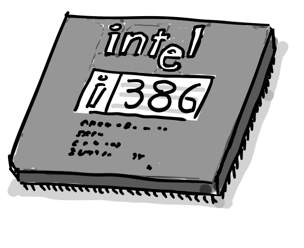

:::

:::panel narration="boxed" rounded="true" style="border-width: 3px;border-color: black;"

In 1989, William and Lynne Jolitz began porting BSD Unix to an Intel 386 PC[\[4\]][reference-4].

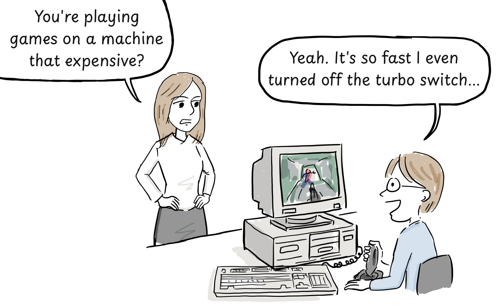

<!-- dialogue: lynne-dos-games -->
> You're playing\
> games on a machine\
> that expensive?
<!-- /dialogue -->

<!-- dialogue: william-turbo-switch -->
> Yeah. It's so fast I even\
> turned off the turbo switch...
<!-- /dialogue -->

Compaq introduced the first PC powered by the [Intel 80386](https://en.wikipedia.org/wiki/Intel_80386) [in 1986](http://www.computerhistory.org/timeline/1986/#169ebbe2ad45559efbc6eb35720789b1).

:::
::::

::::panels columns="2"
:::panel rounded="true" style="border-width: 3px;border-color: black;"

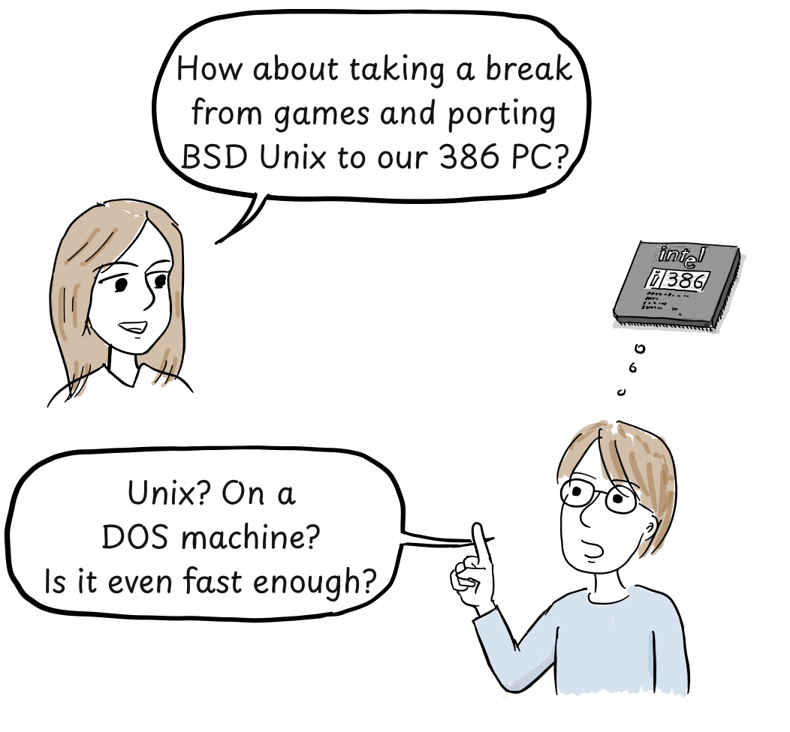

<!-- dialogue: lynne-port-bsd -->
> How about taking a break\
> from games and porting\
> BSD Unix to our 386 PC?
<!-- /dialogue -->

<!-- dialogue: william-intel-doubt -->
> Unix? On a\
> DOS machine?\
> Is it even fast enough?
<!-- /dialogue -->

:::

:::panel rounded="true" style="border-width: 3px;border-color: black;"

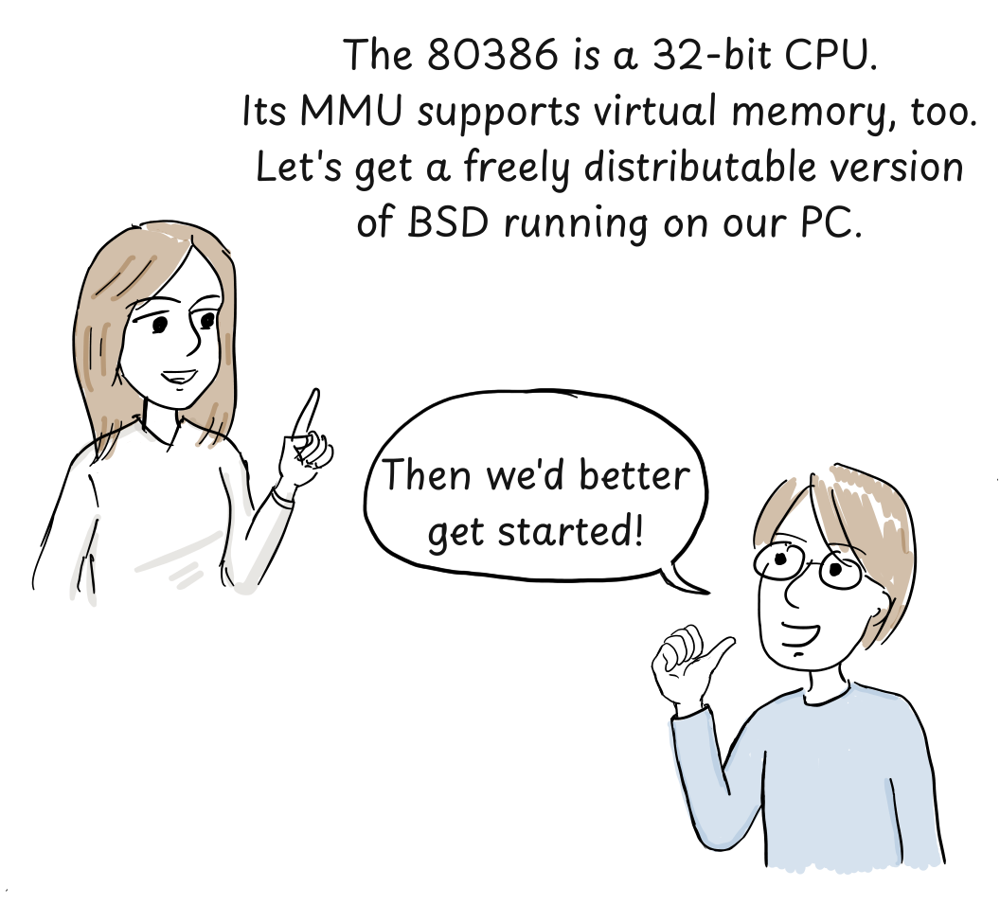

<!-- dialogue: lynne-386-features -->
> The 80386 is a 32-bit CPU.\
> Its MMU supports virtual memory, too.\
> Let's get a freely distributable version\
> of BSD running on our PC.
<!-- /dialogue -->

<!-- dialogue: william-start-porting -->
> Then we'd better\
> get started!
<!-- /dialogue -->

:::
::::

:::panel style="padding: 12px;"

By the late 1980s, Sun Microsystems, IBM, Hewlett-Packard, Silicon Graphics, and NeXT were making high-performance computers known as workstations. Built for research and development rather than home use, they were expensive by PC standards. Most used 32-bit RISC processors, with SCSI interfaces for peripherals. Their operating systems were Unix variants based on AT&T Unix or BSD.

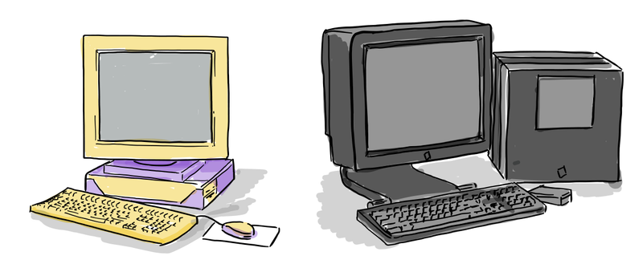

:::

::::panels columns="2"
:::panel rounded="true" style="border-width: 3px;border-color: black;"

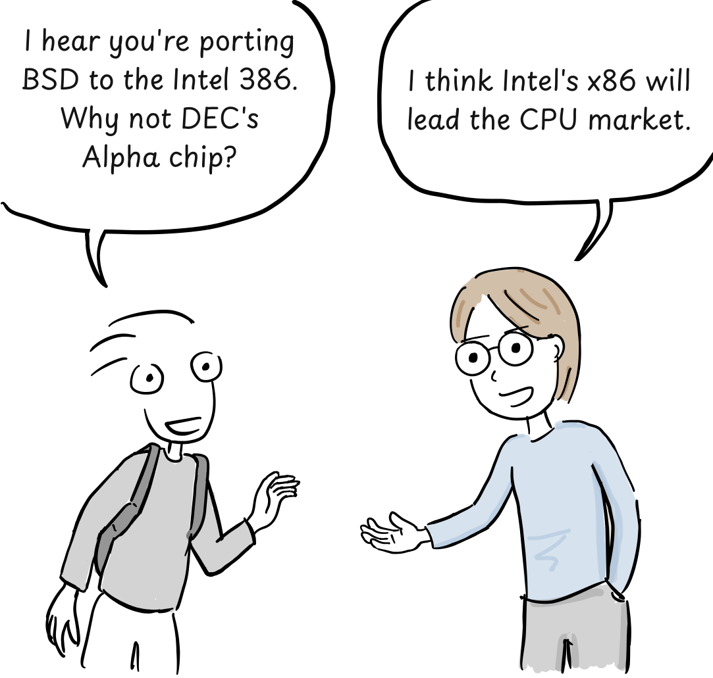

<!-- dialogue: colleague-alpha-chip -->
> I hear you're porting\
> BSD to the Intel 386.\
> Why not DEC's\
> Alpha chip?
<!-- /dialogue -->

<!-- dialogue: william-x86-future -->
> I think Intel's x86 will\
> lead the CPU market.
<!-- /dialogue -->

:::

:::panel rounded="true" style="border-width: 3px;border-color: black;"

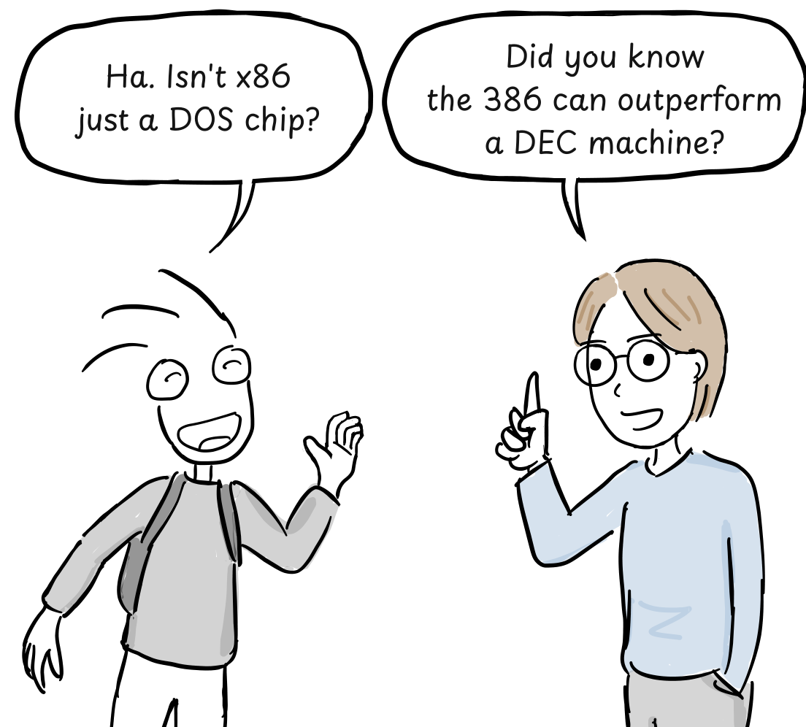

<!-- dialogue: colleague-dos-chip -->
> Ha. Isn't x86\
> just a DOS chip?
<!-- /dialogue -->

<!-- dialogue: william-386-performance -->
> Did you know\
> the 386 can outperform\
> a DEC machine?
<!-- /dialogue -->

:::
::::

::::panels columns="2" ratios="45:55"
:::panel rounded="true" style="border-width: 3px;border-color: black;"

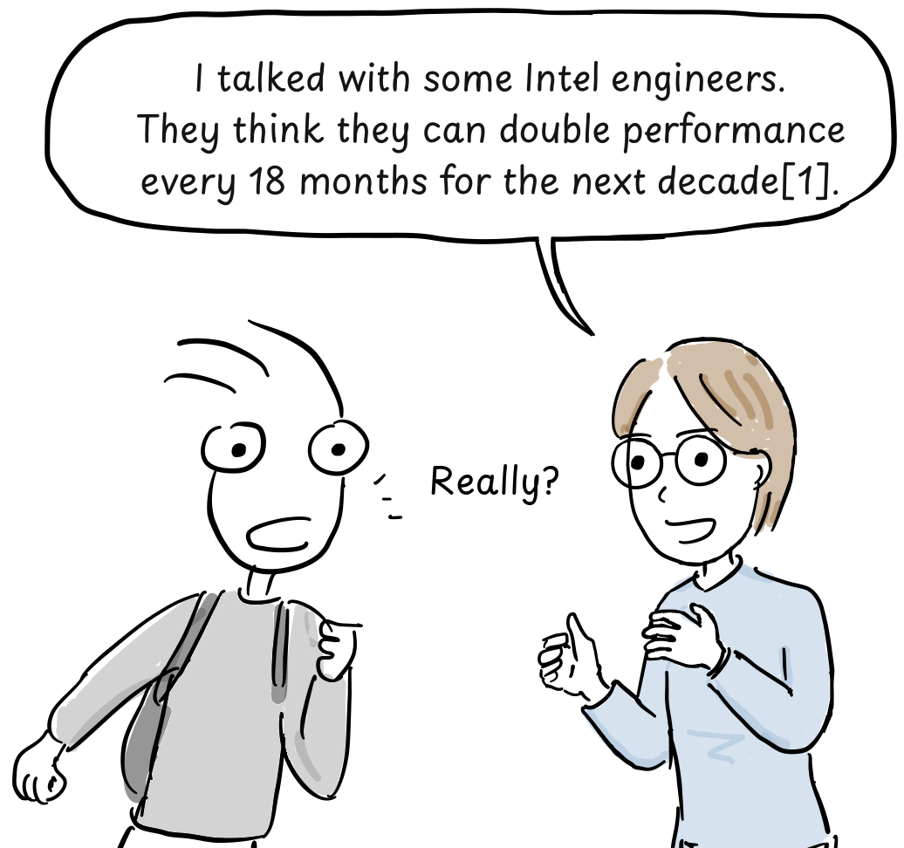

<!-- dialogue: william-performance-doubling -->
> I talked with some Intel engineers.\
> They think they can double performance\
> every 18 months for the next decade[1].
<!-- /dialogue -->

> Really?

:::

:::panel rounded="true" style="border-width: 3px;border-color: black;"

As Intel 386 PCs became more widely available in the late 1980s, affordable PCs could take advantage of 32-bit processing and a [memory management unit (MMU)](https://en.wikipedia.org/wiki/Memory_management_unit) with paging support. Commercial Unix systems such as Xenix already existed[\[7\]][reference-7], but the Jolitzes built a freely distributable BSD for these PCs[\[4\]][reference-4][\[5\]][reference-5]. Their work later became the foundation for FreeBSD and NetBSD[\[10\]][reference-10][\[11\]][reference-11]. Their choice of processor paid off.

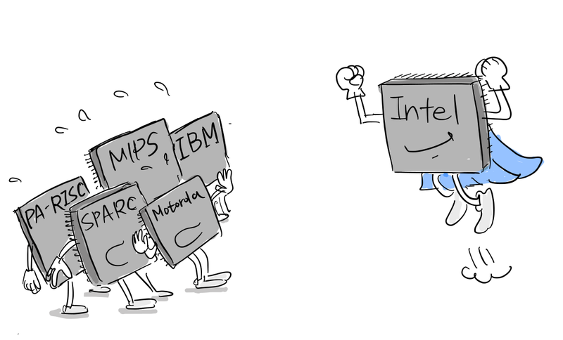

:::
::::

:::panel rounded="true" style="border-width: 3px;border-color: black;"

They documented the port in a series of articles published in *[Dr. Dobb's Journal](https://en.wikipedia.org/wiki/Dr._Dobb%27s_Journal)* from January 1991 to July 1992[\[9\]][reference-9].

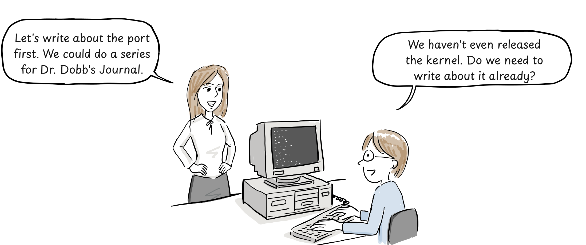

<!-- dialogue: lynne-propose-articles -->
> Let's write about the port\
> first. We could do a series\
> for Dr. Dobb's Journal.
<!-- /dialogue -->

<!-- dialogue: william-before-release -->
> We haven't even released\
> the kernel. Do we need to\
> write about it already?
<!-- /dialogue -->

:::

:::panel rounded="true" style="border-width: 3px;border-color: black;"

<!-- dialogue: lynne-share-work -->
> Other people could learn\
> from what we're doing.
<!-- /dialogue -->

<!-- dialogue: william-learned-from-unix -->
> Come to think of it,\
> I learned a lot from reading\
> the Unix Version 6 code.
<!-- /dialogue -->

:::

:::panel style="padding: 12px;"

## Porting UNIX to the 386: A Practical Approach

By **William F. Jolitz · Lynne Greer Jolitz**

The 17 articles in their Dr. Dobb's Journal series are available at [386bsd.org](https://386bsd.org/)[\[9\]][reference-9].

1. [Designing the Software Specification](https://386bsd.org/releases/porting-unix-to-the-386-a-practical-approach-designing-the-software-specification-article) In this first installment of a multipart series, the design specification for 386BSD, Berkeley UNIX for the 80386, is discussed. **(January 1991)**
2. [Three Initial PC Utilities](https://386bsd.org/releases/porting-unix-to-the-386-three-initial-pc-utilities-getting-to-the-hardware-article) Utilities to let you execute GCC- compiled programs in protected mode from MS-DOS and copy files to a shared portion of disk so MS-DOS and UNIX can exchange information. **(February 1991)**
3. [The Standalone System](https://386bsd.org/releases/porting-unix-to-the-386-the-standalone-system-creating-a-protectedmode-standalone-c-programming-environment-article) Using the protected mode program loader, a minimal 80386 protected mode standalone C programming environment for operating systems kernel development is created. **(March 1991)**
4. [Language Tools Cross Support](https://386bsd.org/releases/porting-unix-to-the-386-language-tools-cross-support-developing-the-initial-utilities-article) Developing the initial cross-tool utilities to bootstrap 386BSD. **(April 1991)**
5. [The Initial Root Filesystem](https://386bsd.org/releases/porting-unix-to-the-386-the-initial-root-filesystem-completing-the-toolset-article) The development of the initial root filesystem required for the 386BSD operating system kernel. **(May 1991)**
6. [Research & The Commercial Sector](https://386bsd.org/releases/porting-unix-to-the-386-research-the-commercial-sector-where-does-bsd-fit-in-article) A discussion of the various demands placed on research and commercial operating systems, and how they differ. **(June 1991)**
7. [A Stripped-Down Kernel](https://386bsd.org/releases/porting-unix-to-the-386-a-strippeddown-kernel-onto-the-initial-utilities-article) The 386BSD basic kernel, incorporating a unique ‘recursive’ paging feature that leverages resources and reduces complexity. **(July 1991)**
8. [The Basic Kernel](https://386bsd.org/releases/porting-unix-to-the-386-the-basic-kernel-overview-and-initialization-article) Initialization of the 386BSD kernel services and data structures **(August 1991)**
9. [Multiprogramming and Multitasking I](https://386bsd.org/releases/porting-unix-to-the-386-the-basic-kernel-multiprogramming-and-multiprogramming-and-multitasking-part-one-article) An overview of the multiprogramming paradigm in 386BSD. Conventions, definitions, and organization of multiprogramming. **(September 1991)**
10. [Multiprogramming and Multitasking II](https://386bsd.org/releases/porting-unix-to-the-386-the-basic-kernel-multiprogramming-and-multiprogramming-and-multitasking-part-ii-article) How multiprogramming is achieved via multitasking. A discussion of the process. Alternative implementations and trade-offs. A reflection on why it has been so difficult to add multiprogramming to non-UNIX operating systems such as MS- DOS. **(October 1991)**
11. [Device Autoconfiguration](https://386bsd.org/releases/porting-unix-to-the-386-the-basic-kernel-device-autoconfiguration-device-autoconfiguration-article) How 386BSD discovers hardware devices that are present and configures itself for operation with those devices. **(November 1991)**
12. [Unix Device Drivers I](https://386bsd.org/releases/porting-unix-to-the-386-device-drivers-drivers-for-the-basic-kernel-article) The structure of 386BSD device drivers, interfaces to the operating system, and minimal device drivers for the console, disk drive and scheduling clock of the PC. **(February 1992)**
13. [Unix Device Drivers II](https://386bsd.org/releases/porting-unix-to-the-386-device-drivers-entering-exiting-and-entering-exiting-and-masking-processor-interrupts-article) Interfaces to the operating system. Entering, exiting and masking processor interrupts. **(March 1992)**
14. [Unix Device Drivers III](https://386bsd.org/releases/porting-unix-to-the-386-device-drivers-getting-into-and-getting-into-and-out-of-interrupt-routines-article) Completion of basic 386BSD device drivers. **(April 1992)**
15. [Missing Pieces I](https://386bsd.org/releases/porting-unix-to-the-386-missing-pieces-part-1-completing-the-386bsd-kernel-article) Finishing the NET/2 release of Berkeley UNIX to obtain a complete, unencumbered system for the 386 PC. Describes the methodology and implementation of the remaining facilities necessary to generate a working operating system for the PC. **(May 1992)**
16. [Missing Pieces II](https://386bsd.org/releases/porting-unix-to-the-386-missing-pieces-part-ii-completing-the-386bsd-kernel-article) Finishing the NET/2 release of Berkeley UNIX to obtain a complete, unencumbered system for the 386 PC. Describes the methodology and implementation of the remaining facilities necessary to generate a working operating system for the PC. **(June 1992)**
17. [The Final Step](https://386bsd.org/releases/porting-unix-to-the-386-the-final-step-running-light-with-386bsd-article) Overview of the impact of Release 0.0 on the BSD community. Installation procedures for and highlights of Release 0.1. Final installment of series. **(July 1992)**

:::

::::panels columns="2"
:::panel rounded="true" style="border-width: 3px;border-color: black;"

Linus Torvalds was among the readers. In a 1993 interview, he recalled that Linux might never have happened if 386BSD had been available when he began development[\[2\]][reference-2].

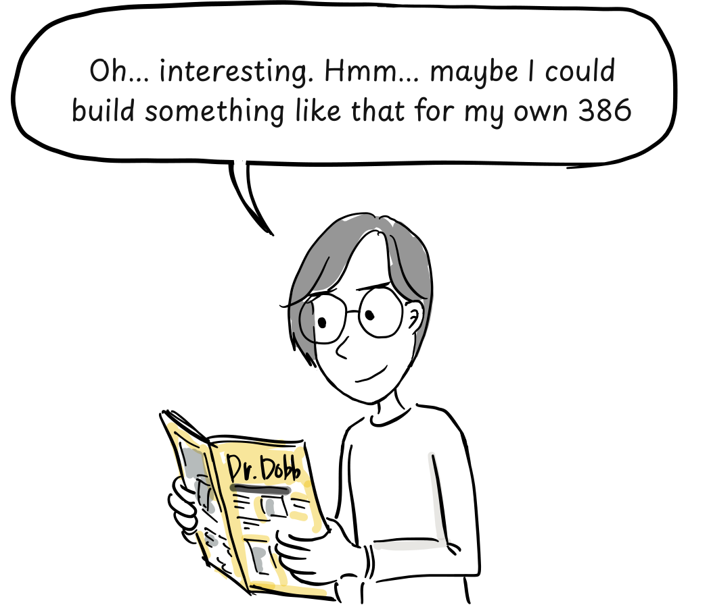

<!-- dialogue: linus-reading-articles -->
> Oh... interesting. Hmm... maybe I could\
> build something like that for my own 386
<!-- /dialogue -->

:::

:::panel rounded="true" style="border-width: 3px;border-color: black;"

In his first public post in August 1991, Linus said he had been working on an operating system since April[\[3\]][reference-3]. He released Linux kernel 0.01 that September[\[13\]][reference-13], before 386BSD's first public distribution.

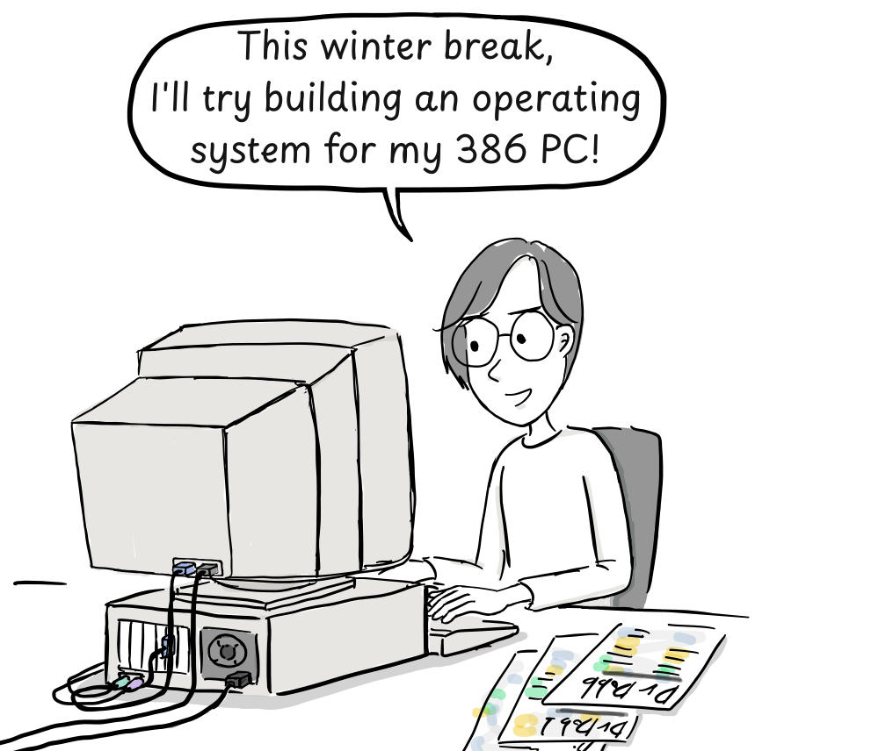

<!-- dialogue: linus-winter-kernel -->
> This winter break,\
> I'll try building an operating\
> system for my 386 PC!
<!-- /dialogue -->

:::
::::

:::panel rounded="true" style="border-width: 3px;border-color: black;"

The Jolitzes released 386BSD 0.0 in March 1992, followed by 0.1 on July 14 that year[\[4\]][reference-4][\[5\]][reference-5]. Back then, the entire distribution fit on just 30 floppy disks. :-)

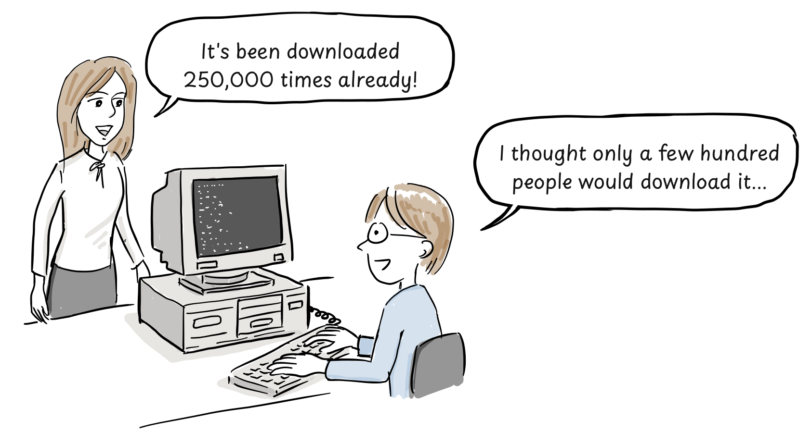

<!-- dialogue: lynne-download-count -->
> It's been downloaded\
> 250,000 times already!
<!-- /dialogue -->

<!-- dialogue: william-download-expectation -->
> I thought only a few hundred\
> people would download it...
<!-- /dialogue -->

:::

:::panel rounded="true" style="border-width: 3px;border-color: black;"

Users could freely modify and redistribute early 386BSD, provided they kept the copyright notices and followed the other BSD license terms[\[4\]][reference-4][\[5\]][reference-5]. But the Jolitzes spent considerable time improving 386BSD and adding new features, and the next release was delayed[\[1\]][reference-1].

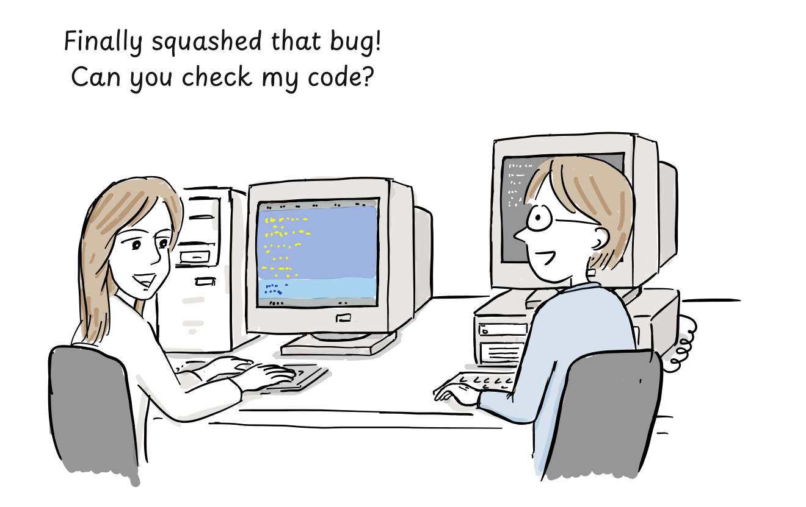

<!-- dialogue: lynne-review-fix -->
> Finally squashed that bug!\
> Can you check my code?
<!-- /dialogue -->

:::

::::panels columns="2" ratios="40:60"
:::panel rounded="true" style="border-width: 3px;border-color: black;"

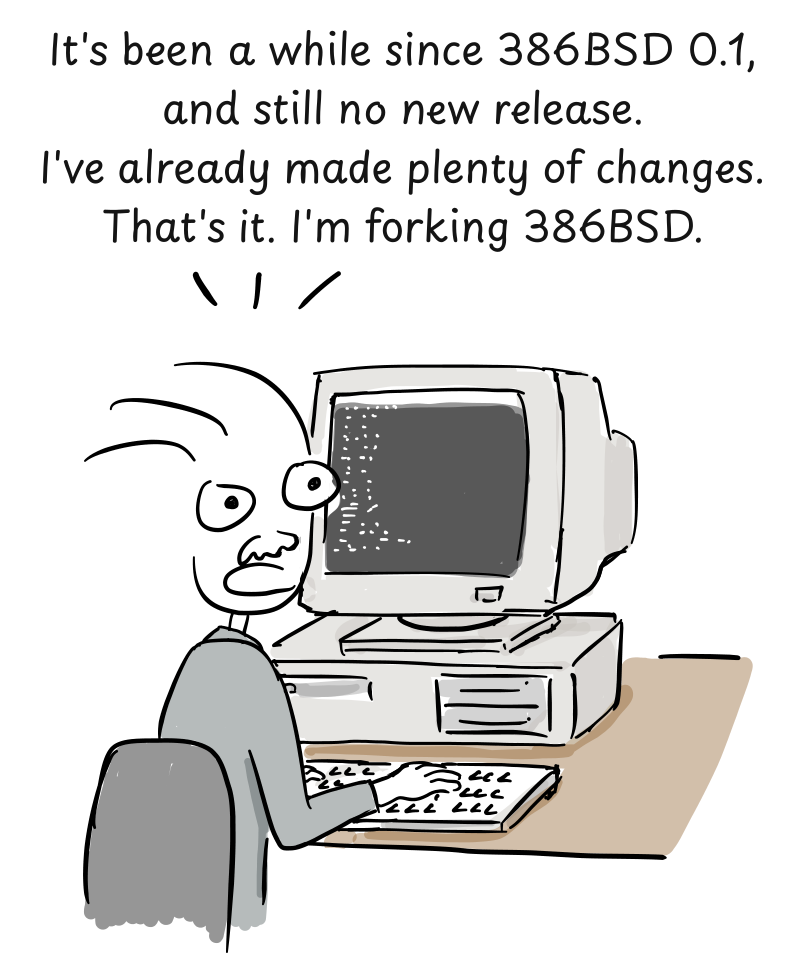

<!-- dialogue: user-start-project -->
> It's been a while since 386BSD 0.1,\
> and still no new release.\
> I've already made plenty of changes.\
> That's it. I'm forking 386BSD.
<!-- /dialogue -->

:::

:::panel rounded="true" style="border-width: 3px;border-color: black;"

In 1993, separate BSD projects emerged from the 386BSD community. New releases were slow to arrive, and getting outside patches incorporated was difficult. NetBSD released its first version, 0.8, on April 20. FreeBSD also began as an independent project that year[\[10\]][reference-10][\[11\]][reference-11]. Some users chose Linux instead[\[2\]][reference-2].

:::
::::

:::panel rounded="true" style="border-width: 3px;border-color: black;"

Many BSD users were excited when 386BSD 0.1 was released. But as the wait for the next release dragged on, they began moving to other projects, and 386BSD lost much of its development momentum.

<!-- dialogue: lynne-missing-users -->
> Where did all those users go?
<!-- /dialogue -->

386BSD 1.0 was released on a Dr. Dobb's Journal CD-ROM in 1994[\[6\]][reference-6]. By then, FreeBSD and NetBSD were already making releases of their own[\[10\]][reference-10][\[11\]][reference-11].

:::

:::panel style="padding: 12px;"

Meanwhile, Linus welcomed outside patches and released often, building a Linux community in which many developers could participate[\[1\]][reference-1][\[2\]][reference-2].

Although 386BSD itself did not become a mainstream operating system, the Jolitzes' work laid the foundations for FreeBSD and NetBSD[\[10\]][reference-10][\[11\]][reference-11]. Linux was developed independently, but their articles also helped Linus during its early development[\[1\]][reference-1][\[2\]][reference-2].

:::

## A Few Additional Notes

* Not every workstation used RISC. NeXT used CISC processors such as the [Motorola 68030](https://en.wikipedia.org/wiki/NeXT_Computer).

* [Alpha](https://en.wikipedia.org/wiki/DEC_Alpha)-based workstations were first introduced in [November 1992](https://en.wikipedia.org/wiki/DEC_3000_AXP), after the BSD port to the 386 PC had begun. The conversation above is reconstructed from a retrospective account; its exact date is not known[\[1\]][reference-1]. The DEC performance comparison and Intel's forecast also come from that account, which does not identify the DEC computer model.

* The publication dates given here for the *Dr. Dobb's Journal* series come from an article list Jolitz shared in a December 28, 1992 reply on comp.unix.bsd[\[9\]][reference-9].

* In 2016, older 386BSD source code was made available on [GitHub](https://github.com/386bsd/386bsd)[\[12\]][reference-12].

The dialogue is reconstructed from published accounts.

## References

1.  Rachel Chalmers, [The unknown hackers][reference-1], Salon, May 17, 2000.
2.  Mike Linksvayer, [The Choice of a GNU Generation: An Interview With Linus Torvalds][reference-2], Meta Magazine, late 1993.
3.  Linus Torvalds, [What would you like to see most in minix?][reference-3], comp.os.minix, August 25, 1991.
4.  William F. Jolitz, [386BSD 0.0 Release Notes][reference-4], posted by John D. Irwin, March 12, 1992.
5.  William and Lynne Jolitz, [Announcing 386BSD Release 0.1][reference-5], posted July 19, 1992.
6.  Lynne Jolitz, [The Fun with 386BSD][reference-6], Jolitz Heritage archive.
7.  CBR Staff Writer, [Xenix 386, Unix V.3 to Merge, Microsoft, Interactive Agree][reference-7], January 22, 1987.
8.  Computer History Museum, [Alpha microprocessor, DEC, 1993][reference-8].
9.  Jolitz and Jolitz, [Which DDJ articles for 386BSD?][reference-9], December 28, 1992 (reply).
10. NetBSD Project, [History of the NetBSD Project][reference-10].
11. FreeBSD Project, [A Brief History of FreeBSD][reference-11].
12. [After 22 Years, 386BSD Gets an Update][reference-12], Slashdot, October 9, 2016.
13. [Linux kernel][reference-13], Wikipedia.

[reference-1]: https://www.salon.com/2000/05/17/386bsd/
[reference-2]: https://gondwanaland.com/meta/history/interview.html
[reference-3]: https://landley.net/history/mirror/linux/linus_post.html
[reference-4]: https://groups.google.com/g/comp.unix.bsd/c/TZ-gIRRHiXA/m/eAe6xqiqiU0J
[reference-5]: https://groups.google.com/g/comp.unix.bsd/c/zA8Jl89HSRo/m/DqMzaUUZ7wYJ
[reference-6]: https://web.archive.org/web/20180523112805/https://jolitz.telemuse.net/2lgj/on386bsd
[reference-7]: https://www.techmonitor.ai/technology/xenix_386_unix_v3_to_merge_microsoft_interactive_agree
[reference-8]: https://www.computerhistory.org/revolution/digital-logic/12/286/1599
[reference-9]: https://groups.google.com/g/comp.unix.bsd/c/uXJjzT4g7qI/m/mLMsO0hJsV4J
[reference-10]: https://www.netbsd.org/about/history.html
[reference-11]: https://docs.freebsd.org/en/books/handbook/introduction/#intro-history
[reference-12]: https://bsd.slashdot.org/story/16/10/09/0230203/after-22-years-386bsd-gets-an-update
[reference-13]: https://en.wikipedia.org/wiki/Linux_kernel
